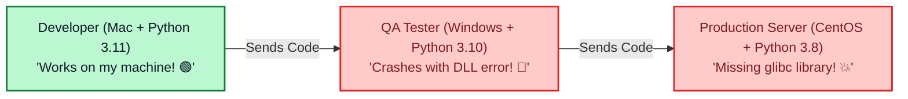
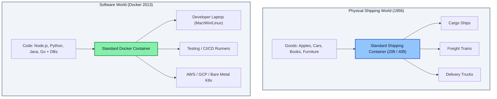
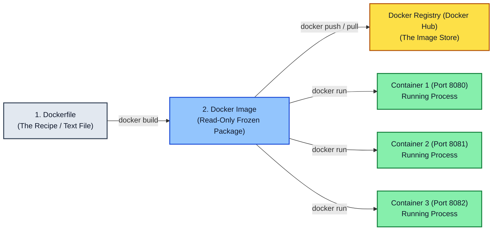
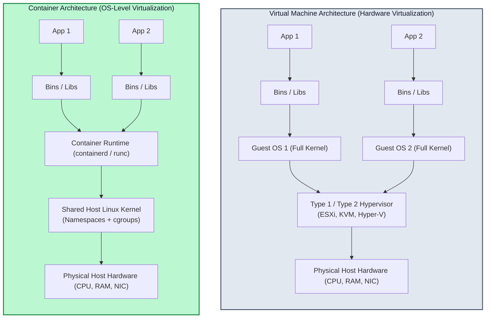
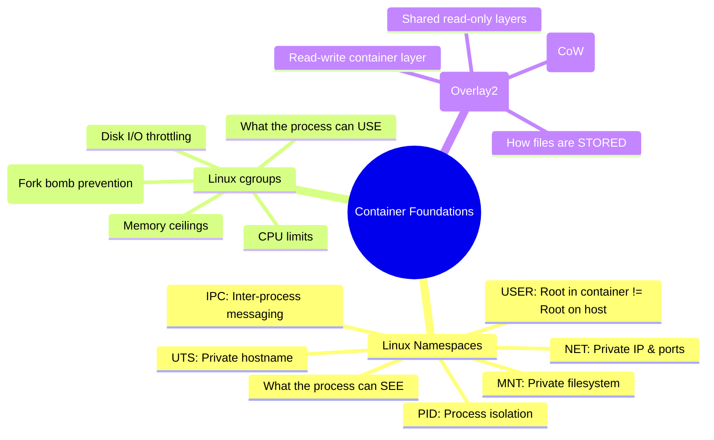
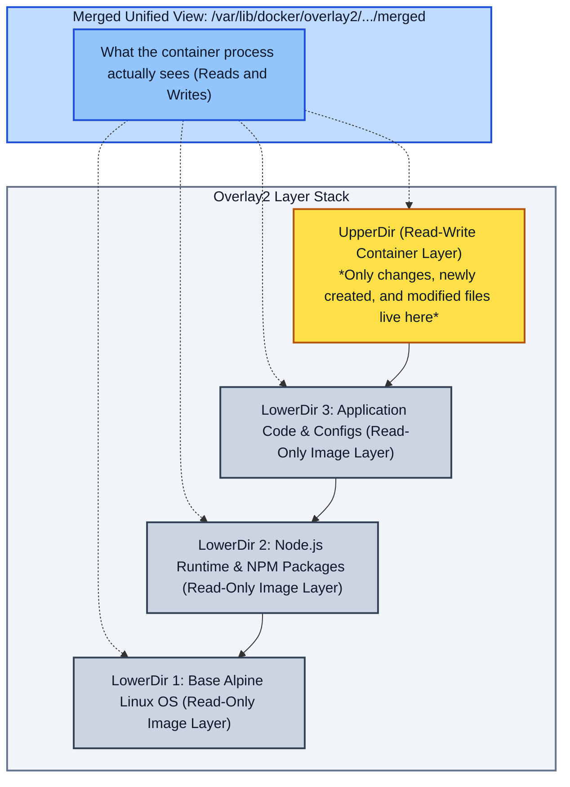

# Docker: From Beginner Foundations to Core Internals & Architecture

> **Cluster 01 — Module 01**
> **Level**: Beginner-Friendly to Production & FAANG-Level Deep Dive
> **Key References**: TechWorld with Nana, Docker Official Docs, Brendan Gregg Systems Performance, OCI Specifications

---

## 🌱 0. The Beginner's Mental Model: Why Docker Changed the World

### The Nightmare Before Docker: "It Works on My Machine!"

Imagine you are building a web application in Python 3.11 with PostgreSQL 15. You test it locally on your MacBook, and everything works flawlessly.
You hand your code over to your teammate who runs Ubuntu with Python 3.9, and it crashes.
You hand it to the QA engineer running Windows, and the database driver fails to install.
Finally, you deploy it to a CentOS production server, and missing system libraries bring down the site.

This classic developer nightmare is called the **"Matrix from Hell"** ($N$ applications $\times$ $M$ operating systems and hardware environments).

---

### The Real-World Analogy: The 1956 Shipping Container Revolution

*(Popularized in TechWorld with Nana & DevOps history)*

Before 1956, transporting goods by sea was a logistical disaster:

- Cargo was packed in loose barrels, wooden crates, and cloth sacks.
- Loading an ocean freighter took over a week of backbreaking manual labor.
- Cargo was damaged, stolen, or did not fit onto trains and delivery trucks.

In 1956, **Malcolm McLean** invented the **Standardized Intermodal Shipping Container**.
It didn't matter what was inside the container (bananas, cars, electronics, or clothes). The container had standardized dimensions and corner locks:

- The cargo ship only needs to know how to stack the container.
- The crane only needs to know how to lift the container.
- The truck and train only need to know how to carry the container.

> **The Golden Rule**: **Docker is the shipping container of the software world.**
> It packages your application code together with its runtime, system libraries, configuration files, and dependencies into an isolated, standardized container that runs identically on *any* computer that has Docker installed.

---

### The Core Trinity: Dockerfile vs. Image vs. Container

Beginners often confuse these three fundamental terms. Think of them using the **Chef & Cake** or **Blueprint & House** analogy:

| Concept                         | Real-World Analogy                          | Programming Analogy                        | Plain English Definition                                                                                      |
| :------------------------------ | :------------------------------------------ | :----------------------------------------- | :------------------------------------------------------------------------------------------------------------ |
| **Dockerfile**            | **The Recipe / Blueprint**            | Source Code / Class definition             | A plain text file containing step-by-step instructions on how to assemble your app.                           |
| **Docker Image**          | **The Frozen Pre-baked Cake**         | Compiled Executable / Class                | The read-only, immutable snapshot built from your Dockerfile. It has all files packaged.                      |
| **Docker Container**      | **The Slices You Eat / Living House** | An active Object instance / Process in RAM | The living, running instance created from an image. You can have 10 containers running from 1 image! |
| **Docker Registry / Hub** | **The Supermarket / App Store**       | GitHub / Maven Central / npm               | A cloud storage repository where you download (pull) and upload (push) Docker images.                         |

---

## 📝 1. Comprehensive Study Notes: Understanding Docker from the Ground Up

### What is Docker?

Docker is an open-source containerization platform that allows developers to package an application along with everything it needs to run—source code, dependencies, system libraries, configuration files, and runtime environment—into a single, standardized, lightweight unit called a **container**.

Before Docker, running someone else's software meant manually installing the exact language version (like Python 3.10 or Java 17), configuring environment variables, installing database drivers, and resolving conflicting system packages. If anything in the environment didn't match what the original developer used, the application failed to start or threw cryptic runtime errors. Docker solves this problem by encapsulating the application in an isolated bubble that behaves identically on a developer’s personal laptop, a QA testing machine, or a massive Kubernetes cluster in AWS, Google Cloud, or Microsoft Azure.

### What Does Docker Actually Do?

At its core, Docker performs three fundamental functions:

1. **Building & Packaging:** Docker reads a plain-text configuration file called a `Dockerfile` and builds an immutable, read-only snapshot of the filesystem known as a **Docker Image**. This image contains the application binary, required operating system libraries, and runtime dependencies.
2. **Execution & Isolation:** When you instruct Docker to run an image, it asks the host operating system's kernel to spin up an isolated process called a **Container**. Unlike a virtual machine, this process does not boot a separate operating system; it runs directly on the host computer's hardware, but the Linux kernel restricts its view so that it cannot see or interfere with other processes or host files.
3. **Distribution & Sharing:** Docker provides standardized tooling to push images to public or private cloud registries (such as Docker Hub, Amazon ECR, or GitHub Container Registry) and pull them onto any machine in seconds with a single command.

### Why Do We Need Docker & What Help Does It Provide?

Understanding *why* software engineering teams adopt Docker is essential for both daily engineering and interview discussions. Here is how Docker transforms software delivery:

* **Eliminating the "Works on My Machine" Syndrome:** In traditional software development, code passes through multiple developer laptops, testing servers, and staging environments before reaching production. Small differences in operating systems, minor library patch versions, or missing environment variables cause unexpected crashes. Docker guarantees that the environment running in production is byte-for-byte identical to the environment where the code was written and tested.
* **Radical Resource Efficiency:** Traditional Virtual Machines (VMs) require allocating dedicated slices of physical RAM, virtual CPU cores, and gigabytes of storage for an entire guest operating system. Containers share the host kernel and only consume the exact memory and CPU that their application process requires. This allows companies to run 5 to 10 times more application instances on the exact same physical server hardware, significantly reducing cloud infrastructure bills.
* **Instantaneous Startup and Scalability:** Because containers do not have to initialize virtual hardware, run a virtual BIOS, or boot an entire guest OS kernel, they start in fractions of a second (milliseconds). This lightning-fast startup enables modern cloud architectures to scale up in response to sudden traffic surges and scale down during quiet hours to save money.
* **Clean Isolation and Polyglot Stacks:** Modern microservice architectures frequently use different programming languages and databases. One service might require Node.js 18 and Redis 6, while another service on the same server requires Python 3.11 and PostgreSQL 15. Without containers, installing these conflicting packages on a single operating system leads to library corruption ("dependency hell"). Containers keep each application's filesystem and dependencies strictly isolated from one another.
* **Effortless Developer Onboarding:** When a new engineer joins an engineering team, setting up a complex development environment with databases, message queues, and backend services traditionally took 2 to 3 days of manual installation and debugging. With Docker and Docker Compose, a new team member can simply clone the git repository, run `docker compose up`, and have the entire multi-service stack running locally within 5 minutes.

---

## ⚡ 2. Before vs. After: Why Do We Need Docker?

### The Before vs. After Transformation Table

| Feature / Metric                     | Before Docker (Bare Metal & Traditional VMs)                                   | After Docker (Containerization)                               | Why This Helps (The Impact)                                          |
| :----------------------------------- | :----------------------------------------------------------------------------- | :------------------------------------------------------------ | :------------------------------------------------------------------- |
| **Onboarding a New Developer** | Took 1–3 days to manually install SDKs, DBs, and configure paths.             | Takes 5 minutes:`git clone` then `docker compose up`.     | Eliminates friction; instant developer productivity.                 |
| **Environmental Consistency**  | "Works on my machine, fails in production."                                    | 100% byte-for-byte identical environment everywhere.          | Zero configuration drift between Dev, QA, and Production.            |
| **Resource Overhead**          | Each VM requires its own complete Guest OS (gigabytes of RAM & storage).       | Containers share the host OS kernel (only megabytes of RAM).  | 5x to 10x higher workload density on the exact same server hardware. |
| **Startup / Boot Time**        | VMs take 1 to 5 minutes to boot the full virtual BIOS and OS.                  | Containers start in **sub-seconds (milliseconds)**.           | Rapid auto-scaling during sudden traffic surges.                     |
| **Dependency Clashes**         | Can't run Python 2.7 and Python 3.11 easily on one host without conflicts.     | Each container has its own isolated filesystem and libraries. | Clean microservices with polyglot tech stacks on one machine.        |
| **Teardown & Cleanup**         | Leftover temporary files, registry keys, and orphan services pollute the host. | `docker rm -f $(docker ps -aq)` leaves host 100% spotless.  | Fast automated testing and ephemeral disposable CI/CD runners.       |

---

## 🏗️ 3. Architectural Deep Dive: Virtual Machines vs. Containers

### Deep Technical Comparison: What Actually Happens Under the Hood?

1. **Hardware Virtualization (VMs)**:

   - The Hypervisor creates virtualized representations of hardware (Virtual CPU, Virtual RAM, Virtual Network Card).
   - Each VM runs an independent, complete operating system with its own Linux or Windows kernel, page cache, device drivers, and background daemons.
   - When App 1 makes a system call, it goes to Guest Kernel 1 $\rightarrow$ translated by the Hypervisor $\rightarrow$ sent to the Host CPU.
2. **OS Virtualization (Containers)**:

   - There is **NO virtual hardware** and **NO guest kernel**.
   - A container is simply a **regular Linux process** running directly on the host computer.
   - It makes direct, native system calls to the host Linux kernel.
   - The kernel makes the process *think* it is on its own dedicated machine by putting digital blinders on it (using Linux Namespaces and Control Groups).

---

## 🐧 4. The Linux Kernel Primitives: The Real Magic Engine

Beginners often ask: *"If a container is just a normal Linux process, what prevents it from seeing other processes or taking over the entire machine?"*

The Linux kernel provides two fundamental security and isolation features:

### A. Linux Namespaces (Isolation: "What You Can See")

Linux Namespaces are a fundamental Linux kernel feature that partitions kernel resources so that one set of processes sees one set of resources while another set of processes sees an entirely different, isolated set.

*Analogy: A private hotel room.* Even though all guests share the same hotel foundation, inside room 302 you have your own private bathroom, your own phone extension, and you cannot see the guest in room 303.

Namespaces are created using the `clone()`, `unshare()`, and `setns()` Linux system calls:

1. **PID Namespace (`CLONE_NEWPID`)**:
   - Isolates the process tree. It virtualizes the process ID number space, allowing a container's main process to be PID 1 while appearing as a standard unprivileged PID on the host.
   - Inside the container, your application process thinks it is **PID 1** (the master process).
   - Outside on the host system, the kernel sees it as regular process PID `38491`.
2. **NET Namespace (`CLONE_NEWNET`)**:
   - Isolates the network stack. It virtualizes network controllers, IP addresses, port ranges, routing tables, and firewall rules independently for each container.
   - Provides an isolated virtual network stack: its own loopback (`127.0.0.1`), its own virtual ethernet interface (`eth0`), private routing table, and private port bindings.
   - Two different containers can both listen on port `8080` on the same host without any conflict!
3. **MNT Namespace (`CLONE_NEWNS`)**:
   - Isolates the filesystem mount points, enabling a container to construct its own private root filesystem tree.
   - The container cannot see `/` of the host; it only sees the folder designated as its root.
   - Modern runtimes use `pivot_root` (NOT just `chroot`) to permanently swap out the root filesystem securely so escaping into the host filesystem is prevented.
4. **UTS Namespace (`CLONE_NEWUTS`)**:
   - Isolates hostname and domain name. It isolates hostnames and NIS domain names, allowing containers to possess unique hostnames independent of the host machine.
   - The container can name itself `order-service` without renaming the host server.
5. **IPC Namespace (`CLONE_NEWIPC`)**:
   - Isolates Inter-Process Communication (POSIX message queues, shared memory), preventing processes across different containers from sharing memory segments or message queues.
6. **USER Namespace (`CLONE_NEWUSER`)**:
   - Isolates user and group IDs. It maps a container's internal user and group ID numbers to distinct host UID/GID ranges for non-root security.
   - Maps user and group IDs. User `root` (UID 0) inside the container is mapped to an unprivileged user (e.g., UID 10001) on the host, drastically reducing security risks.

---

### B. Linux Control Groups / cgroups (Metering: "What You Can Use")

Control Groups (cgroups) are a Linux kernel subsystem that organizes processes hierarchically to meter, allocate, throttle, and enforce hard limits on physical hardware resources (CPU, RAM, block I/O, network bandwidth, and PID counts).

*Analogy: The utility meter and fuse box in your apartment.* It caps your electricity and water consumption so one resident cannot drain the building's entire supply.

If an application enters an infinite loop or leaks memory, cgroups ensure it does not freeze or crash the host server:

- **cgroups v1 vs. cgroups v2**:

  - *cgroups v1*: Legacy model where CPU, memory, and blkio were managed in separate directory trees, creating synchronization race conditions.
  - *cgroups v2 (Unified Hierarchy)*: Modern default in modern Linux distributions. Located at `/sys/fs/cgroup/`, where all resource controllers (cpu, memory, io, pids) apply hierarchically to the same process tree.
- **Out Of Memory (OOM) Killer Mechanics**:

  - If a container exceeds its memory limit (`memory.max`), the Linux kernel OOM Killer steps in.
  - It calculates an `oom_score` for the offending process and abruptly terminates it with `SIGKILL`.
  - In Docker, this manifests as **Exit Code 137** ($128 + 9$ for `SIGKILL`).

---

## 📂 5. Storage Internals: How Docker Stores Files (OverlayFS / Overlay2)

How can Docker start a container with a 500MB Ubuntu image in 0.2 seconds? It does **not** copy 500MB of files. It uses a **Union File System** called **Overlay2**.

### The Three Critical Rules of Overlay2:

Overlay2 is a union mount filesystem implementation in the Linux kernel that combines multiple underlying directories into a single unified directory structure without modifying original underlying files.

1. **Shared Read-Only Layers (`LowerDir`)**:
   - LowerDir consists of one or more stacked, immutable image layers that provide the base operating system and application files.
   - All image layers are immutable. If you start 100 containers from the same `ubuntu:latest` image, all 100 containers read from the **exact same lower layer on disk**. They consume zero extra disk space!
2. **Ephemeral Read-Write Layer (`UpperDir`)**:
   - UpperDir is the topmost writable directory layer created per container where all runtime modifications and newly generated files are recorded.
   - When a container starts, Docker places a razor-thin, writable layer on top.
   - Any new file created by the container is saved here.
3. **Copy-on-Write (CoW) / `copy_up`**:
   - Copy-on-Write (CoW) is an operating system storage optimization where an existing read-only file is copied to writable storage only when a write operation is initiated.
   - If a container modifies an existing file from a lower layer, OverlayFS executes a `copy_up` operation: it copies the file up to the `UpperDir` and applies changes there. The original lower layer remains pristine and untouched.
   - *Whiteouts*: If a file in a lower layer is deleted, Overlay2 writes a special "whiteout" character device (with 0/0 device numbers) in the upper layer to hide it from the merged view.

---

## ⚙️ 6. Docker Ecosystem Architecture: CLI, dockerd, containerd, and runc

Docker is not a monolithic program. It is a modern, modular ecosystem adhering to the **Open Container Initiative (OCI)** standards.

```mermaid
flowchart LR
    User["Developer / Terminal"] -->|docker run| CLI["Docker CLI\n(Client)"]
    CLI -->|REST API over unix socket\n/var/run/docker.sock| Daemon["dockerd\n(Docker Daemon)"]
    Daemon -->|gRPC| Cntd["containerd\n(High-Level Lifecycle Manager)"]
    Cntd --> Shim["containerd-shim\n(Process Parent)"]
    Shim --> Runc["runc\n(Low-Level OCI Runtime)"]
    Runc -->|clone, unshare, pivot_root| AppProc["Your Container Process\n(PID in isolated namespace)"]

    style CLI fill:#e2e8f0,stroke:#334155,stroke-width:2px,color:#0f172a
    style Daemon fill:#93c5fd,stroke:#1d4ed8,stroke-width:2px,color:#0f172a
    style Cntd fill:#c7d2fe,stroke:#4338ca,stroke-width:2px,color:#0f172a
    style Shim fill:#fde047,stroke:#b45309,stroke-width:2px,color:#0f172a
    style Runc fill:#fbcfe8,stroke:#be185d,stroke-width:2px,color:#0f172a
    style AppProc fill:#86efac,stroke:#15803d,stroke-width:2px,color:#0f172a
```

### Component Breakdown:

- **Docker CLI**: The user interface. It is a command-line client that accepts user input and serializes instructions into RESTful HTTP requests directed to the Docker Engine API. It converts commands (`docker build`, `docker run`) into HTTP REST calls sent to `/var/run/docker.sock`.
- **`dockerd`**: The Docker daemon. It is a persistent background service responsible for orchestrating container objects, managing image downloads, volume allocation, and virtual networking. The daemon manages network creation, storage volumes, image registry authentication, and high-level Docker features.
- **`containerd`**: The robust container manager. It is an industry-standard, CNCF-graduated container runtime that oversees the complete container lifecycle, image distribution, and execution via the Container Runtime Interface (CRI). Handles image downloads (pulling), unpacking, and supervising container lifecycles. (Kubernetes speaks directly to `containerd` via the Container Runtime Interface [CRI], skipping `dockerd` entirely!).
- **`containerd-shim`**: A lightweight monitor process. It is a thin daemon process that acts as the subreaper parent of a running container, maintaining standard I/O streams and exit codes independently of runtime restarts. When `runc` creates the container, `runc` exits immediately. The `containerd-shim` remains running as the parent of the container process.
  > **Why the shim is a lifesaver in production**: Because the shim acts as the parent process, you can restart or upgrade `dockerd` or `containerd` without killing running containers (known as **Live Restore**)!
  >
- **`runc`**: The reference implementation of the OCI runtime. It is a low-level, lightweight command-line tool implemented to the OCI runtime specification that executes direct Linux system calls (`clone`, `setns`, `pivot_root`) to spawn containers. It executes the actual Linux system calls (`clone`, `pivot_root`, cgroup setup) to launch the container process, and then terminates.

---

## 💼 7. Interview Preparation: High-Yield Questions & Answering Strategies

### Q1: "Explain Docker to a non-technical person or a 5-year-old."

- **How to Answer**:
  > *"Think of baking cookies. If you send a friend just the recipe, they might use different butter, a different oven, and the cookies taste wrong. Docker is like packing the baked cookie along with the exact oven, ingredients, and kitchen temperature into a magic lunchbox that always tastes identical no matter whose house you open it in."*
  >

---

### Q2: "What is the fundamental architectural difference between a VM and a Docker container?"

- **Key Points Interviewers Look For**:
  - VMs virtualize hardware (Hypervisor, virtual CPU/RAM) and require a full Guest OS with its own kernel.
  - Containers virtualize the operating system. They share the host kernel and isolate processes using Linux Namespaces and cgroups.
  - Containers boot in milliseconds, have negligible RAM overhead, and allow 10x higher density than VMs.

---

### Q3: "How does Docker work on Windows or macOS if containers need a Linux kernel?"

- **The Answer**:
  - Linux containers *strictly require* a Linux kernel.
  - On macOS and Windows, **Docker Desktop** runs a lightweight Linux virtual machine behind the scenes (using Hyper-V / WSL2 on Windows, and HyperKit / Apple Virtualization Framework on macOS).
  - The Docker CLI on your Mac or Windows host communicates with the Docker Engine running inside that lightweight Linux VM.

---

### Q4: "What happens if 10 containers run simultaneously from the same 1GB image? Does it take 10GB of disk space?"

- **The Answer**:
  - **No, it takes only 1GB + a few megabytes for runtime changes.**
  - Docker uses the **Overlay2** union filesystem. The 1GB image consists of read-only lower layers shared by all 10 containers.
  - Each container only receives an ultra-thin, independent read-write layer (UpperDir) that only stores new files or modified data.

---

### Q5: "What is Exit Code 137, and how do you diagnose it?"

- **The Answer**:
  - Exit Code 137 indicates that the process received `SIGKILL` ($128 + 9$).
  - In 95% of production cases, it means the container ran **Out of Memory (OOMKilled)** because it exceeded its configured cgroup limit.
  - Diagnostic steps:
    1. Inspect container state: `docker inspect <container-id> --format='{{.State.OOMKilled}}'`.
    2. Check kernel logs on host: `dmesg -T | grep -i oom` to see which process was killed.
    3. Increase container memory limit or optimize application memory leaks.

---

### ⏱️ Rapid Recall / 30-Second Elevator Pitch

> *"Docker is a containerization platform that eliminates environmental discrepancies by packaging applications with their dependencies. Unlike heavy VMs that virtualize hardware and run independent guest kernels, Docker runs isolated Linux processes directly on the host kernel via Namespaces (isolation) and cgroups (resource limits), leveraging Overlay2 for instant, copy-on-write storage."*
