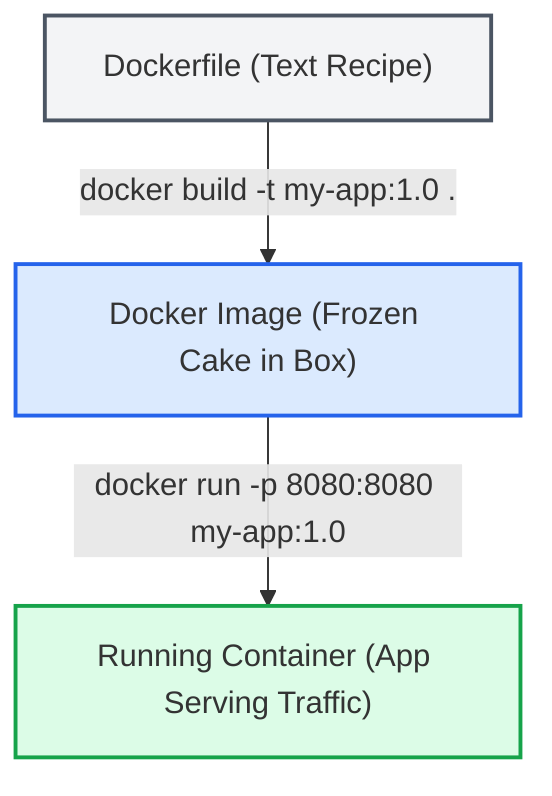
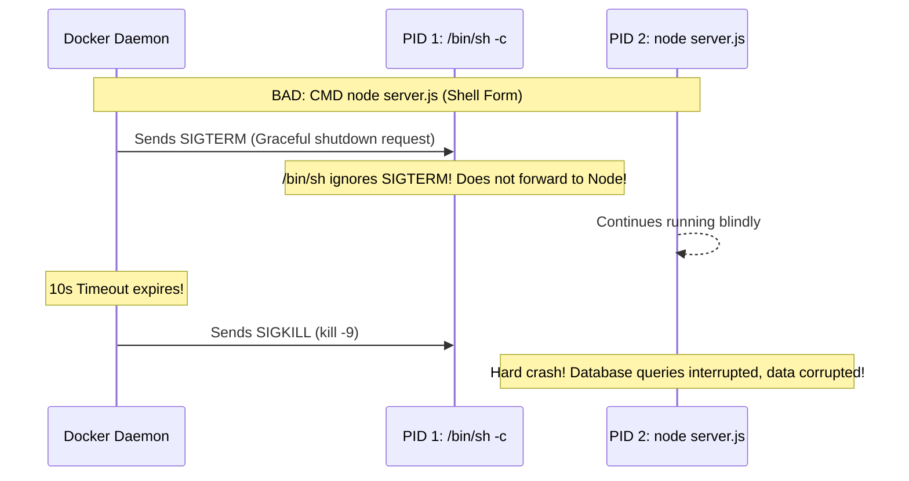
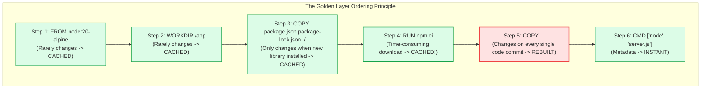

# Dockerfile Mastery: From Beginner Syntax to Production & Security

> **Cluster 01 — Module 02**  
> **Level**: Beginner-Friendly to Production Optimization & FAANG-Level Deep Dive  
> **Key References**: TechWorld with Nana, Docker Official Best Practices, CIS Docker Benchmarks

---

## 🌱 0. The Beginner's Mental Model: What is a Dockerfile?

### The Recipe Analogy
A **Dockerfile** is nothing more than a plain text recipe. If you want to bake a chocolate cake, you don't just dump all ingredients together randomly. You follow an ordered sequence of instructions:
1. *Start with a base*: Take a clean mixing bowl (**`FROM`**).
2. *Set your workspace*: Put the bowl on the kitchen counter (**`WORKDIR`**).
3. *Add ingredients*: Bring in sugar and flour (**`COPY`**).
4. *Prepare*: Mix and bake the ingredients (**`RUN`**).
5. *Open the serving window*: Announce the cake is served at table 80 (**`EXPOSE`**).
6. *Serve*: Hand the cake to the customer when they sit down (**`CMD`**).



---

## 📝 1. Comprehensive Study Notes: Understanding Dockerfiles and Image Creation

### What is a Dockerfile? (Straightforward Definition)
A **Dockerfile** is a plain-text configuration file containing a sequence of commands and instructions that Docker executes automatically to assemble a container image. It acts as the exact architectural blueprint for your application's execution environment. Instead of documenting manual setup steps ("Step 1: Install Python, Step 2: Install pip dependencies, Step 3: Set environment variable"), a developer encodes these steps into a Dockerfile, allowing Docker to build an identical, production-ready container image automatically.

### What Does the Docker Build Process Actually Do?
When you run the command `docker build -t my-app:1.0 .`, several distinct steps happen behind the scenes:
1. **Packaging the Build Context:** Docker collects all files in the specified directory (the `.`) and sends them to the Docker daemon. Any files listed in your `.dockerignore` file are excluded to prevent bloat.
2. **Executing Instructions Line-by-Line:** The Docker engine processes each line sequentially. Every command that mutates files on disk—such as `RUN apt-get install`, `COPY . .`, or `ADD archive.tar`—creates a new, immutable read-only filesystem layer.
3. **Calculating Cryptographic Layer Digests:** Each layer is identified by a unique SHA-256 hash calculated from the contents of that step. If the inputs to that step have not changed since the last build, Docker skips execution and reuses the cached layer, completing builds in seconds rather than minutes.
4. **Tagging and Finalizing:** Once all steps succeed, Docker assigns the specified tag (`my-app:1.0`) to the final top layer and commits it to your local image storage, ready to be run or pushed to a remote registry.

### Why Do We Need Dockerfiles & What Help Do They Provide?
* **Guaranteed Reproducibility:** Anyone who has the Dockerfile can build an identical container image. There is zero ambiguity about which operating system packages, language runtimes, or configuration variables are required.
* **Infrastructure as Code (IaC) for Applications:** Dockerfiles live directly in the application's Git repository. Any changes to system dependencies or build processes are version-controlled, tracked, and reviewed through standard Git pull requests.
* **Separation of Build-Time vs. Runtime Concerns:** Through multi-stage builds, a Dockerfile allows you to use heavy compilers, development libraries, and package managers to build your code, while copying only the final compiled binary into a minimal, hardened runtime image. This dramatically shrinks image sizes and removes security attack surfaces.

---

## ⚡ 2. Before vs. After: Why Dockerfile Optimization Matters

Many beginners write naive Dockerfiles that result in bloated, insecure, and sluggish images. Here is the real-world difference:

| Metric | Before Optimization (Naive Beginner Dockerfile) | After Optimization (Production Best Practices) | Why This Helps (The Impact) |
| :--- | :--- | :--- | :--- |
| **Final Image Size** | **1.4 GB** (Full Ubuntu base + compilers + npm cache) | **45 MB** (Alpine or Distroless multi-stage) | 30x faster image download in Kubernetes; cuts cloud storage bills. |
| **CI/CD Build Time** | **8 to 12 minutes** (re-downloads all dependencies every time) | **15 seconds** (intelligent layer caching & cache mounts) | Rapid developer feedback loops and faster production rollouts. |
| **Security Attack Surface** | Running as `root` with `gcc`, `curl`, `bash`, and package managers installed. | Running as unprivileged `appuser` with zero shell or build tools. | Attackers cannot run malicious scripts or exploit root privileges. |
| **Secret Leaks** | Passwords/API keys baked into image layers using `ENV`. | Secrets passed via BuildKit secret mounts (`--mount=type=secret`). | Zero sensitive credentials stored in the final Docker image. |
| **Graceful Shutdown** | Shell form `CMD node server.js` drops signals; app hard-crashes. | Exec form `CMD ["node", "server.js"]` gracefully terminates in-flight connections. | Zero dropped HTTP requests or database corruptions on deployment. |

---

## 📖 3. The Core Dockerfile Instructions (Explained Simply)

Here are the essential instructions every developer and DevOps engineer must know:

### 1. `FROM` (The Starting Foundation)
- Every Dockerfile starts with `FROM`. It defines your base image.
- *Beginner Tip*: Avoid using heavy OS images like `FROM ubuntu:latest` (80MB+) for simple apps. Prefer specialized slim images like `python:3.11-slim` or `node:20-alpine` (5MB).

### 2. `WORKDIR` (The Working Directory)
- Sets the working directory inside the container for all following instructions.
- *Best Practice*: Always use `WORKDIR /app` instead of running `RUN cd /app`. `WORKDIR` will automatically create the folder if it does not exist.

### 3. `COPY` vs. `ADD` (The File Transfer)
- **`COPY <src> <dest>`**: Copies files from your local computer into the container filesystem. Simple, safe, and transparent.
- **`ADD <src> <dest>`**: Does what `COPY` does, PLUS two magic features: it can auto-extract local `.tar.gz` archives, and download files from remote URLs.
- *Best Practice*: **99% of the time, use `COPY`**. Only use `ADD` when you explicitly need to unpack a local `.tar` file into the container.

### 4. `RUN` (Build-Time Execution)
- Runs commands **during the build phase** to install packages and create files. Each `RUN` creates a permanent new read-only image layer.
- *Example*: `RUN npm install` or `RUN apt-get update && apt-get install -y curl`.

### 5. `ENV` vs. `ARG` (Variables Explained)
- **`ARG` (Build-Time Only)**: Available *only* while the image is being built with `docker build --build-arg VERSION=1.2`. Once the image is built, the ARG vanishes.
- **`ENV` (Runtime Environment Variable)**: Persists inside the image and is available to the running container process (`process.env.DB_HOST`).

### 6. `EXPOSE` (Documentation Port)
- Documents which port the container listens on (e.g., `EXPOSE 8080`).
- *Important Beginner Note*: `EXPOSE` does **not** publish the port to your host machine! It is purely metadata documentation. You still must use `-p 8080:8080` when running `docker run`.

---

### 7. The Classic Interview Favorite: `CMD` vs. `ENTRYPOINT`
*(TechWorld with Nana's Cafe Order Analogy)*

Imagine ordering coffee at a cafe:
- **`ENTRYPOINT`** is the fixed, permanent base item: **"Coffee"**.
- **`CMD`** is the default topping/flavor that can be changed: **"Milk & Sugar"**.
- If a customer says nothing, they get **Coffee with Milk & Sugar**.
- If a customer orders: `docker run my-cafe "Caramel"`, the `CMD` is overridden, but the `ENTRYPOINT` remains: they get **Coffee with Caramel**!

```dockerfile
# Base command that never changes:
ENTRYPOINT ["python", "app.py"]

# Default argument that can be easily overridden:
CMD ["--port", "8080"]
```

#### Shell Form vs. Exec Form (The Deadly PID 1 Trap)
Always write `CMD` and `ENTRYPOINT` in **Exec Form (JSON Array syntax)**, never Shell Form:



- ❌ **Shell Form**: `CMD node server.js` $\rightarrow$ Spawns `/bin/sh -c node server.js`. The shell becomes PID 1 and swallows `SIGTERM`.
- ✅ **Exec Form**: `CMD ["node", "server.js"]` $\rightarrow$ Node runs directly as **PID 1**, receives `SIGTERM`, closes active connections, and exits cleanly.

---

## ⚡ 4. Docker Layer Caching: How to Speed Up Builds by 10x

Every line in a Dockerfile creates an immutable layer. Docker caches each layer. When rebuilding, if a step has not changed, Docker skips execution and uses the cache:



### The Cardinal Rule:
> **Order instructions from least frequently changing (top) to most frequently changing (bottom).**

If you put `COPY . .` *before* `RUN npm install`, every single time you change one line of code or a comment in your application, Docker invalidates the cache for all subsequent steps, forcing a painful 5-minute package download on every build!

---

## 🍽️ 5. Multi-Stage Builds: The "Kitchen vs. Dining Room" Analogy

When dining at a high-end restaurant:
- **The Kitchen (Builder Stage)**: Has raw meat, flour bags, cleavers, vegetable peelers, and giant blenders.
- **The Dining Room (Production Stage)**: Has only the polished dining table and the beautifully cooked steak. You do NOT want greasy blenders and sharp knives on your dining table!

In software:
- Compilers (like `go build`, `mvn package`, `npm build`, `gcc`) are kitchen tools.
- Once your code is compiled into a standalone binary or minified bundle, **you never need the compilers in production**.

```mermaid
flowchart LR
    subgraph Stage1["Stage 1: The Builder (Kitchen)"]
        S1["FROM golang:1.22-alpine AS builder\n• Full Go SDK (400MB)\n• Git, GCC, Linters\n• RUN go build -o myapp"]
    end

    subgraph Stage2["Stage 2: The Production Image (Dining Table)"]
        S2["FROM scratch (or alpine: 5MB)\n• Zero compilers\n• Zero package managers\n• COPY --from=builder /app/myapp /myapp\n• ENTRYPOINT ['/myapp']"]
    end

    S1 -->|Copy only the compiled binary (15MB)| S2

    style Stage1 fill:#fef3c7,stroke:#d97706,stroke-width:2px
    style Stage2 fill:#dcfce7,stroke:#16a34a,stroke-width:2px
```

### Production Example: Multi-Stage Java / Spring Boot Dockerfile

```dockerfile
# ==========================================
# Stage 1: Build the Application (Maven Builder)
# ==========================================
FROM eclipse-temurin:21-jdk-alpine AS builder
WORKDIR /workspace

# Step 1: Copy pom.xml first to cache Maven dependencies!
COPY pom.xml .
RUN ./mvnw dependency:go-offline -B || true

# Step 2: Copy source code and package JAR
COPY src ./src
RUN ./mvnw clean package -DskipTests

# ==========================================
# Stage 2: Minimal Production Runtime
# ==========================================
FROM eclipse-temurin:21-jre-alpine AS runtime
WORKDIR /app

# Security: Run as non-root user
RUN addgroup -S appgroup && adduser -S appuser -G appgroup
USER appuser

# Copy ONLY the final compiled JAR from the builder stage
COPY --from=builder --chown=appuser:appgroup /workspace/target/*.jar app.jar

# Configuration and Healthcheck
EXPOSE 8080
HEALTHCHECK --interval=30s --timeout=3s --retries=3 \
  CMD wget -qO- http://localhost:8080/actuator/health | grep UP || exit 1

ENTRYPOINT ["java", "-jar", "app.jar"]
```

---

## 🔒 6. Production Dockerfile Security Checklist

1. **Never Run as `root`**:
   - By default, containers run as `root`. If an attacker escapes the container, they gain root on the host!
   - Always create a dedicated unprivileged user: `USER appuser`.
2. **Always Use a `.dockerignore` File**:
   - Prevents local `.git`, `node_modules/`, `.env`, temporary files, and secrets from accidentally being copied into the image.
3. **Pin Base Image Versions**:
   - ❌ Never use `FROM node:latest` or `FROM python:latest` (can break your build unexpectedly when a new major version is released).
   - ✅ Use explicit immutable tags: `FROM node:20.11-alpine3.19`.
4. **Scan for Vulnerabilities**:
   - Scan every image in CI/CD using Trivy: `trivy image my-app:1.0`.

---

## 💼 7. Interview Preparation: High-Yield Questions & Answers

### Q1: "What is the difference between `COPY` and `ADD` in a Dockerfile?"
- **The Direct Answer**:
  - `COPY` copies files and folders from the build context into the image.
  - `ADD` can do everything `COPY` does, but additionally supports:
    1. Unpacking local compressed archives (`.tar.gz`, `.tar.bz2`) automatically into the destination.
    2. Downloading files directly from remote URLs.
  - *Best Practice*: Best practice is to **always use `COPY`** because `ADD` can trigger unexpected behavior (e.g. unintended archive extraction) and remote URL downloads prevent proper layer caching.

---

### Q2: "Why is layer order important in a Dockerfile?"
- **The Direct Answer**:
  - Docker uses layer caching to accelerate builds.
  - When any instruction changes, that layer and **all subsequent layers** are invalidated and must be rebuilt from scratch.
  - Placing static files (like package manifests: `pom.xml`, `package.json`) before frequently changing files (source code) ensures expensive dependency download steps hit the cache on 99% of builds.

---

### Q3: "What is the difference between `CMD` and `ENTRYPOINT`?"
- **The Direct Answer**:
  - `ENTRYPOINT` specifies the executable command that will always run when the container starts.
  - `CMD` provides the default arguments passed to the `ENTRYPOINT`.
  - While `CMD` can be overridden by arguments passed to `docker run`, `ENTRYPOINT` remains fixed (unless overridden explicitly with `--entrypoint`).
  - *Golden combination*: Use `ENTRYPOINT` for the application binary and `CMD` for default runtime flags.

---

### Q4: "Why should you never store secrets in an `ENV` instruction?"
- **The Direct Answer**:
  - Environment variables defined via `ENV` are permanently baked into the image metadata.
  - Anyone with access to the image can run `docker inspect <image>` or `docker history <image>` to read the plain-text credentials, even across different layers.
  - *Solution*: Use BuildKit secrets (`RUN --mount=type=secret`) or inject secrets dynamically at container runtime via Kubernetes Secrets or HashiCorp Vault.
