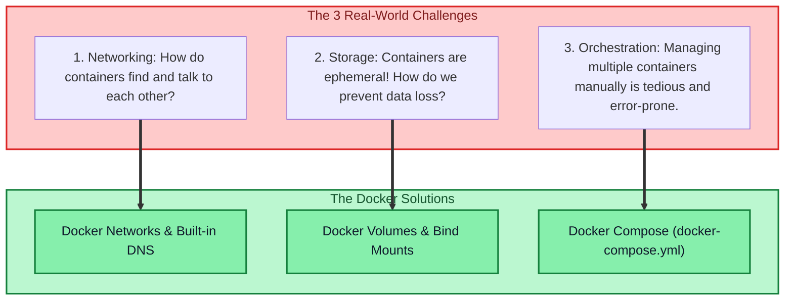
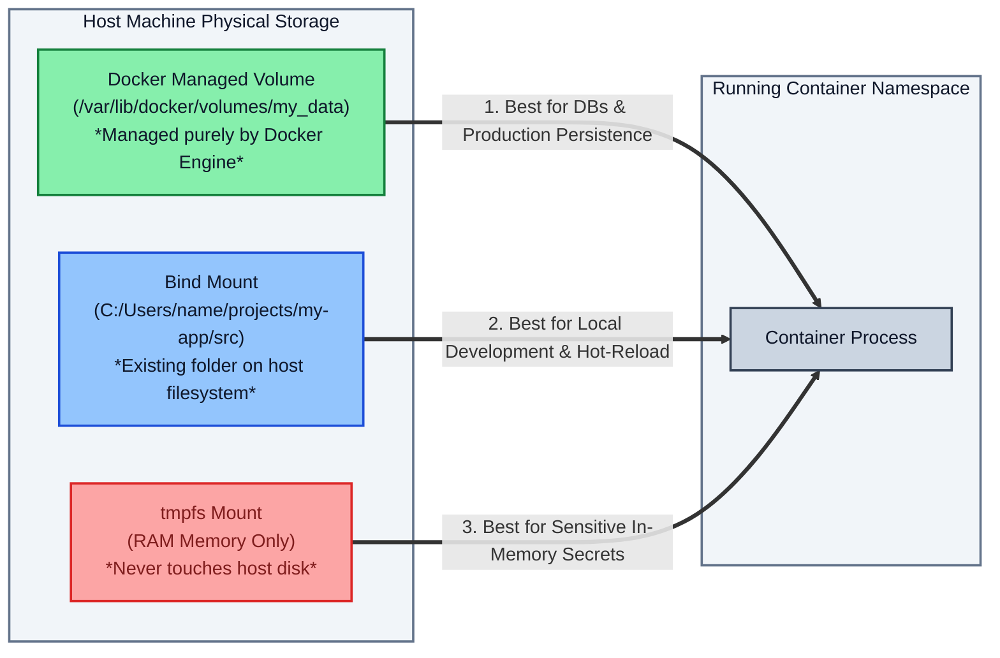

# Docker: Networking, Storage Volumes & Compose Orchestration

> **Cluster 01 — Module 03**  
> **Level**: Beginner-Friendly Foundations to Production Architecture  
> **Key References**: TechWorld with Nana, Docker Networking & Storage Docs

---

## 🌱 0. The Beginner's Mental Model: The Three Big Challenges

Once you learn how to run a single container, you immediately hit three real-world problems:
1. **The Networking Problem**: How does my web app talk to my database container?
2. **The Data Loss Problem**: If my database container crashes or restarts, does all my data disappear?
3. **The Multi-Container Problem**: Do I really have to type 5 complex `docker run` commands in the terminal every time I start my project?



---

## 📝 1. Comprehensive Study Notes: Networking, Persistent Storage & Multi-Container Stacks

### 1. Docker Networking: How Isolated Containers Communicate
By default, Docker isolates each container inside its own private network namespace. This means a container has its own loopback interface (`127.0.0.1`), its own virtual IP address, and its own routing table. 

**What Docker Networking Does:**
When Docker starts, it creates a virtual software bridge (by default `bridge` or a custom user-defined network). When you attach containers to this network, Docker assigns each container a private virtual IP address and connects it to the virtual switch via a virtual ethernet pair (`veth`). Furthermore, on user-defined networks, Docker runs an embedded DNS server located at `127.0.0.11`. Whenever an application in `order-service` attempts to connect to `http://postgres:5432`, Docker's DNS server automatically resolves the hostname `postgres` to the database container's current private IP address.

**How It Helps:**
* **Zero Hardcoded IP Addresses:** Containers frequently restart or reschedule, changing their internal IPs. With Docker DNS, services talk to each other using stable, human-readable service names.
* **Port Isolation:** Two different containers (e.g., two web applications) can both listen on port `8080` internally without colliding, because they live in separate network namespaces. You map each to different host ports only when external access is needed.
* **Security & Segmentation:** You can create separate networks for frontend and backend tiers. Database containers can be placed on an internal backend network that is completely inaccessible from the outside world, drastically reducing the attack surface.

### 2. Docker Storage: Surviving Container Ephemerality
Containers are designed to be stateless, immutable, and ephemeral. When a container writes a file to its internal filesystem, that file is stored in the container's thin, read-write layer (the `UpperDir` in OverlayFS). The second that container is removed with `docker rm`, its read-write layer is permanently destroyed, and all data written inside is lost forever.

**What Docker Volumes Do:**
To persist data (such as PostgreSQL database tables, Kafka commit logs, or customer file uploads), Docker provides **Volumes**. A volume is a dedicated directory stored directly on the host machine's physical hard drive (typically under `/var/lib/docker/volumes/`) that is mounted into the container's filesystem. Reads and writes to this folder completely bypass the OverlayFS union filesystem driver, executing at native host disk speeds.

**How It Helps:**
* **Data Permanence:** When a database container crashes or is upgraded to a newer version, the container is destroyed and recreated, but the volume remains untouched on the host disk. The new container mounts the exact same volume and resumes seamlessly.
* **Performance:** Union filesystems introduce overhead for write-heavy workloads (Copy-on-Write). Volumes write directly to the host filesystem, providing maximum I/O operations per second (IOPS).
* **Hot-Reloading in Development (Bind Mounts):** By mounting your local project source code folder from your laptop directly into the container (`-v $(pwd)/src:/app/src`), any code changes you save in your editor immediately reflect inside the running container without rebuilding the image.

### 3. Docker Compose: Orchestrating Multi-Container Applications
In real-world architectures, an application rarely runs as a single container. A typical web platform requires a frontend web server, an API backend, a PostgreSQL database, a Redis cache, and an Apache Kafka message broker.

**What Docker Compose Does:**
Managing five separate containers using individual `docker run` commands requires manually creating networks, remembering long lists of environment variables, specifying port mappings, and running commands in the exact right order. **Docker Compose** replaces this tedious manual workflow with a single declarative configuration file (`compose.yaml` or `docker-compose.yml`). In this file, you declare all services, networks, volumes, environment variables, and healthchecks.

**How It Helps:**
* **Single-Command Control:** You can boot up the entire multi-service distributed architecture with `docker compose up -d` and shut it down cleanly with `docker compose down`.
* **Standardized Team Environments:** The `docker-compose.yml` file is committed to version control. Every developer on the team runs the exact same stack with zero manual configuration differences.
* **Service Dependency Management:** With features like `depends_on` and `condition: service_healthy`, Compose ensures that downstream services (like your API backend) do not start until upstream dependencies (like PostgreSQL) are fully initialized and ready to accept connections.

---

## ⚡ 2. Before vs. After: Networking, Storage & Compose

| Feature | Before (The Manual Nightmare) | After (Docker Native Solution) | Why This Helps (The Impact) |
| :--- | :--- | :--- | :--- |
| **Container Communication** | Hardcoding container IP addresses (`172.17.0.3`). If a container restarts, its IP changes and the app breaks! | User-defined bridge network with **automatic DNS**. Just use the service name: `http://postgres:5432`. | Resilient, dynamic microservice communication with zero manual IP management. |
| **Port Exposure** | Port conflicts on the host machine. You can't run two web servers on port 80. | **Port Mapping (`-p 8080:80`)**. Host port routes cleanly to isolated container port. | Run multiple instances of the same service on a single laptop or server without collisions. |
| **Data Persistence** | When a container is deleted (`docker rm`), all database rows and uploads are **permanently wiped out**. | **Docker Volumes (`-v db_data:/var/lib/mysql`)**. Data lives safely on the host disk outside the container. | You can destroy, recreate, and upgrade containers without losing a single byte of data. |
| **Multi-Service Startup** | Writing 50-line shell scripts with chained `docker run` commands in the exact right order. | **Docker Compose (`docker compose up -d`)**. Declarative configuration for the entire multi-service stack. | One single command boots up the frontend, backend, database, and cache with automated wiring. |

---

## 🌐 3. Docker Networking: How Containers Talk

### The Apartment Intercom Analogy
*(Popularized by TechWorld with Nana)*

- Imagine an apartment building with several units (containers).
- By default, Unit 101 cannot hear Unit 102 through the soundproof walls (namespace isolation).
- When you connect containers to the same **Docker Network**, you give them an internal intercom system:
  - Unit 101 can call Unit 102 simply by speaking its name: *"Hey, Database!"*
  - The outside world (the internet) cannot access the intercom directly unless the front desk receptionist assigns an external doorbell (**Port Mapping: `-p 8080:80`**).

```mermaid
flowchart TD
    subgraph Outside["The Outside World (Internet / Host Laptop)"]
        Browser["User Browser: http://localhost:3000"]
    end

    subgraph DockerHost["Docker Host (Bridge Network: app-net)"]
        direction TB
        Browser -->|Port Map: -p 3000:80| Web["Frontend Nginx Container\nInternal IP: 172.20.0.2"]
        Web -->|HTTP Call: http://api:8080\n(Docker DNS resolves 'api'!)| API["Backend Spring Boot / Node Container\nInternal IP: 172.20.0.3"]
        API -->|TCP Call: postgres:5432\n(Docker DNS resolves 'postgres'!)| DB[("PostgreSQL Database\nInternal IP: 172.20.0.4\n*Port 5432 NOT exposed to Internet!*")]
    end

    style Outside fill:#e2e8f0,stroke:#334155,stroke-width:2px,color:#0f172a
    style DockerHost fill:#bbf7d0,stroke:#15803d,stroke-width:2px,color:#0f172a
    style Browser fill:#93c5fd,stroke:#1d4ed8,stroke-width:2px,color:#0f172a
    style Web fill:#c7d2fe,stroke:#4338ca,stroke-width:2px,color:#0f172a
    style API fill:#93c5fd,stroke:#1d4ed8,stroke-width:2px,color:#0f172a
    style DB fill:#fde047,stroke:#b45309,stroke-width:2px,color:#0f172a
```

### Docker Network Drivers Explained:
1. **Bridge (Default)**:
   - *Book Definition*: A software-based network switch managed by Docker that allows containers connected to the same bridge network to communicate while providing isolation from external networks.
   - Creates a virtual private software bridge inside the host.
   - Containers get private IPs (e.g., `172.18.0.x`).
   - *CRITICAL INTERVIEW FACT*: The **default bridge** (`docker0`) does **not** provide automatic DNS name resolution. You **must** create a **user-defined bridge network** (`docker network create my-net`) to get automatic DNS resolution!
2. **Host Network (`--network host`)**:
   - *Book Definition*: A network driver that bypasses network namespace isolation, allowing a container to attach directly to the host machine's physical network interfaces and port space.
   - Skips network isolation entirely. The container binds directly to the host's network interfaces.
   - Offers maximum performance (zero NAT overhead), but port conflicts can occur.
3. **None (`--network none`)**:
   - *Book Definition*: A driver that provisions only an internal loopback interface, completely disabling all external and inter-container network I/O for security isolation.
   - Completely air-gapped with no network access except local loopback. Used for secure offline batch jobs.
4. **Overlay Network**:
   - *Book Definition*: A distributed multi-host network driver using VXLAN tunneling to encapsulate packet frames across multiple physical or cloud hosts.
   - Connects multiple Docker daemons across different physical machines (used in Docker Swarm and Kubernetes).

---

## 💾 4. Docker Storage: Volumes vs. Bind Mounts

### The Hotel Room Safe Analogy
Containers have an ephemeral, disposable writable layer. If you check out of a hotel room, the cleaning staff throws away everything left behind in the room. 
If you want your valuables (database data, customer uploads) to survive, you place them inside a **permanent storage locker (Docker Volume)** located on the host.



### Storage Decision Matrix:

| Type | How It Works | Best Use Case | Command Example |
| :--- | :--- | :--- | :--- |
| **Named Volume** | *Book Definition: A persistent storage directory managed entirely by the Docker daemon at `/var/lib/docker/volumes/`, isolated from host directory changes.* High performance, completely independent of host directory structure. | **Production Databases (PostgreSQL, MySQL, MongoDB), Kafka logs.** | `docker run -v pg_data:/var/lib/postgresql/data postgres:15` |
| **Bind Mount** | *Book Definition: A direct filesystem mapping that mounts a file or directory from the host machine directly into a container path, mirroring host permissions.* Directly mounts an exact file or folder from your computer into the container. | **Local Development**: Mount your local source code into the container so you can edit code and see hot-reloading without rebuilding images! | `docker run -v $(pwd)/src:/app/src node:20` |
| **`tmpfs` Mount** | *Book Definition: A volatile storage mount located entirely within host system RAM that never commits data to underlying disk storage.* Stores data purely in the host machine's RAM memory. Never writes to disk. | **Sensitive tokens, passwords, private keys** that must vanish the second the container stops. | `docker run --tmpfs /tmp/secrets my-app` |

---

## 🎼 5. Docker Compose: The Conductor of Multi-Container Apps

### What is Docker Compose?
*Book Definition*: **Docker Compose** is a declarative orchestration tool for defining, configuring, and executing multi-container Docker applications using structured YAML configuration files.

### Production-Ready Example: Frontend + Spring Boot Backend + PostgreSQL + Kafka
*(Aligned with our Hands-On Capstone Project)*

```yaml
version: "3.8"

services:
  # 1. Database Service
  postgres:
    image: postgres:15-alpine
    container_name: postgres-db
    environment:
      POSTGRES_DB: orders_db
      POSTGRES_USER: user
      POSTGRES_PASSWORD: password123
    volumes:
      - postgres-data:/var/lib/postgresql/data
    networks:
      - cloudnative-net
    healthcheck:
      test: ["CMD-SHELL", "pg_isready -U user -d orders_db"]
      interval: 5s
      timeout: 5s
      retries: 5

  # 2. Apache Kafka Message Broker
  kafka:
    image: apache/kafka:3.7.0
    container_name: kafka-broker
    environment:
      KAFKA_NODE_ID: 1
      KAFKA_PROCESS_ROLES: broker,controller
      KAFKA_LISTENERS: PLAINTEXT://:9092,CONTROLLER://:9093
      KAFKA_ADVERTISED_LISTENERS: PLAINTEXT://kafka:9092
      KAFKA_CONTROLLER_LISTENER_NAMES: CONTROLLER
      KAFKA_CONTROLLER_QUORUM_VOTERS: 1@kafka:9093
      KAFKA_OFFSETS_TOPIC_REPLICATION_FACTOR: 1
    networks:
      - cloudnative-net

  # 3. Order Microservice (Spring Boot)
  order-service:
    build:
      context: ./order-service
      dockerfile: Dockerfile
    container_name: order-service
    ports:
      - "8081:8081"
    environment:
      SPRING_DATASOURCE_URL: jdbc:postgresql://postgres:5432/orders_db
      SPRING_DATASOURCE_USERNAME: user
      SPRING_DATASOURCE_PASSWORD: password123
      SPRING_KAFKA_BOOTSTRAP_SERVERS: kafka:9092
    depends_on:
      postgres:
        condition: service_healthy # Waits until Postgres is actually READY to accept connections!
      kafka:
        condition: service_started
    networks:
      - cloudnative-net

volumes:
  postgres-data:

networks:
  cloudnative-net:
    driver: bridge
```

### Essential Docker Compose Commands:
- `docker compose up -d`: Builds images (if needed), creates networks/volumes, and starts all containers in the background.
- `docker compose ps`: Shows the status and health of all services in the stack.
- `docker compose logs -f <service>`: Streams real-time logs from a specific container.
- `docker compose down`: Gracefully stops and removes containers and internal networks.
- `docker compose down -v`: Stops containers AND deletes the named volumes (clean slate!).

---

## 💼 6. Interview Preparation: High-Yield Questions & Answers

### Q1: "Why should you NOT use the default bridge network in production?"
- **The Answer**:
  - The default bridge network (`bridge` / `docker0`) lacks **automatic DNS resolution between containers**.
  - Containers on the default bridge can only reach each other via IP addresses or manual `--link` flags (which are deprecated).
  - On a **user-defined bridge network**, Docker automatically spins up an embedded DNS server (`127.0.0.11`) that resolves container and service names automatically.

---

### Q2: "What is the difference between a Volume and a Bind Mount?"
- **The Answer**:
  - **Volumes** are completely managed by Docker and stored in Docker's dedicated directory on the host (`/var/lib/docker/volumes/`). They are isolated from host file permissions, deliver optimal performance, and are the standard for production stateful workloads.
  - **Bind Mounts** point to an arbitrary path on the host filesystem (e.g. `./src`). They are tightly coupled to the host OS directory structure and permissions, making them ideal for local development hot-reloading.

---

### Q3: "What is the common issue with `depends_on` in Docker Compose, and how do you solve it?"
- **The Answer**:
  - By default, `depends_on` only checks if the container has **started**, not whether the application inside is ready to accept traffic.
  - For example, the PostgreSQL container starts in 1 second, but takes 10 seconds to initialize schemas and open port 5432. The backend app crashes immediately because the DB is not ready!
  - *The Solution*: Use Docker Compose **`healthcheck`** on the database and configure `depends_on: { postgres: { condition: service_healthy } }`.

---

### Q4: "How does Port Mapping work under the hood?"
- **The Answer**:
  - When you specify `-p 8080:80`, Docker interacts with the Linux kernel's **Netfilter / iptables** subsystem.
  - It creates a **Destination NAT (DNAT)** rule in the `PREROUTING` chain.
  - Any packet arriving at host network interface `eth0` on port `8080` has its destination IP rewritten to the container's private IP (`172.20.0.2`) and port `80`.
