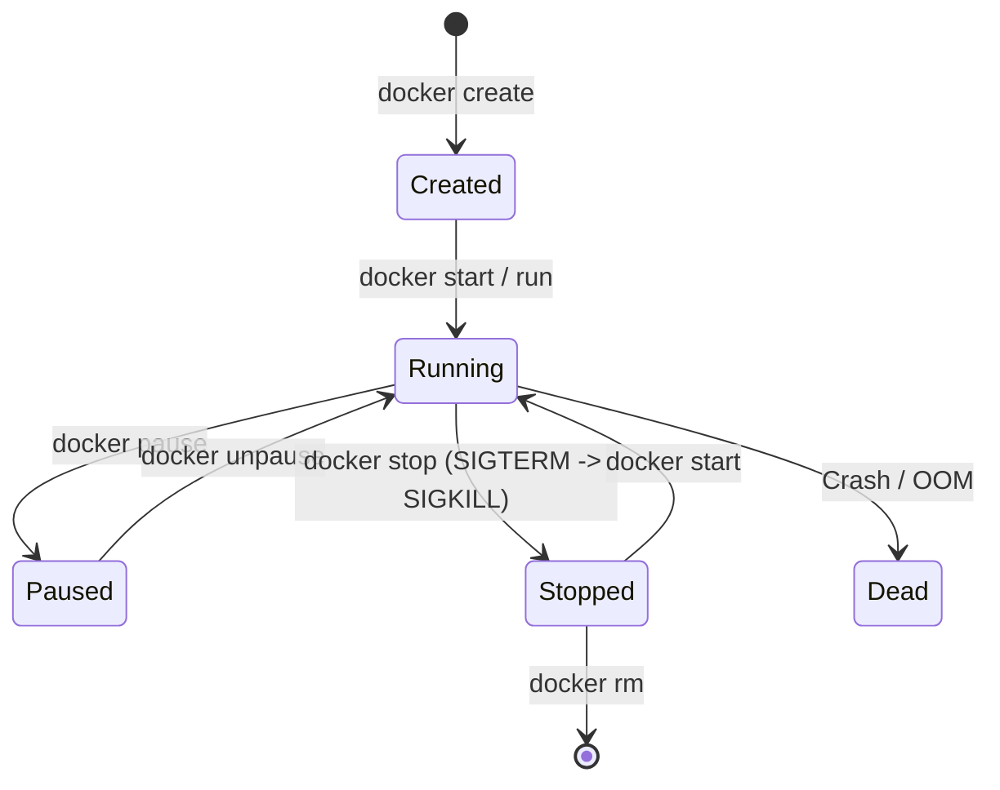

# Docker: The Complete Interview Question Bank & Troubleshooting Playbook

> **Cluster 01 — Module 04**  
> **Level**: Beginner to Senior / FAANG Engineering  
> **Key References**: TechWorld with Nana, Docker Engineering, Linux Kernel Docs

---

## 🎯 How to Use This Guide in an Interview
In technical interviews, interviewers evaluate three tiers of competence:
1. **Clarity**: Can you explain technical concepts simply without relying on memorized buzzwords?
2. **Under-the-Hood Knowledge**: Do you understand the Linux OS primitives powering the tool?
3. **Production Realism**: Have you debugged live production failures (OOM, network drops, zombie processes)?

---

## 🟢 Part 1: Beginner Interview Questions

### Q1: What is Docker, and why is it used over traditional Virtual Machines?
**The 60-Second Winning Answer**:
> *"Docker is a containerization platform that packages an application and all its dependencies into a lightweight, portable container that runs consistently across any environment.  
> Unlike traditional Virtual Machines, which virtualize physical hardware and require a heavy, standalone Guest OS (gigabytes of RAM and minutes to boot), Docker virtualizes at the OS level. Containers run as isolated standard Linux processes directly on the host kernel using Namespaces and cgroups. This makes Docker containers start in milliseconds, consume megabytes instead of gigabytes, and allows 5x to 10x higher density on the same hardware."*

---

### Q2: What is the difference between a Docker Image and a Docker Container?
**The Plain-English Analogy**:
- A **Docker Image** is like a **cooking recipe or frozen cake** (or a Class in OOP). It is read-only, immutable, and stored on disk.
- A **Docker Container** is the **living, running process** created from that image (an Object instance in OOP). It has an active PID in RAM and a thin writable layer on top.
- *Bonus Point*: You can spawn 100 identical containers from a single Docker image without duplicating the image files on disk.

---

### Q3: What is the difference between `docker run` and `docker start`?
- **`docker run`**: Creates a **brand new** container from an image and starts it immediately (`docker create` + `docker start`).
- **`docker start`**: Starts an **already existing**, previously stopped container without creating a new one.

---

### Q4: How do you get inside and interact with a running Docker container?
- By using `docker exec -it <container_name_or_id> /bin/sh` (or `/bin/bash`).
  - `-i` stands for interactive (keeps STDIN open).
  - `-t` allocates a pseudo-TTY terminal.
- *Interviewer Follow-up*: *"What if the container was built `FROM scratch` with no shell?"*
  - Answer: You cannot run `docker exec` because there is no shell binary. You debug it by attaching host tools to its namespaces via `nsenter` or using ephemeral debug containers (`docker debug`).

---

### Q5: What is the container lifecycle, and what are its states?

- States: **Created** $\rightarrow$ **Running** $\rightarrow$ **Paused** $\rightarrow$ **Stopped** $\rightarrow$ **Removed**.

---

## 🟡 Part 2: Intermediate Interview Questions

### Q6: What is a multi-stage build, and why is it a non-negotiable best practice?
**The Answer**:
> *"A multi-stage build uses multiple `FROM` instructions in a single Dockerfile. It allows you to separate the build environment from the final runtime environment.  
> In stage 1 (the builder), we use a heavy image with compilers, SDKs, and build tools (like Maven or Go SDK) to compile our code. In stage 2 (the runtime), we start with a minimal, clean image (like Alpine or Distroless) and copy ONLY the compiled artifact over.  
> This drastically shrinks image sizes from 1.5GB down to 30MB and eliminates security vulnerabilities by keeping compilers, package managers, and development tools completely out of production."*

---

### Q7: Explain the difference between `CMD` and `ENTRYPOINT`.
**The Answer**:
- **`ENTRYPOINT`** sets the immutable command executable that will run when the container starts (e.g. `python`, `node`, or `/app/bin`).
- **`CMD`** provides the default arguments passed into the entrypoint, which can be easily overridden at runtime.
- *Example*:
  ```dockerfile
  ENTRYPOINT ["python", "app.py"]
  CMD ["--port", "8080"]
  ```
  Running `docker run my-image --port 9000` overrides only the `CMD` argument (`--port 9000`), while maintaining `python app.py` as the entrypoint.

---

### Q8: What is the difference between Docker Volumes and Bind Mounts?
- **Docker Volume**: Managed by Docker in a dedicated location on the host (`/var/lib/docker/volumes/`). Independent of host OS directory layout, immune to accidental host deletion, and optimal for database persistence.
- **Bind Mount**: Binds an arbitrary file or folder from the host filesystem into the container (e.g. `$(pwd)/src:/app/src`). Ideal for local development hot reloading.
- **`tmpfs` Mount**: Stored purely in host RAM. Wiped immediately when the container stops; ideal for sensitive in-memory credentials.

---

### Q9: Why is layer ordering important for Docker caching?
**The Answer**:
> *"Docker caches each layer sequentially. When any layer changes, that layer and all subsequent layers are invalidated and re-executed.  
> To maximize build speed, you must order instructions from least frequently changing to most frequently changing. For example, copy `package.json` and run `npm install` before copying the source code. That way, code changes don't force re-downloading dependencies on every build."*

---

### Q10: What is the difference between the default bridge network and a user-defined bridge network?
**The Answer**:
- The **default bridge** (`bridge` or `docker0`) does **not** support automatic DNS service discovery between containers; containers can only communicate via raw IP addresses or legacy `--link`.
- A **user-defined bridge** (`docker network create my-net`) starts an embedded DNS server (`127.0.0.11`) that automatically resolves container names to their private IPs, enabling simple communication like `http://backend-api:8080`.

---

## 🔴 Part 3: Senior & FAANG-Level System Questions

### Q11: Explain how Linux Namespaces, cgroups, and OverlayFS combine to form a container.
**The System Architecture Answer**:
> *"Under the hood, a container does not exist as a physical object. It is a standard Linux process governed by three kernel subsystems:  
> 1. **Linux Namespaces** provide resource isolation (what the process can *see*): PID (process tree), NET (network interfaces & iptables), MNT (filesystem mounts), IPC, UTS (hostnames), and USER.  
> 2. **Control Groups (cgroups v2)** provide resource metering (what the process can *consume*): enforcing limits on CPU cores, memory limits, and disk I/O bandwidth.  
> 3. **OverlayFS (Overlay2)** provides copy-on-write filesystem composition: layering read-only image layers under a thin read-write container layer, keeping disk usage minimal."*

---

### Q12: What is the security danger of mounting `/var/run/docker.sock` inside a container?
**The Answer**:
> *"Mounting the Docker socket inside a container gives that container direct root-level control over the host Docker daemon. An attacker inside the container can send an API call to the daemon to spin up a new container with privileged flags and the host root directory mounted at `/host`. From there, they can execute code directly on the host machine as `root`, achieving a full container breakout."*

---

### Q13: What is the PID 1 Problem, and how does it cause zombie processes?
**The Answer**:
- In Linux, process **PID 1** (`init` or `systemd`) has two critical duties:
  1. Forwarding operating system signals (`SIGTERM`, `SIGINT`) to child processes.
  2. Reaping **zombie processes** (dead child processes whose exit status has not been read).
- If your container process runs as PID 1 without an init system and spawns child processes, those children can become zombies when they terminate, leaking PID table entries.
- Furthermore, if using shell form (`CMD node server.js`), `/bin/sh` runs as PID 1 and swallows `SIGTERM`, meaning your app never gets notified to shut down gracefully.
- *Solution*: Use exec form (`CMD ["node", "server.js"]`) and optionally use a lightweight init binary like `tini` (`ENTRYPOINT ["/sbin/tini", "--"]`).

---

## 🛠️ Part 4: Production Incident Troubleshooting Playbook

### Scenario 1: Exit Code 137 (OOMKilled)
- **Symptom**: Container dies suddenly with exit code 137.
- **Triage Steps**:
  ```bash
  # 1. Check if Docker flagged it as OOM
  docker inspect <container_id> --format='{{.State.OOMKilled}}' # Returns 'true'
  
  # 2. Check host kernel ring buffer for OOM events
  dmesg -T | grep -E -i "oom|killed process"
  ```
- **Fix**: Increase memory limits (`--memory=1g`) or profile heap usage for memory leaks.

---

### Scenario 2: Container Starts and Immediately Exits (Exit Code 0 or 1)
- **Symptom**: `docker ps` shows nothing, but `docker ps -a` shows container exited 2 seconds ago.
- **Root Cause**: A container only runs as long as its foreground PID 1 process is alive. If the command daemonizes into the background (e.g. `nginx` running as a background daemon) or finishes immediately, the container exits.
- **Triage & Fix**:
  ```bash
  # Check logs of exited container
  docker logs <container_id>
  ```
  Ensure the process runs in the foreground (e.g., `CMD ["nginx", "-g", "daemon off;"]`).

---

### Scenario 3: "Port Already in Use" Error
- **Symptom**: `Bind for 0.0.0.0:8080 failed: port is already allocated`.
- **Triage & Fix**:
  ```bash
  # On Windows (PowerShell):
  netstat -ano | findstr :8080
  Stop-Process -Id <PID> -Force

  # On Linux / macOS:
  sudo lsof -i :8080
  sudo kill -9 <PID>
  ```
