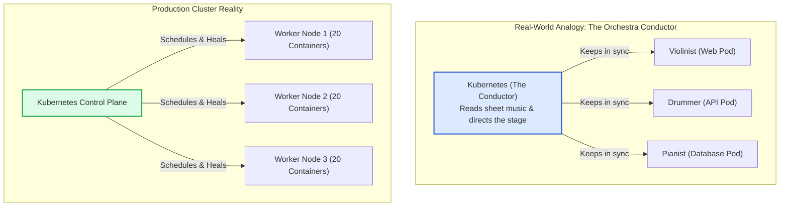
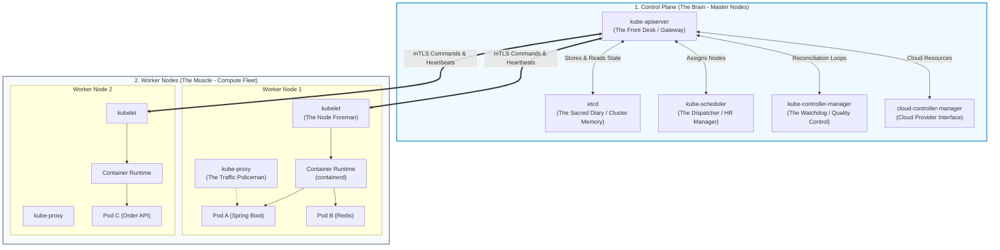
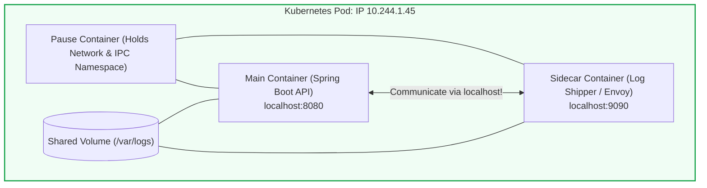
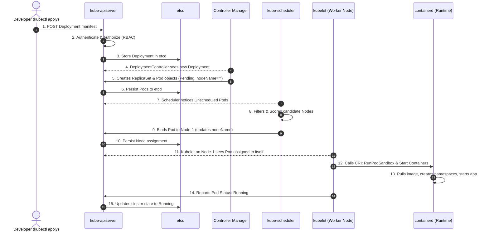

# Kubernetes: Architecture, Control Plane & Node Internals

> **Cluster 02 — Module 01**  
> **Level**: Beginner Foundations to Production & FAANG-Level Deep Dive  
> **Key References**: TechWorld with Nana, Kubernetes Official Docs, Borg Paper (Google)

---

## 🌱 0. The Beginner's Mental Model: Why Do We Need Kubernetes?

### The Question Every Beginner Asks:
*"Docker runs containers great on my laptop. Why do we need Kubernetes?"*

Docker is fantastic for running a few containers on a single computer. But imagine you work at Netflix, Uber, or an e-commerce platform with **1,000 microservice containers** spread across **50 production servers**:
- **What happens when Server #3 dies or suffers a hardware failure at 2:00 AM?** Who wakes up to restart those 40 containers on another server?
- **What happens on Black Friday when website traffic surges by 500%?** Who manually spins up 50 new container replicas and wires them into the load balancer?
- **How do you roll out a new version of your software with ZERO downtime** while millions of active users are purchasing items?
- **How do containers discover each other** when servers are constantly being added and removed?

Docker alone cannot solve these problems. You need a **Container Orchestrator**.

---

### The Real-World Analogy: The Orchestra Conductor & Ship Captain
*(Popularized in TechWorld with Nana)*

- **The Musicians (Containers)**: Each musician (violinist, drummer, pianist) is highly skilled and plays their instrument independently (Node.js, PostgreSQL, Redis).
- **The Problem**: Without someone in charge, musicians play at different speeds, wander off stage, or when the lead violinist faints, nobody knows what to do.
- **The Conductor (Kubernetes)**:
  - Stands on the podium, reads the sheet music (**Desired State / YAML Manifest**).
  - Watches the entire orchestra (**Cluster**).
  - Signals musicians to play faster during crescendos (**Auto-scaling**).
  - Instantly subs in a replacement violinist if one drops their bow (**Self-Healing & Auto-Restart**).



> **The Golden Definition**:  
> **Kubernetes (K8s)** is an open-source container orchestration platform that automates the **deployment, scaling, networking, and self-healing** of containerized applications across a cluster of servers.

---

## 📝 1. Comprehensive Study Notes: What is Kubernetes, What Does It Do, and How Does It Help?

### What is Kubernetes? (Straightforward Definition)
**Kubernetes** (frequently abbreviated as **K8s**, representing the 8 letters between 'K' and 's') is an open-source container orchestration platform designed to automate the deployment, scaling, networking, and lifecycle management of containerized applications across clusters of host machines. Originally designed by Google based on more than fifteen years of experience running production workloads with its internal cluster manager called **Borg**, Kubernetes was open-sourced in 2014 and is now maintained by the Cloud Native Computing Foundation (CNCF).

In simple terms, while Docker gives you the ability to run a container on a single machine, Kubernetes takes hundreds or thousands of individual machines and stitches them together into a unified, resilient computing fabric. You stop thinking about individual servers (e.g., "Server 14 in AWS us-east-1") and instead interact with the cluster as a single, giant, self-managing computer.

### What Does Kubernetes Actually Do?
Kubernetes operates on a **declarative management model**. Instead of issuing imperative commands to individual servers ("SSH into Server A, download version 2.0, restart the service"), you describe your desired outcome in a declarative YAML or JSON file: *"I want 5 replicas of the Order Service running image v2.1, with 500MB of RAM each, accessible over port 8080."* 

Once you submit this description to the Kubernetes API, the platform performs the following continuous actions:
1. **Intelligent Scheduling (Bin-Packing):** It evaluates the CPU and memory utilization across all worker nodes in your cluster, identifies the optimal physical machines with sufficient spare capacity, and places your application containers there.
2. **Continuous Reconciliation (The Control Loop):** Kubernetes runs automated control loops 24 hours a day. It constantly compares the **actual state** of the cluster with your **desired state**. If an application process crashes, Kubernetes restarts it immediately. If a physical server experiences a hardware failure, Kubernetes detects the loss and automatically reschedules the displaced workloads onto healthy surviving servers within seconds.
3. **Automated Service Discovery & Internal Routing:** As containers start, stop, and migrate across different physical nodes, their dynamic IP addresses change constantly. Kubernetes creates stable virtual IP addresses and internal DNS endpoints that automatically route traffic only to healthy instances, transparently load-balancing requests.
4. **Zero-Downtime Rollouts and Rollbacks:** When deploying a new software release, Kubernetes progressively swaps out old application pods for new ones, waiting for health checks to pass before routing real customer traffic to the new version. If the new release fails its health checks, Kubernetes automatically pauses or rolls back the deployment before users experience an outage.

### Why Do We Need Kubernetes & What Help Does It Provide?
Engineering organizations adopt Kubernetes because managing modern distributed systems manually is impossible at scale:
* **High Availability Without Human Intervention:** In traditional deployments, a hardware failure at 3:00 AM meant an on-call engineer was awakened by pager alerts to manually log in, inspect the server, and redeploy services. Kubernetes handles hardware crashes autonomously, recovering services in seconds without human involvement.
* **Elastic Autoscaling:** Traffic to modern applications fluctuates wildly. E-commerce platforms see massive spikes during flash sales, and streaming services see surges on weekend evenings. Kubernetes integrates with metrics engines to scale the number of running application pods up or down dynamically based on real-time CPU usage, memory thresholds, or custom business metrics (such as queue backlog depth).
* **Significant Cloud Infrastructure Cost Savings:** Without an orchestrator, teams typically provision oversized virtual machines for each individual service to handle peak traffic, leading to servers sitting idle at 10% CPU utilization 90% of the time. Kubernetes packs dozens of disparate containerized workloads onto the same servers based on requested resource quotas, raising average server utilization and slashing cloud infrastructure expenses by 40% to 60%.
* **Cloud Agnostic Portability:** Because Kubernetes provides a standardized API and operating model, your deployment manifests run identically on Amazon Elastic Kubernetes Service (EKS), Google Kubernetes Engine (GKE), Microsoft Azure Kubernetes Service (AKS), or on-premise bare-metal data centers. This protects companies from vendor lock-in.

---

## ⚡ 2. Before vs. After: Why Kubernetes is Essential

| Scenario / Challenge | Before Kubernetes (Manual Docker / Bare Metal) | After Kubernetes (Automated Orchestration) | Why This Helps (The Impact) |
| :--- | :--- | :--- | :--- |
| **Server Crash at 2 AM** | Server dies $\rightarrow$ PagerDuty alerts wake up engineer $\rightarrow$ 45 minutes of downtime to manually SSH and restart containers. | K8s detects dead node $\rightarrow$ automatically reschedules all pods to healthy nodes in **under 30 seconds**. | True self-healing; engineers sleep peacefully; 99.99% uptime. |
| **Traffic Spike / Flash Sale** | Manual server provisioning $\rightarrow$ load balancer reconfiguration $\rightarrow$ site slows down or crashes under load. | **Horizontal Pod Autoscaler (HPA)** detects CPU/traffic rise $\rightarrow$ scales pods from 5 to 50 automatically in seconds. | Elastic scaling handle flash traffic without manual intervention. |
| **Deploying New Versions** | Scheduled maintenance windows at midnight $\rightarrow$ "Website under maintenance" downtime banner for users. | **Zero-Downtime Rolling Updates**: Spins up new version pods, verifies health checks, then safely drains old pods. | Deploy to production multiple times a day without impacting users. |
| **Networking & Discovery** | Hardcoding IP addresses; manual reverse-proxy updates when IPs change. | **Kubernetes Services & CoreDNS**: Stable virtual IP and DNS name (`http://order-service`) that never changes. | Microservices find each other seamlessly regardless of pod restarts. |
| **Resource Optimization** | Underutilized servers running at 10% CPU, wasting thousands of cloud dollars. | Intelligent **Bin-Packing (Scheduler)** packs containers onto nodes based on requested CPU and RAM. | Slashes cloud infrastructure costs by 40% to 60%. |

---

## 🏛️ 3. The Complete Cluster Architecture: Control Plane & Worker Nodes

A Kubernetes cluster is divided into two distinct planes:
1. **The Control Plane (The Brains / Management)**: Decides what runs where.
2. **The Worker Nodes (The Muscle / Workers)**: Where your actual application containers run.



---

## 🧠 4. Control Plane Components (Explained in Plain English)

*(Using TechWorld with Nana's "Cast of Characters" Mental Model)*

### 1. `kube-apiserver` (The Front Desk / Receptionist)
- **Role**: The central communication hub of the entire cluster.
- Every command from `kubectl`, the dashboard, or internal components **must pass through the API Server**. No component ever talks directly to the database except the API server.
- **Responsibilities**:
  1. *Authentication (AuthN)*: Are you who you say you are?
  2. *Authorization (AuthZ)*: Do your RBAC permissions allow you to create this pod?
  3. *Admission Control*: Validates and mutates manifests (e.g. injecting sidecars).
  4. *Persistence*: Saves the verified configuration to `etcd`.

### 2. `etcd` (The Cluster's Sacred Notebook / Brain Memory)
- **Role**: A distributed, consistent key-value store that holds the complete truth of the cluster state (every Pod, Service, Secret, and Node status).
- **Core Rules**:
  - Uses the **Raft Consensus Algorithm** to ensure all master nodes agree on state.
  - Runs in odd-numbered clusters (3, 5, or 7 nodes) to avoid split-brain scenarios ($N/2 + 1$ quorum).
  - *Golden Rule*: If `etcd` loses data, your cluster loses its memory. Regular automated snapshots of `etcd` are mandatory in production!

### 3. `kube-scheduler` (The Smart HR / Dispatcher)
- **Role**: Decides **which worker node** should run a newly created Pod.
- **How it Works (Two-Phase Process)**:
  1. *Filtering (Predicates)*: Eliminates nodes that don't have enough CPU/RAM, or have taints that the pod doesn't tolerate.
  2. *Scoring (Priorities)*: Ranks surviving nodes. Prefers spreading pods across different availability zones to prevent all pods dying in one outage.

### 4. `kube-controller-manager` (The Watchdog / Inspector)
- **Role**: Continuously monitors the cluster to make sure **Actual State == Desired State**.
- **The Reconciliation Loop**:
  ```text
  Loop forever:
     1. Observe what is currently running (Actual State: 2 Pods).
     2. Check what the user requested in YAML (Desired State: 3 Pods).
     3. If Actual != Desired: Take corrective action (Ask API server to create 1 Pod)!
  ```

---

## 🛠️ 5. Worker Node Components (The Muscle)

### 1. `kubelet` (The Node Foreman / Supervisor)
- **Role**: The agent running on every single worker node.
- It receives Pod specifications (PodSpecs) from the API server and instructs the local container runtime (`containerd`) to download images, start containers, and mount volumes.
- It constantly checks container health (Liveness & Readiness probes) and reports node health back to the control plane.

### 2. `kube-proxy` (The Traffic Policeman / Switchboard)
- **Role**: Runs on each worker node to handle network routing for Kubernetes **Services**.
- When traffic is sent to a Service virtual IP (`ClusterIP`), `kube-proxy` programs the Linux kernel's `iptables` or `IPVS` rules to load-balance traffic across the healthy backend Pods.

### 3. Container Runtime (`containerd` / `CRI-O`)
- **Role**: The software that pulls container images and actually launches/stops the containers (via the **Container Runtime Interface [CRI]**).

---

## 🥜 6. The Pod: The Smallest Atomic Unit in Kubernetes

Beginners often ask: *"Why does Kubernetes deploy Pods instead of bare Docker containers?"*

### The Pea Pod Analogy
A **Pod** is like a pea pod that holds one or more peas (containers):
- 95% of the time, a Pod runs **one single container** (e.g. your Spring Boot web app).
- In advanced patterns, a Pod runs a **main container + helper sidecar container**:
  - *Main Container*: Your application serving HTTP requests.
  - *Sidecar Container*: A logging agent (Fluentbit) or service mesh proxy (Envoy) that collects metrics.



### Why Pods are Brilliant:
1. **Shared Network**: All containers inside the same Pod share the exact same network namespace and IP address. They can talk to each other over `localhost` at lightning speed!
2. **Shared Storage**: Containers in a Pod can mount the exact same storage volume to share files.
3. **Atomic Scheduling**: All containers in a Pod are always scheduled together onto the exact same physical node.

---

## 🔄 7. What Happens When You Run `kubectl apply -f deploy.yaml`?

*(The #1 Most Frequently Asked Kubernetes Interview Question!)*



---

## 💼 8. Interview Preparation: High-Yield Questions & Answers

### Q1: "Explain Kubernetes architecture to a junior engineer."
- **The Answer**:
  - *"A Kubernetes cluster consists of a Control Plane (the master brain) and Worker Nodes (the workers). The Control Plane consists of the API Server (the single gateway), etcd (the consistent database storing cluster state), the Scheduler (places pods on nodes), and the Controller Manager (reconciles desired state with actual state). Worker Nodes run the Kubelet (node agent enforcing pod state), kube-proxy (networking and load-balancing), and the container runtime (containerd) that actually executes the pods."*

---

### Q2: "What is a Pod, and why not deploy containers directly?"
- **The Answer**:
  - *"A Pod is the smallest deployable execution unit in Kubernetes. It encapsulates one or more containers that share the same network namespace (IP address and port space), shared storage volumes, and IPC. Kubernetes uses Pods rather than individual containers to natively support co-located helper patterns, like sidecars (logging, proxies, security agents), allowing them to communicate via localhost while being scheduled and scaled as a single cohesive unit."*

---

### Q3: "Why does `etcd` require an odd number of nodes (3, 5, 7)?"
- **The Answer**:
  - *"`etcd` uses the Raft consensus algorithm, which requires a strict majority quorum to commit writes: $Quorum = \lfloor N/2 \rfloor + 1$.  
  - A 3-node cluster requires 2 nodes for quorum, tolerating 1 failure.  
  - A 4-node cluster requires 3 nodes for quorum, which STILL only tolerates 1 failure while adding network overhead and failure risk!  
  - Therefore, running an odd number of nodes provides the maximum fault tolerance with the minimum node count."*

---

### Q4: "What is the difference between `kubelet` and `kube-proxy`?"
- **The Answer**:
  - **`kubelet`** manages the **lifecycle of Pods** on the node. It talks to the container runtime via CRI to start/stop containers and monitor their health.
  - **`kube-proxy`** manages **networking rules** on the node. It configures `iptables` or `IPVS` so that requests to Service virtual IPs are properly routed and load-balanced to the backend Pod IPs.

---

### ⏱️ Rapid Recall / 30-Second Elevator Pitch
> *"Kubernetes is a declarative container orchestration platform that continuously reconciles actual cluster state with desired state. Its Control Plane (API Server, etcd, Scheduler, Controller Manager) coordinates scheduling and self-healing, while Worker Nodes (Kubelet, Kube-proxy, Container Runtime) execute Pods, providing zero-downtime deployments, automated scaling, and unified service discovery."*
