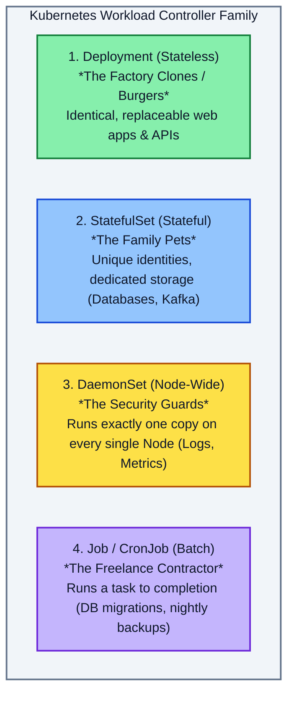
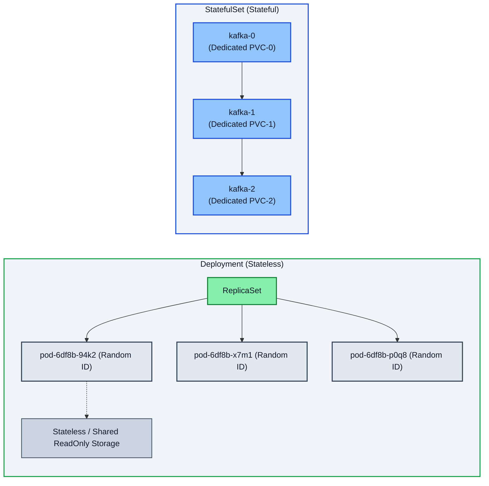
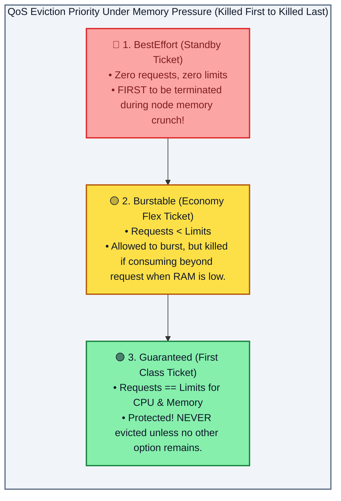
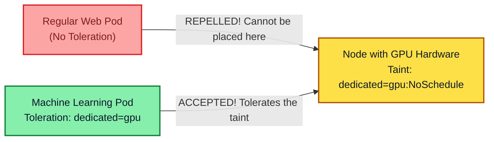

# Kubernetes: Workloads, Lifecycle & Advanced Scheduling

> **Cluster 02 — Module 02**  
> **Level**: Beginner Foundations to Production & FAANG-Level Deep Dive  
> **Key References**: TechWorld with Nana, Kubernetes Official Docs, Scheduling SIG

---

## 🌱 0. The Beginner's Mental Model: Why Controllers?

### The Trap: Why You Should NEVER Deploy a "Naked" Pod
A common beginner mistake is running:
```bash
kubectl run my-web --image=nginx
```
This creates a **bare (or naked) Pod**. 
- If the worker node hosting that Pod crashes, **the Pod dies and is NEVER restarted**.
- If someone accidentally deletes the Pod, it is gone forever.
- There is zero auto-healing, zero auto-scaling, and zero rolling updates!

To get enterprise reliability, Kubernetes provides **Workload Controllers**—intelligent managers that supervise and maintain Pods for you.

---

### The Workload Controller Family (Real-World Analogies)
*(Inspired by TechWorld with Nana's Workloads Guide)*



1. **Deployments (The Burgers / Cattle)**:
   - If you order 3 cheeseburgers at McDonald's, you don't care which one is which. They are 100% identical. If one falls on the floor, the staff throws it away and hands you a new one.
   - Deployments manage **stateless applications** (REST APIs, frontend apps). Any pod can be destroyed and recreated at random.
2. **StatefulSets (The Pets)**:
   - If you have three dogs named Spot, Rover, and Bella, they are NOT interchangeable. Each has its own distinct personality, memory, and bed.
   - StatefulSets manage **stateful applications** (Databases, Kafka brokers, Elasticsearch). Each Pod has a fixed name (`kafka-0`, `kafka-1`), fixed network identity, and its own dedicated hard drive.
3. **DaemonSets (The Security Guards)**:
   - Every physical building needs exactly one security guard at the front entrance.
   - DaemonSets automatically place **one copy of a Pod on every worker node** (e.g. Fluentbit for collecting node logs, Datadog/Prometheus node-exporter for monitoring).
4. **Jobs & CronJobs (The Cleaning Crew)**:
   - Unlike web servers that must run forever, a Job runs until the task succeeds (e.g. running a database schema migration) and then terminates cleanly.

---

## 📝 1. Comprehensive Study Notes: Workload Management & Scheduling Mechanics

### What is a Workload Controller?
In Kubernetes, you rarely run individual Pods directly. A **Workload Controller** is a higher-level abstraction and management loop that automates the lifecycle of Pods. When you define a controller in YAML, you state the rules of execution: how many copies should exist, how updates should be rolled out, what storage each replica needs, and how failures should be healed. The controller monitors the cluster continuously and issues commands to create, terminate, or replace Pods so that the live system strictly adheres to your rules.

### Detailed Breakdown of Workload Controllers
Each workload controller is purpose-built for a specific application architecture:
1. **Deployments (For Stateless Applications):** A Deployment manages a stateless group of identical Pods via an underlying **ReplicaSet**. If your web server or REST API doesn't care which physical server it runs on, and doesn't store permanent data on its local disk, you use a Deployment. Deployments provide declarative rolling updates, pausing, and instant rollbacks. If any replica crashes or its host node dies, the Deployment controller instantly spawns a replacement replica.
2. **StatefulSets (For Stateful Workloads & Databases):** Traditional databases (PostgreSQL, MySQL), message brokers (Apache Kafka), and distributed datastores (Cassandra, Elasticsearch) cannot be treated like disposable web servers. They require stable network identifiers, predictable startup and shutdown ordering, and dedicated persistent storage that survives across restarts. A **StatefulSet** assigns a stable ordinal index to each pod (e.g., `kafka-0`, `kafka-1`, `kafka-2`). When a stateful pod is deleted and recreated, it retains its exact name, its DNS identity, and automatically reconnects to its dedicated PersistentVolume.
3. **DaemonSets (For Node-Level Infrastructure Services):** A DaemonSet ensures that **all (or selected) worker nodes run exactly one copy of a Pod**. As new worker nodes are added to the cluster, the DaemonSet controller automatically schedules a pod onto them. When a node is decommissioned, the pod is garbage-collected. DaemonSets are universally used for cluster logging agents (Fluentbit, Logstash), system monitoring daemons (Prometheus `node-exporter`), and software-defined network CNI plugins.
4. **Jobs & CronJobs (For Batch & Scheduled Tasks):** Unlike web applications that run indefinitely, a **Job** runs a pod to completion. It ensures that a specified number of tasks successfully finish (with retries on failure) and then stops. Typical use cases include running automated database schema migrations (Liquibase, Flyway) before deploying a new app version. A **CronJob** runs Jobs on a recurring schedule based on standard cron syntax (e.g., executing nightly database backups or sending monthly billing invoices).

### How Kubernetes Scheduling Works in Practice
When a Pod is submitted to the cluster, its `nodeName` field is initially empty—it is in a **`Pending`** state. The **`kube-scheduler`** is the control plane component responsible for assigning the Pod to a healthy worker node. It does this in two distinct phases:
1. **Filtering (Predicates):** The scheduler checks all nodes in the cluster against hard requirements. It filters out nodes that lack sufficient unallocated CPU or RAM (`resources.requests`), nodes marked as unschedulable (cordoned or tainted), or nodes that do not match the Pod's `nodeSelector` or `nodeAffinity` rules.
2. **Scoring (Priorities):** Among the surviving nodes that passed the filter, the scheduler scores them from 0 to 100 based on optimization algorithms. It favors nodes that already have the container image cached locally, nodes that balance workloads evenly across availability zones (anti-affinity), and nodes that maximize bin-packing efficiency. The node with the highest score is chosen, and the scheduler binds the Pod to that node.

### How Resource Requests and Limits Protect Your Cluster
Every container inside a Pod specification should define two critical resource thresholds:
* **`requests` (The Scheduling Guarantee):** This is the minimum amount of CPU and RAM that the container is guaranteed to receive. The `kube-scheduler` only places a Pod onto a node if the node has enough unreserved capacity to satisfy its requests. Requests prevent nodes from being accidentally over-committed.
* **`limits` (The Hard Ceiling):** This is the maximum amount of CPU and RAM the container is permitted to consume. If a container enters an infinite loop and attempts to use excessive CPU, the Linux kernel throttles its CPU time slices (slowing it down without killing it). However, if an application leaks memory and attempts to allocate more RAM than its memory limit, the Linux kernel OOM Killer immediately terminates the container with **Exit Code 137 (`OOMKilled`)**, preventing a single malfunctioning application from bringing down the entire host operating system.

---

## ⚡ 2. Before vs. After: Workload Controllers

| Scenario | Before (Naked Pods) | After (Managed Controllers) | Why This Helps (The Impact) |
| :--- | :--- | :--- | :--- |
| **Node Hardware Failure** | Pod dies permanently. Customer transactions fail until manual sysadmin intervention. | Deployment detects loss; immediately launches replacement Pod on another node. | **Automated self-healing**; achieves 99.99% service availability. |
| **Deploying Code Updates** | Shut down old pods manually; website experiences downtime while new pods boot. | Deployment executes **RollingUpdate**: brings up Pod v2, verifies health, then drains Pod v1. | **Zero-downtime releases** with automatic rollbacks if new version fails. |
| **Database Clustering** | Pods get random names and random IPs; master/slave replication breaks on restart. | StatefulSet assigns deterministic identities (`db-0`, `db-1`) with stable persistent storage. | Safe clustering for distributed systems (PostgreSQL, Kafka, Cassandra). |

---

## 📦 3. Deep Dive: Deployments vs. StatefulSets



### The Architectural Differences:

| Feature | Deployment | StatefulSet |
| :--- | :--- | :--- |
| **Pod Naming** | Random hash suffix (`order-svc-7f89d4-abc12`) | Predictable ordinal index (`kafka-0`, `kafka-1`, `kafka-2`) |
| **Startup / Shutdown Order** | All pods launch or terminate in parallel | Sequential order ($0 \to 1 \to 2$ on scale-up; $2 \to 1 \to 0$ on scale-down) |
| **Storage Persistence** | Ephemeral or shared PVC | Dedicated, permanent `PersistentVolumeClaim` per pod via `volumeClaimTemplates` |
| **Network Identification** | Random IP behind a Service | Stable DNS A-records provided via a **Headless Service** (`kafka-0.kafka-headless.default.svc.cluster.local`) |
| **Primary Use Cases** | Microservices, REST APIs, Web UIs | Kafka, Cassandra, ZooKeeper, Redis Sentinel, PostgreSQL Primary/Replica |

---

## ✈️ 4. Resource Management: Requests, Limits & QoS Classes

- *Quality of Service (QoS)*: A classification mechanism (Guaranteed, Burstable, BestEffort) assigned by Kubernetes based on container resource definitions that dictates pod eviction precedence when a worker node encounters resource starvation.
- *Resource Requests*: The baseline quantity of compute resources (CPU and RAM) that Kubernetes guarantees to allocate to a container, directly utilized by the scheduler for node placement.
- *Resource Limits*: The maximum upper boundary of compute resources that a container is permitted to consume before being throttled (CPU) or terminated via kernel OOM (Memory).

### The Flight Ticket Analogy for QoS Classes
When a worker node runs out of physical RAM, the Linux kernel OOM Killer must step in and terminate pods. How does Kubernetes decide which pod to kill first? 
It assigns each Pod a **Quality of Service (QoS) Class**, exactly like airline passenger tickets:



### Resource Requests vs. Limits:
- **`requests` (The Guarantee)**: How much CPU/RAM the pod is **guaranteed** to get. The `kube-scheduler` uses this number to decide which node has enough spare room to host the pod.
- **`limits` (The Ceiling)**: The absolute maximum resource the pod is allowed to consume.
  - If a Pod exceeds its **CPU limit**, it is **throttled** (slowed down, but NOT killed).
  - If a Pod exceeds its **Memory limit**, it is **OOMKilled immediately** (Exit Code 137)!

---

## 🧲 5. Advanced Scheduling: Affinity, Taints & Tolerations

- *Node Affinity*: An expressive set of scheduling constraints configured on pods that directs the kube-scheduler to attract pods to nodes with specific label key-value pairs.
- *Taint*: A node-level configuration attribute that repels any pod that does not possess an explicit, matching toleration.
- *Toleration*: A pod-level scheduling configuration that permits (but does not force) a pod to schedule onto a node with a matching taint.

How do you control **where** your Pods get placed?

### 1. Node Affinity (Pod Attraction: "Where Pods Prefer to Go")
- *Analogy*: A vegetarian looking for a restaurant with vegetarian options.
- Tells the scheduler to place specific Pods on specific nodes (e.g. nodes with SSDs, or nodes in AWS availability zone `us-east-1a`).
- **`requiredDuringSchedulingIgnoredDuringExecution`**: Hard rule (Pod will NOT run unless matched).
- **`preferredDuringSchedulingIgnoredDuringExecution`**: Soft rule (Scheduler tries to match, but will place elsewhere if no node matches).

### 2. Taints and Tolerations (Node Repulsion: The VIP Lounge Analogy)
- *Analogy*: A VIP nightclub lounge has a bouncer (**Taint**) saying: *"Only VIP pass holders allowed!"*
- Normal customers (Pods) are turned away.
- Only a customer with a VIP wristband (**Toleration**) is allowed to enter!



### 3. Pod Anti-Affinity (High Availability Rule)
- *"Never schedule two replicas of `order-service` on the exact same physical node!"*
- If Node 1 crashes, your second replica is guaranteed to be safe on Node 2, ensuring zero user downtime.

---

## 💼 6. Interview Preparation: High-Yield Questions & Answers

### Q1: "Why should you never deploy a bare Pod in production?"
- **The Answer**:
  - *"Bare Pods are not bound to a controller. If the worker node hosting a bare Pod reboots or suffers a hardware failure, Kubernetes will NOT reschedule or recreate that Pod on another node. Deployments provide a self-healing controller loop via ReplicaSets that automatically guarantees the desired number of healthy replicas are running at all times."*

---

### Q2: "When must you use a StatefulSet instead of a Deployment?"
- **The Answer**:
  - *"You must use a StatefulSet when your workloads are stateful and require:  
    1. Stable, unique network identifiers (e.g. `kafka-0`, `kafka-1` via Headless Services).  
    2. Stable, persistent storage where each individual replica has its own dedicated volume that remains bound to that replica even across restarts and rescheduling.  
    3. Ordered, graceful deployment and scaling (e.g. node 0 must start before node 1, and node 1 before node 2).  
  - Typical examples: Distributed databases, Kafka clusters, and ZooKeeper."*

---

### Q3: "What happens when a Pod exceeds its CPU limit vs its Memory limit?"
- **The Answer**:
  - **CPU Limit Exceeded**: CPU is a compressible resource. When a pod exceeds its limit, the Linux kernel cgroup throttles the CPU time slices allocated to the process. The application slows down, but is **NOT killed**.
  - **Memory Limit Exceeded**: Memory is an incompressible resource. When a pod attempts to allocate RAM beyond its limit, the kernel OOM Killer immediately terminates the container with `SIGKILL` (**Exit Code 137 / OOMKilled**).

---

### Q4: "What is the difference between Node Affinity and Taints & Tolerations?"
- **The Answer**:
  - **Node Affinity** is an attraction property configured on the **Pod** to attract the pod to specific nodes.
  - **Taints & Tolerations** are a repulsion property configured on the **Node** to repel all pods, allowing only pods that explicitly carry matching tolerations to be scheduled there.
