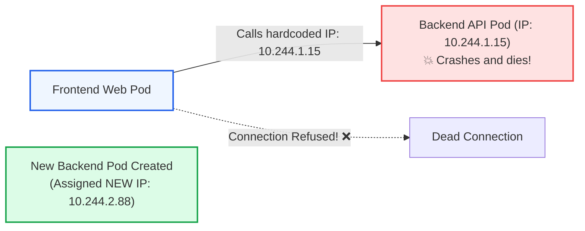
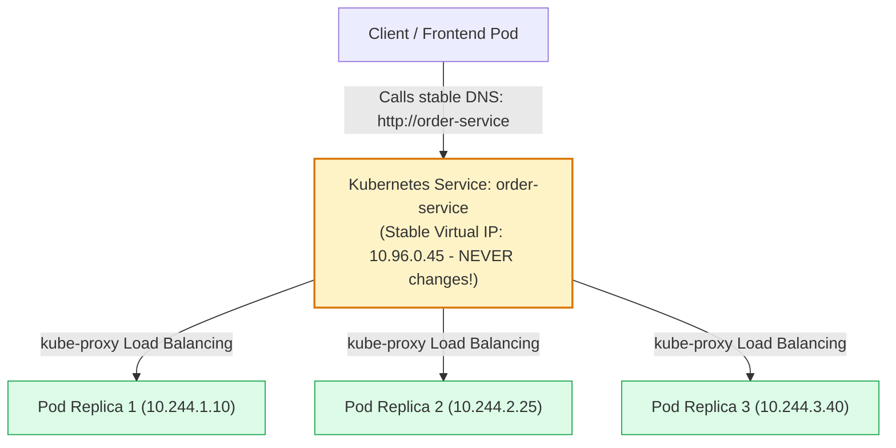
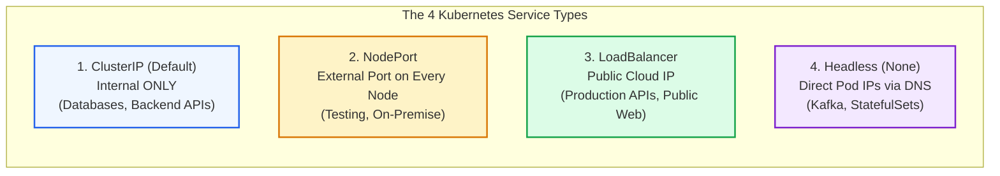
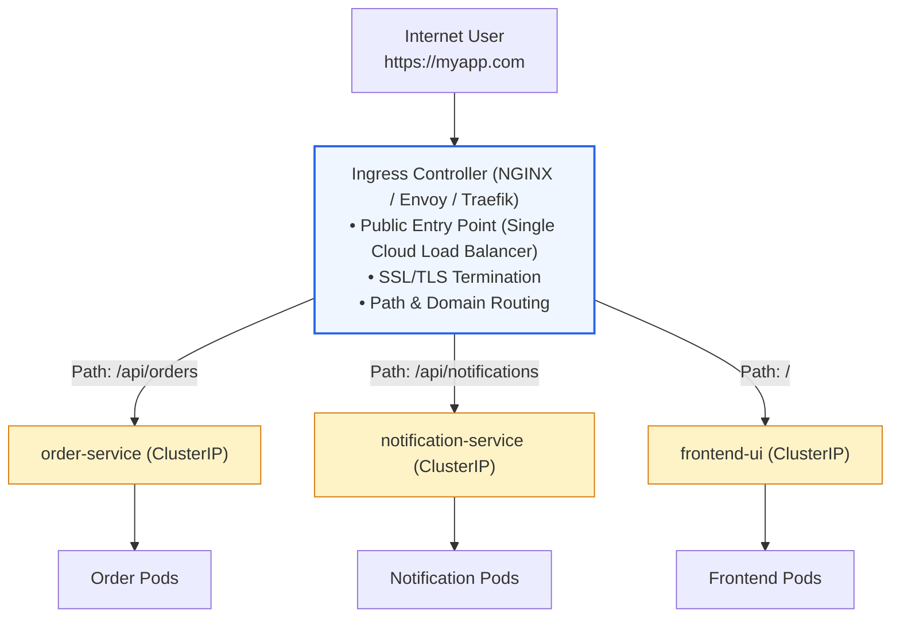

# Kubernetes: Networking, Services, Ingress & Security Policies

> **Cluster 02 — Module 03**  
> **Level**: Beginner Foundations to Production & FAANG-Level Deep Dive  
> **Key References**: TechWorld with Nana, Kubernetes Networking Docs, Ingress NGINX

---

## 🌱 0. The Beginner's Mental Model: Why Do We Need Services?

### The Ephemeral IP Problem
In Kubernetes, **Pods are mortal and ephemeral**:
- They get created, destroyed, autoscaled, and rescheduled onto different servers.
- Every time a Pod dies or is recreated during a deployment, **it receives a brand new, unpredictable IP address**.



If your frontend tried to communicate with backend Pods using direct Pod IPs, your application would break every time a Pod restarted!

---

### The Real-World Analogy: The Company Main Switchboard
*(TechWorld with Nana's Hotline Mental Model)*

- You don't give customers the personal cell phone numbers of individual customer support agents (who might go on lunch, quit, or change phone numbers).
- Instead, you give customers the **company's official toll-free hotline (**Kubernetes Service**)**.
- When a customer dials the hotline, the automated PBX switchboard (**kube-proxy**) instantly routes the call to whichever customer support agent (**healthy Pod**) is currently sitting at their desk.



> **The Golden Definition**:  
> A **Kubernetes Service** provides a **permanent, stable Virtual IP (ClusterIP) and internal DNS name** that acts as a built-in load balancer across a dynamic, changing set of Pod replicas.

---

## 📝 1. Comprehensive Study Notes: Understanding Services, Ingress & Cluster Traffic

### 1. The Fundamental Kubernetes Networking Model
Kubernetes enforces a **flat, direct-routing network model**. Every Pod in the cluster receives its own unique, private IP address from the cluster's Pod CIDR range. Under this model:
* Every Pod can communicate directly with every other Pod across any node in the cluster without requiring Network Address Translation (NAT).
* Every Node agent (`kubelet`) can communicate directly with all Pods on that node.
* The IP that a Pod sees for itself is the exact same IP that all other Pods see for it.

This flat network is established by **CNI (Container Network Interface) plugins** such as Calico, Cilium, or Flannel.

### 2. What is a Kubernetes Service? (Straightforward Definition)
A **Kubernetes Service** is an abstract resource that defines a logical set of Pods and a policy by which to access them. Because Pods are ephemeral and frequently recreated with new, dynamic IP addresses, you never point clients or other services directly at a Pod's IP. 

Instead, you create a Service with a **label selector** (e.g., `app: order-service`). Kubernetes automatically assigns this Service a static **Virtual IP (ClusterIP)** and registers an internal DNS name (`order-service.default.svc.cluster.local`) with CoreDNS. When an application sends a request to the Service's Virtual IP or DNS name, Kubernetes intercepts the network packets at the Linux kernel level and transparently load-balances them across all healthy Pods matching that label selector.

### 3. How the Four Service Types Work in Practice
* **`ClusterIP` (Internal Only - The Default):** Exposes the Service on an internal Virtual IP reachable only from *inside* the Kubernetes cluster. This is the standard choice for databases, caching layers, and private backend microservices that should never be exposed directly to the outside internet.
* **`NodePort` (Testing & On-Premise Access):** Opens a dedicated static port (within the range `30000–32767`) on **every single worker node** in the cluster. Any external traffic hitting `<NodeIP>:<NodePort>` is forwarded to the Service and load-balanced to backend Pods. This is primarily used for quick debugging or on-premise clusters lacking cloud load-balancer integrations.
* **`LoadBalancer` (Cloud-Native Production):** Designed for public-facing applications hosted on cloud providers (AWS, GCP, Azure). When created, Kubernetes talks to the cloud provider's API to automatically provision a managed cloud load balancer (e.g., AWS Network Load Balancer) with a public static IP address that routes external internet traffic into your cluster's services.
* **`Headless Service` (`clusterIP: None`):** Intentionally allocates **no Virtual IP**. Instead of load-balancing requests through `kube-proxy`, CoreDNS directly returns the individual A-records of all backing Pods. This is strictly required for stateful distributed systems like **Apache Kafka** and **Cassandra**, where client libraries must open point-to-point connections with the specific broker leading a partition.

### 4. What is an Ingress Controller? (Layer 7 Routing)
While a `LoadBalancer` Service operates at **Layer 4 (Transport / TCP)**, managing separate cloud load balancers for dozens of microservices becomes prohibitively expensive ($20–$30/month per load balancer) and cannot inspect HTTP URLs. 

An **Ingress** operates at **Layer 7 (Application / HTTP & HTTPS)**. It provides a single entry point into the cluster running behind a single cloud load balancer. The **Ingress Controller** (such as NGINX Ingress, Traefik, or Envoy) acts as a smart reverse-proxy that examines incoming HTTP request paths (e.g., `/api/orders` vs. `/api/notifications`) or domain hostnames (`orders.company.com`) and routes traffic to the appropriate internal `ClusterIP` Service. It also centralizes SSL/TLS certificate termination and rate-limiting.

### 5. NetworkPolicies: Enforcing Zero-Trust Cluster Security
By default, Kubernetes implements an open network topology: any Pod in any namespace can communicate with any other Pod. If an attacker breaches an internet-facing frontend pod, they can freely explore internal cluster networks and connect to sensitive databases.

A **NetworkPolicy** acts as a built-in stateful firewall at Layer 3 and Layer 4. By defining label-based ingress and egress rules, you enforce the **Principle of Least Privilege**: for example, declaring that the PostgreSQL database pod will accept incoming TCP traffic on port 5432 *only* if the originating pod carries the label `role: backend-api`. All other connections are dropped at the kernel packet level by the CNI plugin.

---

## ⚡ 2. Before vs. After: Kubernetes Networking & Ingress

| Feature | Before (Calling Pod IPs Directly) | After (Services & Ingress) | Why This Helps (The Impact) |
| :--- | :--- | :--- | :--- |
| **Microservice Discovery** | Tracking shifting IP addresses; service outages whenever pods roll out updates. | Fixed internal DNS: `http://order-service` handles all routing automatically. | Zero coupling to ephemeral pod IPs; seamless microservice communication. |
| **Load Balancing** | Writing custom reverse proxies (HAProxy) or external load balancers per application. | Native Layer 4 load balancing handled in the Linux kernel by `kube-proxy`. | Free, automated round-robin traffic distribution across all healthy pods. |
| **Cloud Cost & Public Exposure** | Creating an AWS Load Balancer for each of your 20 microservices ($400+/month). | **Single Ingress Controller** routes traffic to 20+ services via URL paths/subdomains. | Slashes cloud load-balancer costs by 90% and centralizes SSL/TLS certificates. |
| **Zero-Trust Security** | Any container can connect to any database port across the entire cluster. | **NetworkPolicies** enforce firewall rules (e.g. DB only allows calls from API). | Prevents lateral movement if a public frontend pod is compromised. |

---

## 🎛️ 3. The Four Service Types (Explained Simply)



### 1. `ClusterIP` (Default — Internal Only)
- **What it does**: Assigns an internal Virtual IP accessible **only inside the cluster**.
- **Use Case**: Databases, caching servers, backend microservices that should **never be touched directly by the public internet**.

### 2. `NodePort` (Testing / Development)
- **What it does**: Opens a high-numbered port (range `30000–32767`) on **every single worker node** in your cluster.
- **Use Case**: Quick manual debugging or on-premise bare-metal setups where you don't have a cloud provider load balancer.
- Anyone can access the service via: `http://<Node-Public-IP>:31000`.

### 3. `LoadBalancer` (Cloud Native Production)
- **What it does**: Integrates directly with your cloud provider (AWS, Google Cloud, Azure).
- Automatically provisions a managed external Cloud Load Balancer (AWS NLB/ALB, Google Cloud LB) with a public static IP address.

### 4. `Headless Service` (`clusterIP: None`)
- **What it does**: Allocates **NO Virtual IP**.
- When you perform a DNS query for the service name, CoreDNS returns the **actual list of individual Pod IP addresses**.
- **Why Kafka & StatefulSets Require This**: Kafka clients need to talk directly to the specific broker that acts as the leader for Partition 2 (`kafka-0` or `kafka-1`), rather than being randomly load-balanced!

---

## 🚪 4. Layer 7 Routing: What is Ingress?

### The Airport Terminal Analogy
Imagine traveling to an international airport:
- You don't build a separate highway from the city directly to each individual airplane gate.
- Everyone drives to the **Central Airport Terminal Entrance (Ingress)**.
- The terminal displays signs:
  - Passengers for Paris $\rightarrow$ Gate A (`/api/orders`)
  - Passengers for Tokyo $\rightarrow$ Gate B (`/api/payments`)



### Complete Ingress YAML Example
```yaml
apiVersion: networking.k8s.io/v1
kind: Ingress
metadata:
  name: cloudnative-ingress
  annotations:
    nginx.ingress.kubernetes.io/rewrite-target: /
spec:
  ingressClassName: nginx
  rules:
    - host: myapp.company.com
      http:
        paths:
          - path: /api/orders
            pathType: Prefix
            backend:
              service:
                name: order-service
                port:
                  number: 8081
          - path: /api/notifications
            pathType: Prefix
            backend:
              service:
                name: notification-service
                port:
                  number: 8082
```

---

## 🛡️ 5. NetworkPolicies: Zero-Trust Security for Microservices

### The Problem: Open Flat Network
By default, Kubernetes has an open network: **any Pod can send network packets to any other Pod**, even across different namespaces! 
If an attacker compromises a simple public WordPress or frontend container, they can probe and connect directly to your production MySQL or payment database.

### The Solution: NetworkPolicy
A Kubernetes **NetworkPolicy** acts like a built-in firewall. You can declare: *"The PostgreSQL database only accepts incoming TCP traffic on port 5432 from Pods labeled `app: order-service`!"*

```yaml
apiVersion: networking.k8s.io/v1
kind: NetworkPolicy
metadata:
  name: protect-database
spec:
  podSelector:
    matchLabels:
      app: postgres-db
  policyTypes:
    - Ingress
  ingress:
    - from:
        - podSelector:
            matchLabels:
              app: order-service # ONLY allow calls from order-service!
      ports:
        - protocol: TCP
          port: 5432
```

---

## 💼 6. Interview Preparation: High-Yield Questions & Answers

### Q1: "Why do we need a Kubernetes Service instead of communicating directly with Pod IPs?"
- **The Answer**:
  - *"Pods in Kubernetes are ephemeral and mortal. Whenever a pod crashes, is rescheduled, or rolls out a new release, it receives a new dynamic IP address.  
  - A Kubernetes Service provides a persistent Virtual IP (ClusterIP) and a stable CoreDNS name that never changes. It automatically abstracts away the dynamic pool of pods, using label selectors to route and load-balance traffic only to healthy pods that pass readiness probes."*

---

### Q2: "What is the difference between ClusterIP, NodePort, and LoadBalancer?"
- **The Answer**:
  - **ClusterIP**: Internal only. Reachable strictly from inside the cluster; default for backend databases and private microservices.
  - **NodePort**: Exposes the service on a static high port (`30000–32767`) on every node's external IP; primarily used for testing or on-premise clusters.
  - **LoadBalancer**: Provisions an external cloud load balancer (AWS/GCP/Azure) with a public IP that forwards traffic into the cluster; standard for production ingress.

---

### Q3: "What is the difference between an Ingress and a LoadBalancer Service?"
- **The Answer**:
  - A **LoadBalancer Service** operates at **Layer 4 (TCP/UDP)**. Each LoadBalancer Service creates a separate cloud provider load balancer instance, which is expensive and cannot inspect HTTP paths or headers.
  - An **Ingress** operates at **Layer 7 (HTTP/HTTPS)**. It acts as a smart reverse-proxy (NGINX/Envoy) running inside the cluster behind a single cloud load balancer, enabling path-based routing (`/orders` vs `/payments`), host-based routing, and centralized TLS termination across dozens of backend services.

---

### Q4: "What is a Headless Service and why do Kafka or Cassandra use it?"
- **The Answer**:
  - *"A Headless Service is created with `clusterIP: None`. It intentionally bypasses kube-proxy and allocates no Virtual IP. Instead, CoreDNS returns direct A-records pointing to the individual Pod IPs.  
  - Distributed stateful systems like Apache Kafka and Cassandra require this because client drivers need direct point-to-point connections to the specific broker leading a partition, rather than having their requests randomly distributed by a load balancer."*
