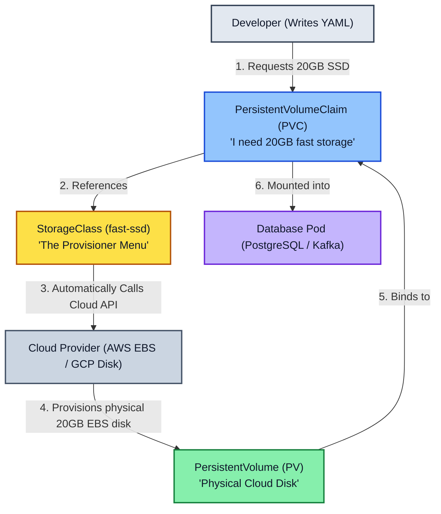
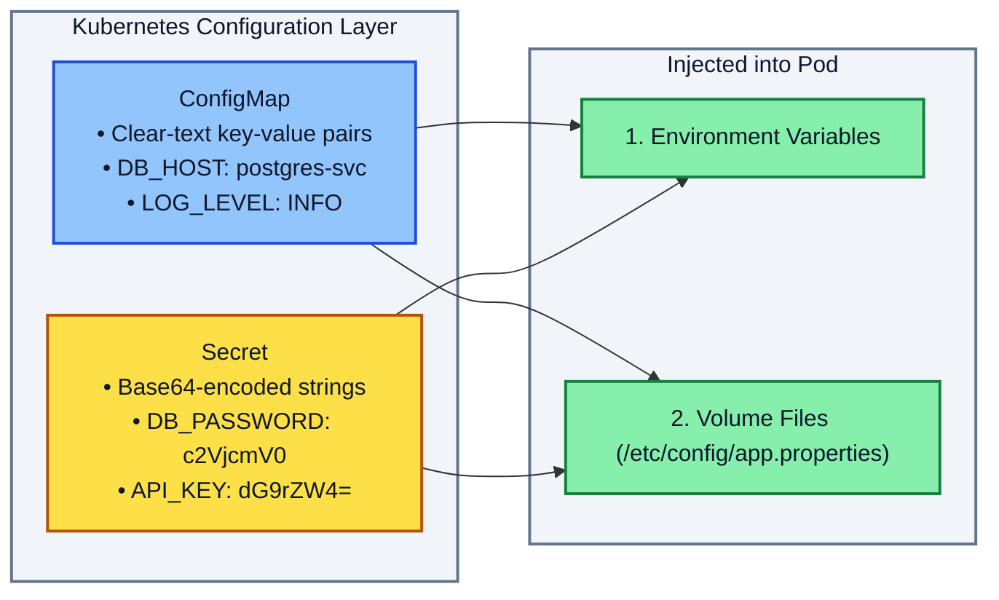
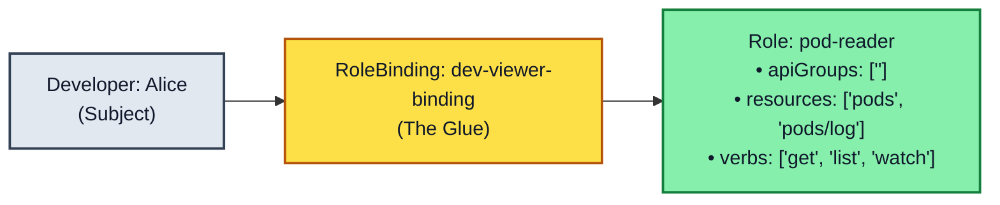

# Kubernetes: Storage, Configuration, Secrets & RBAC Security

> **Cluster 02 — Module 04**  
> **Level**: Beginner Foundations to Production & FAANG-Level Deep Dive  
> **Key References**: TechWorld with Nana, Kubernetes Storage & Security SIG

---

## 🌱 0. The Beginner's Mental Model: Decoupling State and Configuration

In modern cloud-native systems, we follow the **Twelve-Factor App** philosophy:
1. **Never hardcode configurations** or credentials inside Docker images.
2. **Never store database state inside ephemeral container filesystems**.
3. **Never give every user full root/admin permissions**.

Kubernetes provides dedicated abstractions to solve each of these challenges cleanly.

---

### The Storage Trinity: PV vs. PVC vs. StorageClass
*(TechWorld with Nana's Restaurant Menu Analogy)*

Beginners often get confused by these three storage terms. Think of ordering food at a restaurant:

| Kubernetes Concept | Real-World Restaurant Analogy | What It Actually Is |
| :--- | :--- | :--- |
| **`StorageClass`** | **The Restaurant Menu / Vending Machine** | Defines the *types* of storage available in the cloud (e.g. `fast-ssd` on AWS EBS gp3, or `cheap-hdd`). |
| **`PersistentVolumeClaim` (PVC)** | **The Customer's Order Slip** | The developer submits a request: *"I need 20GB of Fast SSD storage, please!"* |
| **`PersistentVolume` (PV)** | **The Actual Meal / Physical Disk** | The real storage volume provisioned in the cloud and attached to the cluster node. |



---

## 📝 1. Comprehensive Study Notes: Persistent Storage, Configuration & Cluster Security

### 1. Persistent Storage in Kubernetes: The CSI, PV, and PVC Pipeline
By default, any data written inside a container lives in ephemeral storage. If the Pod is terminated or rescheduled to another worker node, that data is wiped out. For stateful systems like databases and Kafka brokers, data must survive independent of the Pod's lifecycle.

**The Role of the Container Storage Interface (CSI):**
Kubernetes does not write custom storage drivers for every cloud vendor. Instead, it defines a standard gRPC specification called the **CSI (Container Storage Interface)**. Storage vendors (AWS EBS, Google Cloud Persistent Disk, Azure Disk, Ceph) implement out-of-tree CSI plugins that handle volume creation, attachment to virtual machines, and filesystem formatting.

**How Dynamic Storage Provisioning Works:**
* **`StorageClass`:**
  - A StorageClass describes the classes of storage available in the cluster and enables dynamic provisioning of PersistentVolumes via designated provisioners.
  - The cluster administrator defines one or more StorageClasses (e.g., `gp3-sc` for AWS EBS gp3 SSDs). It declares which CSI provisioner to use and parameters like volume type and IOPS.
* **`PersistentVolumeClaim` (PVC):**
  - A PersistentVolumeClaim (PVC) is a user's declarative request for storage specifying size, volume mode, and access modes that binds to a matching PersistentVolume.
  - When a developer deploys a database, they submit a PVC requesting specific capacity (e.g., `50Gi`) and an access mode (`ReadWriteOnce`).
* **Dynamic Provisioning (`PersistentVolume` / PV):**
  - A PersistentVolume (PV) is an administrator-provisioned or dynamically created piece of networked storage in the cluster whose lifecycle is independent of any individual pod.
  - The Kubernetes volume controller detects the PVC, calls the CSI driver, provisions the physical 50GB disk in the cloud, creates a **`PersistentVolume` (PV)** object representing that disk in the cluster, and binds the PVC to the PV. When the Pod starts, Kubernetes attaches the cloud disk to the worker node and mounts it directly into the container's designated folder (`/var/lib/postgresql/data`).

### 2. Externalizing Application Configuration: ConfigMaps vs. Secrets
Under the Twelve-Factor App methodology, code and configuration must be strictly separated. If you bake database hostnames, API endpoints, or credentials into a Docker image, changing a single configuration parameter requires rebuilding and redeploying the entire container image.

**ConfigMaps (For Non-Sensitive Data):**
- A ConfigMap is an API object used to store non-confidential configuration data in key-value pairs that can be consumed by pods as environment variables, command-line arguments, or volume files.
- A **ConfigMap** stores clear-text configuration parameters as key-value pairs (e.g., `DATABASE_URL=postgres-svc:5432` or `LOG_LEVEL=INFO`). ConfigMaps can be injected into Pods as individual environment variables, as command-line arguments, or mounted as configuration files inside a volume (e.g., mounting an `application.yml` file into `/config`). When you update a mounted ConfigMap, Kubernetes updates the file inside the container dynamically without restarting the Pod.

**Secrets (For Sensitive Data):**
- A Secret is an API object intended to hold a small amount of sensitive data such as passwords, tokens, or keys to prevent accidental exposure in application code or images.
- A **Secret** stores confidential information such as passwords, API tokens, OAuth keys, and TLS certificates. Secrets are injected similarly to ConfigMaps (as environment variables or mounted files), but with a critical security difference: mounted Secrets are backed by the host's in-memory RAM filesystem (`tmpfs`), ensuring that sensitive credentials are never written to physical disk.

*The Base64 Reality Check:* By default, Secrets stored in `etcd` are only **Base64-encoded**, which offers zero cryptographic protection. In enterprise production, clusters must enable **KMS Envelope Encryption** (where the `kube-apiserver` encrypts secrets with keys managed by AWS KMS or HashiCorp Vault before saving them to `etcd`).

### 3. Securing the Cluster: Role-Based Access Control (RBAC)
Kubernetes exposes a massive REST API. Without access control, any user or compromised container could query secrets, delete deployments, or take over the cluster. **RBAC** enforces fine-grained authorization using four core primitives:
* **The "What" (Permissions):**
  - A Role contains rules that represent a set of permissions scoped strictly within a single specific Kubernetes namespace.
  - A ClusterRole is a non-namespaced resource that defines permissions across the entire cluster, covering cluster-scoped resources as well as namespaced resources cluster-wide.
  - A **`Role`** defines allowed actions within a specific namespace (e.g., permission to `get`, `list`, and `watch` pods in the `development` namespace). A **`ClusterRole`** defines permissions that apply cluster-wide (e.g., managing Nodes, PersistentVolumes, or reading pods across all namespaces).
* **The "Who" (Subjects):** The entity requesting access—a human user, a developer group, or a **`ServiceAccount`** used by an automated pod or CI/CD runner.
* **The "Glue" (Bindings):**
  - A RoleBinding grants the permissions defined in a Role to a user, group, or service account within a specific namespace.
  - A **`RoleBinding`** attaches a Role to a Subject within a single namespace. A **`ClusterRoleBinding`** grants cluster-wide privileges to a Subject. Following the **Principle of Least Privilege**, engineers and applications should only receive the minimum permissions necessary to perform their work.

---

## ⚡ 2. Before vs. After: Storage & Configuration

| Feature | Before (Manual / Hardcoded) | After (Kubernetes Native) | Why This Helps (The Impact) |
| :--- | :--- | :--- | :--- |
| **Database Storage Provisioning** | Sysadmin manually logs into AWS console $\rightarrow$ creates EBS volume $\rightarrow$ writes custom mount scripts $\rightarrow$ binds to VM. | **Dynamic Storage Provisioning**: Creating a PVC automatically creates the cloud disk and attaches it in seconds! | Developers get on-demand storage without needing AWS root credentials. |
| **Application Configuration** | Hardcoding database URLs and port numbers inside the Docker image. Must rebuild image to change a port! | **ConfigMaps**: Injected dynamically at runtime as environment variables or mounted config files. | One single Docker image runs in Dev, Staging, and Production with different configs. |
| **Sensitive Credentials** | Committing passwords and API keys into GitHub or Dockerfiles. | **Secrets & KMS**: Injected into memory via `tmpfs` mounts; encrypted at rest via AWS KMS / Vault. | Prevents credential leaks in git history and image registries. |
| **Cluster Access & Security** | Sharing a single `admin.kubeconfig` file with all 20 developers on the engineering team. | **RBAC (Role-Based Access Control)**: Fine-grained permissions (e.g. Interns can only view logs in dev namespace). | Enforces least-privilege security; eliminates accidental cluster deletion. |

---

## 💾 3. Storage Deep Dive: Access Modes & Binding Lifecycle

### Storage Access Modes
When creating a PVC, you must specify how nodes can access the disk:

1. **`ReadWriteOnce` (RWO)**:
   - Can be mounted as read-write by a **single node at a time**.
   - *Standard for block storage*: AWS EBS, Google Persistent Disk, Azure Disk.
   - *Best for*: Single-instance databases (PostgreSQL, MySQL, Kafka broker).
2. **`ReadOnlyMany` (ROX)**:
   - Mounted read-only by multiple nodes simultaneously. Great for shared static assets.
3. **`ReadWriteMany` (RWX)**:
   - Can be mounted as read-write by **multiple nodes concurrently**.
   - *Requires network file systems*: NFS, AWS EFS, CephFS, Google Filestore.
   - *Best for*: Content Management Systems (WordPress uploads shared across 5 pods).

### Volume Binding Modes: `Immediate` vs. `WaitForFirstConsumer`
- **`Immediate` (Pitfall!)**: Provisions the EBS volume in AWS availability zone `us-east-1a` the instant the PVC is created. Later, if the Pod is scheduled onto a worker node in `us-east-1b`, the disk cannot attach across zones, causing a crash!
- **`WaitForFirstConsumer` (Production Best Practice)**: Delays creating the cloud disk until the Pod is actually scheduled onto a node. This guarantees the disk is created in the exact same Availability Zone as the Pod!

---

## 🔑 4. ConfigMaps vs. Secrets: Managing Configuration Cleanly



### Critical Security Alert: Base64 is NOT Encryption!
> [!WARNING]
> By default, Kubernetes Secrets are merely **Base64-encoded plain text** stored inside `etcd`. Anyone with read access can decode them:
> ```bash
> echo "c2VjcmV0MTIz" | base64 --decode # Outputs: secret123
> ```
> In production, you must:
> 1. Enable **KMS Envelope Encryption** in the API Server (encrypts secrets before writing to `etcd`).
> 2. Or use external secret managers like **HashiCorp Vault** or the **External Secrets Operator (ESO)** to fetch secrets dynamically.

---

## 🛡️ 5. RBAC: Role-Based Access Control

### The Keycard Badge Analogy
Think of building security in an office tower:
- **`Role` / `ClusterRole` (The Permission Slip)**: Defines *what actions are allowed*.
  - *"Can read documents in Room 302, but cannot edit or delete them."*
- **Subject (The Person / Bot)**: The User or `ServiceAccount` requesting access.
- **`RoleBinding` / `ClusterRoleBinding` (The Keycard Assignment)**: Binds the permission slip to the specific person.



- **Role vs. ClusterRole**:
  - `Role`: Applies **only to a single namespace** (e.g. `development`).
  - `ClusterRole`: Applies **cluster-wide** across all namespaces (e.g. nodes, storage classes, persistent volumes).

---

## 💼 6. Interview Preparation: High-Yield Questions & Answers

### Q1: "Explain the difference between a PV, a PVC, and a StorageClass."
- **The Answer**:
  - *"A **StorageClass** defines the storage provisioner and hardware profile (e.g., AWS gp3 SSD vs standard HDD).  
  - A **PersistentVolumeClaim (PVC)** is a developer's request for storage specifying capacity and access mode (e.g., '10Gi with ReadWriteOnce').  
  - A **PersistentVolume (PV)** is the actual underlying storage resource in the cluster that fulfills the claim. In dynamic provisioning, when a PVC is applied, the StorageClass automatically creates the physical disk in the cloud, registers it as a PV, and binds it to the PVC."*

---

### Q2: "What is the difference between RWO, ROX, and RWX access modes?"
- **The Answer**:
  - **RWO (ReadWriteOnce)**: Can be mounted as read-write by a **single cluster node**. (Standard for block storage like AWS EBS).
  - **ROX (ReadOnlyMany)**: Can be mounted as read-only by **multiple cluster nodes** simultaneously.
  - **RWX (ReadWriteMany)**: Can be mounted as read-write by **multiple cluster nodes** concurrently. Requires a shared network filesystem like NFS or AWS EFS.

---

### Q3: "Are Kubernetes Secrets encrypted by default?"
- **The Answer**:
  - *"No. By default, Secrets are only **Base64-encoded**, not encrypted. They are stored as plain text inside `etcd`.  
  - To secure secrets in production, we must enable **Encryption at Rest** in the `kube-apiserver` using an external Key Management Service (KMS) provider (such as AWS KMS, GCP KMS, or Vault), or leverage tools like the External Secrets Operator to pull secrets directly from an external enterprise secret store into ephemeral pod memory."*

---

### Q4: "What is the difference between a Role and a ClusterRole?"
- **The Answer**:
  - A **Role** is namespaced. It grants permissions within a specific namespace (e.g., listing pods only inside the `staging` namespace).
  - A **ClusterRole** is non-namespaced. It can grant permissions to cluster-scoped resources (like Nodes, StorageClasses, and Namespaces), or grant access to namespaced resources across all namespaces in the cluster.
