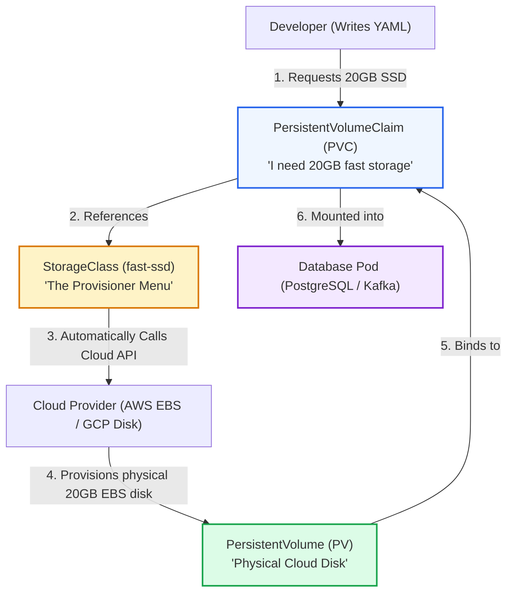
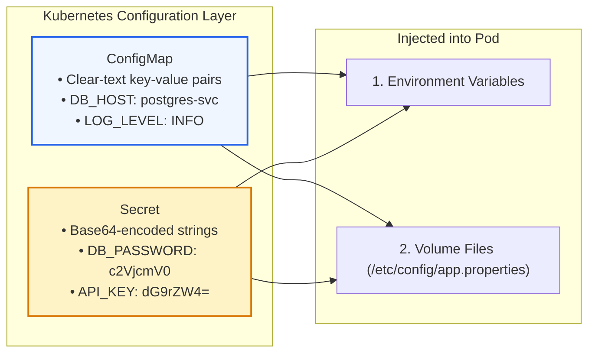
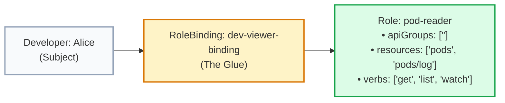

# Kubernetes: Storage, Configuration, Secrets & RBAC Security

> **Cluster 02 — Module 04**  
> **Level**: Beginner Foundations to Production & FAANG-Level Deep Dive  
> **Key References**: TechWorld with Nana, Kubernetes Storage & Security SIG

---

## 🌱 0. The Beginner's Mental Model: Decoupling State and Configuration

In modern cloud-native systems, we follow the **Twelve-Factor App** philosophy:
1. **Never hardcode configurations** or credentials inside Docker images.
2. **Never store database state inside ephemeral container filesystems**.
3. **Never give every user full root/admin permissions**.

Kubernetes provides dedicated abstractions to solve each of these challenges cleanly.

---

### The Storage Trinity: PV vs. PVC vs. StorageClass
*(TechWorld with Nana's Restaurant Menu Analogy)*

Beginners often get confused by these three storage terms. Think of ordering food at a restaurant:

| Kubernetes Concept | Real-World Restaurant Analogy | What It Actually Is |
| :--- | :--- | :--- |
| **`StorageClass`** | **The Restaurant Menu / Vending Machine** | Defines the *types* of storage available in the cloud (e.g. `fast-ssd` on AWS EBS gp3, or `cheap-hdd`). |
| **`PersistentVolumeClaim` (PVC)** | **The Customer's Order Slip** | The developer submits a request: *"I need 20GB of Fast SSD storage, please!"* |
| **`PersistentVolume` (PV)** | **The Actual Meal / Physical Disk** | The real storage volume provisioned in the cloud and attached to the cluster node. |



---

## ⚡ 1. Before vs. After: Storage & Configuration

| Feature | Before (Manual / Hardcoded) | After (Kubernetes Native) | Why This Helps (The Impact) |
| :--- | :--- | :--- | :--- |
| **Database Storage Provisioning** | Sysadmin manually logs into AWS console $\rightarrow$ creates EBS volume $\rightarrow$ writes custom mount scripts $\rightarrow$ binds to VM. | **Dynamic Storage Provisioning**: Creating a PVC automatically creates the cloud disk and attaches it in seconds! | Developers get on-demand storage without needing AWS root credentials. |
| **Application Configuration** | Hardcoding database URLs and port numbers inside the Docker image. Must rebuild image to change a port! | **ConfigMaps**: Injected dynamically at runtime as environment variables or mounted config files. | One single Docker image runs in Dev, Staging, and Production with different configs. |
| **Sensitive Credentials** | Committing passwords and API keys into GitHub or Dockerfiles. | **Secrets & KMS**: Injected into memory via `tmpfs` mounts; encrypted at rest via AWS KMS / Vault. | Prevents credential leaks in git history and image registries. |
| **Cluster Access & Security** | Sharing a single `admin.kubeconfig` file with all 20 developers on the engineering team. | **RBAC (Role-Based Access Control)**: Fine-grained permissions (e.g. Interns can only view logs in dev namespace). | Enforces least-privilege security; eliminates accidental cluster deletion. |

---

## 💾 2. Storage Deep Dive: Access Modes & Binding Lifecycle

### Storage Access Modes
When creating a PVC, you must specify how nodes can access the disk:

1. **`ReadWriteOnce` (RWO)**:
   - Can be mounted as read-write by a **single node at a time**.
   - *Standard for block storage*: AWS EBS, Google Persistent Disk, Azure Disk.
   - *Best for*: Single-instance databases (PostgreSQL, MySQL, Kafka broker).
2. **`ReadOnlyMany` (ROX)**:
   - Mounted read-only by multiple nodes simultaneously. Great for shared static assets.
3. **`ReadWriteMany` (RWX)**:
   - Can be mounted as read-write by **multiple nodes concurrently**.
   - *Requires network file systems*: NFS, AWS EFS, CephFS, Google Filestore.
   - *Best for*: Content Management Systems (WordPress uploads shared across 5 pods).

### Volume Binding Modes: `Immediate` vs. `WaitForFirstConsumer`
- **`Immediate` (Pitfall!)**: Provisions the EBS volume in AWS availability zone `us-east-1a` the instant the PVC is created. Later, if the Pod is scheduled onto a worker node in `us-east-1b`, the disk cannot attach across zones, causing a crash!
- **`WaitForFirstConsumer` (Production Best Practice)**: Delays creating the cloud disk until the Pod is actually scheduled onto a node. This guarantees the disk is created in the exact same Availability Zone as the Pod!

---

## 🔑 3. ConfigMaps vs. Secrets: Managing Configuration Cleanly



### Critical Security Alert: Base64 is NOT Encryption!
> [!WARNING]
> By default, Kubernetes Secrets are merely **Base64-encoded plain text** stored inside `etcd`. Anyone with read access can decode them:
> ```bash
> echo "c2VjcmV0MTIz" | base64 --decode # Outputs: secret123
> ```
> In production, you must:
> 1. Enable **KMS Envelope Encryption** in the API Server (encrypts secrets before writing to `etcd`).
> 2. Or use external secret managers like **HashiCorp Vault** or the **External Secrets Operator (ESO)** to fetch secrets dynamically.

---

## 🛡️ 4. RBAC: Role-Based Access Control

### The Keycard Badge Analogy
Think of building security in an office tower:
- **`Role` / `ClusterRole` (The Permission Slip)**: Defines *what actions are allowed*.
  - *"Can read documents in Room 302, but cannot edit or delete them."*
- **Subject (The Person / Bot)**: The User or `ServiceAccount` requesting access.
- **`RoleBinding` / `ClusterRoleBinding` (The Keycard Assignment)**: Binds the permission slip to the specific person.



- **Role vs. ClusterRole**:
  - `Role`: Applies **only to a single namespace** (e.g. `development`).
  - `ClusterRole`: Applies **cluster-wide** across all namespaces (e.g. nodes, storage classes, persistent volumes).

---

## 💼 5. Interview Preparation: High-Yield Questions & Answers

### Q1: "Explain the difference between a PV, a PVC, and a StorageClass."
- **The Answer**:
  - *"A **StorageClass** defines the storage provisioner and hardware profile (e.g., AWS gp3 SSD vs standard HDD).  
  - A **PersistentVolumeClaim (PVC)** is a developer's request for storage specifying capacity and access mode (e.g., '10Gi with ReadWriteOnce').  
  - A **PersistentVolume (PV)** is the actual underlying storage resource in the cluster that fulfills the claim. In dynamic provisioning, when a PVC is applied, the StorageClass automatically creates the physical disk in the cloud, registers it as a PV, and binds it to the PVC."*

---

### Q2: "What is the difference between RWO, ROX, and RWX access modes?"
- **The Answer**:
  - **RWO (ReadWriteOnce)**: Can be mounted as read-write by a **single cluster node**. (Standard for block storage like AWS EBS).
  - **ROX (ReadOnlyMany)**: Can be mounted as read-only by **multiple cluster nodes** simultaneously.
  - **RWX (ReadWriteMany)**: Can be mounted as read-write by **multiple cluster nodes** concurrently. Requires a shared network filesystem like NFS or AWS EFS.

---

### Q3: "Are Kubernetes Secrets encrypted by default?"
- **The Answer**:
  - *"No. By default, Secrets are only **Base64-encoded**, not encrypted. They are stored as plain text inside `etcd`.  
  - To secure secrets in production, we must enable **Encryption at Rest** in the `kube-apiserver` using an external Key Management Service (KMS) provider (such as AWS KMS, GCP KMS, or Vault), or leverage tools like the External Secrets Operator to pull secrets directly from an external enterprise secret store into ephemeral pod memory."*

---

### Q4: "What is the difference between a Role and a ClusterRole?"
- **The Answer**:
  - A **Role** is namespaced. It grants permissions within a specific namespace (e.g., listing pods only inside the `staging` namespace).
  - A **ClusterRole** is non-namespaced. It can grant permissions to cluster-scoped resources (like Nodes, StorageClasses, and Namespaces), or grant access to namespaced resources across all namespaces in the cluster.
