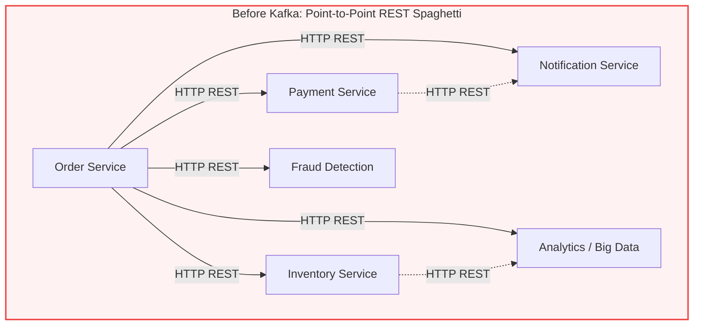
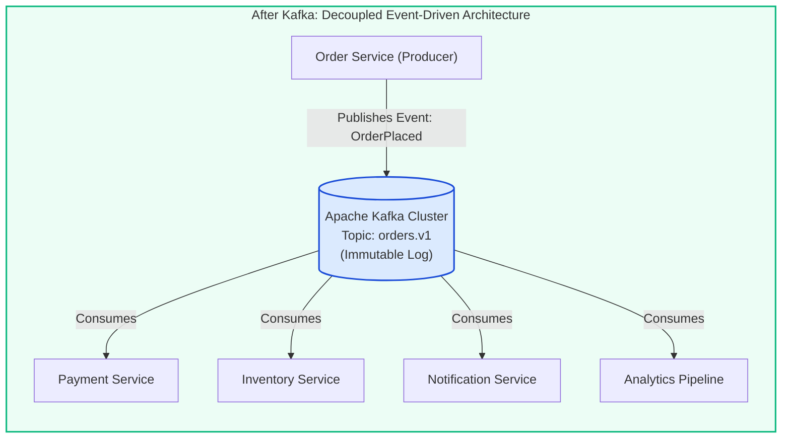
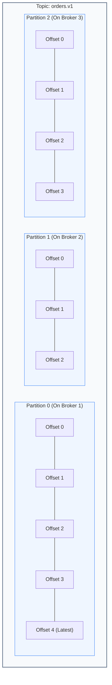
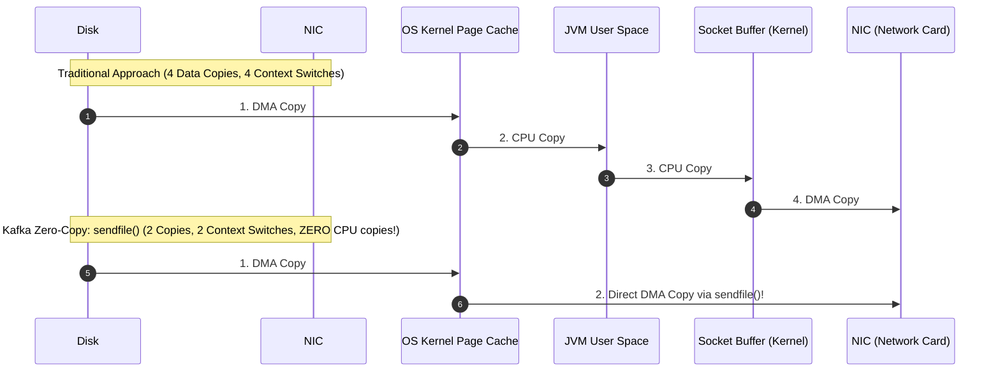
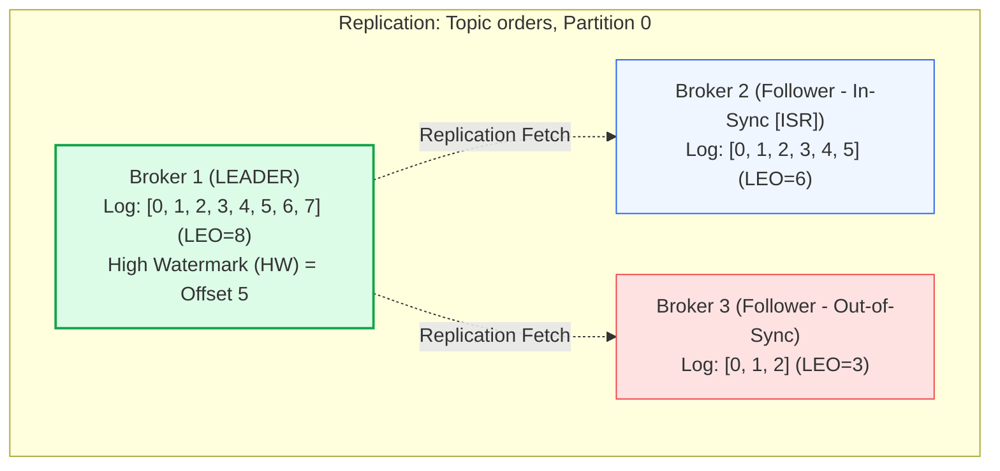

# Apache Kafka: Architecture, Storage & Commit Log Internals

> **Cluster 03 — Module 01**  
> **Level**: Beginner Foundations to Production & FAANG-Level Deep Dive  
> **Key References**: TechWorld with Nana, ByteByteGo, Jay Kreps (Kafka Co-founder), Confluent Docs

---

## 🌱 0. The Beginner's Mental Model: Why Do We Need Apache Kafka?

### The Spaghetti Architecture Nightmare
Imagine building an e-commerce platform. When a customer places an order:
- Order Service makes a synchronous HTTP REST call to Payment Service.
- Payment Service calls Inventory Service.
- Inventory Service calls Email/SMS Notification Service.
- All three send data to the Analytics Data Warehouse and Fraud Detection Service.

### What Happens in Production?
1. **Cascading Failures**: If the Notification Service slows down or crashes, the Order Service's HTTP connection times out, and the entire checkout fails for the customer!
2. **Tight Coupling**: Adding a new Recommendations engine requires modifying the Order Service code to call yet another HTTP API.
3. **Data Loss During Downtime**: If the Analytics database is down for maintenance, all real-time events sent during that window are permanently lost.

---

### The Real-World Solution: The Central Event Nervous System
*(TechWorld with Nana & ByteByteGo Architectural Pattern)*

Instead of services calling each other directly, we introduce **Apache Kafka as a Central Event Bus**:
- Order Service simply writes a single event: `OrderPlaced { id: 101, amount: $50 }` into Kafka, and its job is finished in 2 milliseconds!
- Payment Service, Inventory Service, Notification Service, and Analytics independently read the event from Kafka at their own pace.
- If the Notification Service crashes for 2 hours, **no customer transactions are blocked**. When the Notification Service comes back online, it resumes reading right where it left off!

---

### Kafka vs. Traditional Message Queues (RabbitMQ): The Ledger Analogy
Many beginners ask: *"Isn't Kafka just another message queue like RabbitMQ or ActiveMQ?"*  
**No! They operate on fundamentally different paradigms:**

| Feature | Traditional Queue (RabbitMQ) | Apache Kafka (Distributed Commit Log) |
| :--- | :--- | :--- |
| **Real-World Analogy** | **Disposable Post-It Notes**: A task is written on a post-it note. A worker takes it off the board, executes it, and throws it in the trash bin. | **The Sacred Bank Ledger / Chronicle Book**: Transactions are recorded in permanent ink in an append-only ledger. The ink never disappears! |
| **Message Lifetime** | **Transient**: Messages are deleted immediately after the consumer acknowledges them. | **Persistent**: Messages stay on disk for days, weeks, or indefinitely (retention period). |
| **Multiple Consumers** | Competing consumers: Only **one** consumer gets each message. | Independent consumer groups: 10 different systems can read the **exact same** message! |
| **Historical Replay** | **Impossible**: Once read, the data is gone forever. | **Trivial**: Consumers can rewind their bookmark (offset) and re-process last month's events! |
| **Throughput Capacity** | 10,000 to 50,000 messages/sec. | **Millions of messages per second**. |

---

## 📖 1. Core Vocabulary (Plain-English Definitions)

- **Event / Record**: A piece of data recording something that happened (Key, Value, Timestamp, Headers).
- **Producer**: The application that creates and sends events to Kafka.
- **Consumer**: The application that reads and processes events from Kafka.
- **Broker**: A single Kafka server. A Kafka cluster is a group of brokers working together.
- **Topic**: A named channel or category where records are published (e.g., `orders`, `user-signups`).
- **Partition**: Topics are split into **Partitions** (shards) for horizontal scalability and parallel processing.
- **Offset**: A unique sequential integer assigned to each record within a partition. It acts as a **bookmark** indicating which message a consumer has read up to.

---

## ⚡ 2. Before vs. After: Why Organizations Adopt Kafka

| Metric / Scenario | Before Kafka (Synchronous REST & Queues) | After Kafka (Distributed Streaming) | Why This Helps (The Impact) |
| :--- | :--- | :--- | :--- |
| **System Coupling** | Tight coupling; sender must know the IP/URL of every receiver. | Complete decoupling; sender only knows the Kafka topic. | Add new microservices anytime without altering producer code. |
| **System Outages** | If downstream service crashes, upstream calls fail and user is blocked. | Events buffer safely in Kafka; downstream catches up when restored. | High fault tolerance and 100% resilient user checkouts. |
| **Data Replay & Auditing** | Cannot recalculate analytics if business logic had a bug. | Rewind consumer offset to `0` and re-run entire historical dataset. | Fix bugs and re-process months of historical data with zero data loss. |
| **High Traffic Throughput** | Traditional databases and queues choke on 100k events/sec. | Scales to millions of events per second with sub-10ms latency. | Handles massive global scale (Uber ride tracks, LinkedIn feeds). |

---

## 🚀 3. Why is Kafka Insanely Fast? (The 3 Engineering Secrets)

Beginners often wonder: *"If Kafka writes every single message to physical disk, how can it process millions of events per second faster than in-memory queues?"*

Kafka achieves this through three brilliant low-level optimizations:

### Secret 1: Sequential Disk I/O vs. Random RAM Access
- Disks are only slow when performing **random seeks** (jumping the magnetic head or flash memory blocks across different locations).
- When appending sequentially to the end of a file (**Sequential Disk Write**), modern SSDs and HDDs achieve speeds of 300 to 600 MB/s—nearly matching the speed of random RAM access!
- Kafka log files are strictly **append-only**. It never updates or deletes records in place.

### Secret 2: Linux OS Page Cache
- Kafka avoids application-level caching inside the Java JVM Heap.
- Instead, it lets the Linux kernel manage memory via the **Page Cache**. All incoming writes go directly into OS memory buffers.
- When real-time consumers read data, the kernel serves it straight from the Page Cache in RAM without touching physical disk or triggering JVM Garbage Collection pauses!

### Secret 3: Linux Zero-Copy (`sendfile()` System Call)
In traditional web servers, sending data from disk to network requires 4 context switches and 4 memory copies:

By using the Linux `sendfile()` system call, Kafka bypasses user space entirely. Data moves directly from the OS Page Cache to the Network Card, reducing CPU load to near zero!

---

## 🛡️ 4. Replication, High Watermark & Fault Tolerance

Every partition in Kafka has:
- **One Leader Broker**: Handles all writes and reads.
- **Zero or More Follower Brokers**: Passively replicate the leader's commit log.

### The Three Critical Acronyms:
1. **LEO (Log End Offset)**: The offset of the next message to be written.
2. **ISR (In-Sync Replicas)**: The set of broker replicas that are caught up with the leader.
3. **HW (High Watermark)**: The highest offset that has been replicated to **all members of the ISR**.
   > **The Visibility Guarantee**: Consumers can **only read up to the High Watermark**. Uncommitted messages past the HW are invisible to consumers. If the leader broker dies, the new leader is guaranteed to have all committed messages!

---

## 💼 5. Interview Preparation: High-Yield Questions & Answers

### Q1: "Explain Apache Kafka in 60 seconds to an interviewer."
- **The Answer**:
  - *"Apache Kafka is a distributed, horizontally scalable, event streaming platform based on an append-only commit log.  
  - Rather than transient message queues that delete records upon receipt, Kafka acts as an immutable distributed event store where producers publish records to partitioned topics, and independent consumer groups read records by maintaining their own sequential offsets.  
  - Kafka achieves extreme throughput via sequential disk I/O, OS Page Cache utilization, and Linux Zero-Copy data transfers."*

---

### Q2: "How is Kafka different from RabbitMQ?"
- **The Answer**:
  - **RabbitMQ** is a traditional message broker designed for smart broker, dumb consumer workflows. Messages are transient and deleted once consumed. It does not support historical replay and is optimized for complex routing (exchanges) with moderate throughput.
  - **Kafka** is a distributed append-only log designed for dumb broker, smart consumer workflows. Messages persist on disk according to time or size retention policies. Multiple consumer groups can independently read and replay historical events at millions of messages per second.

---

### Q3: "Why is Kafka so fast despite persisting to disk?"
- **The Answer**:
  - *"Kafka achieves high throughput through three architectural pillars:  
    1. **Sequential Disk I/O**: Kafka only performs sequential appends and sequential reads, matching random RAM speeds.  
    2. **Linux Page Cache**: Kafka leverages the OS kernel's page cache instead of JVM heap memory, avoiding Garbage Collection pauses and serving reads directly from RAM.  
    3. **Zero-Copy Optimization**: Kafka uses the Linux `sendfile()` system call to transfer data directly from the OS page cache to the Network Interface Card (NIC), bypassing CPU user-space copies entirely."*

---

### Q4: "What is an Offset and who tracks it?"
- **The Answer**:
  - *"An Offset is a monotonically increasing 64-bit integer assigned to every message within a partition. It represents the exact physical position of that message in the commit log.  
  - Consumers track their progress by committing their offset to an internal Kafka topic called `__consumer_offsets`. This ensures that if a consumer crashes and restarts, it resumes reading from its last committed offset."*
