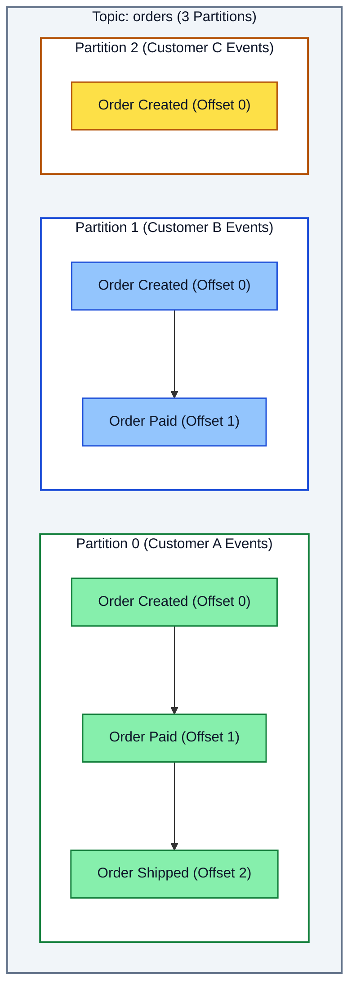
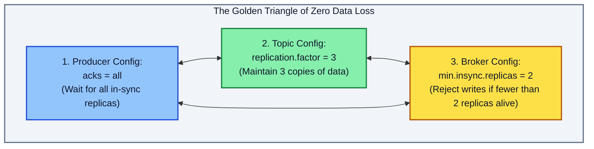
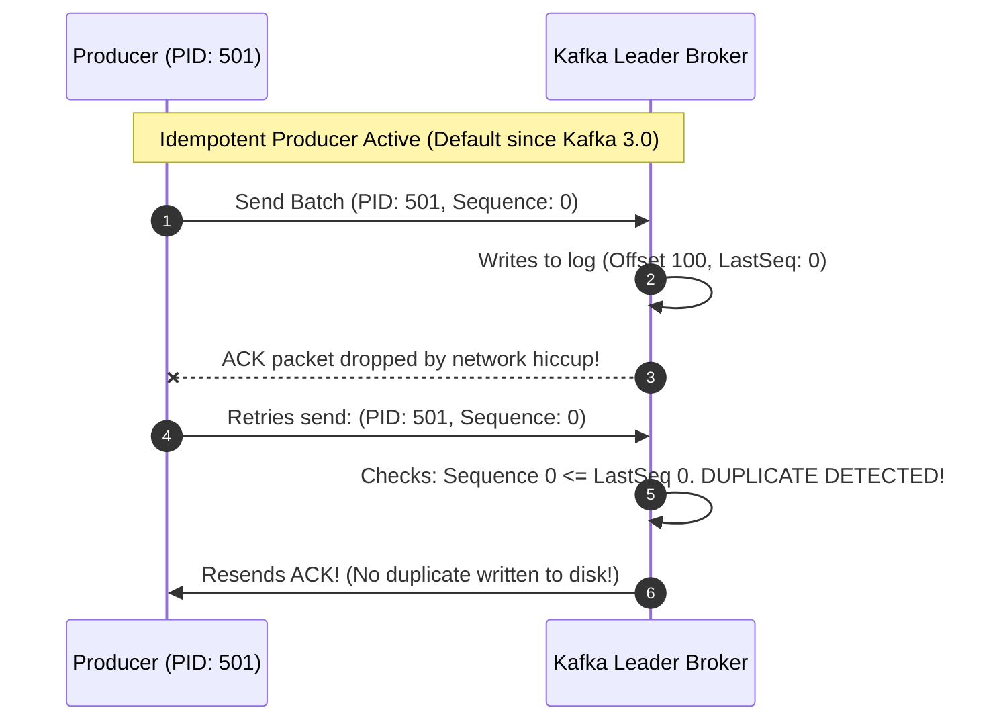

# Kafka: Producer Internals, Delivery Semantics & Zero Data Loss

> **Cluster 03 — Module 02**  
> **Level**: Beginner Foundations to Production & FAANG-Level Deep Dive  
> **Key References**: TechWorld with Nana, ByteByteGo, Kafka Client Architecture (KIP-98, KIP-480)

---

## 🌱 0. The Beginner's Mental Model: How Kafka Producers Work

### The Question: What Happens When You Call `producer.send()`?
Beginners often assume calling `producer.send("Hello")` immediately opens an HTTP or TCP socket, pushes the message to the server, and waits for a reply.  
**That is NOT how Kafka works.**

Kafka is built for extreme throughput (hundreds of thousands of messages per second). If every single message made an individual network call, the network card would saturate with TCP overhead.

---

### The Real-World Analogy: The School Bus & Postal Mail
*(TechWorld with Nana & ByteByteGo Mental Model)*

1. **The School Bus Analogy (`batch.size` & `linger.ms`)**:
   - Imagine a school bus picking up students.
   - If the bus driver leaves the instant one single child steps on board (`linger.ms = 0`), you would need 50 buses driving down the highway at once, creating a massive traffic jam!
   - Instead, the bus driver waits for **5 milliseconds** (`linger.ms = 5`). In those 5 milliseconds, 40 kids board the bus (`batch.size = 64KB`). The bus drives once!
   - Result: 90% less network overhead and massive throughput gains.

```mermaid
flowchart LR
    Record1["Event 1"] --> Acc["RecordAccumulator (The Bus Stop)\nBuffers records into batches"]
    Record2["Event 2"] --> Acc
    Record3["Event 3"] --> Acc

    Acc -->|Bus departs when batch.size (64KB) full\nOR linger.ms (10ms) expires| Sender["Background Sender Thread\nTransmits single TCP batch"]
    Sender --> Broker["Kafka Broker Leader"]

    style Record1 fill:#e2e8f0,stroke:#334155,stroke-width:2px,color:#0f172a
    style Record2 fill:#e2e8f0,stroke:#334155,stroke-width:2px,color:#0f172a
    style Record3 fill:#e2e8f0,stroke:#334155,stroke-width:2px,color:#0f172a
    style Acc fill:#93c5fd,stroke:#1d4ed8,stroke-width:2px,color:#0f172a
    style Sender fill:#fde047,stroke:#b45309,stroke-width:2px,color:#0f172a
    style Broker fill:#86efac,stroke:#15803d,stroke-width:2px,color:#0f172a
```

2. **The Postal Delivery Analogy (`acks` = 0, 1, all)**:
   How certain do you want to be that your letter was received?
   - **`acks=0` (Postcard / Fire & Forget)**: You drop a postcard in a public mailbox and walk away. If it rains or gets lost, you have no idea. Ultra-fast, zero confirmation, high risk of data loss.
   - **`acks=1` (Standard Package)**: You hand the parcel to the local post office clerk. The clerk stamps it and gives you a receipt. But if that post office building catches fire before forwarding it to other branches, the package is lost.
   - **`acks=all` (Certified Bank Vault Courier)**: The package is copied and securely verified at multiple branch bank vaults before you get your receipt. 100% guaranteed delivery!

---

## 📝 1. Comprehensive Study Notes: Producer Mechanics, Delivery Guarantees & Zero Data Loss

### What is a Kafka Producer? (Straightforward Definition)
A **Kafka Producer** is a client application or library responsible for publishing data into Apache Kafka topics. It serializes application objects into raw byte streams, assigns them to appropriate topic partitions, groups them into compressed batches, and transmits them over persistent TCP connections to Kafka partition leader brokers.

Publishing to Kafka is fundamentally asynchronous and decoupled. When an application calls `producer.send()`, the thread does not block waiting for the message to travel across the network and reach disk; instead, the record is placed into an internal high-speed memory buffer, and a future/callback is returned immediately.

### What Happens Behind the Scenes During `producer.send()`?
> **Book Definitions**:
> - *ProducerRecord*: A ProducerRecord is an object representing an individual key-value pair, target topic, optional partition number, timestamp, and metadata headers to be published to Kafka.
> - *RecordAccumulator*: The RecordAccumulator is an in-memory client buffer pool that groups newly produced records into batches segmented by topic-partition to optimize network I/O throughput.
> - *batch.size*: batch.size is a producer configuration setting that defines the maximum memory threshold in bytes allocated for batching records destined for a single partition.
> - *linger.ms*: linger.ms is an artificial producer latency threshold in milliseconds that delays sending to allow additional records to accumulate into the current batch.
> - *acks*: acks is a producer setting that controls the number of partition broker acknowledgments required before considering an append request complete.
> - *Idempotent Producer*: An Idempotent Producer is a Kafka producer mode that assigns producer IDs and monotonic sequence numbers to ensure exactly-once message logging per partition across transient network retries.

When your code executes `producer.send(new ProducerRecord<>("orders", customerId, orderJson))`, Kafka's internal pipeline executes four sequential phases:
1. **Serialization:** Kafka only stores raw byte arrays. The producer runs configured serializers (such as `StringSerializer`, `JsonSerializer`, or `KafkaAvroSerializer`) to convert your Java/Python objects into binary bytes.
2. **Partition Selection:** If the message has a key (`customerId`), Kafka computes a 32-bit Murmur2 hash of that key: `abs(Murmur2(key)) % num_partitions`. This ensures that all events for that specific customer are guaranteed to land on the exact same partition in chronological order. If no key is provided, modern Kafka uses the **Sticky Partitioner** to pack messages into the current active partition batch until full before rotating to the next.
3. **Accumulation in Memory Buffers (`RecordAccumulator`):** The serialized record is not sent to the network immediately. It enters an in-memory queue called the **`RecordAccumulator`**, which groups records destined for the same topic-partition into a **`ProducerBatch`**.
4. **The Background Sender Thread:** A separate, dedicated background I/O thread continuously inspects the accumulator. It flushes and transmits a batch over TCP whenever either of two conditions is met:
   * The batch reaches its size limit (**`batch.size`**, default 16KB).
   * Or the artificial wait timer (**`linger.ms`**) expires.

### How Producer Acknowledgments (`acks`) Control Durability
When the broker receives a batch, how does the producer know the data is safe? This is governed by the `acks` parameter:
* **`acks=0` (Fire and Forget):** The producer considers the write successful the moment the network socket sends the bytes. It never waits for a response from the broker. This provides maximum throughput but carries a high risk of silent data loss if the broker crashes.
* **`acks=1` (Leader Acknowledgment):** The producer waits until the partition leader broker has written the message to its local log. If the leader crashes before in-sync followers have pulled the record, the un-replicated message is lost during failover.
* **`acks=all` (or `-1` - Quorum Replicas):** The producer only considers the write successful after the partition leader **and all in-sync replicas (ISR)** have written the record to their logs. Combined with `min.insync.replicas=2`, this guarantees zero data loss even if a physical broker experiences a complete hardware failure.

### How Idempotent Producers Prevent Duplicate Records
On an unreliable network, a producer might send a batch, the broker might commit it to disk, but the network acknowledgment packet might be dropped. To ensure safety, standard producers retry sending the message. Without idempotence, the broker writes the message a second time, resulting in **duplicate payments or duplicate orders**.

When **`enable.idempotence=true`** is configured (the modern default since Kafka 3.0):
1. The broker assigns each producer instance a unique 64-bit **Producer ID (PID)** during initialization.
2. The producer assigns a strictly monotonic incremental **Sequence Number** (0, 1, 2, ...) to every batch sent to each partition.
3. The broker remembers the highest sequence number committed for that `(PID, Partition)`. If a retried batch arrives with a sequence number less than or equal to the committed number, the broker recognizes it as a network duplicate, silently discards the payload, and resends the success acknowledgment. The database log receives exactly one copy.

---

## ⚡ 2. Before vs. After: Producer Semantics & Idempotence

| Scenario / Problem | Before (Naive Producer / At-Least-Once) | After (Idempotent Producer / EOS) | Why This Helps (The Impact) |
| :--- | :--- | :--- | :--- |
| **Network Timeout During Ack** | Producer sends "Charge $100". Broker writes it, but network drops the ACK. Producer retries $\rightarrow$ **Customer is charged $200!** | Broker uses **Producer ID + Sequence Number** to recognize the retry and drop the duplicate. | Exactly-once delivery within a partition; zero duplicate charges. |
| **Network Latency & CPU Overhead** | Micro-requests sent for every single event; network bandwidth wasted on TCP headers. | **Intelligent Batching & Compression (zstd/lz4)** bundles 1,000 records together. | Slashes network egress costs by 50% to 70% while boosting throughput 10x. |
| **Broker Leader Crash** | Leader crashes before replicating message to followers $\rightarrow$ message is lost forever! | **The Golden Triangle (`acks=all` + `min.insync.replicas=2`)** ensures message exists on replicas. | Financial-grade durability; **zero data loss** during broker crashes. |

---

## 🎯 3. Partitioning Strategies & The Ordering Guarantee

> [!IMPORTANT]
> **The #1 Golden Rule of Kafka Ordering**:  
> Kafka **ONLY guarantees strict ordering within a SINGLE partition**. It does **NOT** guarantee global ordering across different partitions in a topic!



### How Kafka Decides Which Partition to Write To:
1. **Explicit Key Provided (`key != null`)**:
   - Kafka computes a hash of the key using **Murmur2**:
     $$\text{Partition} = |\text{Murmur2}(\text{key})| \pmod{\text{Total Partitions}}$$
   - *Why this is essential*: If you pass `key = customer_id_101`, **all events for customer 101 will always land on the exact same partition**. This guarantees Customer 101's events are processed in strict chronological order!
2. **Null Key (`key == null`) — The Sticky Partitioner (Modern Default)**:
   - If no key is provided, Kafka groups messages into the current active partition until the batch is full (`batch.size`), then smoothly rotates to the next partition. This maximizes batching efficiency and minimizes broker load.

---

## 🔒 4. The "Golden Triangle" of Zero Data Loss

In distributed systems, achieving 100% data durability requires coordinating three configurations across both producer and broker:



### Why all three are required:
- If `acks=all` is set, but `min.insync.replicas=1`, and 2 of your 3 brokers die, the leader broker is the *only* in-sync replica. The write succeeds on just that single machine. If that machine dies 1 second later, data is lost!
- Setting `min.insync.replicas=2` forces Kafka to reject the write if at least 2 nodes cannot commit it, ensuring true redundancy at all times.

---

## 🔁 5. Idempotent & Transactional Producers

### How Idempotence Eliminates Duplicates (`enable.idempotence=true`)
When a producer sends a batch, network drops can cause duplicate writes:



Each idempotent producer is assigned an internal **Producer ID (PID)**. Every batch sent contains an incremental **Sequence Number**. The broker tracks the highest sequence number received for each PID. If it sees a duplicate sequence number, it drops the record while acknowledging the success!

---

## 💼 6. Interview Preparation: High-Yield Questions & Answers

### Q1: "Explain the difference between `acks=0`, `acks=1`, and `acks=all`."
- **The Answer**:
  - **`acks=0`**: Producer does not wait for any acknowledgment from the broker. Highest throughput, lowest latency, but high risk of message loss if the broker crashes.
  - **`acks=1`**: Producer waits until the partition leader has written the record to its local log. Offers good balance, but if the leader crashes before replicas pull the record, data loss occurs.
  - **`acks=all` (or `-1`)**: Producer waits until the leader AND all in-sync replicas (`min.insync.replicas`) have committed the record. Guarantees zero data loss under broker failure.

---

### Q2: "Can Kafka guarantee message ordering across an entire topic?"
- **The Answer**:
  - *"No. Kafka strictly guarantees message ordering **only within an individual partition**, not across partitions.  
  - If global ordering across an entire topic is strictly required, the topic must be created with exactly 1 partition. However, this bottlenecks throughput to a single consumer.  
  - In practice, systems achieve ordering by using a partition key (such as `user_id` or `order_id`) so all events for a specific business entity land on the same partition and are processed in order."*

---

### Q3: "What are `batch.size` and `linger.ms`?"
- **The Answer**:
  - **`batch.size`**: The maximum size in bytes (default 16KB) that the producer will accumulate per partition before sending a batch to the broker.
  - **`linger.ms`**: The artificial wait time (default 0ms) the producer will pause before sending, allowing more messages to fill the batch.
  - Setting `linger.ms=5` or `10` allows the producer to group hundreds of individual records into a single compressed batch, drastically increasing throughput with negligible latency impact.

---

### Q4: "How does Kafka's Idempotent Producer prevent duplicate records?"
- **The Answer**:
  - *"The broker assigns each producer a unique 64-bit Producer ID (PID). For each partition, the producer assigns monotonically increasing Sequence Numbers to each batch.  
  - The broker tracks the latest sequence number for each PID. If a network retry occurs and the broker receives a sequence number that has already been committed, the broker discards the duplicate payload and resends the acknowledgment, preventing duplicate records from being written to the log."*
