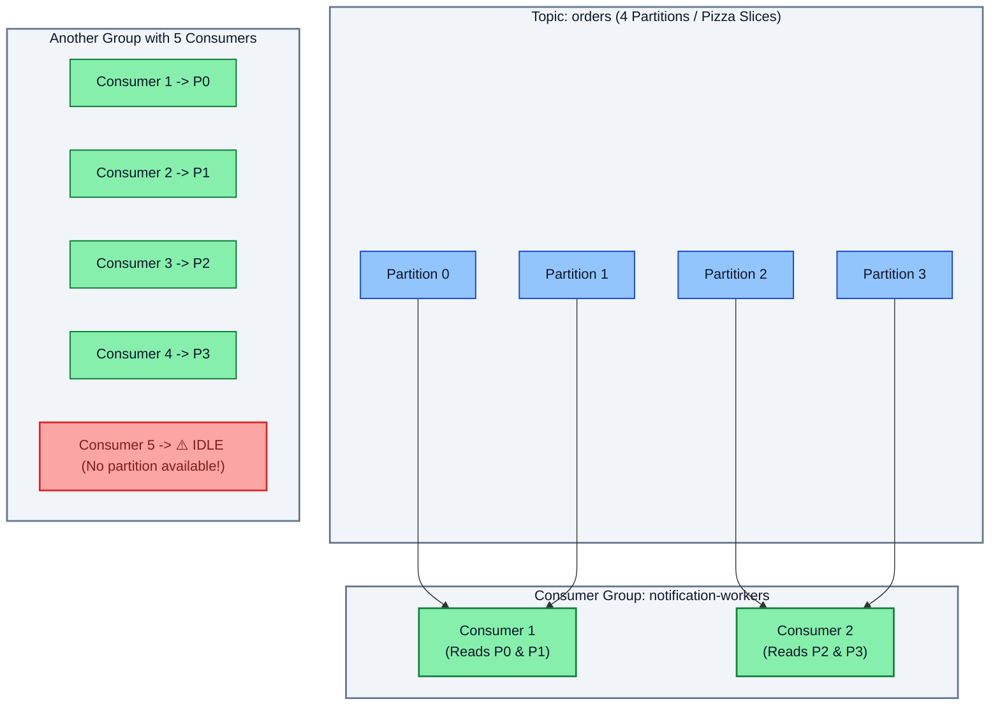
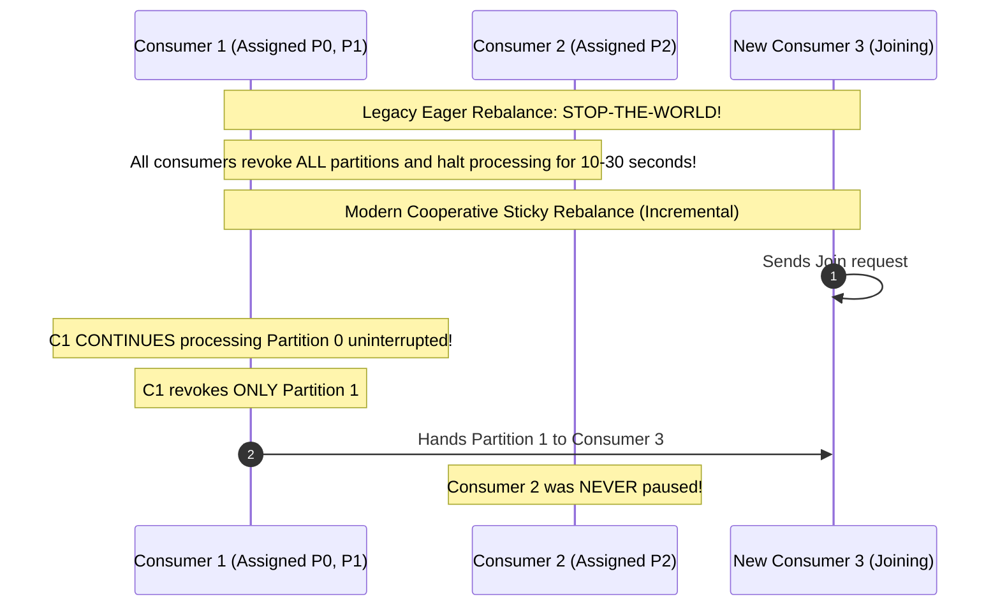

# Kafka: Consumer Groups, Rebalances & Offset Management

> **Cluster 03 — Module 03**  
> **Level**: Beginner Foundations to Production & FAANG-Level Deep Dive  
> **Key References**: TechWorld with Nana, ByteByteGo, KIP-429 (Incremental Rebalance)

---

## 🌱 0. The Beginner's Mental Model: Scaling Consumers Horizontally

If a producer publishes 10,000 messages per second, a single consumer process will get overwhelmed and crash.  
How does Apache Kafka scale reading horizontally across multiple servers? Through **Consumer Groups**!

---

### The Real-World Analogy: The Pizza Slices & Office Inbox
*(TechWorld with Nana Mental Model)*

1. **The Pizza Slices Analogy (Consumer Groups & Partitions)**:
   - Imagine a large pizza cut into **4 slices** (**4 Partitions**).
   - If **1 person** sits at the table (`Consumer 1`), they must eat all 4 slices alone (slow).
   - If **2 people** sit at the table (`Consumer 1 & 2`), each eats 2 slices. Processing speed doubles!
   - If **4 people** sit at the table, each eats 1 slice. Maximum parallel throughput!
   - **What if a 5th person sits down?** There are only 4 slices! The 5th person sits with their hands empty (**Idle Standby**).

> **The Golden Rule of Consumer Scaling**:  
> Within a single Consumer Group, **each partition is consumed by at most ONE consumer at a time**.  
> Therefore, **the number of partitions is the maximum ceiling for horizontal scaling!**

---

2. **The Unread Email Inbox Analogy (Consumer Lag)**:
   - Suppose your boss sends you 100 emails per hour (Producer Rate = 100 msgs/hr).
   - You only read and process 70 emails per hour (Consumer Rate = 70 msgs/hr).
   - Every hour, your inbox piles up with 30 unread emails.
   - That accumulating pile of unread messages is your **Consumer Lag**!
   - In production, if Consumer Lag keeps rising, users experience delayed emails, order status delays, and stale analytics!

---

## 📖 1. Comprehensive Study Notes: Understanding Consumer Groups, Rebalances & Offsets from the Ground Up

### What is a Consumer Group?
A **Consumer Group** is a cooperative set of independent consumer processes identified by a shared group ID that collaborate to consume data in parallel from a set of topic partitions.

A **Consumer Group** is a cooperative set of independent consumer processes (e.g., microservice instances or background workers) that share a common identifier (`group.id`) and work together to read, process, and scale message consumption from one or more Kafka topics.

To understand why Consumer Groups are revolutionary, consider how traditional messaging systems work:
* In a **Message Queue** (like RabbitMQ or AWS SQS), multiple worker processes pull from a shared queue. Once a worker consumes a message, that message is acknowledged and deleted. Multiple workers provide horizontal scale, but you cannot easily broadcast the exact same message stream to multiple independent applications without duplicating queues.
* In a **Publish/Subscribe Topic** (like JMS or Redis Pub/Sub), every subscriber receives an identical broadcast copy of every message. However, you cannot easily scale out a single subscriber across a cluster of 10 worker nodes without processing duplicates.

Kafka's Consumer Group unifies both paradigms cleanly into a single architecture:
1. **Pub/Sub Across Groups**: If you have two independent applications—such as `order-fulfillment-service` (`group.id = "fulfillment"`) and `fraud-detection-service` (`group.id = "fraud"`)—both groups independently receive and consume every single message published to the `orders` topic.
2. **Queue-style Parallelism Within a Group**: Inside the `order-fulfillment-service` group, if you launch 4 container instances, Kafka automatically divides the topic's partitions among the 4 containers. Each message is processed by exactly one consumer within that group, providing parallel processing with zero duplicated work.

---

### What does it actually do? (Step-by-Step Execution & Mechanics)
Understanding consumer internals requires tracing how consumers join a group, process records, and record their progress:

1. **Group Coordination & Partition Assignment**:
   * **Group Coordinator**: A designated Kafka broker responsible for managing consumer group membership, tracking heartbeats, and orchestrating partition rebalances.
   * When a consumer starts up with a specified `group.id`, it sends a `FindCoordinator` request to any Kafka broker. Kafka hashes the `group.id` and assigns a specific broker to act as the **Group Coordinator** for that consumer group.
   * The consumer sends a `JoinGroup` request to the coordinator. The coordinator elects one consumer in the group to be the **Group Leader** (typically the first consumer to join).
   * The Group Leader runs a partition assignment strategy (such as `RoundRobinAssignor` or `CooperativeStickyAssignor`) to assign specific topic partitions to each member of the group.
   * The leader sends the assignment plan back to the Group Coordinator in a `SyncGroup` request, and the coordinator distributes the individual partition assignments to each consumer.

2. **The Continuous Poll Loop**:
   * Kafka consumers use a pull-based model. Each consumer runs a continuous loop calling `consumer.poll(Duration.ofMillis(100))`.
   * When `poll()` is invoked, the consumer client fetches a batch of records from the brokers managing its assigned partitions into an in-memory buffer.
   * The application thread iterates over the batch, executes business logic (e.g., validation, database writes, external API calls), and then commits its progress.

3. **Offset Tracking via `__consumer_offsets`**:
   * **`__consumer_offsets`**: An internal, compacted Kafka system topic that durably persists committed consumer group offset bookmarks per topic-partition.
   * Kafka does not maintain per-message acknowledgments like traditional brokers. Instead, it tracks consumer progress through a continuous sequence integer called an **Offset**.
   * When a consumer commits an offset (e.g., offset 105), it tells Kafka: *"I have completely processed all records up through offset 104; the next record I expect to read is 105."*
   * Kafka stores these committed offsets inside an internal, high-throughput, compacted topic called **`__consumer_offsets`** (partitioned by hash of `group.id`).
   * When a consumer crashes or restarts, its replacement simply reads the latest committed offset for its assigned partitions from `__consumer_offsets` and picks up exactly where the previous consumer stopped.

4. **Health Monitoring: Two Independent Detection Mechanisms**:
   * **Network & Node Liveness (`session.timeout.ms`)**: Kafka consumer clients run a separate background **Heartbeat Thread**. This thread periodically transmits heartbeat signals (`heartbeat.interval.ms`, typically 3 seconds) to the Group Coordinator. If the broker does not receive a heartbeat within `session.timeout.ms` (default 45 seconds), it assumes the node crashed or suffered a network partition and initiates a rebalance.
   * **Application Processing Liveness (`max.poll.interval.ms`)**: Heartbeats only prove that the consumer process and its background thread are alive; they do not prove that the main application thread is successfully processing data. If an application thread hangs (e.g., waiting indefinitely on a locked database table or an unresponsive HTTP API) and fails to invoke `poll()` within `max.poll.interval.ms` (default 5 minutes), the coordinator marks the consumer as livelocked and kicks it out of the group.

5. **Rebalances (Eager vs. Cooperative Sticky)**:
   * **Rebalance Protocol**: A coordinated distributed protocol during which Kafka reassigns partition ownership across active members of a consumer group in response to membership or topology changes.
   * Whenever group membership changes (a consumer joins, crashes, or departs gracefully) or topic partitions increase, Kafka executes a **Rebalance** to redistribute partitions.
   * **Eager Rebalancing (Legacy)**: Consumers revoke all assigned partitions, halt processing entirely across the entire group ("Stop-The-World"), rejoin the group, and wait for new assignments. This causes severe latency spikes in production.
   * **Cooperative Sticky Rebalancing (Modern Standard - KIP-429)**: Rebalancing occurs incrementally over two rounds. Consumers continue processing unaffected partitions uninterrupted. Only the specific partitions that must move to a new consumer are briefly paused and reassigned.

---

### Why do we need it & What help does it provide? (Concrete Engineering Benefits)
* **Seamless Horizontal Scalability**: When message volume surges, you can scale consumer throughput simply by launching additional container replicas (up to the total number of partitions in the topic) without modifying application logic or restarting brokers.
* **Resilient Automatic Failover**: If a consumer pod experiences an Out-Of-Memory (OOM) error or hardware failure, Kafka automatically detects the dead consumer, redistributes its partitions to surviving group members, and resumes consumption from the last committed offset within seconds.
* **Deterministic Reprocessing & Time-Travel Debugging**: Because Kafka preserves committed offsets in `__consumer_offsets` and retains historical log segments on disk, engineers can reset a consumer group's offsets backward in time (`--to-offset` or `--to-datetime`). This enables full reprocessing of historical data if a bug corrupted downstream databases.
* **Actionable Operational Visibility via Consumer Lag**:
  - Consumer Lag is the numerical difference between the Log End Offset (LEO) of a partition and the current committed offset of a consumer group, measuring unprocessed message backlog.
  - By subtracting the consumer's current offset from the Log End Offset (LEO), operations teams obtain a real-time metric of **Consumer Lag**. This reveals whether downstream processing is keeping pace with upstream production and allows auto-scaling policies to trigger before backpressure threatens system stability.

---

## ⚡ 2. Before vs. After: Consumer Offset Commits & Rebalancing

| Feature | Before (Default / Auto-Commit) | After (Production Best Practices) | Why This Helps (The Impact) |
| :--- | :--- | :--- | :--- |
| **Offset Committing** | `enable.auto.commit = true`. Offsets commit every 5s on a background timer regardless of whether work finished. | **Manual Offset Commit (`commitSync` / `commitAsync`)**. Only commit after database save succeeds! | **Zero skipped messages**; guarantees At-Least-Once processing. |
| **Rebalance Protocol** | **Eager Rebalance**: Whole consumer group stops processing for 20-30 seconds ("Stop-The-World"). | **Cooperative Sticky Rebalance**: Only the reassigned partition pauses. Everyone else keeps consuming uninterrupted! | Eliminates severe consumer latency spikes when scaling pods up or down. |
| **Livelock Prevention** | Single thread poll loop hangs during heavy DB insert $\rightarrow$ broker assumes node died $\rightarrow$ triggers endless rebalance loops. | Decoupled background Heartbeat thread + tuned `max.poll.interval.ms` and `max.poll.records`. | Rock-solid consumer stability even during heavy batch database insertions. |

---

## 🔄 3. Demystifying Rebalances: Eager vs. Cooperative Sticky

A **Rebalance** occurs whenever:
1. A new consumer joins the group (e.g. Kubernetes scales up replicas).
2. An existing consumer crashes or disconnects.
3. Partitions are added to a topic.

- **Eager Rebalance (Legacy)**: Consumers drop everything, revoke all partitions, and pause message consumption entirely until the group re-assigns everything.
- **Cooperative Sticky (Modern Standard)**: Incremental reassignment. Consumers only revoke partitions that must migrate to new nodes. Healthy consumers keep processing uninterrupted!

---

## 💾 4. How Offsets Work: The `__consumer_offsets` Internal Topic

How does Kafka remember what you have read?
1. Every message has an integer **Offset** (`0, 1, 2, 3...`).
2. When a consumer finishes processing message 42, it commits `Offset = 43` (the *next* message it expects).
3. Kafka stores this commit inside an internal, high-throughput compacted topic named **`__consumer_offsets`**.
4. If Consumer 1 crashes, its replacement reads `__consumer_offsets` and immediately resumes from offset 43 with zero confusion!

---

## 💼 5. Interview Preparation: High-Yield Questions & Answers

### Q1: "What happens if a topic has 3 partitions, but a consumer group has 5 consumers?"
- **The Answer**:
  - *"In Kafka, each partition can only be assigned to a single consumer within the same consumer group at any given time.  
  - Therefore, 3 consumers will each be assigned 1 partition, while the remaining **2 consumers will sit completely idle**.  
  - They act purely as hot standbys; if one of the active 3 consumers dies, an idle consumer will immediately be assigned the vacated partition during rebalance."*

---

### Q2: "Why should you disable `enable.auto.commit` in production?"
- **The Answer**:
  - *"When `enable.auto.commit = true`, offsets are automatically committed every 5 seconds on a background timer, regardless of whether the business processing succeeded.  
  - If a consumer polls 50 records, the timer auto-commits offset 50, and the container crashes while processing record 10, records 11 through 50 will **never be processed**! When the consumer restarts, it starts at offset 51, leading to silent data loss.  
  - Setting `enable.auto.commit = false` allows manual commits only after records are safely written to the database or downstream system."*

---

### Q3: "What is Consumer Lag, and how do you monitor and resolve it?"
- **The Answer**:
  - *"Consumer Lag is the delta between the latest offset written to a partition (LEO) and the latest offset committed by the consumer group. It represents how many unprocessed messages are waiting in the queue.  
  - We monitor it using tools like Prometheus, Datadog, or Burrow.  
  - To resolve lag:  
    1. Scale out the number of consumers in the group (up to the partition count).  
    2. Increase partition count if the consumer count already matches the partition count.  
    3. Optimize consumer processing logic (use multi-threaded worker pools or tune `max.poll.records`)."*

---

### Q4: "What is the difference between `session.timeout.ms` and `max.poll.interval.ms`?"
- **The Answer**:
  - **`session.timeout.ms`**: Checks **Network Liveness**. Monitored via a dedicated background heartbeat thread (`heartbeat.interval.ms`). If the broker hears no heartbeats for this duration, it considers the node dead.
  - **`max.poll.interval.ms`**: Checks **Application Processing Liveness**. If the main application thread hangs or takes too long to process records before calling `poll()` again, Kafka assumes the consumer has livelocked and kicks it out of the group to allow another consumer to take over.
