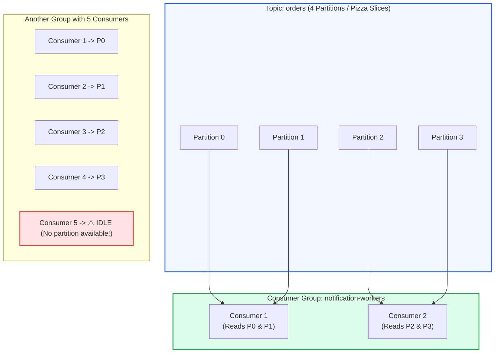
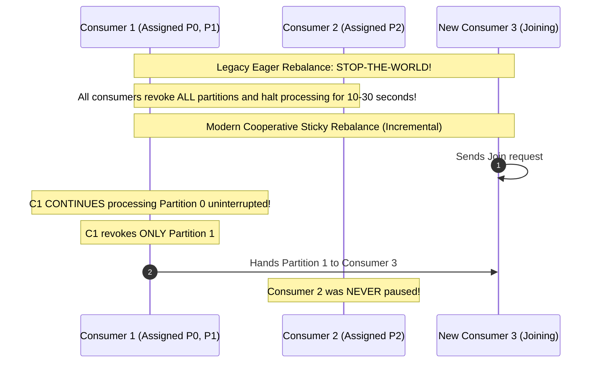

# Kafka: Consumer Groups, Rebalances & Offset Management

> **Cluster 03 — Module 03**  
> **Level**: Beginner Foundations to Production & FAANG-Level Deep Dive  
> **Key References**: TechWorld with Nana, ByteByteGo, KIP-429 (Incremental Rebalance)

---

## 🌱 0. The Beginner's Mental Model: Scaling Consumers Horizontally

If a producer publishes 10,000 messages per second, a single consumer process will get overwhelmed and crash.  
How does Apache Kafka scale reading horizontally across multiple servers? Through **Consumer Groups**!

---

### The Real-World Analogy: The Pizza Slices & Office Inbox
*(TechWorld with Nana Mental Model)*

1. **The Pizza Slices Analogy (Consumer Groups & Partitions)**:
   - Imagine a large pizza cut into **4 slices** (**4 Partitions**).
   - If **1 person** sits at the table (`Consumer 1`), they must eat all 4 slices alone (slow).
   - If **2 people** sit at the table (`Consumer 1 & 2`), each eats 2 slices. Processing speed doubles!
   - If **4 people** sit at the table, each eats 1 slice. Maximum parallel throughput!
   - **What if a 5th person sits down?** There are only 4 slices! The 5th person sits with their hands empty (**Idle Standby**).

> **The Golden Rule of Consumer Scaling**:  
> Within a single Consumer Group, **each partition is consumed by at most ONE consumer at a time**.  
> Therefore, **the number of partitions is the maximum ceiling for horizontal scaling!**

---

2. **The Unread Email Inbox Analogy (Consumer Lag)**:
   - Suppose your boss sends you 100 emails per hour (Producer Rate = 100 msgs/hr).
   - You only read and process 70 emails per hour (Consumer Rate = 70 msgs/hr).
   - Every hour, your inbox piles up with 30 unread emails.
   - That accumulating pile of unread messages is your **Consumer Lag**!
   - In production, if Consumer Lag keeps rising, users experience delayed emails, order status delays, and stale analytics!

---

## ⚡ 1. Before vs. After: Consumer Offset Commits & Rebalancing

| Feature | Before (Default / Auto-Commit) | After (Production Best Practices) | Why This Helps (The Impact) |
| :--- | :--- | :--- | :--- |
| **Offset Committing** | `enable.auto.commit = true`. Offsets commit every 5s on a background timer regardless of whether work finished. | **Manual Offset Commit (`commitSync` / `commitAsync`)**. Only commit after database save succeeds! | **Zero skipped messages**; guarantees At-Least-Once processing. |
| **Rebalance Protocol** | **Eager Rebalance**: Whole consumer group stops processing for 20-30 seconds ("Stop-The-World"). | **Cooperative Sticky Rebalance**: Only the reassigned partition pauses. Everyone else keeps consuming uninterrupted! | Eliminates severe consumer latency spikes when scaling pods up or down. |
| **Livelock Prevention** | Single thread poll loop hangs during heavy DB insert $\rightarrow$ broker assumes node died $\rightarrow$ triggers endless rebalance loops. | Decoupled background Heartbeat thread + tuned `max.poll.interval.ms` and `max.poll.records`. | Rock-solid consumer stability even during heavy batch database insertions. |

---

## 🔄 2. Demystifying Rebalances: Eager vs. Cooperative Sticky

A **Rebalance** occurs whenever:
1. A new consumer joins the group (e.g. Kubernetes scales up replicas).
2. An existing consumer crashes or disconnects.
3. Partitions are added to a topic.

- **Eager Rebalance (Legacy)**: Consumers drop everything, revoke all partitions, and pause message consumption entirely until the group re-assigns everything.
- **Cooperative Sticky (Modern Standard)**: Incremental reassignment. Consumers only revoke partitions that must migrate to new nodes. Healthy consumers keep processing uninterrupted!

---

## 💾 3. How Offsets Work: The `__consumer_offsets` Internal Topic

How does Kafka remember what you have read?
1. Every message has an integer **Offset** (`0, 1, 2, 3...`).
2. When a consumer finishes processing message 42, it commits `Offset = 43` (the *next* message it expects).
3. Kafka stores this commit inside an internal, high-throughput compacted topic named **`__consumer_offsets`**.
4. If Consumer 1 crashes, its replacement reads `__consumer_offsets` and immediately resumes from offset 43 with zero confusion!

---

## 💼 4. Interview Preparation: High-Yield Questions & Answers

### Q1: "What happens if a topic has 3 partitions, but a consumer group has 5 consumers?"
- **The Answer**:
  - *"In Kafka, each partition can only be assigned to a single consumer within the same consumer group at any given time.  
  - Therefore, 3 consumers will each be assigned 1 partition, while the remaining **2 consumers will sit completely idle**.  
  - They act purely as hot standbys; if one of the active 3 consumers dies, an idle consumer will immediately be assigned the vacated partition during rebalance."*

---

### Q2: "Why should you disable `enable.auto.commit` in production?"
- **The Answer**:
  - *"When `enable.auto.commit = true`, offsets are automatically committed every 5 seconds on a background timer, regardless of whether the business processing succeeded.  
  - If a consumer polls 50 records, the timer auto-commits offset 50, and the container crashes while processing record 10, records 11 through 50 will **never be processed**! When the consumer restarts, it starts at offset 51, leading to silent data loss.  
  - Setting `enable.auto.commit = false` allows manual commits only after records are safely written to the database or downstream system."*

---

### Q3: "What is Consumer Lag, and how do you monitor and resolve it?"
- **The Answer**:
  - *"Consumer Lag is the delta between the latest offset written to a partition (LEO) and the latest offset committed by the consumer group. It represents how many unprocessed messages are waiting in the queue.  
  - We monitor it using tools like Prometheus, Datadog, or Burrow.  
  - To resolve lag:  
    1. Scale out the number of consumers in the group (up to the partition count).  
    2. Increase partition count if the consumer count already matches the partition count.  
    3. Optimize consumer processing logic (use multi-threaded worker pools or tune `max.poll.records`)."*

---

### Q4: "What is the difference between `session.timeout.ms` and `max.poll.interval.ms`?"
- **The Answer**:
  - **`session.timeout.ms`**: Checks **Network Liveness**. Monitored via a dedicated background heartbeat thread (`heartbeat.interval.ms`). If the broker hears no heartbeats for this duration, it considers the node dead.
  - **`max.poll.interval.ms`**: Checks **Application Processing Liveness**. If the main application thread hangs or takes too long to process records before calling `poll()` again, Kafka assumes the consumer has livelocked and kicks it out of the group to allow another consumer to take over.
