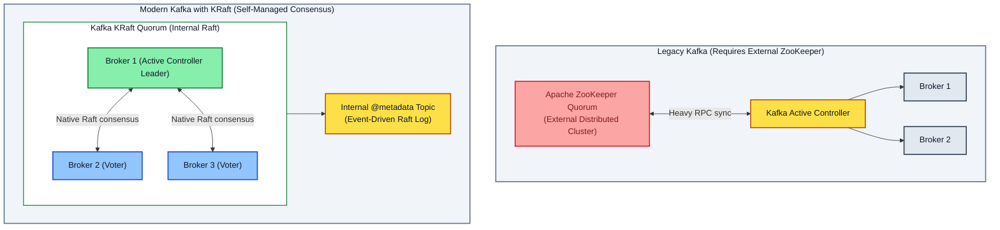
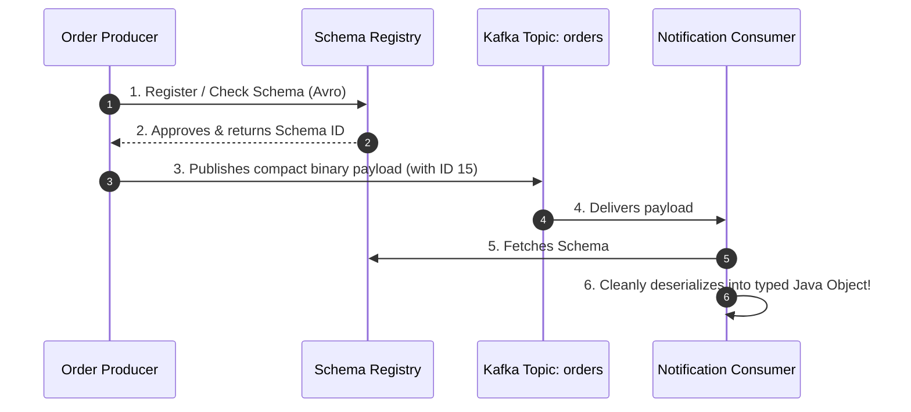
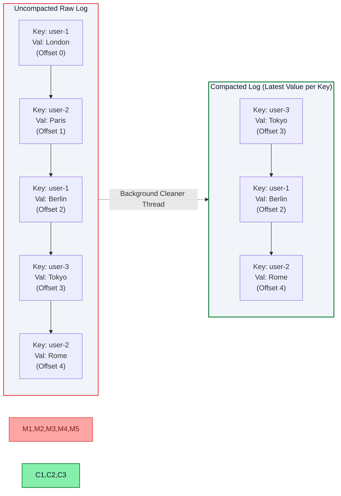

# Kafka Modern Architecture: KRaft, Schema Registry & Stream Processing

> **Cluster 03 — Module 04**  
> **Level**: Beginner Foundations to Production & FAANG-Level Deep Dive  
> **Key References**: TechWorld with Nana, Confluent Docs, KIP-500 (ZooKeeper Removal)

---

## 🌱 0. The Beginner's Mental Model: Modern Kafka Architecture

### The Big Evolution: Good Riddance, ZooKeeper!
In older tutorials and legacy systems, running Apache Kafka required running two separate clusters: **Apache ZooKeeper** and **Kafka Brokers**.
- ZooKeeper acted as an external manager that tracked cluster metadata, leader elections, and broker health.
- **The Problem**: Managing two distributed clusters was an operational headache. When large clusters had hundreds of thousands of partitions, ZooKeeper became a major performance bottleneck, and controller failovers could take minutes.
- **The Modern Solution (KRaft / KIP-500)**: Apache Kafka now manages its own metadata natively using the **Raft Consensus Protocol**. Kafka brokers elect their own controllers internally!

---

### Real-World Analogy: The Schema Registry & The Passport Office
Imagine an e-commerce company where Team A writes the Order Producer in Python, and Team B writes the Notification Consumer in Java.
- What happens if Team A changes the price field from a number (`50.0`) to a string (`"fifty dollars"`)?
- Team B's Java application immediately crashes with a deserialization error (the dreaded **"Poison Pill"**)!
- **Schema Registry**: Acts like an international passport control and contract office.
  - Before a producer can send a message, it verifies the schema (Avro/Protobuf) with Schema Registry.
  - The Schema Registry guarantees **backward/forward compatibility**. If an incompatible schema is sent, it is rejected **before** it enters the Kafka topic!

---

## 📖 1. Comprehensive Study Notes: Understanding KRaft, Schema Registry & Stream Processing from the Ground Up

### What are KRaft, Schema Registry, and Stream Processing?
Modern Kafka production systems rely on three foundational pillars that extend basic pub/sub messaging into an enterprise-grade streaming platform:

1. **KRaft (Kafka Raft Consensus Mode)**:
   * **KRaft (Kafka Raft Metadata mode)**: Kafka's native distributed consensus protocol that manages cluster metadata directly within the brokers via an internal Raft quorum, eliminating the external dependency on ZooKeeper.
   * **Historical Context**: For over a decade (Kafka versions 0.8 through 2.8), Kafka required running two entirely separate distributed clusters: an Apache ZooKeeper quorum and a Kafka broker cluster. ZooKeeper stored cluster metadata, managed broker registrations, and orchestrated controller elections. Under KRaft (introduced in KIP-500 and production-ready in Kafka 3.3+), Kafka brokers self-govern using an internal implementation of the Raft consensus algorithm.

2. **Schema Registry**:
   * **Schema Registry**: A centralized service that serves as a shared repository and validation authority for schemas, ensuring message format compatibility across distributed producers and consumers.
   * **Context**: In decoupled microservice architectures, different engineering teams independently write producers and consumers across multiple programming languages (Java, Go, Python, Node.js). Schema Registry enforces strict data schemas (using formats such as Apache Avro, Protocol Buffers, or JSON Schema) so producers cannot publish malformed payloads that crash downstream consumers.

3. **Log Compaction**:
   * **Log Compaction**: A retention mechanism in Kafka that retains at least the most recent message value for each key within a partition commit log indefinitely.
   * An alternative Kafka storage retention strategy (`cleanup.policy = compact`) that guarantees Kafka will retain at least the latest value for every unique message key within a topic partition indefinitely, rather than discarding records purely based on age or size.

4. **Kafka Connect & Kafka Streams**:
   * **Kafka Connect**: A framework for scalable and resilient streaming data integration between Apache Kafka and external data storage systems.
   * **Kafka Streams**: A client library for building real-time stream processing applications and microservices whose input and output data are stored in Kafka topics.
   * **Kafka Connect**: A distributed, fault-tolerant integration framework for moving high-volume data between Kafka and external datastores (such as PostgreSQL, MySQL, Elasticsearch, Snowflake, and AWS S3) without writing custom producer or consumer code.
   * **Kafka Streams**: A lightweight, embeddable client library for Java and Kotlin that allows applications to process, filter, join, and aggregate event streams in real time with stateful local storage (RocksDB).

---

### What do they actually do? (Step-by-Step Execution & Mechanics)
To grasp how modern Kafka architectures function end-to-end, let us trace their operational mechanics:

1. **How KRaft Manages Cluster Metadata**:
   * A subset of Kafka nodes are designated as **KRaft Controllers** (or dual-role Broker+Controller nodes), forming an active Raft Quorum.
   * One controller is elected as the **Active Controller Leader**, while the others act as follower voters.
   * All cluster metadata—such as broker registrations, topic configurations, partition replica assignments, access control lists (ACLs), and In-Sync Replica (ISR) states—is modeled not as external state trees, but as an append-only internal log called the **`@metadata` topic**.
   * When a topic is created or a partition rebalanced, the leader appends a metadata record to `@metadata` and replicates it to quorum followers. Every broker in the cluster tails this metadata log and maintains a synchronous in-memory snapshot of cluster state.
   * Because every node already maintains cluster state in RAM, if the active controller leader fails, a follower is elected in milliseconds with zero state reloading.

2. **How Schema Registry Enforces Data Contracts**:
   * When an application initializes a Kafka producer configured with a Schema Registry serializer (e.g., `KafkaAvroSerializer`), the serializer inspects the Avro schema of the object being sent.
   * The producer contacts Schema Registry over HTTP to verify whether the schema is already registered under the topic's subject.
   * If the schema is already known, Schema Registry immediately returns its unique numeric **Schema ID** (e.g., Schema ID `42`). If it is a new schema version, Schema Registry validates it against configured compatibility rules (Backward, Forward, Full) before registering it.
   * **The 5-Byte Wire Protocol**: Instead of embedding the full schema definition (which might be several kilobytes of JSON) inside every message, the serializer writes a compact 5-byte header followed by the binary-encoded payload:
     * **Byte 0**: Magic Byte (`0x00`), signaling Confluent Wire Format.
     * **Bytes 1–4**: 4-byte integer representing the Schema ID.
     * **Bytes 5+**: The raw, compact binary Avro/Protobuf payload.
   * When the consumer reads the message, its deserializer reads the Schema ID from bytes 1–4, retrieves the schema from its local in-memory cache (or queries Schema Registry if encountered for the first time), and safely deserializes the binary into a typed object.

3. **How Log Compaction Preserves Current State**:
   * Each partition log consists of two sections: the **Clean section** (records that have already been compacted) and the **Dirty section** (newly appended records that have not yet been processed by the compactor).
   * A background Cleaner thread periodically wakes up, scans the dirty log, and builds an in-memory hash map (`SkimpyOffsetMap`) of `[Hash(Key) -> LatestOffset]`.
   * The thread then rewrites the log segments: for each key, if a record's offset is older than the latest offset recorded in the map, it is discarded. Only the newest record for each key survives.
   * **Tombstone Records for Deletions**: If a key must be completely deleted, the producer publishes a record with the target key and a `null` payload. The cleaner retains this tombstone for a configurable duration (`delete.retention.ms`, default 24 hours) to allow consumers to observe the deletion event before permanently scrubbing the key from disk.

4. **How Kafka Connect and Streams Process Data**:
   * **Kafka Connect** runs standalone or clustered worker nodes. A Source Connector queries a source system (e.g., via Debezium reading database WAL logs) and converts records into Kafka events. A Sink Connector reads from Kafka and writes batches into target databases or object stores.
   * **Kafka Streams** embeds stream processing directly inside your application microservice. It consumes from Kafka topics, applies functional transformations (e.g., `map`, `filter`, `groupByKey`, `windowedBy`), maintains stateful aggregations in local RocksDB databases, and writes output streams back to Kafka topics with sub-millisecond latency.

---

### Why do we need them & What help do they provide? (Concrete Engineering Benefits)
* **Elimination of Dual-System DevOps Overhead (KRaft)**: Running KRaft cuts your operational footprint in half. Engineers no longer need to provision, monitor, back up, upgrade, and secure two disparate distributed systems.
* **Massive Partition Scalability & Instant Failovers**: Legacy ZooKeeper clusters struggled past 200,000 partitions because controller failovers required reloading all metadata from ZooKeeper, taking several minutes. KRaft easily handles tens of millions of partitions per cluster with sub-second failovers.
* **Zero Poison Pills & Continuous Contract Evolution (Schema Registry)**: In a large organization, unvalidated schema changes are the leading cause of downstream microservice outages. Schema Registry guarantees that breaking changes are caught and rejected at build/publish time, protecting consumer applications.
* **Dramatic Reductions in Network Egress & Storage Costs**: By replacing bloated JSON payloads (which repeat field names like `customer_address_line_1` millions of times) with compact binary serialization and 5-byte headers, organizations typically achieve **60% to 80% reduction in network bandwidth and storage costs**.
* **Turnkey Key-Value Datastore & Event Sourcing (Log Compaction)**: Compacted topics allow Kafka to act as a resilient system-of-record. Microservices can rebuild local search indexes or in-memory caches from scratch simply by replaying the compacted topic from offset 0, without burdening upstream relational databases.
* **Code-Free Integrations with Kafka Connect**: Teams avoid wasting thousands of engineering hours building bespoke database pollers and ETL scripts by leveraging robust, battle-tested, open-source connectors.

---

## ⚡ 2. Before vs. After: Modern Kafka Evolutions

| Feature | Before (Legacy Kafka) | After (Modern KRaft & Schema Registry) | Why This Helps (The Impact) |
| :--- | :--- | :--- | :--- |
| **Cluster Management** | Managing two distinct systems (ZooKeeper + Kafka brokers). | Single unified Kafka cluster running KRaft consensus. | Simplifies DevOps, halving operational complexity and memory usage. |
| **Controller Failover** | Took 1 to 5 minutes to reload entire ZooKeeper state into RAM. | Near-instantaneous (sub-second) failover using continuous `@metadata` log. | Zero visible downtime during broker restarts or maintenance. |
| **Data Contracts** | Sending raw, unvalidated JSON strings. A missing field crashes downstream apps. | Strictly typed **Avro/Protobuf** validated via Schema Registry. | Prevents broken schemas and poison pills; enables clean team collaboration. |
| **Payload Network Size** | Large verbose JSON payloads with repeating keys (`{"customer_id": 101, ...}`). | Compact binary serialization with 5-byte header. | Reduces message size by 60% to 80%, slashing cloud network egress costs. |

---

## 📖 3. Log Retention vs. Log Compaction

Kafka provides two cleanup strategies for managing disk space:

### A. Time/Size-based Retention (`cleanup.policy = delete`)
- Deletes log segments after a specific age (e.g. `retention.ms = 7 days`) or size limit.
- Ideal for ephemeral event streams: clickstreams, access logs, metrics.

### B. Key-Based Log Compaction (`cleanup.policy = compact`)
- *The Phone Book Analogy*: You don't need a history of every old address a user has had over the past 10 years. You only care about their **latest current address**!
- Kafka keeps the **latest known value for each message key** and discards older values during background cleaning.
- Perfect for Change Data Capture (CDC), account balance tables, and configuration caches.

> **The Tombstone Record**:
> **The Tombstone Record**: A tombstone is a record published with a non-null key and a null payload that explicitly marks that key for deletion in a compacted topic.
> To completely delete a key from a compacted topic, a producer writes a record with that key and a `null` value. The compactor retains the tombstone for `delete.retention.ms` before permanently scrubbing the key from disk.

---

## 🌐 4. The Kafka Ecosystem: Kafka Connect & Kafka Streams

```mermaid
flowchart LR
    DB[(PostgreSQL)] -->|CDC Connector| Source["Kafka Connect (Source)"]
    Source --> Raw["Raw Topic: orders.raw"]
    
    subgraph Stream_Engine["Kafka Streams / Flink"]
        KS["Filter, Aggregate, Enrich Events in Real Time"]
    end
    
    Raw --> KS
    KS --> Enriched["Enriched Topic: orders.processed"]
    
    Enriched --> Sink["Kafka Connect (Sink)"]
    Sink --> ES[(Elasticsearch / Snowflake Data Lake)]

    style Stream_Engine fill:#f1f5f9,stroke:#64748b,stroke-width:2px,color:#0f172a
    style DB fill:#e2e8f0,stroke:#334155,stroke-width:2px,color:#0f172a
    style ES fill:#e2e8f0,stroke:#334155,stroke-width:2px,color:#0f172a
    style Source fill:#93c5fd,stroke:#1d4ed8,stroke-width:2px,color:#0f172a
    style Sink fill:#93c5fd,stroke:#1d4ed8,stroke-width:2px,color:#0f172a
    style Raw fill:#fde047,stroke:#b45309,stroke-width:2px,color:#0f172a
    style Enriched fill:#86efac,stroke:#15803d,stroke-width:2px,color:#0f172a
    style KS fill:#fde047,stroke:#b45309,stroke-width:2px,color:#0f172a
```

1. **Kafka Connect**: A plug-and-play framework for integrating Kafka with external databases and data lakes **without writing custom code**.
   - *Source Connectors*: Pull data into Kafka (e.g. Debezium capturing PostgreSQL CDC changes).
   - *Sink Connectors*: Push data from Kafka to external destinations (e.g. Elasticsearch, Amazon S3).
2. **Kafka Streams**: A lightweight client library for Java/Kotlin that performs real-time data transformations, stream-table joins, and stateful aggregations directly inside microservices.

---

## 💼 5. Interview Preparation: High-Yield Questions & Answers

### Q1: "Why did Apache Kafka remove ZooKeeper and adopt KRaft?"
- **The Answer**:
  - *"ZooKeeper was an external dependency that introduced operational complexity and scalability bottlenecks. In large clusters with hundreds of thousands of partitions, synchronizing metadata across ZooKeeper caused slow controller failovers and high latency.  
  - KRaft (Kafka Raft Metadata mode) implements a native Raft consensus protocol directly inside Kafka brokers. Metadata is stored as an internal event-driven Kafka topic (`@metadata`), allowing sub-second controller failovers, scaling to millions of partitions, and eliminating the need to manage a separate ZooKeeper cluster."*

---

### Q2: "What is Schema Registry, and why is it important in microservice architectures?"
- **The Answer**:
  - *"Schema Registry is a centralized service that stores and validates schemas (like Apache Avro or Protobuf) used by Kafka producers and consumers.  
  - It prevents schema drift and poison pill events by enforcing strict compatibility rules (e.g. Backward, Forward, Full compatibility) before messages are published.  
  - It also drastically reduces network payload sizes by stripping schema definitions from individual messages and replacing them with a compact 5-byte header containing the Schema ID."*

---

### Q3: "What is Log Compaction and what is a Tombstone record?"
- **The Answer**:
  - *"Log Compaction is a retention policy (`cleanup.policy = compact`) where Kafka retains the latest known value for each message key within a partition, discarding older records during background compaction.  
  - A **Tombstone record** is a message with a valid key and a `null` payload. It acts as a deliberate deletion marker, instructing the background cleaner to permanently delete that key and its history from the compacted log after `delete.retention.ms`."*

---

### Q4: "What is the difference between Kafka Connect and Kafka Streams?"
- **The Answer**:
  - **Kafka Connect** is an integration tool for moving data into and out of Kafka without writing code, using pre-built open-source connectors (e.g. syncing a database to Kafka or Kafka to S3).
  - **Kafka Streams** is a Java processing library for performing real-time computational logic (filtering, transforming, grouping, windowing, and aggregating) on event streams within custom applications.
