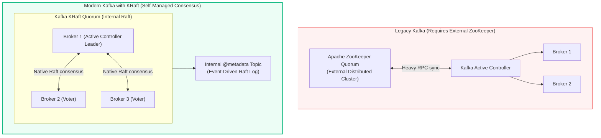
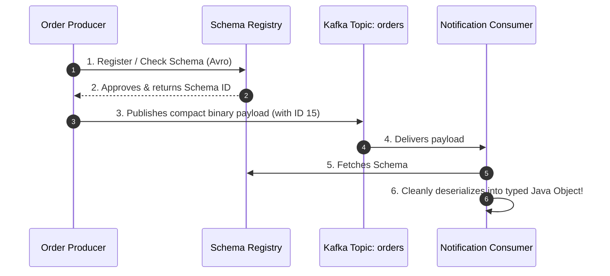
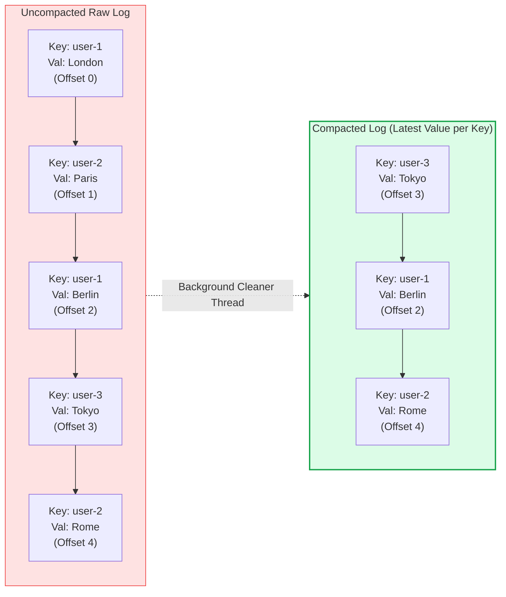
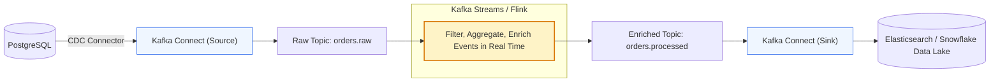

# Kafka Modern Architecture: KRaft, Schema Registry & Stream Processing

> **Cluster 03 — Module 04**  
> **Level**: Beginner Foundations to Production & FAANG-Level Deep Dive  
> **Key References**: TechWorld with Nana, Confluent Docs, KIP-500 (ZooKeeper Removal)

---

## 🌱 0. The Beginner's Mental Model: Modern Kafka Architecture

### The Big Evolution: Good Riddance, ZooKeeper!
In older tutorials and legacy systems, running Apache Kafka required running two separate clusters: **Apache ZooKeeper** and **Kafka Brokers**.
- ZooKeeper acted as an external manager that tracked cluster metadata, leader elections, and broker health.
- **The Problem**: Managing two distributed clusters was an operational headache. When large clusters had hundreds of thousands of partitions, ZooKeeper became a major performance bottleneck, and controller failovers could take minutes.
- **The Modern Solution (KRaft / KIP-500)**: Apache Kafka now manages its own metadata natively using the **Raft Consensus Protocol**. Kafka brokers elect their own controllers internally!

---

### Real-World Analogy: The Schema Registry & The Passport Office
Imagine an e-commerce company where Team A writes the Order Producer in Python, and Team B writes the Notification Consumer in Java.
- What happens if Team A changes the price field from a number (`50.0`) to a string (`"fifty dollars"`)?
- Team B's Java application immediately crashes with a deserialization error (the dreaded **"Poison Pill"**)!
- **Schema Registry**: Acts like an international passport control and contract office.
  - Before a producer can send a message, it verifies the schema (Avro/Protobuf) with Schema Registry.
  - The Schema Registry guarantees **backward/forward compatibility**. If an incompatible schema is sent, it is rejected **before** it enters the Kafka topic!

---

## ⚡ 1. Before vs. After: Modern Kafka Evolutions

| Feature | Before (Legacy Kafka) | After (Modern KRaft & Schema Registry) | Why This Helps (The Impact) |
| :--- | :--- | :--- | :--- |
| **Cluster Management** | Managing two distinct systems (ZooKeeper + Kafka brokers). | Single unified Kafka cluster running KRaft consensus. | Simplifies DevOps, halving operational complexity and memory usage. |
| **Controller Failover** | Took 1 to 5 minutes to reload entire ZooKeeper state into RAM. | Near-instantaneous (sub-second) failover using continuous `@metadata` log. | Zero visible downtime during broker restarts or maintenance. |
| **Data Contracts** | Sending raw, unvalidated JSON strings. A missing field crashes downstream apps. | Strictly typed **Avro/Protobuf** validated via Schema Registry. | Prevents broken schemas and poison pills; enables clean team collaboration. |
| **Payload Network Size** | Large verbose JSON payloads with repeating keys (`{"customer_id": 101, ...}`). | Compact binary serialization with 5-byte header. | Reduces message size by 60% to 80%, slashing cloud network egress costs. |

---

## 📖 2. Log Retention vs. Log Compaction

Kafka provides two cleanup strategies for managing disk space:

### A. Time/Size-based Retention (`cleanup.policy = delete`)
- Deletes log segments after a specific age (e.g. `retention.ms = 7 days`) or size limit.
- Ideal for ephemeral event streams: clickstreams, access logs, metrics.

### B. Key-Based Log Compaction (`cleanup.policy = compact`)
- *The Phone Book Analogy*: You don't need a history of every old address a user has had over the past 10 years. You only care about their **latest current address**!
- Kafka keeps the **latest known value for each message key** and discards older values during background cleaning.
- Perfect for Change Data Capture (CDC), account balance tables, and configuration caches.

> **The Tombstone Record**: To completely delete a key from a compacted topic, a producer writes a record with that key and a `null` value. The compactor retains the tombstone for `delete.retention.ms` before permanently scrubbing the key from disk.

---

## 🌐 3. The Kafka Ecosystem: Kafka Connect & Kafka Streams

1. **Kafka Connect**: A plug-and-play framework for integrating Kafka with external databases and data lakes **without writing custom code**.
   - *Source Connectors*: Pull data into Kafka (e.g. Debezium capturing PostgreSQL CDC changes).
   - *Sink Connectors*: Push data from Kafka to external destinations (e.g. Elasticsearch, Amazon S3).
2. **Kafka Streams**: A lightweight client library for Java/Kotlin that performs real-time data transformations, stream-table joins, and stateful aggregations directly inside microservices.

---

## 💼 4. Interview Preparation: High-Yield Questions & Answers

### Q1: "Why did Apache Kafka remove ZooKeeper and adopt KRaft?"
- **The Answer**:
  - *"ZooKeeper was an external dependency that introduced operational complexity and scalability bottlenecks. In large clusters with hundreds of thousands of partitions, synchronizing metadata across ZooKeeper caused slow controller failovers and high latency.  
  - KRaft (Kafka Raft Metadata mode) implements a native Raft consensus protocol directly inside Kafka brokers. Metadata is stored as an internal event-driven Kafka topic (`@metadata`), allowing sub-second controller failovers, scaling to millions of partitions, and eliminating the need to manage a separate ZooKeeper cluster."*

---

### Q2: "What is Schema Registry, and why is it important in microservice architectures?"
- **The Answer**:
  - *"Schema Registry is a centralized service that stores and validates schemas (like Apache Avro or Protobuf) used by Kafka producers and consumers.  
  - It prevents schema drift and poison pill events by enforcing strict compatibility rules (e.g. Backward, Forward, Full compatibility) before messages are published.  
  - It also drastically reduces network payload sizes by stripping schema definitions from individual messages and replacing them with a compact 5-byte header containing the Schema ID."*

---

### Q3: "What is Log Compaction and what is a Tombstone record?"
- **The Answer**:
  - *"Log Compaction is a retention policy (`cleanup.policy = compact`) where Kafka retains the latest known value for each message key within a partition, discarding older records during background compaction.  
  - A **Tombstone record** is a message with a valid key and a `null` payload. It acts as a deliberate deletion marker, instructing the background cleaner to permanently delete that key and its history from the compacted log after `delete.retention.ms`."*

---

### Q4: "What is the difference between Kafka Connect and Kafka Streams?"
- **The Answer**:
  - **Kafka Connect** is an integration tool for moving data into and out of Kafka without writing code, using pre-built open-source connectors (e.g. syncing a database to Kafka or Kafka to S3).
  - **Kafka Streams** is a Java processing library for performing real-time computational logic (filtering, transforming, grouping, windowing, and aggregating) on event streams within custom applications.
