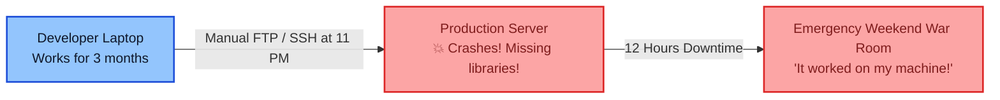

# CI/CD: Fundamentals, GitOps & Pipeline Design

> **Cluster 04 — Module 01**  
> **Level**: Beginner Foundations to Production & FAANG-Level Deep Dive  
> **Key References**: TechWorld with Nana, Martin Fowler, DORA Metrics, OpenGitOps Principles

---

## 🌱 0. The Beginner's Mental Model: Why Do We Need CI/CD?

### The Nightmare Before CI/CD: The "Deployment Friday Panic"
Years ago, software deployment was a terrifying, manual ordeal:
- Developers wrote code on their personal laptops for 3 to 6 months in complete isolation.
- On "Release Weekend", the team scheduled a 12-hour maintenance outage at midnight on Friday.
- A senior engineer manually copied `.jar` or `.zip` files over SSH or FTP to 10 live servers, manually edited configuration files, and executed database scripts.
- Inevitably, something broke. A missing DLL, an incompatible Java version, or a conflicting database column caused production to crash!
- Engineers spent the entire weekend sleeplessly debugging in production, blaming each other: *"It worked on my machine!"*



---

### The Real-World Analogy: The Automated Car Assembly Line
*(TechWorld with Nana & DevOps Manufacturing Analogy)*

Think of an automated automotive factory (like Toyota or Tesla):
- You don't build a car by having someone hammer metal in their backyard and drive it straight onto the highway.
- The car moves along an automated conveyor belt (**The Pipeline**):
  - **Station 1**: Assemble frame & stress test the welds (**Unit Testing & Linters**).
  - **Station 2**: Drop in the engine and check oil pressure (**Integration Tests & Build**).
  - **Station 3**: Laser scan for structural defects (**Security & Vulnerability Scans - Trivy/SAST**).
  - **Station 4**: Drive on test track under heavy rain simulation (**Deploy to Staging**).
  - **Station 5**: Ship to customer's driveway (**Production Release**).
- **The Golden Safety Rule**: If ANY station detects a defect (a failed test or security flaw), **the entire conveyor belt halts immediately**! Broken code is NEVER allowed to reach production.

```mermaid
flowchart LR
    Commit["Code Push\n(git commit)"] --> Lint["1. Quality Gate\nLint & Unit Tests"]
    Lint --> Sec["2. Security Gate\nSAST & Vulnerability Scans"]
    Sec --> Build["3. Package Gate\nDocker Build & Push"]
    Build --> Stage["4. Verification Gate\nDeploy to Staging"]
    Stage --> Prod["5. Release Gate\nDeploy to Production"]

    style Commit fill:#e2e8f0,stroke:#334155,stroke-width:2px,color:#0f172a
    style Lint fill:#93c5fd,stroke:#1d4ed8,stroke-width:2px,color:#0f172a
    style Sec fill:#fde047,stroke:#b45309,stroke-width:2px,color:#0f172a
    style Build fill:#93c5fd,stroke:#1d4ed8,stroke-width:2px,color:#0f172a
    style Stage fill:#c4b5fd,stroke:#6d28d9,stroke-width:2px,color:#0f172a
    style Prod fill:#86efac,stroke:#15803d,stroke-width:2px,color:#0f172a
```



---

## 📖 1. Comprehensive Study Notes: Understanding CI/CD, GitOps & Pipeline Design from the Ground Up

### What is CI/CD & GitOps? (Straightforward Definitions & Context)
Modern cloud-native engineering relies on automated delivery pipelines and declarative operations to ship software safely and reliably:

1. **Continuous Integration (CI)**:
   * *Book Definition*: Continuous Integration (CI) is a software development practice where developers regularly merge code changes into a central repository, triggering automated builds and tests to rapidly identify defects.
   * **Core Purpose**: Each merge triggers an automated pipeline that compiles the code, executes automated linters and unit tests, and validates that the new code integrates cleanly without breaking existing functionality. CI eliminates the dreaded "integration hell" where multiple teams attempt to merge diverging feature branches after months of isolated work.

2. **Continuous Delivery (CD)**:
   * *Book Definition*: Continuous Delivery is a software engineering approach in which teams produce software in short cycles, ensuring that the software can be reliably released to production at any time through automated quality gates subject to manual deployment authorization.
   * **The Defining Attribute**: In Continuous Delivery, **every build is inherently release-ready**, but the actual deployment to the production environment requires a deliberate human business decision (such as an authorized release manager clicking an "Approve Release" button in a portal).

3. **Continuous Deployment (CD)**:
   * *Book Definition*: Continuous Deployment is an automated software delivery process in which every code change that passes all stages of the production pipeline is released directly into live production without human intervention.
   * **The Defining Attribute**: There is **zero human intervention** between a developer committing verified code and that code running in live production. If all automated quality gates, security scans, integration tests, and staging smoke tests pass, the pipeline deploys the change directly to production users automatically.

4. **GitOps**:
   * *Book Definition*: GitOps is an operating model for cloud-native applications that uses Git version control as the single source of truth for declarative infrastructure and application configurations, enforced via continuous automated reconciliation.
   * **Core Principle**: Rather than having engineers or CI runners run manual `kubectl apply` commands against live clusters, the desired state of the cluster is committed declaratively to a Git repository. Specialized in-cluster controllers (such as ArgoCD or Flux) continuously reconcile the live cluster state with the configuration in Git.

---

### What does a Modern Pipeline actually do? (Step-by-Step Mechanics & Pipeline Flow)
A production-grade CI/CD pipeline acts as an automated, multi-stage quality control assembly line. Let us trace the journey of a code commit from a developer's machine to production:

1. **Stage 1: Code Verification & Static Analysis (Linting & SAST)**:
   * As soon as a developer opens a Pull Request (PR), the CI server spins up an ephemeral runner.
   * Static analyzers inspect code style, syntax errors, and anti-patterns (e.g., ESLint, Ruff, GolangCI-Lint).
   * Static Application Security Testing (SAST) tools (like SonarQube or GitHub CodeQL) analyze source code for common security vulnerabilities such as SQL injection, insecure cryptography, and buffer overflows.
   * Software Composition Analysis (SCA) tools (like Snyk or Dependabot) check third-party libraries against known Common Vulnerabilities and Exposures (CVE) databases.

2. **Stage 2: Automated Testing (Unit & Integration)**:
   * The pipeline runs fast unit tests in parallel, isolating individual business functions using in-memory mocks.
   * Integration tests spin up ephemeral backing services (such as PostgreSQL databases or Redis caches via Testcontainers) to verify realistic network interactions and database schema migrations.
   * If any test fails, the pipeline immediately halts, marks the Pull Request with a red checkmark, and prevents merging.

3. **Stage 3: Immutable Artifact Packaging**:
   * Once code is merged into the main branch, the pipeline builds an immutable container image using Docker or Buildx.
   * The image is deterministically tagged with the specific Git commit SHA (e.g., `api:sha-7b3f91a`) or semantic version (`api:v2.4.1`), never mutable tags like `latest`.
   * Container security scanners (like Trivy or Grype) inspect the base OS layers and installed packages for vulnerabilities.
   * Container signing tools (like Cosign) cryptographically sign the image before pushing it to a trusted container registry (e.g., GitHub Container Registry, AWS ECR, or Google Artifact Registry).

4. **Stage 4: Progressive Deployment & Verification**:
   * The deployment controller rolls out the new version using canary or rolling strategies, gradually shifting traffic from the old version to the new version.
   * Synthetic smoke tests and health probes verify application responsiveness.
   * Monitoring engines observe key golden signals (HTTP 5xx error rates, response latencies, CPU/memory consumption). If metrics degrade past predetermined thresholds, the deployment automatically halts and rolls back to the previous stable state.

5. **Push-Based vs. Pull-Based (GitOps) Architecture**:
   * **Push Model (Legacy)**: The CI server (e.g., Jenkins or GitHub Actions) stores administrative credentials (kubeconfig) and pushes updates directly to the Kubernetes API server.
   * **Pull Model (GitOps)**: The CI server only updates configuration files in a Git repository. An operator running *inside* the Kubernetes cluster (e.g., ArgoCD) continuously compares the cluster's live state against the Git repository. When it detects a discrepancy, it pulls the changes and applies them internally, eliminating the need to expose cluster credentials to external CI tools.

---

### Why do we need it & What help does it provide? (Concrete Engineering Benefits)
* **Elimination of Deployment Fear & Manual Errors**: Traditional manual deployments are prone to human fatigue, missed steps, and accidental configuration drift. Automated pipelines ensure that every release follows an identical, reproducible, and verifiable sequence of steps.
* **Rapid Feedback Loops & Radical Risk Reduction**: Instead of shipping giant, risky quarterly releases containing thousands of changes, teams ship small, incremental commits multiple times per day. When each release contains only 20 lines of code, identifying and resolving any bug takes minutes rather than days.
* **Maximized Developer Velocity**: Developers focus purely on writing high-value business features. They do not spend hours manually configuring staging servers, running manual regression tests, or SSH-ing into production boxes.
* **Cryptographic Traceability & Audit Compliance**: In regulated industries (finance, healthcare), every change must be audited. GitOps provides a complete, tamper-proof history of every production modification: who committed it, who reviewed the pull request, which tests passed, and exactly when it went live.
* **Rapid Disaster Recovery (Zero MTTR)**: If a catastrophic cluster failure occurs, an entire Kubernetes cluster can be completely recreated from scratch simply by pointing ArgoCD to the Git repository containing all environment manifests.

---

## ⚡ 2. Before vs. After: The CI/CD Transformation

| Metric / Aspect | Before CI/CD (Manual Releases) | After CI/CD (Automated Pipelines) | Why This Helps (The Impact) |
| :--- | :--- | :--- | :--- |
| **Release Frequency** | Once every 3 to 6 months ("Big Bang" releases). | Multiple times **per day** (small, incremental releases). | Delivers new features to customers 100x faster. |
| **Risk per Release** | Massive risk; thousands of changed files deployed at once. | Tiny risk; each release has only a few lines of code. | If a bug occurs, isolating and rolling back takes 2 minutes! |
| **Testing Confidence** | Manual QA testing taking 2 weeks; human fatigue leads to missed bugs. | Automated unit, integration, and security tests run on every pull request. | Catches bugs within 5 minutes of being written. |
| **Rollback Time** | Hours of manual forensic work; restoring database backups. | Automated 1-click or automated canary rollbacks. | Mean Time to Recovery (MTTR) drops from hours to seconds. |

---

## 🚦 3. The Big Three: CI vs. CD (Delivery) vs. CD (Deployment)

Many beginners get confused between the three terms. Here is the definitive breakdown:

```mermaid
flowchart TD
    subgraph CI["1. Continuous Integration (CI)"]
        A["Developer commits code"] --> B["Automated Build"]
        B --> C["Automated Unit & Integration Tests"]
        C --> D["Static Code Analysis & Security Scans"]
    end

    subgraph CD_Deliv["2. Continuous Delivery (CD)"]
        D --> E["Package Docker Image / Artifact"]
        E --> F["Deploy to Staging Environment"]
        F --> G{"🛑 Manual Business Approval Gate\n(Product Manager clicks 'Approve')"}
    end

    subgraph CD_Deploy["3. Continuous Deployment"]
        G -->|Approved| H["🚀 Automated Production Deployment"]
        F -.->|Fully Automated (No Human Gate)| H
    end

    style CI fill:#f1f5f9,stroke:#1d4ed8,stroke-width:2px,color:#0f172a
    style CD_Deliv fill:#f1f5f9,stroke:#b45309,stroke-width:2px,color:#0f172a
    style CD_Deploy fill:#f1f5f9,stroke:#15803d,stroke-width:2px,color:#0f172a
    style A fill:#e2e8f0,stroke:#334155,stroke-width:1.5px,color:#0f172a
    style B fill:#93c5fd,stroke:#1d4ed8,stroke-width:1.5px,color:#0f172a
    style C fill:#93c5fd,stroke:#1d4ed8,stroke-width:1.5px,color:#0f172a
    style D fill:#93c5fd,stroke:#1d4ed8,stroke-width:1.5px,color:#0f172a
    style E fill:#fde047,stroke:#b45309,stroke-width:1.5px,color:#0f172a
    style F fill:#fde047,stroke:#b45309,stroke-width:1.5px,color:#0f172a
    style G fill:#fca5a5,stroke:#dc2626,stroke-width:2px,color:#7f1d1d
    style H fill:#86efac,stroke:#15803d,stroke-width:2px,color:#0f172a
```

### The Bakery Analogy:
- **Continuous Integration (CI)**: Mixing the dough and baking the bread loaves continuously throughout the day.
- **Continuous Delivery**: Placing the fresh bread on the bakery shelf, ready for sale. The store manager makes a conscious business choice when to sell it (**Manual Approval**).
- **Continuous Deployment**: The bread rolls straight out of the oven onto the customer's dining table without any human touching it (**100% Fully Automated**)!

---

## 🐙 4. Push-Based CI/CD vs. Pull-Based GitOps (ArgoCD)

How should a pipeline deploy to Kubernetes?

```mermaid
flowchart TD
    subgraph Push_Model["Traditional Push Model (Jenkins / GitHub Actions Direct)"]
        GHA["External CI Server\n(GitHub Actions / Jenkins)"] -->|Requires Production Cluster-Admin Kubeconfig! ⚠️| API1["Kube-API Server"]
        API1 --> Cluster1["Production Cluster"]
    end

    subgraph Pull_Model["Modern Pull-Based GitOps (ArgoCD / Flux)"]
        GitRepo[("Git Config Repository\n(Single Source of Truth)")]
        Argo["ArgoCD Operator\n(Runs INSIDE the secure cluster)"]
        API2["Internal Kube-API"]

        Argo -->|1. Watches for changes (Read-Only Git)| GitRepo
        Argo -->|2. Detects drift & applies diff internally| API2
        API2 --> Cluster2["Production Cluster"]
    end

    style Push_Model fill:#f1f5f9,stroke:#dc2626,stroke-width:1.5px,color:#0f172a
    style Pull_Model fill:#f1f5f9,stroke:#15803d,stroke-width:2px,color:#0f172a
    style GHA fill:#fca5a5,stroke:#dc2626,stroke-width:1.5px,color:#7f1d1d
    style API1 fill:#e2e8f0,stroke:#334155,stroke-width:1.5px,color:#0f172a
    style Cluster1 fill:#e2e8f0,stroke:#334155,stroke-width:1.5px,color:#0f172a
    style GitRepo fill:#93c5fd,stroke:#1d4ed8,stroke-width:2px,color:#0f172a
    style Argo fill:#86efac,stroke:#15803d,stroke-width:2px,color:#0f172a
    style API2 fill:#e2e8f0,stroke:#334155,stroke-width:1.5px,color:#0f172a
    style Cluster2 fill:#e2e8f0,stroke:#334155,stroke-width:1.5px,color:#0f172a
```

### Why Pull-Based GitOps is the Gold Standard:
1. **Zero External Credentials**: You never store production cluster admin tokens inside GitHub Actions or Jenkins.
2. **Automatic Self-Healing**: If a junior engineer runs `kubectl delete deployment` manually, ArgoCD instantly detects the drift against Git and recreates the deployment!
3. **Git as Single Source of Truth**: The Git commit history (`git log`) is the complete audit trail of who changed what, when, and why.

---

## 📈 5. The 4 DORA Metrics (What Elite Engineering Teams Measure)

> **Book Definition**:
> *DORA Metrics*: Four foundational DevOps benchmarks (Deployment Frequency, Lead Time for Changes, Change Failure Rate, and Time to Restore Service) established by Google's DevOps Research and Assessment team to measure software delivery velocity and stability.

Google's DevOps Research and Assessment (DORA) identifies four metrics that distinguish top-performing engineering organizations:

| DORA Metric | What It Measures | Elite Performance Level | Low Performance Level |
| :--- | :--- | :--- | :--- |
| **1. Deployment Frequency** | How often code is successfully deployed to production. | Multiple deploys per day | Once per month to 6 months |
| **2. Lead Time for Changes** | Time from a commit being created to running in production. | Less than 1 hour | 1 to 6 months |
| **3. Change Failure Rate** | Percentage of deployments that cause a production outage or defect. | 0% – 5% | 46% – 60% |
| **4. Time to Restore Service (MTTR)** | How long it takes to recover from a production outage. | Less than 1 hour | More than 1 week |

---

## 💼 6. Interview Preparation: High-Yield Questions & Answers

### Q1: "Explain the difference between Continuous Delivery and Continuous Deployment."
- **The Answer**:
  - *"Both practices automate the build, test, and staging deployment phases.  
  - In **Continuous Delivery**, every green build is inherently release-ready and deployed to staging, but the final promotion to production requires a deliberate human business trigger (such as a release manager clicking 'Approve').  
  - In **Continuous Deployment**, there is zero human intervention; every commit that passes all automated tests and quality gates is immediately and automatically deployed directly into production."*

---

### Q2: "What is GitOps and why is Pull-Based GitOps safer than Push-Based CI/CD?"
- **The Answer**:
  - *"GitOps is an operational framework where Git repositories serve as the single source of truth for declarative infrastructure and application configurations.  
  - In **Push-based CI/CD**, an external server (like Jenkins or GitHub Actions) requires cluster-admin credentials to push changes into Kubernetes, creating a major security risk if the CI runner is compromised.  
  - In **Pull-based GitOps** (e.g. ArgoCD), an operator lives inside the Kubernetes cluster with zero external network ingress. It continuously pulls the desired state from Git, compares it with live cluster state, and automatically reconciles configuration drift."*

---

### Q3: "What is Trunk-Based Development vs GitFlow?"
- **The Answer**:
  - **GitFlow** uses long-lived branches (`develop`, `feature/*`, `release/*`). Features take days or weeks to merge, leading to massive merge conflicts ("Merge Hell") and delayed feedback loops.
  - **Trunk-Based Development** encourages developers to commit small, short-lived branches (< 24 hours) directly into `main` (the trunk) multiple times a day. Features that are still in progress are hidden behind **Feature Flags**, decoupling code deployment from feature release.

---

### Q4: "How do you handle database migrations in a zero-downtime CI/CD pipeline?"
- **The Answer**:
  - *"Database migrations must always be backward-compatible (the Expand and Contract pattern):  
    1. **Expand**: Run migration to add new nullable columns or tables first, ensuring old application versions continue working.  
    2. **Deploy**: Deploy the new application version that writes to both old and new columns.  
    3. **Contract**: Once all pods are updated and verified, run a follow-up migration in a subsequent release to deprecate and drop the unused legacy columns."*
