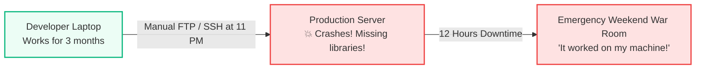

# CI/CD: Fundamentals, GitOps & Pipeline Design

> **Cluster 04 — Module 01**  
> **Level**: Beginner Foundations to Production & FAANG-Level Deep Dive  
> **Key References**: TechWorld with Nana, Martin Fowler, DORA Metrics, OpenGitOps Principles

---

## 🌱 0. The Beginner's Mental Model: Why Do We Need CI/CD?

### The Nightmare Before CI/CD: The "Deployment Friday Panic"
Years ago, software deployment was a terrifying, manual ordeal:
- Developers wrote code on their personal laptops for 3 to 6 months in complete isolation.
- On "Release Weekend", the team scheduled a 12-hour maintenance outage at midnight on Friday.
- A senior engineer manually copied `.jar` or `.zip` files over SSH or FTP to 10 live servers, manually edited configuration files, and executed database scripts.
- Inevitably, something broke. A missing DLL, an incompatible Java version, or a conflicting database column caused production to crash!
- Engineers spent the entire weekend sleeplessly debugging in production, blaming each other: *"It worked on my machine!"*



---

### The Real-World Analogy: The Automated Car Assembly Line
*(TechWorld with Nana & DevOps Manufacturing Analogy)*

Think of an automated automotive factory (like Toyota or Tesla):
- You don't build a car by having someone hammer metal in their backyard and drive it straight onto the highway.
- The car moves along an automated conveyor belt (**The Pipeline**):
  - **Station 1**: Assemble frame & stress test the welds (**Unit Testing & Linters**).
  - **Station 2**: Drop in the engine and check oil pressure (**Integration Tests & Build**).
  - **Station 3**: Laser scan for structural defects (**Security & Vulnerability Scans - Trivy/SAST**).
  - **Station 4**: Drive on test track under heavy rain simulation (**Deploy to Staging**).
  - **Station 5**: Ship to customer's driveway (**Production Release**).
- **The Golden Safety Rule**: If ANY station detects a defect (a failed test or security flaw), **the entire conveyor belt halts immediately**! Broken code is NEVER allowed to reach production.

```mermaid
flowchart LR
    Commit["Code Push\n(git commit)"] --> Lint["1. Quality Gate\nLint & Unit Tests"]
    Lint --> Sec["2. Security Gate\nSAST & Vulnerability Scans"]
    Sec --> Build["3. Package Gate\nDocker Build & Push"]
    Build --> Stage["4. Verification Gate\nDeploy to Staging"]
    Stage --> Prod["5. Release Gate\nDeploy to Production"]

    style Commit fill:#f3f4f6,stroke:#4b5563,stroke-width:2px
    style Lint fill:#eff6ff,stroke:#2563eb,stroke-width:2px
    style Sec fill:#fef3c7,stroke:#d97706,stroke-width:2px
    style Build fill:#dbeafe,stroke:#1d4ed8,stroke-width:2px
    style Stage fill:#e0e7ff,stroke:#4338ca,stroke-width:2px
    style Prod fill:#dcfce7,stroke:#16a34a,stroke-width:2px
```



---

## ⚡ 1. Before vs. After: The CI/CD Transformation

| Metric / Aspect | Before CI/CD (Manual Releases) | After CI/CD (Automated Pipelines) | Why This Helps (The Impact) |
| :--- | :--- | :--- | :--- |
| **Release Frequency** | Once every 3 to 6 months ("Big Bang" releases). | Multiple times **per day** (small, incremental releases). | Delivers new features to customers 100x faster. |
| **Risk per Release** | Massive risk; thousands of changed files deployed at once. | Tiny risk; each release has only a few lines of code. | If a bug occurs, isolating and rolling back takes 2 minutes! |
| **Testing Confidence** | Manual QA testing taking 2 weeks; human fatigue leads to missed bugs. | Automated unit, integration, and security tests run on every pull request. | Catches bugs within 5 minutes of being written. |
| **Rollback Time** | Hours of manual forensic work; restoring database backups. | Automated 1-click or automated canary rollbacks. | Mean Time to Recovery (MTTR) drops from hours to seconds. |

---

## 🚦 2. The Big Three: CI vs. CD (Delivery) vs. CD (Deployment)

Many beginners get confused between the three terms. Here is the definitive breakdown:

```mermaid
flowchart TD
    subgraph CI["1. Continuous Integration (CI)"]
        A["Developer commits code"] --> B["Automated Build"]
        B --> C["Automated Unit & Integration Tests"]
        C --> D["Static Code Analysis & Security Scans"]
    end

    subgraph CD_Deliv["2. Continuous Delivery (CD)"]
        D --> E["Package Docker Image / Artifact"]
        E --> F["Deploy to Staging Environment"]
        F --> G{"🛑 Manual Business Approval Gate\n(Product Manager clicks 'Approve')"}
    end

    subgraph CD_Deploy["3. Continuous Deployment"]
        G -->|Approved| H["🚀 Automated Production Deployment"]
        F -.->|Fully Automated (No Human Gate)| H
    end

    style CI fill:#eff6ff,stroke:#2563eb,stroke-width:2px
    style CD_Deliv fill:#fef3c7,stroke:#d97706,stroke-width:2px
    style CD_Deploy fill:#dcfce7,stroke:#16a34a,stroke-width:2px
```

### The Bakery Analogy:
- **Continuous Integration (CI)**: Mixing the dough and baking the bread loaves continuously throughout the day.
- **Continuous Delivery**: Placing the fresh bread on the bakery shelf, ready for sale. The store manager makes a conscious business choice when to sell it (**Manual Approval**).
- **Continuous Deployment**: The bread rolls straight out of the oven onto the customer's dining table without any human touching it (**100% Fully Automated**)!

---

## 🐙 3. Push-Based CI/CD vs. Pull-Based GitOps (ArgoCD)

How should a pipeline deploy to Kubernetes?

```mermaid
flowchart TD
    subgraph Push_Model["Traditional Push Model (Jenkins / GitHub Actions Direct)"]
        GHA["External CI Server\n(GitHub Actions / Jenkins)"] -->|Requires Production Cluster-Admin Kubeconfig! ⚠️| API1["Kube-API Server"]
        API1 --> Cluster1["Production Cluster"]
    end

    subgraph Pull_Model["Modern Pull-Based GitOps (ArgoCD / Flux)"]
        GitRepo[("Git Config Repository\n(Single Source of Truth)")]
        Argo["ArgoCD Operator\n(Runs INSIDE the secure cluster)"]
        API2["Internal Kube-API"]

        Argo -->|1. Watches for changes (Read-Only Git)| GitRepo
        Argo -->|2. Detects drift & applies diff internally| API2
        API2 --> Cluster2["Production Cluster"]
    end

    style Push_Model fill:#fef2f2,stroke:#ef4444,stroke-width:1px
    style Pull_Model fill:#ecfdf5,stroke:#10b981,stroke-width:2px
    style Argo fill:#dcfce7,stroke:#16a34a,stroke-width:2px
```

### Why Pull-Based GitOps is the Gold Standard:
1. **Zero External Credentials**: You never store production cluster admin tokens inside GitHub Actions or Jenkins.
2. **Automatic Self-Healing**: If a junior engineer runs `kubectl delete deployment` manually, ArgoCD instantly detects the drift against Git and recreates the deployment!
3. **Git as Single Source of Truth**: The Git commit history (`git log`) is the complete audit trail of who changed what, when, and why.

---

## 📈 4. The 4 DORA Metrics (What Elite Engineering Teams Measure)

Google's DevOps Research and Assessment (DORA) identifies four metrics that distinguish top-performing engineering organizations:

| DORA Metric | What It Measures | Elite Performance Level | Low Performance Level |
| :--- | :--- | :--- | :--- |
| **1. Deployment Frequency** | How often code is successfully deployed to production. | Multiple deploys per day | Once per month to 6 months |
| **2. Lead Time for Changes** | Time from a commit being created to running in production. | Less than 1 hour | 1 to 6 months |
| **3. Change Failure Rate** | Percentage of deployments that cause a production outage or defect. | 0% – 5% | 46% – 60% |
| **4. Time to Restore Service (MTTR)** | How long it takes to recover from a production outage. | Less than 1 hour | More than 1 week |

---

## 💼 5. Interview Preparation: High-Yield Questions & Answers

### Q1: "Explain the difference between Continuous Delivery and Continuous Deployment."
- **The Answer**:
  - *"Both practices automate the build, test, and staging deployment phases.  
  - In **Continuous Delivery**, every green build is inherently release-ready and deployed to staging, but the final promotion to production requires a deliberate human business trigger (such as a release manager clicking 'Approve').  
  - In **Continuous Deployment**, there is zero human intervention; every commit that passes all automated tests and quality gates is immediately and automatically deployed directly into production."*

---

### Q2: "What is GitOps and why is Pull-Based GitOps safer than Push-Based CI/CD?"
- **The Answer**:
  - *"GitOps is an operational framework where Git repositories serve as the single source of truth for declarative infrastructure and application configurations.  
  - In **Push-based CI/CD**, an external server (like Jenkins or GitHub Actions) requires cluster-admin credentials to push changes into Kubernetes, creating a major security risk if the CI runner is compromised.  
  - In **Pull-based GitOps** (e.g. ArgoCD), an operator lives inside the Kubernetes cluster with zero external network ingress. It continuously pulls the desired state from Git, compares it with live cluster state, and automatically reconciles configuration drift."*

---

### Q3: "What is Trunk-Based Development vs GitFlow?"
- **The Answer**:
  - **GitFlow** uses long-lived branches (`develop`, `feature/*`, `release/*`). Features take days or weeks to merge, leading to massive merge conflicts ("Merge Hell") and delayed feedback loops.
  - **Trunk-Based Development** encourages developers to commit small, short-lived branches (< 24 hours) directly into `main` (the trunk) multiple times a day. Features that are still in progress are hidden behind **Feature Flags**, decoupling code deployment from feature release.

---

### Q4: "How do you handle database migrations in a zero-downtime CI/CD pipeline?"
- **The Answer**:
  - *"Database migrations must always be backward-compatible (the Expand and Contract pattern):  
    1. **Expand**: Run migration to add new nullable columns or tables first, ensuring old application versions continue working.  
    2. **Deploy**: Deploy the new application version that writes to both old and new columns.  
    3. **Contract**: Once all pods are updated and verified, run a follow-up migration in a subsequent release to deprecate and drop the unused legacy columns."*
