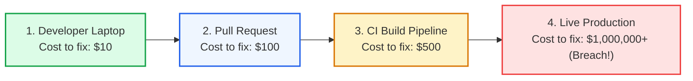
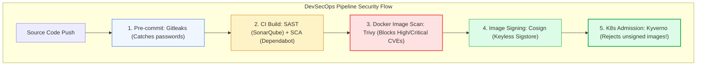

# CI/CD: DevSecOps, Container Security & Supply Chain Defense

> **Cluster 04 — Module 03**  
> **Level**: Beginner Foundations to Production & FAANG-Level Deep Dive  
> **Key References**: TechWorld with Nana, Aqua Security Trivy, OpenSSF SLSA Framework

---

## 🌱 0. The Beginner's Mental Model: What is DevSecOps & "Shift-Left"?

### The Doctor Checkup Analogy: The Cost of Fixing Bugs
- If a doctor catches a small cavity during a routine 6-month dental checkup, it takes 15 minutes and costs $50 to fill.
- If you ignore it until the tooth decays to the root and infects your jaw, it requires emergency hospital surgery costing $50,000 and intense pain!

In software engineering:
- Finding a security flaw on a **developer's laptop** costs 2 minutes to edit the code.
- Finding a leaked API key or SQL injection vulnerability **after deploying to production** leads to stolen customer credit cards, ransomware, a $10,000,000 fine, and corporate reputational collapse!



> **The Golden Rule of "Shift-Left"**:  
> In a project timeline (moving from Left to Right $\to$ Code $\to$ Build $\to$ Deploy $\to$ Production), **Shift-Left** means moving security testing as far to the **left (earliest stages)** as possible so vulnerabilities are caught before they ever leave the developer's pull request!

---

## 🛡️ 1. The Security Arsenal: SAST vs. SCA vs. DAST vs. Trivy

*(TechWorld with Nana Mental Model)*

| Security Tool | Plain-English Analogy | What It Actually Does | Popular Tools |
| :--- | :--- | :--- | :--- |
| **SAST (Static Testing)** | **Code Spellchecker & Grammar Police** | Analyzes raw source code without executing it, looking for bad programming practices and injection bugs. | SonarQube, CodeQL, Semgrep |
| **SCA (Dependency Audit)** | **Food Allergen & Expiration Inspector** | Scans your third-party dependencies (`pom.xml`, `package.json`) against known CVE databases (e.g. Log4j vulnerability). | Snyk, Dependabot, OWASP DC |
| **Container Scanning (Trivy)** | **Airport Luggage X-Ray Scanner** | Inspects every layer of a built Docker container image for unpatched OS libraries and CVEs. | Aqua Trivy, Grype, Clair |
| **DAST (Dynamic Testing)** | **Simulated Bank Robber / Pen Tester** | Attacks a live running application from the outside with automated malicious payloads to see if it breaches. | OWASP ZAP, Burp Suite |
| **Secret Detection** | **Metal Detector for Passwords** | Scans Git commits to ensure no developer accidentally committed private keys or passwords. | Gitleaks, TruffleHog |
| **Image Signing (Cosign)** | **The Wax Royal Seal on an Envelope** | Digitally signs container images so Kubernetes knows the image was not tampered with in Docker Hub. | Sigstore Cosign |



---

## ⚡ 2. Before vs. After: DevSecOps

| Metric | Before (Old-School Security Gate) | After (DevSecOps Shift-Left) | Why This Helps (The Impact) |
| :--- | :--- | :--- | :--- |
| **Security Review Timing** | Once every 6 months right before major launch; blocks releases for weeks. | Automated scans execute in **under 2 minutes** on every pull request. | Security becomes an automated enabler, not a bottleneck. |
| **Secret Leaks** | Passwords committed to Git; bots scrape and drain cloud accounts. | **Gitleaks** blocks commits containing credentials before git push succeeds. | Zero leaked credentials in public or private git history. |
| **Unpatched Vulnerabilities** | Outdated base images running known exploits in production. | **Trivy** fails the pipeline build if unpatched Critical CVEs are detected. | Zero known high-severity vulnerabilities deployed to production. |
| **Registry Tampering** | Anyone with Docker Hub access can overwrite `my-app:latest` with malicious code. | **Cosign digital signatures** validated by Kubernetes Kyverno admission webhooks. | Untrusted, unsigned images cannot run inside your Kubernetes cluster. |

---

## 🛠️ 3. Hands-On Production Trivy Scan in GitHub Actions

```yaml
- name: Run Aqua Trivy Vulnerability Scanner
  uses: aquasecurity/trivy-action@master
  with:
    image-ref: 'ghcr.io/${{ github.repository }}:${{ github.sha }}'
    format: 'table'
    exit-code: '1'             # Fails the pipeline if vulnerabilities found!
    ignore-unfixed: true      # Don't fail if the OS vendor hasn't released a patch yet
    severity: 'CRITICAL,HIGH'  # Only block on Critical and High severity CVEs
```

---

## 💼 4. Interview Preparation: High-Yield Questions & Answers

### Q1: "What is DevSecOps and what does 'Shift-Left' mean?"
- **The Answer**:
  - *"DevSecOps is the integration of automated security practices at every stage of the software development and DevOps lifecycle.  
  - 'Shift-Left' refers to moving security verifications (such as secret detection, static code analysis, dependency audits, and container vulnerability scanning) earlier into the development timeline (towards the left), catching and fixing vulnerabilities during local development and CI pull requests rather than right before or after production deployment."*

---

### Q2: "What is the difference between SAST, DAST, and SCA?"
- **The Answer**:
  - **SAST (Static Application Security Testing)**: Scans source code from the inside (white-box) without running the application, identifying coding mistakes like SQL injection and buffer overflows.
  - **SCA (Software Composition Analysis)**: Scans open-source third-party dependencies (like Maven libraries or npm packages) for known CVE vulnerabilities and license compliance.
  - **DAST (Dynamic Application Security Testing)**: Tests the live, running application from the outside (black-box) by simulating real hacker attacks against HTTP endpoints.

---

### Q3: "What is an SBOM and why is it important?"
- **The Answer**:
  - *"An SBOM (Software Bill of Materials) is a machine-readable inventory of every library, compiler, third-party package, and license bundled inside a container or software artifact.  
  - It is critical for modern supply chain security; when a zero-day vulnerability (like Log4j or Heartbleed) is disclosed, an organization can instantly search its SBOM database to identify exactly which production containers contain the vulnerable library within seconds."*

---

### Q4: "How does container image signing with Cosign prevent supply chain attacks?"
- **The Answer**:
  - *"Cosign uses public-key cryptography to digitally sign container images during the CI build process.  
  - Inside Kubernetes, an Admission Controller (such as Kyverno or OPA Gatekeeper) intercepts pod creation requests, validates the cryptographic signature against trusted public keys, and rejects any container that is unsigned or has been tampered with in the registry, ensuring that only verified CI-built images can execute in production."*
