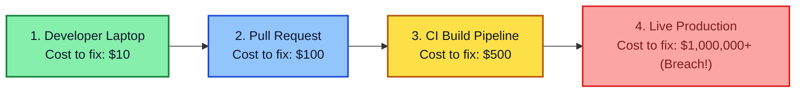

# CI/CD: DevSecOps, Container Security & Supply Chain Defense

> **Cluster 04 — Module 03**  
> **Level**: Beginner Foundations to Production & FAANG-Level Deep Dive  
> **Key References**: TechWorld with Nana, Aqua Security Trivy, OpenSSF SLSA Framework

---

## 🌱 0. The Beginner's Mental Model: What is DevSecOps & "Shift-Left"?

### The Doctor Checkup Analogy: The Cost of Fixing Bugs
- If a doctor catches a small cavity during a routine 6-month dental checkup, it takes 15 minutes and costs $50 to fill.
- If you ignore it until the tooth decays to the root and infects your jaw, it requires emergency hospital surgery costing $50,000 and intense pain!

In software engineering:
- Finding a security flaw on a **developer's laptop** costs 2 minutes to edit the code.
- Finding a leaked API key or SQL injection vulnerability **after deploying to production** leads to stolen customer credit cards, ransomware, a $10,000,000 fine, and corporate reputational collapse!



> **The Golden Rule of "Shift-Left"**:  
> In a project timeline (moving from Left to Right $\to$ Code $\to$ Build $\to$ Deploy $\to$ Production), **Shift-Left** means moving security testing as far to the **left (earliest stages)** as possible so vulnerabilities are caught before they ever leave the developer's pull request!

---

## 📖 1. Comprehensive Study Notes: Understanding DevSecOps & Supply Chain Defense from the Ground Up

### What is DevSecOps and "Shift-Left"? (Straightforward Definition & Context)
> **Book Definition**: DevSecOps is an organizational software engineering culture that automates the integration of security practices and compliance gates at every phase of the software delivery lifecycle.

**DevSecOps** is the cultural, architectural, and operational engineering practice of integrating automated security testing, vulnerability management, and compliance controls into every stage of the software delivery lifecycle—from initial coding to automated testing, container packaging, and production runtime.

To appreciate why DevSecOps is vital, consider how security was handled traditionally:
* **The Traditional Security Bottleneck**: Development and Operations teams shipped features as quickly as possible, while Security operated as a detached, external audit team. A formal security review took place only once every six months, right before a major scheduled release. When the security team invariably discovered critical vulnerabilities days before launch, releases were delayed for weeks, sparking heated organizational blame.
* **The Shift-Left Philosophy**: If the timeline of software delivery progresses from left to right (**Code $\to$ Build $\to$ Test $\to$ Deploy $\to$ Production**), "Shift-Left" means moving security checks as far to the **left (earliest stages)** as possible. Finding a flaw on a developer's workstation or within an automated pull request takes minutes to fix at negligible cost. Conversely, discovering a vulnerability after an attacker breaches a production database results in catastrophic financial losses, regulatory fines, and permanent reputational damage.

---

### What does the DevSecOps Arsenal actually do? (Mechanics & Tool Categories)
Modern CI/CD pipelines erect an automated, defense-in-depth security perimeter using specialized tool categories that inspect different layers of the software stack:

1. **Secret Detection (Gitleaks / TruffleHog)**:
   * **The Threat**: Developers accidentally hardcoding API tokens, private SSH keys, database passwords, or cloud credentials into git repositories.
   * **The Mechanics**: Secret scanners use regex pattern matching and Shannon entropy algorithms to detect high-randomness strings within source code, commit messages, and PR diffs. When configured as git `pre-commit` hooks or CI checks, they reject commits before credentials can be pushed to remote repositories.

2. **Static Application Security Testing - SAST (SonarQube, GitHub CodeQL, Semgrep)**:
   * *Book Definition*: Static Application Security Testing (SAST) is a white-box testing methodology that analyzes source code, byte code, or binaries for security vulnerabilities without executing the program.
   * **The Mechanics**: SAST tools perform "white-box" analysis by scanning raw application source code without executing it.
   * They build an Abstract Syntax Tree (AST) and perform taint analysis—tracking how untrusted user inputs (sources) flow through application logic to sensitive database queries or system calls (sinks). This catches critical programming bugs like SQL injection, cross-site scripting (XSS), path traversal, and insecure deserialization.

3. **Software Composition Analysis - SCA (Snyk, Dependabot, OWASP Dependency-Check)**:
   * *Book Definition*: Software Composition Analysis (SCA) is an automated security process that identifies and tracks open-source components, license compliance, and known vulnerabilities (CVEs) within an application's dependency tree.
   * **The Mechanics**: Over 85% of modern enterprise application code consists of third-party open-source dependencies (Maven artifacts, npm packages, Python wheels, Go modules).
   * SCA scanners parse lockfiles (`pom.xml`, `package-lock.json`, `go.sum`), extract the full dependency tree (including transitive dependencies), and compare them against national vulnerability databases (e.g., NIST NVD, GitHub Advisory Database) to identify known Common Vulnerabilities and Exposures (CVEs). They automatically generate Pull Requests to upgrade libraries to patched versions.

4. **Container Image Scanning (Aqua Trivy, Grype)**:
   * *Book Definition*: Container Scanning is the automated inspection of container image layers, base OS packages, and language dependencies to detect known vulnerabilities before deployment.
   * **The Mechanics**: A container image is not just application code; it bundles an entire miniature Linux operating system (Debian, Ubuntu, Alpine) with hundreds of system utilities and shared libraries (OpenSSL, curl, glibc).
   * Scanners like Trivy unpack OCI image layers, index all installed OS packages and language runtimes, and report vulnerabilities with Common Vulnerability Scoring System (CVSS) ratings. CI pipelines enforce thresholds (e.g., `exit-code: 1` on `CRITICAL,HIGH`), automatically blocking vulnerable images from publishing to registries.

5. **Dynamic Application Security Testing - DAST (OWASP ZAP, StackHawk)**:
   * *Book Definition*: Dynamic Application Security Testing (DAST) is a black-box security testing methodology that probes an active, running application from the outside to identify exploitable security vulnerabilities.
   * **The Mechanics**: DAST conducts "black-box" testing against a live, running instance of the application in an ephemeral staging environment.
   * Acting like an automated penetration tester, the tool sends malformed HTTP payloads, tests for insecure HTTP headers, probes for authentication bypasses, and checks for CORS and SSL/TLS misconfigurations from the outside.

6. **Image Signing & Supply Chain Provenance (Sigstore Cosign & Kyverno)**:
   * *Book Definition*: Cosign is an open-source container signing tool from the Sigstore project that facilitates container signing, verification, and storage in OCI registries to ensure software supply chain integrity.
   * **The Mechanics**: Prevents container registry tampering and unauthorized deployments. During the CI build, after all tests and vulnerability scans pass, **Cosign** digitally signs the container image digest using public-key cryptography.
   * Inside the production Kubernetes cluster, an Admission Controller (e.g., **Kyverno** or **OPA Gatekeeper**) intercepts pod creation requests. It cryptographically verifies that the image was signed by the official CI pipeline key. Unsigned or tampered images are instantly blocked from running.

---

### Why do we need it & What help does it provide? (Concrete Engineering Benefits)
* **Accelerated Time-to-Market Without Security Sacrifices**: Automated CI/CD security scans execute in 2 to 3 minutes during routine pull request builds, eliminating the traditional 3-week manual security audit bottleneck.
* **Resilience Against Supply Chain Attacks**: Cryptographic image signing and Software Bill of Materials (SBOM) generation ensure that only verified, tamper-proof artifacts built by trusted CI workflows reach production clusters.
* **Instant Incident Response to Zero-Day Disclosures**: When widespread zero-day vulnerabilities emerge (such as Log4j or OpenSSL vulnerabilities), teams with automated SCA and SBOM inventories can search their entire application fleet in seconds to pinpoint precisely which microservices require immediate patching.
* **Continuous Regulatory Compliance**: Automated pipeline security controls provide auditable, tamper-resistant evidence required by regulatory standards (SOC 2, ISO 27001, HIPAA, PCI-DSS) that every deployed production release has passed strict security gates.

---

## 🛡️ 2. The Security Arsenal: SAST vs. SCA vs. DAST vs. Trivy

*(TechWorld with Nana Mental Model)*

| Security Tool | Plain-English Analogy | What It Actually Does | Popular Tools |
| :--- | :--- | :--- | :--- |
| **SAST (Static Testing)** | **Code Spellchecker & Grammar Police** | Analyzes raw source code without executing it, looking for bad programming practices and injection bugs. | SonarQube, CodeQL, Semgrep |
| **SCA (Dependency Audit)** | **Food Allergen & Expiration Inspector** | Scans your third-party dependencies (`pom.xml`, `package.json`) against known CVE databases (e.g. Log4j vulnerability). | Snyk, Dependabot, OWASP DC |
| **Container Scanning (Trivy)** | **Airport Luggage X-Ray Scanner** | Inspects every layer of a built Docker container image for unpatched OS libraries and CVEs. | Aqua Trivy, Grype, Clair |
| **DAST (Dynamic Testing)** | **Simulated Bank Robber / Pen Tester** | Attacks a live running application from the outside with automated malicious payloads to see if it breaches. | OWASP ZAP, Burp Suite |
| **Secret Detection** | **Metal Detector for Passwords** | Scans Git commits to ensure no developer accidentally committed private keys or passwords. | Gitleaks, TruffleHog |
| **Image Signing (Cosign)** | **The Wax Royal Seal on an Envelope** | Digitally signs container images so Kubernetes knows the image was not tampered with in Docker Hub. | Sigstore Cosign |

```mermaid
flowchart TD
    subgraph Pipeline_Security["DevSecOps Pipeline Security Flow"]
        Code["Source Code Push"] --> Pre["1. Pre-commit: Gitleaks (Catches passwords)"]
        Pre --> SAST_SCA["2. CI Build: SAST (SonarQube) + SCA (Dependabot)"]
        SAST_SCA --> TrivyScan["3. Docker Image Scan: Trivy (Blocks High/Critical CVEs)"]
        TrivyScan --> Sign["4. Image Signing: Cosign (Keyless Sigstore)"]
        Sign --> K8sVerify["5. K8s Admission: Kyverno (Rejects unsigned images!)"]
    end

    style Pipeline_Security fill:#f1f5f9,stroke:#64748b,stroke-width:2px,color:#0f172a
    style Code fill:#e2e8f0,stroke:#334155,stroke-width:1.5px,color:#0f172a
    style Pre fill:#93c5fd,stroke:#1d4ed8,stroke-width:2px,color:#0f172a
    style SAST_SCA fill:#fde047,stroke:#b45309,stroke-width:2px,color:#0f172a
    style TrivyScan fill:#fca5a5,stroke:#dc2626,stroke-width:2px,color:#7f1d1d
    style Sign fill:#86efac,stroke:#15803d,stroke-width:2px,color:#0f172a
    style K8sVerify fill:#86efac,stroke:#15803d,stroke-width:2px,color:#0f172a
```



---

## ⚡ 3. Before vs. After: DevSecOps

| Metric | Before (Old-School Security Gate) | After (DevSecOps Shift-Left) | Why This Helps (The Impact) |
| :--- | :--- | :--- | :--- |
| **Security Review Timing** | Once every 6 months right before major launch; blocks releases for weeks. | Automated scans execute in **under 2 minutes** on every pull request. | Security becomes an automated enabler, not a bottleneck. |
| **Secret Leaks** | Passwords committed to Git; bots scrape and drain cloud accounts. | **Gitleaks** blocks commits containing credentials before git push succeeds. | Zero leaked credentials in public or private git history. |
| **Unpatched Vulnerabilities** | Outdated base images running known exploits in production. | **Trivy** fails the pipeline build if unpatched Critical CVEs are detected. | Zero known high-severity vulnerabilities deployed to production. |
| **Registry Tampering** | Anyone with Docker Hub access can overwrite `my-app:latest` with malicious code. | **Cosign digital signatures** validated by Kubernetes Kyverno admission webhooks. | Untrusted, unsigned images cannot run inside your Kubernetes cluster. |

---

## 🛠️ 4. Hands-On Production Trivy Scan in GitHub Actions

```yaml
- name: Run Aqua Trivy Vulnerability Scanner
  uses: aquasecurity/trivy-action@master
  with:
    image-ref: 'ghcr.io/${{ github.repository }}:${{ github.sha }}'
    format: 'table'
    exit-code: '1'             # Fails the pipeline if vulnerabilities found!
    ignore-unfixed: true      # Don't fail if the OS vendor hasn't released a patch yet
    severity: 'CRITICAL,HIGH'  # Only block on Critical and High severity CVEs
```

---

## 💼 5. Interview Preparation: High-Yield Questions & Answers

### Q1: "What is DevSecOps and what does 'Shift-Left' mean?"
- **The Answer**:
  - *"DevSecOps is the integration of automated security practices at every stage of the software development and DevOps lifecycle.  
  - 'Shift-Left' refers to moving security verifications (such as secret detection, static code analysis, dependency audits, and container vulnerability scanning) earlier into the development timeline (towards the left), catching and fixing vulnerabilities during local development and CI pull requests rather than right before or after production deployment."*

---

### Q2: "What is the difference between SAST, DAST, and SCA?"
- **The Answer**:
  - **SAST (Static Application Security Testing)**: Scans source code from the inside (white-box) without running the application, identifying coding mistakes like SQL injection and buffer overflows.
  - **SCA (Software Composition Analysis)**: Scans open-source third-party dependencies (like Maven libraries or npm packages) for known CVE vulnerabilities and license compliance.
  - **DAST (Dynamic Application Security Testing)**: Tests the live, running application from the outside (black-box) by simulating real hacker attacks against HTTP endpoints.

---

### Q3: "What is an SBOM and why is it important?"
- **The Answer**:
  - *"An SBOM (Software Bill of Materials) is a machine-readable inventory of every library, compiler, third-party package, and license bundled inside a container or software artifact.  
  - It is critical for modern supply chain security; when a zero-day vulnerability (like Log4j or Heartbleed) is disclosed, an organization can instantly search its SBOM database to identify exactly which production containers contain the vulnerable library within seconds."*

---

### Q4: "How does container image signing with Cosign prevent supply chain attacks?"
- **The Answer**:
  - *"Cosign uses public-key cryptography to digitally sign container images during the CI build process.  
  - Inside Kubernetes, an Admission Controller (such as Kyverno or OPA Gatekeeper) intercepts pod creation requests, validates the cryptographic signature against trusted public keys, and rejects any container that is unsigned or has been tampered with in the registry, ensuring that only verified CI-built images can execute in production."*
