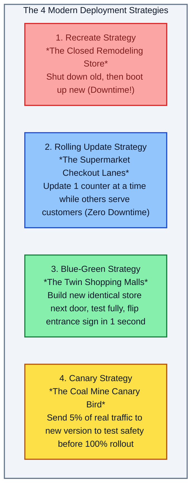
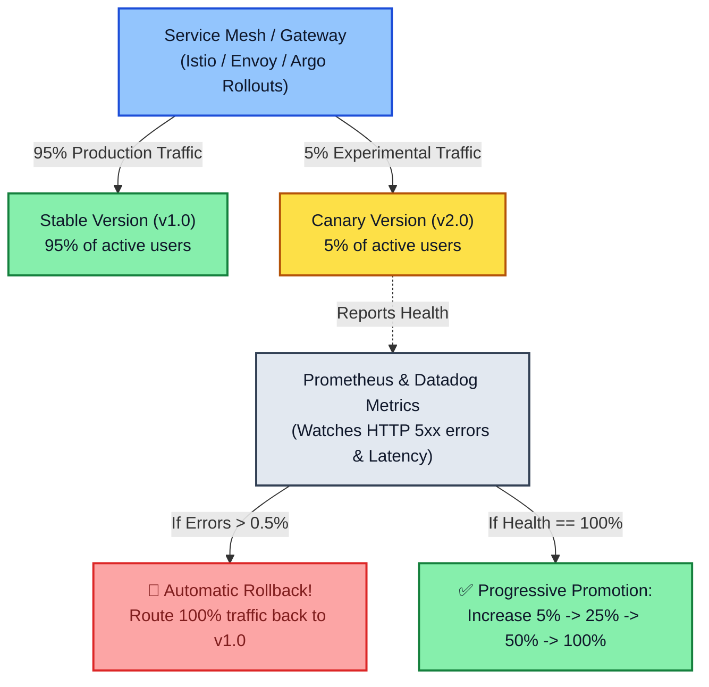
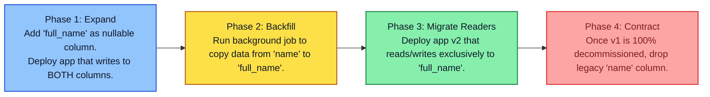

# Deployment Strategies: Rolling, Blue-Green, Canary & A/B

> **Cluster 04 — Module 04**  
> **Level**: Beginner Foundations to Production & FAANG-Level Deep Dive  
> **Key References**: TechWorld with Nana, Argo Rollouts, Martin Fowler Evolutionary Database Design

---

## 🌱 0. The Beginner's Mental Model: How Do We Upgrade Live Systems?

When you have millions of active users buying products on Amazon or streaming movies on Netflix, you cannot simply shut down your servers to deploy a code update.  
How do software companies update live applications without customers noticing a single glitch? Through **Deployment Strategies**!

---

### The Real-World Analogies (TechWorld with Nana)

1. **Recreate (The Closed Store)**:
   - The store hangs a sign: *"Closed for remodeling from 12 AM to 4 AM"*.
   - All old pods are terminated before new pods are launched.
   - *Pros*: Simple, zero chance of two versions running concurrently.
   - *Cons*: **Noticeable downtime for users**.

2. **Rolling Update (The Checkout Counters)**:
   - A grocery store has 4 cash registers. They shut down register 1 to upgrade the software, while registers 2, 3, and 4 continue ringing up customers. Once register 1 is verified, they upgrade register 2.
   - *Pros*: **Zero downtime**, default in Kubernetes.
   - *Cons*: Old and new versions run side-by-side for a few minutes; requires backward-compatible databases.

3. **Blue-Green Deployment (The Twin Malls)**:
   - You build an identical new shopping center right next door (**Green**). You test all air conditioners, lights, and cash registers. When everything is 100% verified, you simply flip the highway sign to direct all traffic to the Green mall!
   - *Pros*: **Instant cutover** and **instant 1-second rollback** if something goes wrong.
   - *Cons*: Requires **2x hardware resources** (costs more cloud money).

4. **Canary Deployment (The Miner's Canary Bird)**:
   - In 19th-century coal mines, miners brought a small canary bird into tunnels. Because canaries are sensitive to gases, if odorless methane or carbon monoxide leaked, the canary reacted first, alerting miners to evacuate safely.
   - In software: We route **5% of real user traffic** to the new version (v2.0) while keeping 95% on the stable version (v1.0). If Prometheus detects an error rate $> 0.1\%$, the canary is terminated automatically. Only 5% of users were affected, protecting 95% of your customer base!

---

## 📖 1. Comprehensive Study Notes: Understanding Deployment Strategies from the Ground Up

### What are Deployment Strategies?
A **Deployment Strategy** is an operational methodology used to upgrade a software service from an existing version to a new version in a live target environment (such as Kubernetes clusters, virtual machines, or serverless infrastructure) while systematically controlling downtime, risk, hardware resource cost, and user experience.

To grasp the necessity of modern deployment strategies, contrast them with historical release practices:
* **The Legacy Paradigm (Maintenance Windows & Downtime)**: In traditional monolithic IT, upgrades required scheduled downtime. Engineering teams forced systems offline during late-night maintenance windows, ran database update scripts, replaced application binaries, and restarted servers. If an unforeseen bug occurred, recovering required hours of forensic rollbacks and restoring multi-gigabyte database backups.
* **The Modern Cloud-Native Expectation**: In modern 24/7 global platforms (e.g., Netflix, Amazon, Uber), scheduled downtime is completely unacceptable. Modern deployment strategies leverage intelligent traffic routing, container orchestrators, and automated observability to deploy new features continuously during peak business hours with zero user-perceived disruption.

---

### What do the 4 Core Strategies actually do? (Step-by-Step Mechanics)
Modern engineering organizations utilize four primary deployment strategies depending on risk tolerance and architecture:

1. **Recreate Strategy**:
   * The Recreate deployment strategy shuts down all existing application instances before provisioning new versions, eliminating version concurrency at the expense of downtime.
   * **Mechanics**: The deployment controller completely terminates and deletes all existing version 1 (`v1`) pods or server instances before spinning up any version 2 (`v2`) instances.
   * **Behavior**: Guarantees that two conflicting versions of the application never run concurrently against the database. However, users experience total service downtime during the gap between `v1` termination and `v2` startup readiness.
   * **Best For**: Non-critical development environments, offline batch processing pipelines, or legacy monolithic systems incapable of running multi-version database migrations.

2. **Rolling Update Strategy (Default in Kubernetes)**:
   * The Rolling Update strategy incrementally replaces instances of the previous application version with the new version, maintaining application availability throughout the update window.
   * **Mechanics**: The orchestrator gradually replaces old `v1` pods with new `v2` pods in a controlled, phased sequence.
   * **Configuration**: Governed in Kubernetes deployments by two crucial throttling parameters:
     * `maxSurge`: The maximum number of pods that can be created *above* the desired replica count during the update (e.g., `25%`).
     * `maxUnavailable`: The maximum number of pods that can be *unreachable* during the update (e.g., `0%` or `25%`).
   * **Traffic Routing**: Traffic is only routed to a newly spawned `v2` pod after its `readinessProbe` succeeds. Once `v2` is confirmed healthy, a corresponding `v1` pod is sent a `SIGTERM` and terminated.
   * **Trade-Off**: Provides zero downtime, but `v1` and `v2` run simultaneously side-by-side for several minutes, requiring strict backward compatibility in databases and caching layers.

3. **Blue-Green (Red-Black) Deployment**:
   * Blue-Green deployment is a release technique that utilizes two identical production environments (one active, one standby) to achieve instantaneous cutovers and rollbacks with zero downtime.
   * **Mechanics**: Two complete, identical production environments exist side-by-side. The current live version runs in the **Blue** environment, receiving 100% of user traffic through a router, load balancer, or Kubernetes Service selector.
   * **The Release Flow**: The new version is deployed entirely into the idle **Green** environment. Comprehensive end-to-end smoke tests and synthetic user journeys run against Green in isolation without affecting real users.
   * **The Cutover**: Once Green is certified 100% production-ready, the load balancer or Service selector is updated to point to Green. Traffic shifts instantaneously ($< 1$ second).
   * **Instant Rollback**: If unexpected critical errors emerge post-cutover, traffic is immediately flipped back to Blue with a single configuration change.
   * **Trade-Off**: Requires double the hardware footprint ($2\times$ compute resources) while both environments run.

4. **Canary Deployment**:
   * Canary deployment is a progressive delivery strategy that exposes a new software release to a small fraction of real production traffic to validate performance and stability before broad rollout.
   * **Mechanics**: Inspired by the historic practice of coal miners using canary birds to detect poisonous gases before humans were harmed. The new `v2` version is deployed alongside `v1`, but an intelligent traffic manager (such as Argo Rollouts, Istio, or Envoy) routes only a tiny fraction of live user traffic (e.g., 2% to 5%) to `v2`, keeping the remaining 95% on stable `v1`.
   * **Automated Metric Analysis**: Telemetry engines (Prometheus, Datadog) monitor golden signals on the canary pods: HTTP 5xx error rates, response latencies, and panic logs.
   * **Progressive Rollout**: If metrics remain healthy over an observation window (e.g., 15 minutes), traffic incrementally steps up: $5\% \to 25\% \to 50\% \to 100\%$.
   * **Automated Abort & Rollback**: If the error rate exceeds a pre-configured threshold (e.g., $> 0.5\%$), the canary is immediately aborted and 100% of traffic drops back to `v1`. Only 5% of users experienced the bug, protecting 95% of your customer base.

5. **The Database Migration Strategy (The Expand-and-Contract Pattern)**:
   * The Expand-and-Contract (Parallel Change) pattern is a refactoring technique that allows breaking database schema migrations to occur safely alongside concurrent multi-version application releases without downtime.
   * During Rolling Updates and Canary releases, `v1` and `v2` application pods query the exact same database simultaneously.
   * Running a breaking schema change (like dropping a column or renaming `user_name` to `full_name`) causes all running `v1` pods to immediately crash with SQL syntax or mapping exceptions!
   * The **Expand-and-Contract (Parallel Change)** pattern solves this across 4 disciplined phases:
     * **Phase 1 (Expand)**: Add the new column as nullable in the database. Deploy an application update that writes to *both* the old and new columns, but continues reading from the old column.
     * **Phase 2 (Backfill)**: Run an asynchronous background migration script to copy all historical records from the old column into the new column.
     * **Phase 3 (Switch Readers)**: Deploy an application release that reads and writes exclusively to the new column.
     * **Phase 4 (Contract)**: Once all old application instances are retired and traffic is stable, run a final database migration to drop the deprecated legacy column.

---

### Why do we need them & What help do they provide? (Concrete Engineering Benefits)
* **Zero User-Perceived Downtime**: Eliminates scheduled maintenance windows, allowing development teams to deploy multiple times per day without interrupting active user transactions.
* **Radically Minimized Blast Radius**: Canary rollouts ensure that catastrophic regressions or edge-case crashes only impact a minuscule fraction of real users before automated health checks trigger rollbacks.
* **Instantaneous, Stress-Free Rollbacks**: Blue-Green and Canary deployments slash Mean Time to Recovery (MTTR) from hours down to seconds, eliminating emergency weekend war-room panic.
* **Statistically Driven Confidence**: Replacing manual "gut feeling" approvals with automated metric analysis guarantees that deployments are certified by hard runtime telemetry before receiving full production traffic.
* **Safe, Non-Disruptive Schema Evolution**: The Expand-and-Contract pattern allows databases to evolve smoothly alongside decoupled microservices without requiring risky global database locks or synchronized multi-team deployments.

---

## ⚡ 2. Comparison Matrix: Choosing the Right Strategy

| Strategy | User Downtime | Rollback Speed | Cloud Cost | Risk / Blast Radius | When to Choose This |
| :--- | :--- | :--- | :--- | :--- | :--- |
| **Recreate** | **Yes** (1–5 mins) | Slow | $1.0\times$ (Low) | High | Non-critical dev environments or legacy batch systems that cannot handle concurrent versions. |
| **Rolling Update** | **Zero** | Moderate (1–2 mins) | $1.25\times$ (Surge) | Medium | Standard web applications, stateless REST microservices (Kubernetes default). |
| **Blue-Green** | **Zero** | **Instant** ($< 1$ sec) | $2.0\times$ (Double) | Low | Mission-critical releases requiring full human QA testing in production before flipping traffic. |
| **Canary** | **Zero** | **Instant** ($< 5$ sec) | $1.1\times$ (Slight) | **Lowest** (5% exposure) | Tier-1 financial systems, high-traffic consumer apps (Uber, Netflix, Amazon). |

---

## 🔀 3. Architectural Deep Dive: Canary Traffic Shifting with Service Meshes

---

## 🗄️ 4. The Database Dilemma: The Expand-and-Contract Pattern

In Rolling Updates and Canary releases, **version 1.0 and version 2.0 access the database simultaneously**.

> [!CAUTION]
> **The #1 Production Deployment Mistake**:  
> Running a destructive database migration (e.g. renaming column `name` to `full_name`, or dropping a table column) during a rolling update will **instantly crash all version 1.0 pods**, bringing down your website!

### The Solution: The 4-Phase Expand & Contract Pattern

---

## 💼 5. Interview Preparation: High-Yield Questions & Answers

### Q1: "Explain the difference between Rolling Update, Blue-Green, and Canary deployments."
- **The Answer**:
  - **Rolling Update**: Gradually replaces old pods with new pods one by one. Zero downtime, but old and new versions run concurrently, requiring backward-compatible database schemas.
  - **Blue-Green**: Maintains two complete, identical environments. Traffic is routed to Blue; the new version is deployed and verified on Green. Once verified, traffic is instantly cut over to Green. Rollback is instantaneous, but it requires double the infrastructure resources.
  - **Canary**: Directs a small fraction of real production traffic (e.g. 5%) to the new version while monitoring error rates and latency. If metrics remain healthy, traffic is progressively increased to 100%. If anomalies are detected, traffic immediately drops back to the stable version, minimizing blast radius.

---

### Q2: "When would you choose Blue-Green over Canary?"
- **The Answer**:
  - *"Blue-Green is preferred when:  
    1. The application does not support fractional traffic splitting or has complex stateful session synchronization requirements.  
    2. The release requires thorough, manual end-to-end user acceptance testing in production prior to public exposure.  
    3. The organization prioritizes near-instantaneous rollback capability over hardware cost."*

---

### Q3: "What is the Expand-and-Contract pattern for database migrations?"
- **The Answer**:
  - *"The Expand-and-Contract pattern enables zero-downtime database schema changes during rolling and canary deployments where multiple application versions run simultaneously.  
  - In the **Expand** phase, new columns are added without breaking existing queries (e.g., nullable or with default values), and the application writes to both old and new columns.  
  - In the **Contract** phase, once all old application pods have been replaced and verified, a follow-up release removes the deprecated columns and constraints."*
