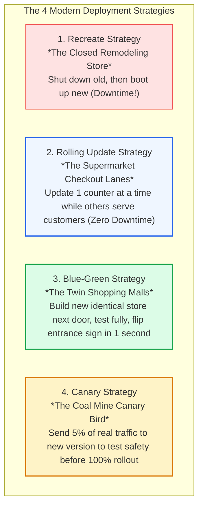
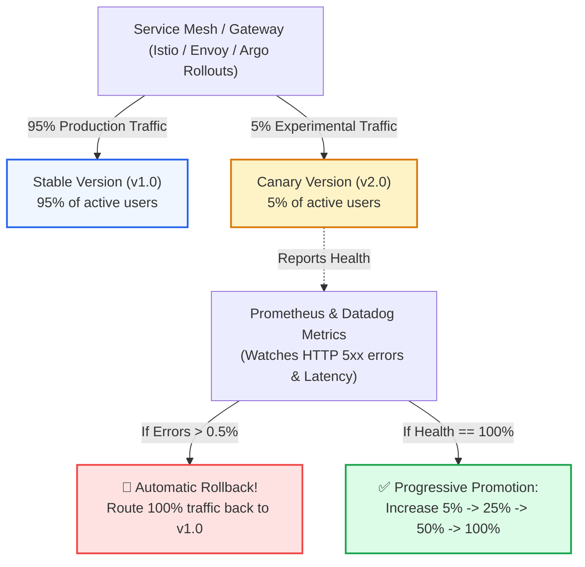
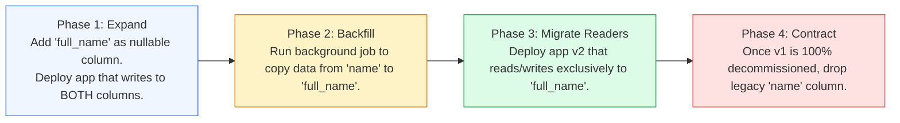

# Deployment Strategies: Rolling, Blue-Green, Canary & A/B

> **Cluster 04 — Module 04**  
> **Level**: Beginner Foundations to Production & FAANG-Level Deep Dive  
> **Key References**: TechWorld with Nana, Argo Rollouts, Martin Fowler Evolutionary Database Design

---

## 🌱 0. The Beginner's Mental Model: How Do We Upgrade Live Systems?

When you have millions of active users buying products on Amazon or streaming movies on Netflix, you cannot simply shut down your servers to deploy a code update.  
How do software companies update live applications without customers noticing a single glitch? Through **Deployment Strategies**!

---

### The Real-World Analogies (TechWorld with Nana)

1. **Recreate (The Closed Store)**:
   - The store hangs a sign: *"Closed for remodeling from 12 AM to 4 AM"*.
   - All old pods are terminated before new pods are launched.
   - *Pros*: Simple, zero chance of two versions running concurrently.
   - *Cons*: **Noticeable downtime for users**.

2. **Rolling Update (The Checkout Counters)**:
   - A grocery store has 4 cash registers. They shut down register 1 to upgrade the software, while registers 2, 3, and 4 continue ringing up customers. Once register 1 is verified, they upgrade register 2.
   - *Pros*: **Zero downtime**, default in Kubernetes.
   - *Cons*: Old and new versions run side-by-side for a few minutes; requires backward-compatible databases.

3. **Blue-Green Deployment (The Twin Malls)**:
   - You build an identical new shopping center right next door (**Green**). You test all air conditioners, lights, and cash registers. When everything is 100% verified, you simply flip the highway sign to direct all traffic to the Green mall!
   - *Pros*: **Instant cutover** and **instant 1-second rollback** if something goes wrong.
   - *Cons*: Requires **2x hardware resources** (costs more cloud money).

4. **Canary Deployment (The Miner's Canary Bird)**:
   - In 19th-century coal mines, miners brought a small canary bird into tunnels. Because canaries are sensitive to gases, if odorless methane or carbon monoxide leaked, the canary reacted first, alerting miners to evacuate safely.
   - In software: We route **5% of real user traffic** to the new version (v2.0) while keeping 95% on the stable version (v1.0). If Prometheus detects an error rate $> 0.1\%$, the canary is terminated automatically. Only 5% of users were affected, protecting 95% of your customer base!

---

## ⚡ 1. Comparison Matrix: Choosing the Right Strategy

| Strategy | User Downtime | Rollback Speed | Cloud Cost | Risk / Blast Radius | When to Choose This |
| :--- | :--- | :--- | :--- | :--- | :--- |
| **Recreate** | **Yes** (1–5 mins) | Slow | $1.0\times$ (Low) | High | Non-critical dev environments or legacy batch systems that cannot handle concurrent versions. |
| **Rolling Update** | **Zero** | Moderate (1–2 mins) | $1.25\times$ (Surge) | Medium | Standard web applications, stateless REST microservices (Kubernetes default). |
| **Blue-Green** | **Zero** | **Instant** ($< 1$ sec) | $2.0\times$ (Double) | Low | Mission-critical releases requiring full human QA testing in production before flipping traffic. |
| **Canary** | **Zero** | **Instant** ($< 5$ sec) | $1.1\times$ (Slight) | **Lowest** (5% exposure) | Tier-1 financial systems, high-traffic consumer apps (Uber, Netflix, Amazon). |

---

## 🔀 2. Architectural Deep Dive: Canary Traffic Shifting with Service Meshes

---

## 🗄️ 3. The Database Dilemma: The Expand-and-Contract Pattern

In Rolling Updates and Canary releases, **version 1.0 and version 2.0 access the database simultaneously**.

> [!CAUTION]
> **The #1 Production Deployment Mistake**:  
> Running a destructive database migration (e.g. renaming column `name` to `full_name`, or dropping a table column) during a rolling update will **instantly crash all version 1.0 pods**, bringing down your website!

### The Solution: The 4-Phase Expand & Contract Pattern

---

## 💼 4. Interview Preparation: High-Yield Questions & Answers

### Q1: "Explain the difference between Rolling Update, Blue-Green, and Canary deployments."
- **The Answer**:
  - **Rolling Update**: Gradually replaces old pods with new pods one by one. Zero downtime, but old and new versions run concurrently, requiring backward-compatible database schemas.
  - **Blue-Green**: Maintains two complete, identical environments. Traffic is routed to Blue; the new version is deployed and verified on Green. Once verified, traffic is instantly cut over to Green. Rollback is instantaneous, but it requires double the infrastructure resources.
  - **Canary**: Directs a small fraction of real production traffic (e.g. 5%) to the new version while monitoring error rates and latency. If metrics remain healthy, traffic is progressively increased to 100%. If anomalies are detected, traffic immediately drops back to the stable version, minimizing blast radius.

---

### Q2: "When would you choose Blue-Green over Canary?"
- **The Answer**:
  - *"Blue-Green is preferred when:  
    1. The application does not support fractional traffic splitting or has complex stateful session synchronization requirements.  
    2. The release requires thorough, manual end-to-end user acceptance testing in production prior to public exposure.  
    3. The organization prioritizes near-instantaneous rollback capability over hardware cost."*

---

### Q3: "What is the Expand-and-Contract pattern for database migrations?"
- **The Answer**:
  - *"The Expand-and-Contract pattern enables zero-downtime database schema changes during rolling and canary deployments where multiple application versions run simultaneously.  
  - In the **Expand** phase, new columns are added without breaking existing queries (e.g., nullable or with default values), and the application writes to both old and new columns.  
  - In the **Contract** phase, once all old application pods have been replaced and verified, a follow-up release removes the deprecated columns and constraints."*
