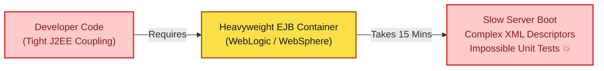
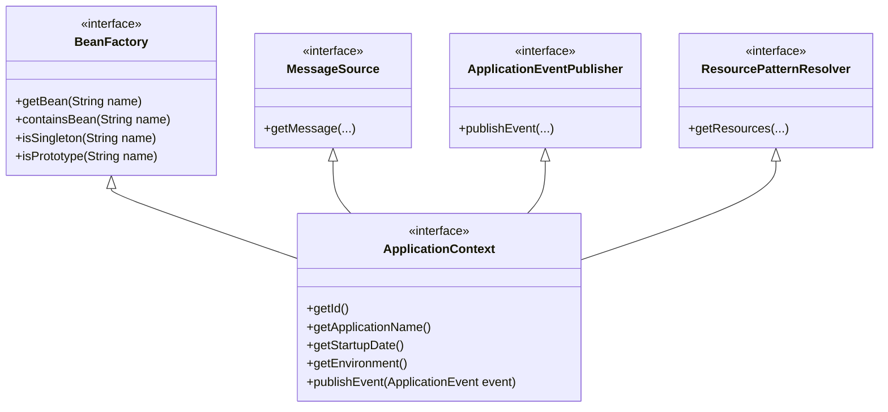
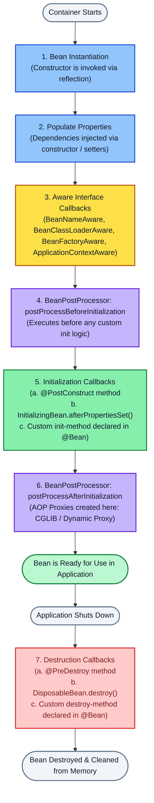
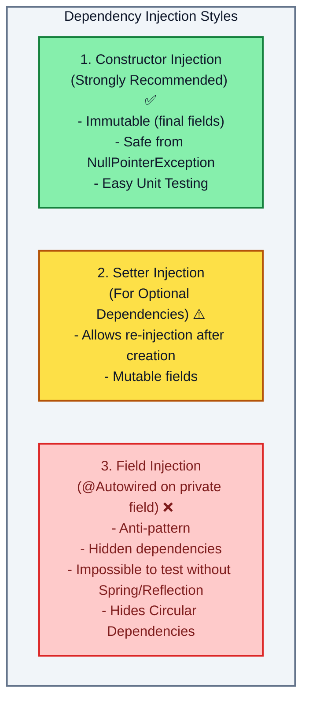
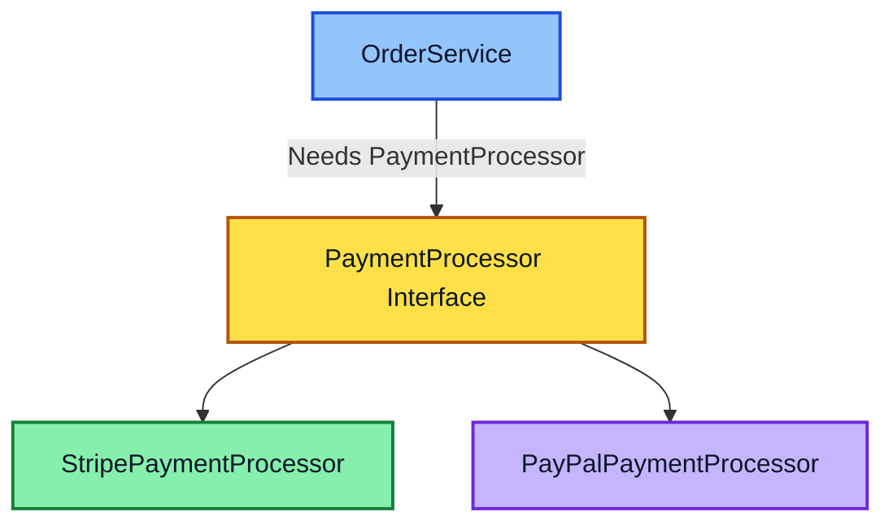
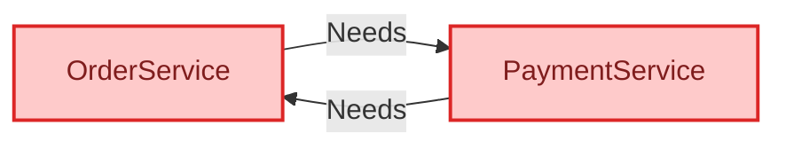

# Spring Framework: Core Architecture, IoC Container & Bean Lifecycle

> **Cluster 05 — Module 01**  
> **Level**: Beginner-Friendly to Production & FAANG-Level Deep Dive  
> **Key References**: Spring Framework Official Documentation, Martin Fowler (Inversion of Control Containers and the Dependency Injection pattern), Rod Johnson (Expert One-on-One J2EE Design and Development), Baeldung, Amigoscode

---

## 🌱 0. The Beginner's Mental Model: Why Spring Changed Enterprise Java

### The Nightmare Before Spring: The Enterprise JavaBeans (EJB) Hell

In the late 1990s and early 2000s, writing enterprise Java applications was notoriously painful. Developers were forced to use Enterprise JavaBeans (EJB 2.x). To write even a simple "Hello World" employee service, you had to:

1. Implement multiple complex EJB interfaces (`EJBObject`, `EJBHome`, `SessionBean`).
2. Write hundreds of lines of cryptic XML deployment descriptors.
3. Package your application into heavy `.ear` archives and deploy them to massive, slow commercial application servers (like WebLogic, WebSphere, or JBoss) that took 10 to 15 minutes to boot up.
4. Unit testing was nearly impossible outside the heavy application server because business logic was tightly coupled to server-specific J2EE APIs.



In 2002, **Rod Johnson** published his landmark book, *Expert One-on-One J2EE Design and Development*, questioning why enterprise software development had to be so unnecessarily difficult. He introduced a lightweight alternative based on **Plain Old Java Objects (POJOs)** and **Inversion of Control (IoC)**. This prototype evolved into the **Spring Framework** in 2003, bringing a breath of fresh air to Java development—hence the name **"Spring"** (marking the end of the traditional "Winter" of J2EE).

---

### The Real-World Analogy: The Car Factory & The Master Chef

To truly understand **Inversion of Control (IoC)** and **Dependency Injection (DI)**, consider these two real-world analogies:

#### Analogy 1: The Master Chef & The Kitchen Butler (Inversion of Control)
In a poorly organized kitchen, if the chef wants to bake a cake, the chef has to stop cooking, leave the kitchen, drive to the farm, milk the cow for milk, harvest wheat for flour, and build an oven from bricks. The chef controls the creation and lifecycle of every single ingredient.
In a world-class restaurant, the kitchen has a **Butler / Expediter (The IoC Container)**. The chef simply states what ingredients are needed on the prep counter (declares dependencies). When the chef arrives to cook, all pre-measured ingredients are already sitting on the table, freshly prepared by the butler. The control of acquiring ingredients has been **inverted**!

#### Analogy 2: The Modern Car Assembly Line (Dependency Injection)
When building a sports car, you do not weld the engine pistons, rubber tires, and fuel pump directly inside the car chassis class.
If you built a car where the chassis manufactured its own V6 gas engine inside its own constructor, you could never swap that engine for an Electric Motor, and you could never test the car in a wind tunnel without burning fuel.
Instead, the car chassis accepts an `Engine` interface in its constructor. The assembly line robot (the Dependency Injector) injects a `V6GasEngine` in production, or a `MockElectricEngine` in testing.

```mermaid
flowchart TD
    subgraph Traditional["Traditional Approach (Tight Coupling - No IoC)"]
        Car1["Car Object"] -->|Calls 'new V6Engine()'| Eng1["V6 Engine (Hardcoded)"]
        Car1 -->|Calls 'new MichelinTires()'| Tire1["Michelin Tires (Hardcoded)"]
    end

    subgraph Spring_IoC["Spring IoC Approach (Loose Coupling - Dependency Injection)"]
        Container["Spring IoC Container\n(ApplicationContext)"]
        Eng2["Engine Bean\n(Gas / Electric / Mock)"] -.->|Injected into constructor| Car2["Car Bean (POJO)"]
        Tire2["Tires Bean\n(Winter / Summer / Mock)"] -.->|Injected into constructor| Car2
        Container -->|Instantiates & Wires| Car2
        Container -->|Instantiates| Eng2
        Container -->|Instantiates| Tire2
    end

    style Traditional fill:#f1f5f9,stroke:#64748b,stroke-width:2px,color:#0f172a
    style Spring_IoC fill:#f1f5f9,stroke:#64748b,stroke-width:2px,color:#0f172a
    style Car1 fill:#fecaca,stroke:#dc2626,stroke-width:2px,color:#7f1d1d
    style Eng1 fill:#fecaca,stroke:#dc2626,stroke-width:2px,color:#7f1d1d
    style Tire1 fill:#fecaca,stroke:#dc2626,stroke-width:2px,color:#7f1d1d
    style Container fill:#93c5fd,stroke:#1d4ed8,stroke-width:2px,color:#0f172a
    style Car2 fill:#86efac,stroke:#15803d,stroke-width:2px,color:#0f172a
    style Eng2 fill:#fde047,stroke:#b45309,stroke-width:2px,color:#0f172a
    style Tire2 fill:#c4b5fd,stroke:#6d28d9,stroke-width:2px,color:#0f172a
```

---

## 📝 1. Comprehensive Study Notes: Core Concepts from the Ground Up

### What is the Spring Framework?

The Spring Framework is an open-source, lightweight application framework and inversion of control container for the Java platform designed to simplify enterprise application development through Plain Old Java Objects (POJOs), dependency injection, and aspect-oriented programming.

Spring eliminates the need for heavyweight enterprise infrastructure by acting as an invisible glue that binds business components together. Instead of developers writing boilerplate plumbing code to manage object lifecycles, database transactions, thread pools, and security filters, Spring handles these infrastructure concerns transparently. This allows software engineers to focus almost 100% of their energy on writing actual business domain logic.

### What Does the Spring Core Container Actually Do?

At its architectural foundation, the Spring Core Container performs three essential functions:

1. **Object Instantiation & Registry:** It scans your codebase for classes marked with component annotations (such as `@Component`, `@Service`, `@Repository`), instantiates them into memory as managed objects called **Spring Beans**, and maintains them in an internal registry.
2. **Dependency Resolution & Wiring:** It inspects each bean to discover what other collaborating beans it requires to do its job. It then automatically satisfies those dependencies by injecting the appropriate bean references into constructors or setters.
3. **Lifecycle Management & Interception:** It manages the entire journey of each bean from creation, property population, and custom initialization callbacks, through to graceful shutdown and destruction when the application stops.

### Why Do We Need Spring & What Help Does It Provide?

Understanding why the industry standardizes on Spring is crucial for architectural design and engineering interviews:

* **Radical Decoupling (Promoting SOLID Principles):** By separating object creation from object usage, Spring enforces the Dependency Inversion Principle. High-level business classes depend on abstract interfaces rather than concrete low-level implementations.
* **Effortless Unit Testing:** Because dependencies are injected from the outside (rather than instantiated with hardcoded `new` operators inside methods), you can easily pass mock objects (using Mockito) into class constructors during unit tests without needing a running database or network connection.
* **Elimination of Plumbing Boilerplate:** Spring handles cross-cutting concerns like opening and closing database connections, managing transaction commits and rollbacks, logging, and security token parsing using declarative annotations (like `@Transactional`).
* **Non-Invasive POJO Programming:** Your business logic classes do not need to inherit from Spring-specific base classes or implement framework interfaces. They remain clean, standard Java classes that can run in any environment.

---

## ⚡ 2. Before vs. After: Why Inversion of Control is Critical

### The Before vs. After Transformation Table

| Metric / Scenario | Before Spring (Manual Object Management) | After Spring (IoC Container & DI) | Why This Helps (Production Impact) |
| :--- | :--- | :--- | :--- |
| **Object Instantiation** | Every class creates collaborating objects using `new OrderRepositoryImpl()`. | The IoC container creates beans once and injects them where needed. | Eliminates tight coupling; prevents hundreds of redundant duplicate instances in heap memory. |
| **Swapping Implementations** | Switching from MySQL to PostgreSQL requires modifying code in dozens of service classes. | Change configuration or swap the `@Repository` bean; zero service code modified. | True polymorphism and adherence to the Open-Closed Principle. |
| **Unit Testing** | Testing a service requires an active database because `new DatabaseConnection()` is hardcoded. | Pass `mock(OrderRepository.class)` directly into the service constructor. | Tests run in 5 milliseconds in RAM without spinning up external servers. |
| **Resource Lifecycle** | Developers manually track when to close DB pools, socket connections, and threads. | Spring manages lifecycle callbacks (`@PostConstruct`, `@PreDestroy`) automatically. | Prevents resource leaks, socket exhaustion, and ungraceful shutdowns. |
| **Cross-Cutting Concerns** | Logging, metrics, and security checks are copied and pasted across every method. | Aspect-Oriented Programming (AOP) intercepts calls declaratively with annotations. | Keeps code DRY (Don't Repeat Yourself) and clean. |

---

## 🏛️ 3. The IoC Container: BeanFactory vs. ApplicationContext

The Spring container is the core engine that implements Inversion of Control. Spring provides two core container interfaces:



### BeanFactory
`org.springframework.beans.factory.BeanFactory` is the most basic, root interface of the Spring IoC container that provides fundamental configuration mechanism and basic object instantiation functionality using lazy initialization.
- **Lazy Loading**: Beans are instantiated only when explicitly requested via `getBean()`.
- **Lightweight**: Consumes minimal memory; ideal for constrained mobile or IoT devices with very limited RAM.
- **Features**: Offers only basic dependency injection and bean lifecycle management.

### ApplicationContext
`org.springframework.context.ApplicationContext` is the advanced, fully-featured enterprise container interface that extends `BeanFactory` with complete framework integration, event publishing, internationalization, and eager bean instantiation.
- **Eager Loading**: All singleton beans are instantiated, configured, and validated at application startup.
- **Early Bug Detection**: If a bean has a missing dependency or invalid configuration, the application fails immediately at startup rather than crashing later during an end-user request at runtime.
- **Enterprise Features**:
  1. Complete integration with Spring AOP (declarative transaction management and security).
  2. Internationalization (i18n) message resolution via `MessageSource`.
  3. Built-in event publication mechanism via `ApplicationEventPublisher`.
  4. Environment abstraction with profile support (`dev`, `prod`, `qa`).

> In modern enterprise applications and Spring Boot, **always use `ApplicationContext`**. `BeanFactory` is virtually never used directly in modern production code.

---

## 🔄 4. The Complete Spring Bean Lifecycle

A **Spring Bean** is an object whose instantiation, assembly, lifecycle, and management are entirely controlled by the Spring IoC container rather than by manual application code.

Understanding the bean lifecycle from start to finish is one of the most frequently tested concepts in senior engineering interviews.



### Detailed Phase-by-Phase Breakdown

1. **Instantiation**: The IoC container allocates memory and calls the class constructor (via reflection) to create the raw Java instance.
2. **Populate Properties**: The container resolves and injects all collaborator beans and `@Value` configuration properties into the target bean.
3. **Aware Interfaces**: If the bean implements specific Spring `Aware` marker interfaces, the container injects infrastructure hooks:
   - `BeanNameAware`: Provides the bean's registered ID string.
   - `BeanFactoryAware`: Passes the enclosing `BeanFactory`.
   - `ApplicationContextAware`: Passes the enclosing `ApplicationContext` so the bean can manually query the container if needed.
4. **`BeanPostProcessor.postProcessBeforeInitialization()`**: Custom extension points that intercept beans *before* their initialization logic runs. Spring uses this internally to process `@PostConstruct` and `@Autowired` annotations.
5. **Initialization Phase**: Executed in this exact sequence:
   - Methods annotated with `@PostConstruct` (from Jakarta EE standard `jakarta.annotation.PostConstruct`).
   - `InitializingBean.afterPropertiesSet()` callback method.
   - Custom `initMethod` specified in `@Bean(initMethod = "customInit")`.
6. **`BeanPostProcessor.postProcessAfterInitialization()`**: Executed immediately after initialization. **This is where Spring AOP wraps your bean in a dynamic proxy** (CGLIB or JDK Dynamic Proxy) to enable `@Transactional`, `@Async`, or security interception!
7. **Ready for Use**: The bean is placed in the container's singleton cache and serves incoming application requests.
8. **Destruction Phase**: When the container shuts down (`context.close()`):
   - Methods annotated with `@PreDestroy` run first.
   - `DisposableBean.destroy()` runs next.
   - Custom `destroyMethod` specified in `@Bean(destroyMethod = "customDestroy")` runs last.

---

## 🎯 5. Spring Bean Scopes

A **Bean Scope** defines the lifecycle, visibility, and number of instances of a bean managed by the Spring container within an application context.

| Scope | Number of Instances | Lifecycle & Duration | Typical Production Use Case |
| :--- | :--- | :--- | :--- |
| **`singleton`** (Default) | Exactly **one** instance per Spring `ApplicationContext`. | Lives for the entire duration of the application. | Stateless services (`@Service`), repositories (`@Repository`), and controllers (`@RestController`). |
| **`prototype`** | A **new** instance created every time it is requested from the container. | Spring creates and configures the bean, but does **NOT** manage its destruction. | Stateful objects, user shopping carts, temporary task workers. |
| **`request`** (Web-aware) | One instance per HTTP request lifecycle. | Destroyed when the HTTP request completes. | Storing request-specific headers, audit trails, tenancy context. |
| **`session`** (Web-aware) | One instance per HTTP Session. | Destroyed when the HTTP Session is invalidated or times out. | User login session data in stateful web applications. |
| **`application`** (Web-aware)| One instance per `ServletContext`. | Shared across all servlets in the web app context. | Global web application metadata, static caches. |
| **`websocket`** (Web-aware) | One instance per WebSocket session. | Lives for the duration of the WebSocket communication channel. | Chat room states, real-time socket sessions. |

### The Prototype-in-Singleton Conundrum (Senior Interview Favorite!)

**The Problem**: A `singleton` bean is instantiated only once during startup. If you inject a `prototype` bean into a `singleton` bean using standard constructor injection:
```java
@Component
public class ReportService { // Singleton
    private final ReportGenerator generator; // Prototype

    public ReportService(ReportGenerator generator) {
        this.generator = generator; // Injected ONLY ONCE at startup!
    }
}
```
Because the `ReportService` singleton is created only once, its constructor runs only once. As a result, the `ReportGenerator` prototype is also injected only once—effectively treating the prototype as a singleton! Every subsequent call to `ReportService` reuses the same instance.

**The Solutions**:
1. **Using `ObjectProvider<T>` (Modern & Recommended)**:
   ```java
   @Component
   public class ReportService {
       private final ObjectProvider<ReportGenerator> reportGeneratorProvider;

       public ReportService(ObjectProvider<ReportGenerator> reportGeneratorProvider) {
           this.reportGeneratorProvider = reportGeneratorProvider;
       }

       public void generateMonthlyReport() {
           ReportGenerator freshInstance = reportGeneratorProvider.getObject(); // Returns a brand new instance every time!
           freshInstance.execute();
       }
   }
   ```
2. **Using Method Injection (`@Lookup`)**:
   Spring subclasses the singleton class at runtime using CGLIB and overrides an abstract method to query the container:
   ```java
   @Component
   public abstract class ReportService {
       @Lookup
       public abstract ReportGenerator getReportGenerator();

       public void generateMonthlyReport() {
           ReportGenerator freshInstance = getReportGenerator();
           freshInstance.execute();
       }
   }
   ```

---

## 💉 6. Dependency Injection: Constructor vs. Setter vs. Field Injection

Spring supports three primary styles of dependency injection:



### 1. Constructor Injection (The Industry Standard)
```java
@Service
public class OrderService {
    private final OrderRepository orderRepository;
    private final PaymentClient paymentClient;

    // In modern Spring (4.3+), @Autowired is OPTIONAL on single constructors
    public OrderService(OrderRepository orderRepository, PaymentClient paymentClient) {
        this.orderRepository = Objects.requireNonNull(orderRepository);
        this.paymentClient = Objects.requireNonNull(paymentClient);
    }
}
```
- **Why It Wins**:
  - Fields can be declared `final`, guaranteeing immutability and thread safety.
  - The object cannot be constructed in a half-initialized or broken state.
  - Writing plain JUnit 5 unit tests is effortless: `new OrderService(mockRepo, mockPayment)` requires no reflection or Spring test runners.

### 2. Setter Injection (For Optional Dependencies)
```java
@Service
public class NotificationService {
    private AuditLogger auditLogger;

    @Autowired(required = false)
    public void setAuditLogger(AuditLogger auditLogger) {
        this.auditLogger = auditLogger;
    }
}
```
- Use only when a dependency has sensible defaults and is strictly optional for core operation.

### 3. Field Injection (Why It Is Considered an Anti-Pattern)
```java
@Service
public class BadOrderService {
    @Autowired
    private OrderRepository orderRepository; // ❌ AVOID IN PRODUCTION
}
```
- **Why Field Injection is Dangerous**:
  1. **Violates Encapsulation**: You cannot instantiate `BadOrderService` in a unit test without using reflection or a Spring runner to forcibly set private fields.
  2. **NullPointerExceptions in Constructors**: If you try to use `orderRepository` inside your constructor, it will throw `NullPointerException` because field injection runs *after* the constructor completes!
  3. **Hides Single Responsibility Violations**: It is dangerously easy to add 15 `@Autowired` fields to a class without noticing how bloated it has become. A constructor with 15 arguments immediately warns you that your class does too much.

---

## 🏷️ 7. Stereotype Annotations & Configuration

Spring provides specialized annotations to categorize the role of each bean:

| Annotation | Semantic Role | Special Capabilities |
| :--- | :--- | :--- |
| **`@Component`** | Generic Spring-managed component. | The parent meta-annotation for all stereotypes. |
| **`@Service`** | Business domain service layer. | Semantic marker; holds transaction logic and domain workflows. |
| **`@Repository`** | Data access layer (DAO). | Automatically translates low-level SQL/database driver exceptions into Spring's consistent `DataAccessException` hierarchy. |
| **`@Controller`** | Web presentation layer (MVC). | Returns view names (JSP, Thymeleaf) to be resolved by a ViewResolver. |
| **`@RestController`** | RESTful web API controller. | Combines `@Controller` and `@ResponseBody`. Automatically serializes returned Java objects into JSON/XML via Jackson. |
| **`@Configuration`**| Configuration class declaring beans. | CGLIB proxies the configuration class to ensure `@Bean` methods return singleton instances when called internally (`proxyBeanMethods = true`). |

### `@Configuration` vs. `@Bean` (Declaring Third-Party Classes)
You cannot annotate classes from external libraries (like `com.fasterxml.jackson.databind.ObjectMapper` or `org.apache.kafka.clients.producer.KafkaProducer`) with `@Component` because you do not own their source code. You declare them explicitly using `@Configuration` and `@Bean`:

```java
@Configuration(proxyBeanMethods = true)
public class AppConfig {

    @Bean
    public ObjectMapper objectMapper() {
        return JsonMapper.builder()
                .findAndAddModules()
                .disable(DeserializationFeature.FAIL_ON_UNKNOWN_PROPERTIES)
                .build();
    }
}
```

---

## ⚔️ 8. Disambiguation: Resolving Multiple Candidate Beans

When two or more beans implement the exact same interface, Spring cannot guess which one you want and throws a `NoUniqueBeanDefinitionException`.



### Disambiguation Strategies

1. **`@Primary`**: Designates one implementation as the default primary choice when multiple beans exist.
   ```java
   @Component
   @Primary
   public class StripePaymentProcessor implements PaymentProcessor { ... }
   ```
2. **`@Qualifier`**: Explicitly selects a specific bean by its qualifier name at the injection site.
   ```java
   @Service
   public class CheckoutService {
       private final PaymentProcessor paymentProcessor;

       public CheckoutService(@Qualifier("payPalPaymentProcessor") PaymentProcessor paymentProcessor) {
           this.paymentProcessor = paymentProcessor;
       }
   }
   ```
3. **Map/List Collection Injection**: Injects *all* implementations into a map keyed by bean name:
   ```java
   @Service
   public class PaymentRoutingService {
       private final Map<String, PaymentProcessor> processors;

       public PaymentRoutingService(Map<String, PaymentProcessor> processors) {
           this.processors = processors; // Keys: "stripePaymentProcessor", "payPalPaymentProcessor"
       }
   }
   ```

---

## 🔁 9. Circular Dependencies: Causes, Dangers & Resolution

A **Circular Dependency** occurs when Bean A requires Bean B, and Bean B requires Bean A (either directly or indirectly via Bean C).



### Why Circular Dependencies Are Dangerous
When the container tries to instantiate `OrderService`, it must first instantiate `PaymentService`. But to instantiate `PaymentService`, it must first instantiate `OrderService`. Without special handling, this results in an infinite loop and crashes with `BeanCurrentlyInCreationException`.

> **Important**: Starting with **Spring Boot 2.6+**, circular references are **forbidden and disabled by default** (`spring.main.allow-circular-references=false`). The application will immediately fail to boot!

### How to Resolve Circular Dependencies:
1. **Architectural Refactoring (The Best Solution)**: Extract the shared responsibility into a third collaborator bean (e.g., `OrderPaymentMediator`).
2. **Using `@Lazy` Injection (The Quick Workaround)**:
   Instructs Spring to inject a synthetic dynamic proxy instead of the real bean. The real bean is resolved only when its method is first called:
   ```java
   @Service
   public class OrderService {
       private final PaymentService paymentService;

       public OrderService(@Lazy PaymentService paymentService) {
           this.paymentService = paymentService;
       }
   }
   ```
3. **Using Domain Events**: Replace direct coupling with decoupled asynchronous events (`ApplicationEventPublisher`). When an order is created, emit `OrderCreatedEvent` instead of directly calling `PaymentService`.
