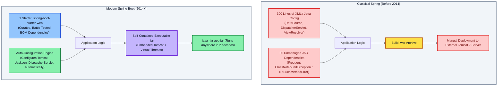
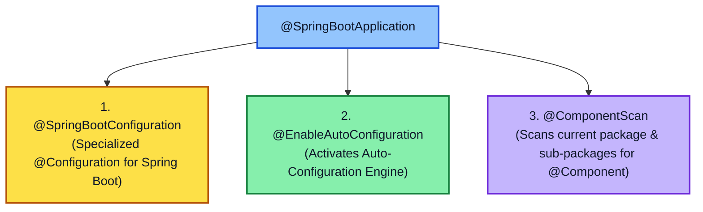
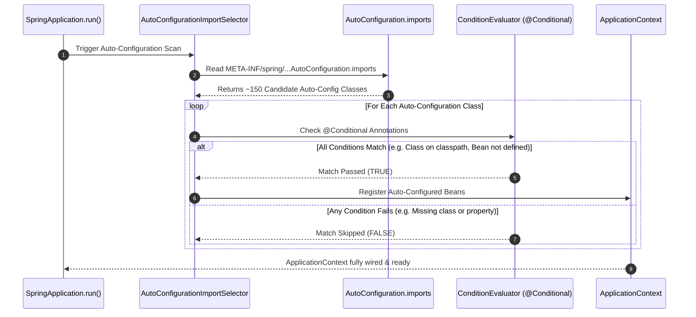
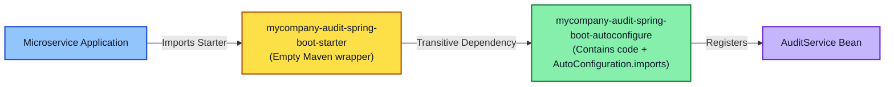
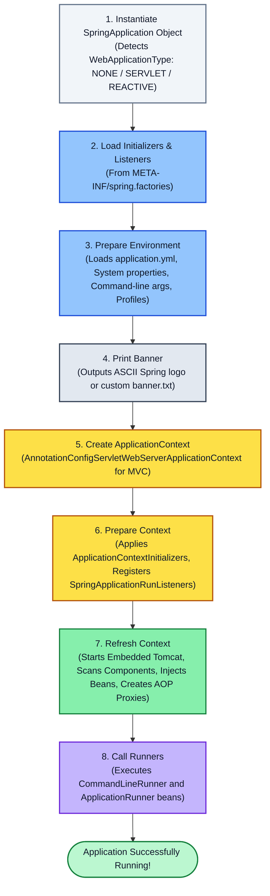
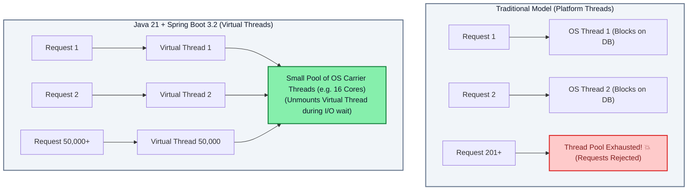

# Spring Boot Internals: Auto-Configuration, Starters & Embedded Runtimes

> **Cluster 05 — Module 02**  
> **Level**: Beginner-Friendly to Production & FAANG-Level Deep Dive  
> **Key References**: Spring Boot Official Reference Documentation, Stéphane Nicoll & Andy Wilkinson (Spring Boot Internals Talks), Josh Long (Spring Tips), Dan Vega, Baeldung

---

## 🌱 0. The Beginner's Mental Model: Why Spring Boot Was Created

### The Configuration Nightmare of Classical Spring: "XML & Dependency Hell"

Before Spring Boot was released in 2014, developing applications with the core Spring Framework required days of painful boilerplate setup:

1. **Dependency Hell**: To build a simple web application with Hibernate, you had to manually specify versions for dozens of third-party JARs (`spring-webmvc`, `hibernate-core`, `jackson-databind`, `slf4j`, `mysql-connector-java`). If `hibernate-core` required a different minor version of `dom4j` or `antlr` than what Spring expected, your application crashed with mysterious `NoSuchMethodError` or `ClassNotFoundException` errors.
2. **Boilerplate XML or Java Configuration**: You had to manually configure dozens of infrastructure beans: `DispatcherServlet`, `InternalResourceViewResolver`, `DataSource`, `LocalContainerEntityManagerFactoryBean`, `PlatformTransactionManager`, and Jackson message converters.
3. **External Web Server Management**: To run your app, you had to install an external Apache Tomcat or WildFly application server on your machine, build a `.war` file, and deploy it manually to the server's `webapps/` folder.



---

### The Real-World Analogy: The Pre-Configured Luxury Sports Car

Imagine you want to buy a car to drive to work:
- **Classical Spring** was like buying a giant crate containing 4,000 separate car parts: screws, spark plugs, pistons, wires, and sheets of steel. You had to assemble the entire engine, connect the brake lines, and tune the transmission yourself before you could turn the key. If you picked the wrong screw size, the engine blew up.
- **Spring Boot** is like buying a fully assembled, factory-tuned sports car with a smart computerized dashboard. You turn the key, and it drives immediately with optimal default settings. However, if you want to swap the stock tires for racing slicks or change the exhaust system (customizing configuration), the hood opens easily and lets you override any part without breaking the rest of the vehicle!

> **The Spring Boot Philosophy**: **"Opinionated with sensible defaults, but quickly un-opinionated when you step in."**

---

## 📝 1. Comprehensive Study Notes: Understanding Spring Boot

### What is Spring Boot?

Spring Boot is an opinionated, production-ready framework built on top of the core Spring Framework that accelerates Java application development by providing automatic configuration, pre-packaged starter dependencies, and embedded web servers.

Spring Boot is not a replacement for Spring; rather, it is a tool that manages Spring for you. It automates the tedious configuration and infrastructure setup that enterprise developers previously had to write by hand. By analyzing the libraries available on your project's classpath and inspecting your defined properties, Spring Boot automatically registers the necessary Spring beans behind the scenes so that your application is immediately ready to execute.

### What Does Spring Boot Actually Do?

Spring Boot performs four revolutionary duties for enterprise Java developers:

1. **Curated Dependency Management (Starters & BOM):** It provides coordinated "Starter" packages (like `spring-boot-starter-web`, `spring-boot-starter-data-jpa`) where the Spring engineering team has pre-tested and validated hundreds of library versions to ensure they work together harmoniously without version conflicts.
2. **Intelligent Auto-Configuration:** At application startup, Spring Boot evaluates conditional logic to determine what infrastructure you need. If it detects `postgresql-42.jar` and `spring-data-jpa.jar` on the classpath, it automatically creates a `DataSource` pool, configures Hibernate, and registers an `EntityManagerFactory`.
3. **Embedded Server Execution:** Instead of packaging your application into a `.war` file that must be deployed to an external servlet container, Spring Boot embeds the web server (Apache Tomcat, Jetty, or Undertow) directly inside your executable `.jar` file. You run the app as a standard Java process (`java -jar app.jar`).
4. **Production-Ready Observability:** It includes out-of-the-box health checks, metric scrapers, thread dump generators, and environment analyzers via **Spring Boot Actuator**, perfectly preparing your application for cloud platforms and Kubernetes clusters.

### Why Do We Need Spring Boot & What Help Does It Provide?

Understanding why modern engineering organizations mandate Spring Boot is fundamental for senior architecture:

* **Drastic Reduction in Time-to-Market:** What used to take a team 3 days of infrastructure configuration now takes 30 seconds using the [Spring Initializr](https://start.spring.io). Developers can write business endpoints on day one.
* **Total Elimination of Classpath Conflicts:** Spring Boot's parent Bill of Materials (BOM) specifies compatible versions for hundreds of libraries. You omit `<version>` tags in your Maven `pom.xml` or Gradle build, preventing version mismatch bugs.
* **First-Class Microservice Readiness:** Because Spring Boot applications package their own embedded server into a single self-contained JAR, they are naturally tailored for Docker containerization and Kubernetes orchestration.
* **Seamless Cloud Native Adaptation:** Spring Boot 3 natively integrates with Java 21 Virtual Threads (Project Loom) for ultra-high throughput I/O and GraalVM Ahead-of-Time (AOT) compilation for near-instant 30ms startup times.

---

## ⚡ 2. Before vs. After: Why Spring Boot Won the Enterprise

### The Before vs. After Transformation Table

| Capability / Metric | Classical Spring (Before Spring Boot) | Modern Spring Boot | Concrete Engineering Value |
| :--- | :--- | :--- | :--- |
| **Dependency Management** | Manually research, select, and manage compatible versions for 40+ third-party JARs. | Add a single starter (`spring-boot-starter-web`); BOM coordinates all sub-dependencies. | Eliminates dependency conflicts, `NoClassDefFoundError`, and upgrade friction. |
| **Infrastructure Setup** | Hundreds of lines of XML (`web.xml`, `dispatcher-servlet.xml`) or repetitive `@Bean` methods. | Auto-Configuration automatically detects classpath and wires beans conditionally. | 90% reduction in boilerplate configuration code. |
| **Web Server Packaging** | Package as `.war`, copy to remote server, configure Tomcat/JBoss server XML. | Self-contained executable `.jar` with embedded Tomcat, Jetty, or Undertow. | 1-line startup (`java -jar app.jar`); effortlessly containerized in Docker. |
| **Configuration Files** | Scattered XML files, custom properties loaders, manual Environment parsing. | Centralized, hierarchical `application.yml` with type-safe `@ConfigurationProperties`. | Clean environment management across Dev, QA, Staging, and Production. |
| **Production Health & Metrics** | Write custom health-check servlets and JMX MBeans from scratch. | Spring Boot Actuator provides `/actuator/health` and `/actuator/metrics` instantly. | Out-of-the-box Kubernetes liveness and readiness probes. |

---

## 🔍 3. The Anatomy of `@SpringBootApplication`

Every Spring Boot project begins with a main class annotated with `@SpringBootApplication`:

```java
package com.company.orderservice;

import org.springframework.boot.SpringApplication;
import org.springframework.boot.autoconfigure.SpringBootApplication;

@SpringBootApplication
public class OrderServiceApplication {
    public static void main(String[] args) {
        SpringApplication.run(OrderServiceApplication.class, args);
    }
}
```

`@SpringBootApplication` is a composite meta-annotation that bundles three indispensable Spring annotations:



1. **`@SpringBootConfiguration`**: A specialized form of `@Configuration` that tags the class as a configuration source. It allows unit test runners (like `@SpringBootTest`) to locate the primary application context configuration.
2. **`@EnableAutoConfiguration`**: The heart of Spring Boot. It instructs the IoC container to examine the classpath, locate auto-configuration classes, evaluate conditional rules, and automatically wire up missing beans.
3. **`@ComponentScan`**: Configures component scanning with default filters. **Crucial Rule**: By default, it scans only the package where the main class resides (`com.company.orderservice`) and all of its sub-packages. If you place a `@Service` in `com.company.util`, Spring will *never* find it unless you explicitly define `basePackages`!

---

## ⚙️ 4. The Auto-Configuration Engine: How It Works Under the Hood

How does Spring Boot know to configure an embedded Tomcat server when you add `spring-boot-starter-web`?



### The Discovery Mechanism: Modern Spring Boot 3 vs. Legacy Spring Boot 2

- **Spring Boot 2.x (Legacy)**: Used `META-INF/spring.factories` to list auto-configuration classes under the key `org.springframework.boot.autoconfigure.EnableAutoConfiguration`.
- **Spring Boot 3.x+ (Modern)**: Auto-configuration classes are now registered in a dedicated, cleaner file:
  `META-INF/spring/org.springframework.boot.autoconfigure.AutoConfiguration.imports`
  This file simply contains a plain list of fully qualified auto-configuration class names (one per line).

### The Power of Conditional Annotations (`@ConditionalOn...`)

Auto-configuration classes are heavily guarded with conditional annotations from the `org.springframework.boot.autoconfigure.condition` package. If any condition evaluates to `false`, the entire auto-configuration class or bean definition is skipped:

| Conditional Annotation | Purpose & Evaluation Rule |
| :--- | :--- |
| **`@ConditionalOnClass`** | Only activates if the specified `.class` is present on the JVM classpath. |
| **`@ConditionalOnMissingClass`** | Only activates if the specified `.class` is **NOT** present on the classpath. |
| **`@ConditionalOnBean`** | Activates only if a specific bean already exists in the `ApplicationContext`. |
| **`@ConditionalOnMissingBean`** | Activates only if the developer has **NOT** defined their own bean of this type. **This is how Spring Boot allows you to override its defaults effortlessly!** |
| **`@ConditionalOnProperty`** | Activates based on the presence or specific value of an environment property in `application.yml`. |
| **`@ConditionalOnWebApplication`** | Activates only when the application is running in a web environment (Servlet or Reactive). |
| **`@ConditionalOnExpression`** | Evaluates a dynamic SpEL (Spring Expression Language) boolean expression. |

### Real-World Example: How Spring Boot Configures Jackson's `ObjectMapper`

Take a look at how Spring Boot's internal `JacksonAutoConfiguration` is written:

```java
@AutoConfiguration
@ConditionalOnClass(ObjectMapper.class) // 1. Only run if Jackson is on classpath
public class JacksonAutoConfiguration {

    @Bean
    @Primary
    @ConditionalOnMissingBean // 2. Only create this if the user hasn't defined their own ObjectMapper!
    public ObjectMapper jacksonObjectMapper(Jackson2ObjectMapperBuilder builder) {
        return builder.createXmlMapper(false).build();
    }
}
```

*Look at how brilliant this design is:*
1. If you do nothing, Spring Boot creates a pre-configured `ObjectMapper` for you.
2. If you write your own `@Bean public ObjectMapper customMapper() { ... }`, Spring Boot's `@ConditionalOnMissingBean` detects your bean, gracefully steps aside, and disables its own auto-configured bean!

---

## 🛠️ 5. Step-by-Step: Creating a Custom Spring Boot Starter

Enterprise companies often build custom starters (e.g., `company-audit-spring-boot-starter`) to standardize security, logging, or metric tracking across hundreds of microservices.

A custom starter consists of two modules:
1. **The Autoconfigure Module**: Contains the business classes and the auto-configuration logic.
2. **The Starter Module**: An empty `pom.xml` that packages the autoconfigure module and any required third-party dependencies for easy consumption.



### 1. Define the Configuration Properties
```java
@ConfigurationProperties(prefix = "enterprise.audit")
public record AuditProperties(boolean enabled, String destinationUrl) {}
```

### 2. Define the Service Class
```java
public class AuditService {
    private final String destinationUrl;

    public AuditService(String destinationUrl) {
        this.destinationUrl = destinationUrl;
    }

    public void logAction(String action) {
        System.out.println("Transmitting audit event [" + action + "] to " + destinationUrl);
    }
}
```

### 3. Create the Auto-Configuration Class
```java
@AutoConfiguration
@EnableConfigurationProperties(AuditProperties.class)
@ConditionalOnProperty(prefix = "enterprise.audit", name = "enabled", havingValue = "true", matchIfMissing = true)
public class AuditAutoConfiguration {

    @Bean
    @ConditionalOnMissingBean
    public AuditService auditService(AuditProperties properties) {
        return new AuditService(properties.destinationUrl());
    }
}
```

### 4. Register the Auto-Configuration in Spring Boot 3
Create file: `src/main/resources/META-INF/spring/org.springframework.boot.autoconfigure.AutoConfiguration.imports`
```text
com.mycompany.audit.autoconfigure.AuditAutoConfiguration
```

Now, any microservice that adds `<artifactId>mycompany-audit-spring-boot-starter</artifactId>` automatically gains access to `AuditService` with zero manual configuration!

---

## 🚀 6. The `SpringApplication.run()` Startup Lifecycle

What actually happens when you execute `public static void main(String[] args)`?



### Executing Code on Startup: `CommandLineRunner` vs. `ApplicationRunner`

If you need to seed database tables or warm up caches immediately after the application boots up, declare an `ApplicationRunner` or `CommandLineRunner` bean:

```java
@Component
public class DatabaseSeeder implements ApplicationRunner {
    private final UserRepository userRepository;

    public DatabaseSeeder(UserRepository userRepository) {
        this.userRepository = userRepository;
    }

    @Override
    public void run(ApplicationArguments args) {
        if (userRepository.count() == 0) {
            userRepository.save(new User("admin@company.com", "ADMIN"));
        }
    }
}
```
- **Difference**: `CommandLineRunner` provides raw `String... args`, whereas `ApplicationRunner` provides parsed `ApplicationArguments` (supporting options like `--port=8080`).

---

## 🌐 7. Embedded Web Servers & Java 21 Virtual Threads

Spring Boot bundles an embedded servlet container directly into the executable archive. By default, `spring-boot-starter-web` provides **Apache Tomcat**.

### Swapping Embedded Containers
If your organization prefers **Undertow** (for high non-blocking throughput) or **Jetty**, simply exclude Tomcat from your build file:

```xml
<dependency>
    <groupId>org.springframework.boot</groupId>
    <artifactId>spring-boot-starter-web</artifactId>
    <exclusions>
        <exclusion>
            <groupId>org.springframework.boot</groupId>
            <artifactId>spring-boot-starter-tomcat</artifactId>
        </exclusion>
    </exclusions>
</dependency>
<dependency>
    <groupId>org.springframework.boot</groupId>
    <artifactId>spring-boot-starter-undertow</artifactId>
</dependency>
```

### The Java 21 Virtual Threads Revolution (Spring Boot 3.2+)

In traditional Java web applications, Tomcat uses a fixed thread pool (default 200 OS platform threads). Each concurrent HTTP request consumes 1 platform thread. If 200 requests are blocked waiting for slow database queries or downstream microservices, the thread pool is completely exhausted, causing incoming requests to hang and timeout.

**Spring Boot 3.2+ and Java 21** introduced native support for **Virtual Threads (Project Loom)**. With a single configuration toggle:

```yaml
# application.yml
spring:
  threads:
    virtual:
      enabled: true
```



When a Virtual Thread blocks waiting for a database query, the JVM automatically **unmounts** it from the underlying carrier OS thread. The carrier thread immediately processes other work. When the database responds, the virtual thread is mounted back onto any available carrier thread. This allows a single Spring Boot server to comfortably handle **50,000+ concurrent requests** using standard imperative code!

---

## 📋 8. Enterprise Configuration Management

### `application.properties` vs. `application.yml`
Spring Boot supports both formats. Modern enterprise architectures strongly favor **YAML (`.yml`)** because it supports clean nested hierarchies, lists, and avoids repeating prefix strings:

```yaml
# application.yml
server:
  port: 8080
  shutdown: graceful

spring:
  application:
    name: order-service
  datasource:
    url: jdbc:postgresql://localhost:5432/orderdb
    username: postgres
    hikari:
      maximum-pool-size: 20
      minimum-idle: 5
```

### Type-Safe Configuration with `@ConfigurationProperties`

While `@Value("${my.property}")` works for one-off primitives, it lacks type safety, validation, and hierarchical grouping. The enterprise standard is **`@ConfigurationProperties`**:

```java
@ConfigurationProperties(prefix = "app.payment")
@Validated // JSR-380 Validation!
public record PaymentProperties(
        @NotBlank String provider,
        @Min(100) @Max(30000) int timeoutMillis,
        @NotNull URI webhookEndpoint,
        RetryPolicy retryPolicy
) {
    public record RetryPolicy(int maxAttempts, Duration backoff) {}
}
```

```java
@Configuration
@EnableConfigurationProperties(PaymentProperties.class)
public class PaymentConfig { ... }
```

- **Benefits**:
  1. Full compile-time and startup-time type safety.
  2. Automatic validation during startup: if `timeoutMillis` is set to `50`, the application refuses to boot and displays a clear validation error.
  3. IDE autocompletion when typing properties in `application.yml`.

### Environment Profiles (`@Profile`)
Profiles allow you to segregate your configuration for different target deployment environments:
- `application-dev.yml`: Local PostgreSQL on `localhost:5432`, SQL logging enabled.
- `application-prod.yml`: AWS RDS endpoint, connection pooling optimized, minimal logging.

Activate profiles using:
```bash
java -jar -Dspring.profiles.active=prod app.jar
```
Or via container environment variables:
```yaml
# Kubernetes Pod Spec
env:
  - name: SPRING_PROFILES_ACTIVE
    value: "prod"
```
