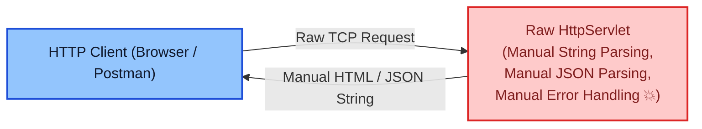
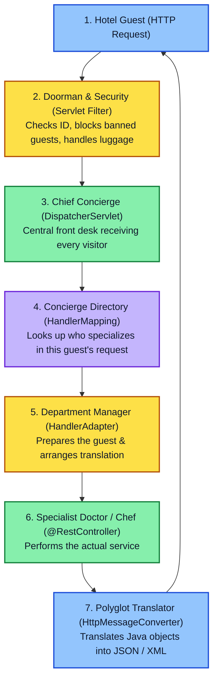
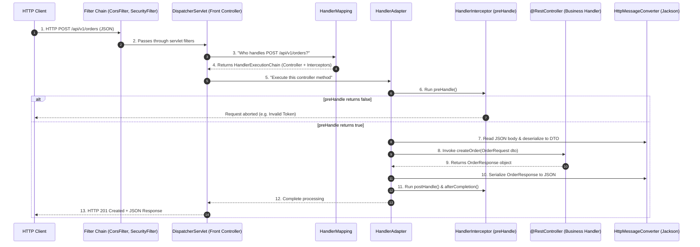
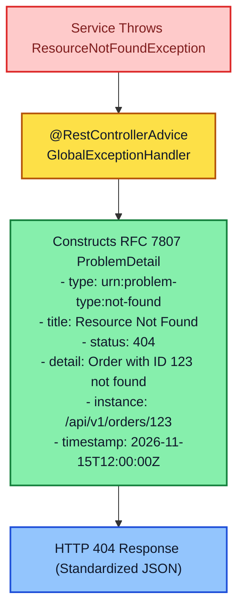

# Spring MVC: RESTful APIs, Web Architecture & Exception Handling

> **Cluster 05 — Module 03**  
> **Level**: Beginner-Friendly to Production & FAANG-Level Deep Dive  
> **Key References**: Spring Web MVC Documentation, RFC 7807 (Problem Details for HTTP APIs), Rossen Stoyanchev (Spring MVC Architecture), Baeldung

---

## 🌱 0. The Beginner's Mental Model: How Web Requests Travel

### The Nightmare Before Spring MVC: Raw Java Servlets

In the early days of Java web development, handling an HTTP request meant writing raw Java Servlets (`HttpServlet`). For every single endpoint, developers had to:

1. Manually parse URL strings and query parameters using `request.getParameter()`.
2. Manually read input streams and parse raw JSON/XML strings into Java objects.
3. Manually write SQL queries, wrap them in try-catch blocks, and manually format HTTP responses using `response.getWriter().println("<html>...")`.
4. Manually map HTTP status codes (`response.setStatus(404)`) and headers.



Writing 20 endpoints meant writing thousands of lines of fragile string parsing code. If a user passed `"abc"` instead of an integer for `?page=`, the servlet threw an unhandled `NumberFormatException` and sent an ugly 500 error stack trace directly to the client.

---

### The Real-World Analogy: The Grand Luxury Hotel Concierge

Think of **Spring MVC** as a 5-star international luxury hotel:



- When you enter the hotel, you do not wander through thousands of private guest rooms. You stop at the **Chief Concierge Desk (`DispatcherServlet`)**.
- The Concierge consults the **Hotel Guidebook (`HandlerMapping`)** to find which specialist handles your request.
- A **Butler (`HandlerAdapter`)** escorts you, translating your language into English.
- The **Specialist (`@RestController`)** performs the service.
- The **Translator (`HttpMessageConverter`)** translates the result back into your native language (JSON) and hands you your receipt.

---

## 📝 1. Comprehensive Study Notes: Understanding Spring MVC

### What is Spring MVC?

Spring MVC is an HTTP web framework built around the **Model-View-Controller (MVC)** architectural pattern and the **Front Controller** design pattern that simplifies the development of web applications and RESTful APIs in Java.

Spring MVC decouples the responsibilities of web development into clear layers. The **Model** represents the application's domain data and business logic; the **View** renders the presentation (such as HTML or JSON responses); and the **Controller** acts as the orchestrator that receives incoming HTTP requests, invokes business services, and returns data to the client.

### What Does Spring MVC Actually Do?

Spring MVC orchestrates the entire request-response life cycle for web applications:

1. **Centralized Request Routing:** It provides a single Front Controller servlet (`DispatcherServlet`) that intercepts all incoming HTTP traffic and routes each request to the designated controller method based on URL patterns, HTTP methods, and headers.
2. **Automated Data Binding & Serialization:** It automatically parses incoming JSON payloads, URL path variables, and query strings, converting them directly into strongly-typed Java objects and domain DTOs via Jackson.
3. **Declarative Validation:** It validates incoming request payloads before they reach business services using standard JSR-380 annotations (like `@NotNull`, `@Size`, `@Email`).
4. **Standardized Exception Handling:** It intercepts errors across the application and maps them to clean, consistent HTTP response codes and standardized error schemas (such as RFC 7807 `ProblemDetail`).

### Why Do We Need Spring MVC & What Help Does It Provide?

Understanding why Spring MVC remains the foundation for enterprise web APIs:

* **Separation of Concerns:** Controllers do not manage socket connections or format JSON strings manually; they focus solely on delegating incoming commands to domain services.
* **RESTful Cleanliness:** Declarative mapping annotations (`@GetMapping`, `@PostMapping`, `@PathVariable`) make designing clean, RESTful APIs natural and expressive.
* **Non-Blocking Extensibility:** With Interceptors, Filters, and Controller Advice, developers can inject cross-cutting logic (authentication, tenancy extraction, rate limiting, and audit logging) without modifying controller methods.
* **Rock-Solid Enterprise Maturity:** Spring MVC powers mission-critical banking, e-commerce, and healthcare backends across the Fortune 500, with unmatched performance, community testing, and security hardening.

---

## ⚡ 2. Before vs. After: Why Spring MVC Won Enterprise Web APIs

### The Before vs. After Transformation Table

| Feature / Metric | Before Spring MVC (Raw Servlets & JSP) | After Spring MVC (Modern REST APIs) | Why This Helps (Production Impact) |
| :--- | :--- | :--- | :--- |
| **Request Routing** | Manually write `web.xml` mappings or messy `if (url.endsWith("/orders"))` logic. | Clean declarative annotations: `@GetMapping("/orders/{id}")`. | Self-documenting code; instant route discovery. |
| **Payload Deserialization** | Manually read `HttpServletRequest.getInputStream()` and parse JSON using tokenizers. | `@RequestBody OrderRequest dto` automatically deserialized via Jackson. | Type-safe; zero manual parsing boilerplate. |
| **Input Validation** | 50 lines of manual `if (dto.getEmail() == null)` checks in every controller. | Declarative `@Valid` and JSR-380 annotations (`@NotBlank`, `@Email`). | Fail-fast validation with automatic 400 Bad Request responses. |
| **Error Handling** | Unhandled exceptions leak full stack traces and internal class names to users. | Centralized `@RestControllerAdvice` transforms exceptions into RFC 7807 schemas. | Consistent client error contracts; prevents sensitive data leaks. |
| **Testing** | Requires running external servlet container (Tomcat) to send HTTP requests. | `MockMvc` allows lightning-fast web layer unit testing entirely in RAM. | Fast feedback loop in CI/CD pipelines. |

---

## 🔄 3. The Web Request Life Cycle: Front Controller Pattern

The **Front Controller Pattern** is an architectural pattern where a single centralized controller handles all incoming requests for an application. In Spring MVC, this role is fulfilled by `DispatcherServlet`.

Here is the exact step-by-step lifecycle of an HTTP request:



### The Seven Pillars of the Spring MVC Architecture

1. **`DispatcherServlet`**: The central dispatch coordinator registered with the servlet container.
2. **`HandlerMapping`**: Maps URLs to handler methods (e.g., `RequestMappingHandlerMapping` searches for `@RequestMapping` and `@GetMapping` annotations).
3. **`HandlerAdapter`**: Adapts the target controller so `DispatcherServlet` can invoke it polymorphically (`RequestMappingHandlerAdapter`).
4. **`HandlerInterceptor`**: Intercepts requests before and after controller execution (ideal for tenancy context and performance timing).
5. **`@RestController`**: The application developer's class where business parameters are processed.
6. **`HttpMessageConverter`**: Translates Java objects to and from HTTP request/response payloads (`MappingJackson2HttpMessageConverter`).
7. **`HandlerExceptionResolver`**: Catches unhandled exceptions and resolves them into appropriate HTTP error responses (`ExceptionHandlerExceptionResolver`).

---

## 🎯 4. Modern REST Controller Design & Annotations

A production-grade REST controller uses standard HTTP verbs and semantic path hierarchies:

```java
@RestController
@RequestMapping("/api/v1/orders")
@Validated // Enables method validation for @PathVariable / @RequestParam
public class OrderController {

    private final OrderService orderService;

    public OrderController(OrderService orderService) {
        this.orderService = orderService;
    }

    // 1. GET Collection with Pagination & Filtering
    @GetMapping
    public ResponseEntity<Page<OrderResponse>> getOrders(
            @RequestParam(defaultValue = "0") int page,
            @RequestParam(defaultValue = "20") int size,
            @RequestParam(required = false) String status
    ) {
        Pageable pageable = PageRequest.of(page, size, Sort.by("createdAt").descending());
        return ResponseEntity.ok(orderService.findOrders(status, pageable));
    }

    // 2. GET Single Resource
    @GetMapping("/{id}")
    public ResponseEntity<OrderResponse> getOrderById(@PathVariable UUID id) {
        return ResponseEntity.ok(orderService.getOrderById(id));
    }

    // 3. POST Create Resource
    @PostMapping
    public ResponseEntity<OrderResponse> createOrder(@Valid @RequestBody OrderCreateRequest request) {
        OrderResponse created = orderService.createOrder(request);
        URI location = ServletUriComponentsBuilder.fromCurrentRequest()
                .path("/{id}")
                .buildAndExpand(created.id())
                .toUri();
        return ResponseEntity.created(location).body(created);
    }

    // 4. PUT Full Replacement
    @PutMapping("/{id}")
    public ResponseEntity<OrderResponse> replaceOrder(
            @PathVariable UUID id,
            @Valid @RequestBody OrderUpdateRequest request
    ) {
        return ResponseEntity.ok(orderService.updateOrder(id, request));
    }

    // 5. PATCH Partial Update
    @PatchMapping("/{id}")
    public ResponseEntity<OrderResponse> patchOrderStatus(
            @PathVariable UUID id,
            @RequestBody OrderStatusPatchRequest patch
    ) {
        return ResponseEntity.ok(orderService.patchStatus(id, patch));
    }

    // 6. DELETE Resource
    @DeleteMapping("/{id}")
    public ResponseEntity<Void> deleteOrder(@PathVariable UUID id) {
        orderService.deleteOrder(id);
        return ResponseEntity.noContent().build();
    }
}
```

### Core Annotation Breakdown

| Annotation | Semantic Function | Example Target |
| :--- | :--- | :--- |
| **`@RestController`** | Marks class as a controller where every method inherits `@ResponseBody`. | Class level |
| **`@PathVariable`** | Extracts dynamic URI segment: `/orders/{id}` $\rightarrow$ `UUID id`. | Method parameter |
| **`@RequestParam`** | Extracts query parameters: `?page=0&size=20`. | Method parameter |
| **`@RequestBody`** | Deserializes the incoming JSON body into a Java Record / Class. | Method parameter |
| **`@RequestHeader`** | Reads incoming HTTP headers: `X-Tenant-Id`. | Method parameter |
| **`@ResponseStatus`** | Defines a default HTTP status code when the method completes normally. | Method level |

---

## ✅ 5. Input Validation with Jakarta EE / JSR-380

Never trust user input! Jakarta Bean Validation (JSR-380) allows you to define validation constraints declaratively on Data Transfer Objects (DTOs):

```java
public record OrderCreateRequest(
        @NotBlank(message = "Customer ID must not be blank")
        String customerId,

        @NotEmpty(message = "Order must contain at least one line item")
        List<@Valid OrderItemRequest> items,

        @NotNull(message = "Total amount is required")
        @DecimalMin(value = "0.01", message = "Amount must be greater than zero")
        BigDecimal totalAmount,

        @Email(message = "Confirmation email must be well-formed")
        String notificationEmail
) {}
```

### Essential Validation Annotations:
- **`@NotNull`**: Verifies that the field is not `null` (allows empty strings `""`).
- **`@NotEmpty`**: Verifies that a String, Collection, Map, or Array is not `null` and has a size $> 0$.
- **`@NotBlank`**: Verifies that a String is not `null`, not empty, and contains at least one non-whitespace character (best for text fields!).
- **`@Size(min=2, max=50)`**: Enforces length constraints on Strings and Collections.
- **`@Min` / `@Max`**: Validates numeric boundaries for integers and longs.
- **`@DecimalMin` / `@DecimalMax`**: Validates financial amounts using `BigDecimal`.
- **`@Pattern(regexp = "^[A-Z0-9]+$")`**: Validates against custom regular expressions.

---

## 🛡️ 6. Enterprise Global Exception Handling & RFC 7807 (`ProblemDetail`)

In production, never let raw Java stack traces leak to HTTP clients. Spring Boot 3 natively implements the **RFC 7807 Specification (Problem Details for HTTP APIs)** via the `ProblemDetail` class.



### Production Global Exception Handler Implementation:

```java
@RestControllerAdvice
public class GlobalExceptionHandler {

    // 1. Handle Resource Not Found (404)
    @ExceptionHandler(ResourceNotFoundException.class)
    public ProblemDetail handleNotFound(ResourceNotFoundException ex, HttpServletRequest request) {
        ProblemDetail problem = ProblemDetail.forStatusAndDetail(HttpStatus.NOT_FOUND, ex.getMessage());
        problem.setTitle("Resource Not Found");
        problem.setType(URI.create("https://api.company.com/errors/not-found"));
        problem.setInstance(URI.create(request.getRequestURI()));
        problem.setProperty("timestamp", Instant.now());
        return problem;
    }

    // 2. Handle Validation Failures (400)
    @ExceptionHandler(MethodArgumentNotValidException.class)
    public ProblemDetail handleValidation(MethodArgumentNotValidException ex, HttpServletRequest request) {
        ProblemDetail problem = ProblemDetail.forStatusAndDetail(HttpStatus.BAD_REQUEST, "Validation failed for request arguments");
        problem.setTitle("Invalid Request Payload");
        problem.setType(URI.create("https://api.company.com/errors/validation-error"));

        Map<String, String> fieldErrors = new HashMap<>();
        for (FieldError error : ex.getBindingResult().getFieldErrors()) {
            fieldErrors.put(error.getField(), error.getDefaultMessage());
        }
        problem.setProperty("invalidFields", fieldErrors);
        problem.setProperty("timestamp", Instant.now());
        return problem;
    }

    // 3. Fallback Handler for Uncaught Exceptions (500)
    @ExceptionHandler(Exception.class)
    public ProblemDetail handleGenericException(Exception ex, HttpServletRequest request) {
        // Log the real internal error for server monitoring
        LoggerFactory.getLogger(GlobalExceptionHandler.class).error("Unhandled internal server error", ex);

        ProblemDetail problem = ProblemDetail.forStatusAndDetail(
                HttpStatus.INTERNAL_SERVER_ERROR,
                "An unexpected internal error occurred. Please contact customer support."
        );
        problem.setTitle("Internal Server Error");
        problem.setType(URI.create("https://api.company.com/errors/internal-error"));
        problem.setProperty("timestamp", Instant.now());
        return problem;
    }
}
```

---

## ⚖️ 7. Servlet Filters vs. Spring Interceptors vs. AOP Aspects

Engineers frequently confuse where to implement cross-cutting HTTP logic:

```mermaid
flowchart LR
    Client["Client Request"] --> Filter["1. Servlet Filter\n(Container Level)"]
    Filter --> DS["2. DispatcherServlet"]
    DS --> Interceptor["3. HandlerInterceptor\n(preHandle)"]
    Interceptor --> AOP["4. Spring AOP (@Around)\n(Method Level)"]
    AOP --> Controller["5. Controller Method"]

    style Client fill:#93c5fd,stroke:#1d4ed8,stroke-width:2px,color:#0f172a
    style Filter fill:#fde047,stroke:#b45309,stroke-width:2px,color:#0f172a
    style DS fill:#86efac,stroke:#15803d,stroke-width:2px,color:#0f172a
    style Interceptor fill:#c4b5fd,stroke:#6d28d9,stroke-width:2px,color:#0f172a
    style AOP fill:#86efac,stroke:#15803d,stroke-width:2px,color:#0f172a
    style Controller fill:#bbf7d0,stroke:#15803d,stroke-width:2px,color:#0f172a
```



| Dimension | Servlet Filter (`javax.servlet.Filter`) | Spring Interceptor (`HandlerInterceptor`) | Spring AOP (`@Aspect`) |
| :--- | :--- | :--- | :--- |
| **Layer** | Servlet Container level (runs *outside* Spring MVC). | Spring MVC level (runs inside `DispatcherServlet`). | Any Spring Bean method (Service, Repository, etc.). |
| **Spring Context Access**| Limited (can inject beans via `DelegatingFilterProxy`). | Full access to Spring `ApplicationContext`. | Full access to Spring `ApplicationContext`. |
| **Access to Controller** | Cannot see target controller method or annotations. | Has access to `Object handler` (`HandlerMethod`). | Has access to method signature, arguments, and return values. |
| **Payload Modification**| Can wrap `HttpServletRequest` to modify raw bytes. | Cannot easily modify raw request/response body. | Can modify method arguments and returned objects. |
| **Typical Use Cases** | CORS headers, Security token parsing, GZIP compression, Request logging. | Authentication verification, Locale resolution, Multi-tenancy header extraction. | Method execution timing, Transaction boundaries (`@Transactional`), Custom business auditing. |

---

## ⚡ 8. Asynchronous Processing & Server-Sent Events (SSE)

For long-running tasks or real-time streaming, Spring MVC provides asynchronous response types that prevent blocking servlet threads:

### 1. `DeferredResult<T>`
Allows a worker thread from an asynchronous thread pool to produce the result while the HTTP worker thread is returned to Tomcat:
```java
@GetMapping("/async-task")
public DeferredResult<ResponseEntity<String>> handleAsyncTask() {
    DeferredResult<ResponseEntity<String>> output = new DeferredResult<>(5000L); // 5s timeout
    taskExecutor.execute(() -> {
        // Heavy processing in background thread
        output.setResult(ResponseEntity.ok("Processing Complete!"));
    });
    return output;
}
```

### 2. Server-Sent Events (`SseEmitter`)
Streams real-time text updates to client browsers over a persistent HTTP connection (ideal for stock tickers, build logs, and notifications):
```java
@GetMapping(path = "/stream-events", produces = MediaType.TEXT_EVENT_STREAM_VALUE)
public SseEmitter streamEvents() {
    SseEmitter emitter = new SseEmitter(180_000L); // 3-minute timeout
    executor.execute(() -> {
        try {
            for (int i = 0; i < 10; i++) {
                emitter.send(SseEmitter.event().name("ping").data("Heartbeat " + i));
                Thread.sleep(1000);
            }
            emitter.complete();
        } catch (Exception ex) {
            emitter.completeWithError(ex);
        }
    });
    return emitter;
}
```
