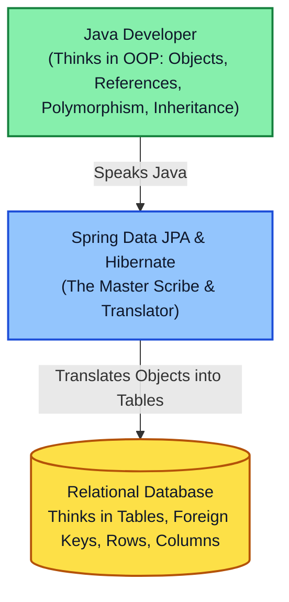
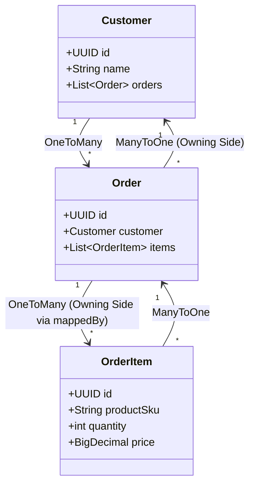
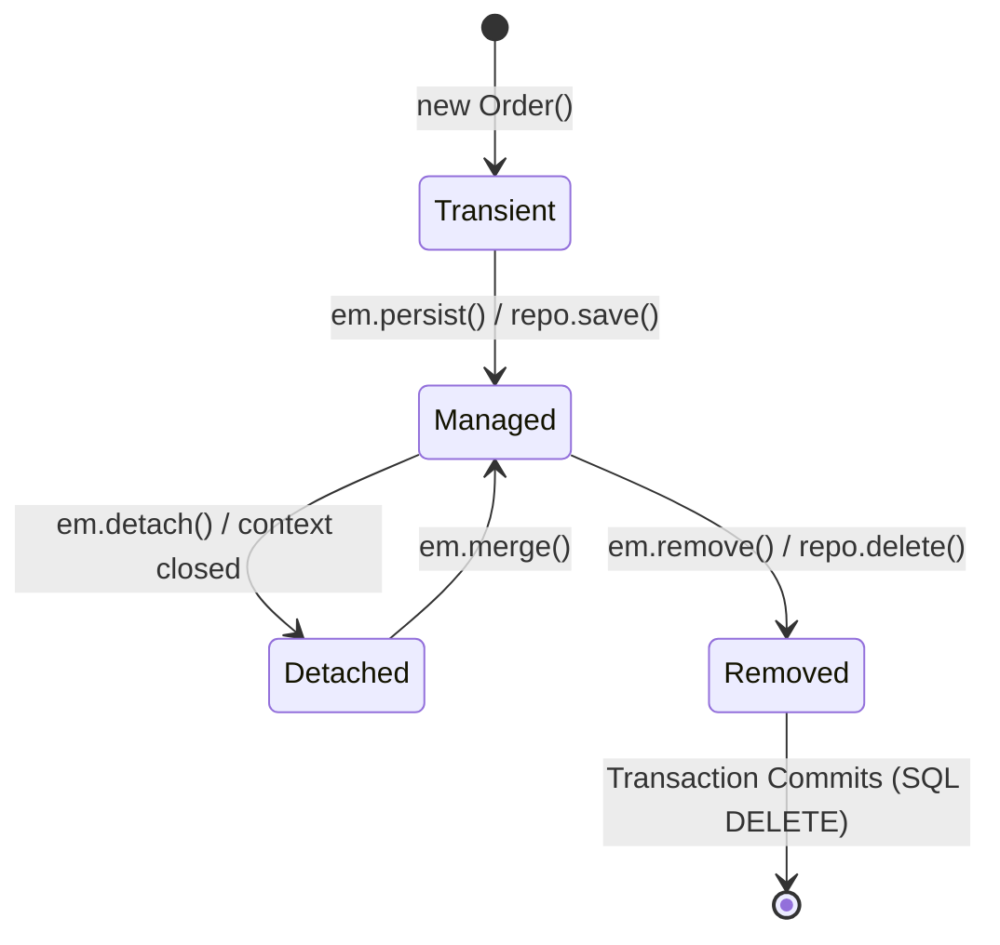

# Spring Data JPA, Hibernate Internals & Transaction Management

> **Cluster 05 — Module 04**  
> **Level**: Beginner-Friendly to Production & FAANG-Level Deep Dive  
> **Key References**: Jakarta Persistence API (JPA) Specification, Vlad Mihalcea (High-Performance Java Persistence), Gavin King (Hibernate In Action), Baeldung

---

## 🌱 0. The Beginner's Mental Model: Bridging Java Objects and SQL Tables

### The Nightmare Before Spring Data JPA: Raw JDBC Spaghetti

In the early days of enterprise Java, persisting data to a relational database meant writing raw **Java Database Connectivity (JDBC)** code. For every single database operation, you had to:

1. Manually open a database `Connection` from a driver manager.
2. Write raw SQL strings concatenated with Java variables (creating massive SQL injection risks).
3. Manually create a `PreparedStatement`, bind indexed positional parameters (`stmt.setString(1, user.getName())`).
4. Execute the query, loop through a cursor-based `ResultSet` row-by-row, and manually map every single database column into Java setters (`user.setId(rs.getLong("id"))`).
5. Ensure every `ResultSet`, `Statement`, and `Connection` was closed inside a nested `finally` block to prevent catastrophic connection leaks.

```mermaid
flowchart LR
    Dev["Developer Code"] -->|Raw SQL Strings + Manual Try-Catch-Finally| JDBC["JDBC Driver"]
    JDBC -->|Positions: setString(1), setInt(2)| DB[(Relational DB)]
    DB -->|ResultSet Cursor| Dev

    style Dev fill:#fecaca,stroke:#dc2626,stroke-width:2px,color:#7f1d1d
    style JDBC fill:#fde047,stroke:#b45309,stroke-width:2px,color:#0f172a
    style DB fill:#93c5fd,stroke:#1d4ed8,stroke-width:2px,color:#0f172a
```

Writing CRUD operations for a database table with 25 columns required over 150 lines of repetitive, error-prone boilerplate. If someone changed a database column from `VARCHAR` to `INTEGER`, half the application broke at runtime!

---

### The Real-World Analogy: The Dedicated Personal Scribe & Translator

Think of **Spring Data JPA & Hibernate** as a master scholar and scribe:



- **The Developer** lives in the world of Object-Oriented Programming (OOP): classes, inheritance, encapsulation, and object references (`order.getItems()`).
- **The Relational Database** lives in the mathematical world of relational algebra: tables, rows, columns, foreign keys, and joins.
- This fundamental mismatch is called the **Object-Relational Impedance Mismatch**.
- **Hibernate (The ORM Scribe)** sits between both worlds. When you say `orderRepository.save(order)`, Hibernate automatically inspects the Java object, writes the optimized `INSERT` SQL statement, binds all parameters, and handles foreign key constraints.

---

## 📝 1. Comprehensive Study Notes: The Persistence Architecture

### What is Spring Data JPA?

Spring Data JPA is a high-level data access abstraction framework built on top of the Jakarta Persistence API (JPA) specification that dramatically reduces boilerplate data access code by providing automated repository implementations, derived query methods, dynamic pagination, and transparent transaction integration.

It is important to understand the distinctions between the three core layers of modern Java persistence:
1. **JPA (Jakarta Persistence API):** A Java specification (a collection of interfaces and annotations like `@Entity`, `@Id`, `EntityManager`) that defines *how* object-relational mapping should work. JPA itself contains no executable code.
2. **Hibernate:** The actual, concrete Object-Relational Mapping (ORM) framework and runtime engine that implements the JPA specification. It translates Java object operations into physical SQL queries for PostgreSQL, MySQL, Oracle, etc.
3. **Spring Data JPA:** An abstraction layer built *on top* of JPA and Hibernate. It eliminates the need to interact directly with Hibernate's `EntityManager` by automatically generating repository implementations at startup.

### What Does Spring Data JPA Actually Do?

Spring Data JPA performs four indispensable responsibilities:

1. **Automated Repository Generation:** By simply declaring an interface extending `JpaRepository<Order, UUID>`, Spring dynamically generates the complete DAO implementation in memory at runtime with full CRUD capabilities.
2. **Derived Query Generation:** It parses method names (such as `findByCustomerIdAndStatusOrderByCreatedAtDesc`) and automatically generates the corresponding JPQL/SQL query without requiring developers to write a single line of SQL.
3. **Transparent Persistence Context Management:** It coordinates with Hibernate to manage entity states, perform automated dirty checking, synchronize changes with the database during flushes, and maintain the First-Level Cache.
4. **Declarative Transaction Management:** It integrates seamlessly with Spring's `@Transactional` annotation to guarantee ACID properties (Atomicity, Consistency, Isolation, Durability) across complex enterprise workflows.

### Why Do We Need Spring Data JPA & What Help Does It Provide?

Understanding why Spring Data JPA is standard across enterprise applications:

* **Massive Reduction in Boilerplate:** Developers no longer write repetitive `find`, `save`, `update`, `delete`, and `count` methods for dozens of domain entities.
* **Database Vendor Independence:** Hibernate generates dialect-specific SQL. If a company migrates from MySQL to PostgreSQL, zero repository code needs to be modified; only the database connection driver and dialect property change.
* **Automated Dirty Checking:** When an entity is modified inside an active transaction, Hibernate automatically detects the mutated fields and writes an optimized `UPDATE` query when the transaction commits. You never have to call `repository.update()`.
* **Built-in Enterprise Pagination & Slicing:** Handling pagination (`LIMIT` and `OFFSET`), multi-column sorting, and dynamic filtering requires just a single `Pageable` parameter.

---

## ⚡ 2. Before vs. After: The Evolution of Java Persistence

### The Before vs. After Transformation Table

| Capability / Metric | Raw JDBC (Oldest) | Spring `JdbcTemplate` | Hibernate / JPA | Spring Data JPA (Modern Standard) |
| :--- | :--- | :--- | :--- | :--- |
| **Boilerplate Code** | Extreme (~100 lines per CRUD query). | Moderate (~30 lines per query). | Low (~15 lines per query). | **Near Zero (1-line interface declaration).** |
| **Connection & Resource Management** | Manual `try-catch-finally` closing. | Handled automatically by Spring. | Handled automatically by EntityManager. | **100% transparent and automated.** |
| **SQL Writing** | 100% manual raw SQL strings. | 100% manual raw SQL strings. | HQL / JPQL queries. | **Auto-generated from method names.** |
| **Object Mapping** | Manual `rs.getString("col")` mapping. | `RowMapper<T>` interfaces. | Declarative via `@Entity` annotations. | **Declarative via `@Entity` annotations.** |
| **Change Detection (Updates)** | Must manually issue `UPDATE ... WHERE id=?`. | Must manually issue `UPDATE ... WHERE id=?`. | Automated Dirty Checking in memory. | **Automated Dirty Checking in memory.** |
| **Pagination & Sorting** | Manual SQL `LIMIT` / `OFFSET` math. | Manual SQL string concatenation. | `setFirstResult()`, `setMaxResults()`. | **Native `Pageable` & `Sort` parameters.** |

---

## 🏛️ 3. JPA Entity Mapping Fundamentals

An **Entity** is a lightweight, persistent Java domain object that represents a table in a relational database, where each instance corresponds to a single row.

```java
@Entity
@Table(
    name = "orders",
    indexes = {
        @Index(name = "idx_orders_customer_id", columnList = "customer_id"),
        @Index(name = "idx_orders_created_at", columnList = "created_at")
    }
)
public class Order {

    @Id
    @GeneratedValue(strategy = GenerationType.UUID)
    @Column(name = "id", updatable = false, nullable = false)
    private UUID id;

    @Column(name = "customer_id", nullable = false, length = 64)
    private String customerId;

    @Enumerated(EnumType.STRING) // ALWAYS use STRING, NEVER ORDINAL!
    @Column(name = "status", nullable = false, length = 32)
    private OrderStatus status;

    @Column(name = "total_amount", nullable = false, precision = 12, scale = 2)
    private BigDecimal totalAmount;

    @CreationTimestamp
    @Column(name = "created_at", updatable = false, nullable = false)
    private Instant createdAt;

    @UpdateTimestamp
    @Column(name = "updated_at", nullable = false)
    private Instant updatedAt;

    @Version // Optimistic Locking
    @Column(name = "version")
    private Long version;

    // Constructors, Getters, Setters...
}
```

### Critical Rules for Entity Design:
1. **Always use `EnumType.STRING`**: If you use `EnumType.ORDINAL` (the default), adding or reordering an enum constant corrupts existing database records!
2. **Always include `@Version` for concurrency**: Enables **Optimistic Locking** to prevent lost updates when two users edit the same record concurrently.
3. **No-arg constructor required**: JPA mandates a `public` or `protected` no-argument constructor so Hibernate can instantiate entities via reflection.

---

## 🔗 4. Entity Relationships & Mapping Best Practices

Relational databases connect data using primary keys and foreign keys. JPA models these connections using relationship annotations:



### The Golden Rule: The "Owning Side" vs. The "Inverse Side"
- **The Owning Side**: The entity that physically holds the foreign key column in the database table. It is annotated with `@JoinColumn(name = "customer_id")`.
- **The Inverse (Bidirectional) Side**: Marked with the `mappedBy` attribute (e.g. `mappedBy = "customer"`). It does **NOT** own the foreign key column; it simply mirrors the relationship.

```java
// ==========================================
// 1. Owning Side: Order
// ==========================================
@Entity
@Table(name = "orders")
public class Order {
    @Id
    @GeneratedValue(strategy = GenerationType.IDENTITY)
    private Long id;

    @ManyToOne(fetch = FetchType.LAZY, optional = false)
    @JoinColumn(name = "customer_id", nullable = false)
    private Customer customer;

    @OneToMany(mappedBy = "order", cascade = CascadeType.ALL, orphanRemoval = true)
    private List<OrderItem> items = new ArrayList<>();

    // Synchronization Helper Methods!
    public void addItem(OrderItem item) {
        items.add(item);
        item.setOrder(this);
    }

    public void removeItem(OrderItem item) {
        items.remove(item);
        item.setOrder(null);
    }
}

// ==========================================
// 2. Child Entity: OrderItem
// ==========================================
@Entity
@Table(name = "order_items")
public class OrderItem {
    @Id
    @GeneratedValue(strategy = GenerationType.IDENTITY)
    private Long id;

    @ManyToOne(fetch = FetchType.LAZY, optional = false)
    @JoinColumn(name = "order_id", nullable = false)
    private Order order;
}
```

### Cascade Types & Orphan Removal
- **`CascadeType.ALL`**: Propagates all state transitions (`PERSIST`, `MERGE`, `REMOVE`, `REFRESH`, `DETACH`) from parent to child. Calling `orderRepository.save(order)` automatically saves all child items.
- **`orphanRemoval = true`**: When a child item is removed from the `items` collection (`items.remove(item)`), Hibernate automatically issues an `DELETE FROM order_items WHERE id = ?` to remove the abandoned child row.

---

## ⚠️ 5. The Dreaded N+1 Query Problem & 4 Concrete Solutions

The **N+1 Query Problem** is the single most common performance killer in enterprise Hibernate applications and the #1 question asked in senior engineering interviews.

### How Does the N+1 Problem Happen?

Suppose you have 100 `Order` records, and each order has an associated `Customer`. You query all orders:
```java
List<Order> orders = orderRepository.findAll();
```
1. **The 1 Query**: Hibernate executes `SELECT * FROM orders;` (fetching 100 rows).
2. **The N Queries**: If `customer` is lazily loaded, when you loop through the orders and call `order.getCustomer().getName()`, Hibernate executes a separate SQL query for **every single order**:
   ```sql
   SELECT * FROM customers WHERE id = ?; -- Query 1
   SELECT * FROM customers WHERE id = ?; -- Query 2
   ...
   SELECT * FROM customers WHERE id = ?; -- Query 100
   ```
Instead of executing **1 fast SQL JOIN**, Hibernate fires **101 separate database roundtrips**! In high-traffic systems, this saturates database connections and crashes production.

```mermaid
flowchart TD
    App["Application Code\nList<Order> orders = repo.findAll();"] -->|1 Query| Q1["SELECT * FROM orders; (Returns 100 Rows)"]
    Q1 --> Loop["Loop: order.getCustomer().getName()"]
    Loop -->|N Queries (100 separate roundtrips)| QN["SELECT * FROM customers WHERE id = 1;\nSELECT * FROM customers WHERE id = 2;\n... (100 queries!) 💥"]

    style App fill:#fecaca,stroke:#dc2626,stroke-width:2px,color:#7f1d1d
    style Q1 fill:#93c5fd,stroke:#1d4ed8,stroke-width:2px,color:#0f172a
    style Loop fill:#fde047,stroke:#b45309,stroke-width:2px,color:#0f172a
    style QN fill:#fecaca,stroke:#dc2626,stroke-width:2px,color:#7f1d1d
```

---

### The 4 Solutions to Kill the N+1 Problem:

#### Solution 1: JPQL `JOIN FETCH` (The Direct Fix)
Forces Hibernate to fetch the parent and child entities together in a single SQL `INNER JOIN` or `LEFT JOIN`:
```java
public interface OrderRepository extends JpaRepository<Order, Long> {
    @Query("SELECT o FROM Order o JOIN FETCH o.customer JOIN FETCH o.items WHERE o.status = :status")
    List<Order> findAllWithCustomerAndItems(@Param("status") OrderStatus status);
}
```
*Result*: Exactly **1 SQL Query** executed!

#### Solution 2: JPA `@EntityGraph` (Declarative Fetching)
Instructs Hibernate to override lazy loading dynamically for specific queries without writing manual joins:
```java
public interface OrderRepository extends JpaRepository<Order, Long> {
    @EntityGraph(attributePaths = {"customer", "items"})
    List<Order> findByStatus(OrderStatus status);
}
```

#### Solution 3: Hibernate `@BatchSize` (Batch Fetching)
Instead of fetching 1-by-1, Hibernate groups lazy IDs into a single `IN (?, ?, ...)` clause:
```java
@Entity
public class Customer {
    @BatchSize(size = 50)
    @OneToMany(mappedBy = "customer")
    private List<Order> orders;
}
```
*Result*: Reduces 100 queries down to just **2 queries** (`WHERE id IN (1..50)` and `WHERE id IN (51..100)`).

#### Solution 4: DTO Projections (Zero Overhead - Recommended for Read-Heavy APIs!)
Do not fetch heavy managed entities if you only need data for an HTTP response. Project directly into Java Records:
```java
public record OrderSummaryDto(Long id, String customerName, BigDecimal totalAmount) {}

public interface OrderRepository extends JpaRepository<Order, Long> {
    @Query("""
        SELECT new com.company.dto.OrderSummaryDto(o.id, c.name, o.totalAmount)
        FROM Order o JOIN o.customer c
    """)
    List<OrderSummaryDto> findOrderSummaries();
}
```
*Result*: Extreme performance. Skips Hibernate dirty checking, entity hydration, and memory caching entirely!

---

## 🧠 6. Hibernate Internals: The Persistence Context & Entity States

The **Persistence Context** (First-Level Cache) is an internal memory buffer managed by Hibernate during an active transaction where all managed entities are cached and tracked for changes.



### The 4 Entity States:
1. **Transient (New)**: A plain Java object instantiated with `new Order()`. It has no primary key and is not associated with any Hibernate session.
2. **Managed (Persistent)**: Associated with the active Persistence Context and has a database ID. Any modification to its fields is automatically detected by **Dirty Checking** and saved to the database upon transaction commit.
3. **Detached**: Had a database ID and was managed, but the transaction closed or the session was cleared (`em.clear()`). Modifying a detached object does **NOT** trigger dirty checking.
4. **Removed**: Marked for deletion. Hibernate issues a SQL `DELETE` statement when the transaction flushes.

### Automated Dirty Checking Explained
When an entity enters the Managed state, Hibernate takes an internal **memory snapshot** of all its field values. Before committing the transaction:
1. Hibernate compares the current state of the entity against the initial snapshot.
2. If any field differs, Hibernate automatically generates and executes an optimized SQL `UPDATE` statement.
3. **Key Takeaway**: You do *not* need to call `repository.save(order)` to update an existing entity inside a `@Transactional` method!

---

## 🛡️ 7. Transaction Management (`@Transactional` Deep Dive)

A **Database Transaction** is a sequence of database operations executed as a single, atomic unit of work that satisfies the ACID properties (Atomicity, Consistency, Isolation, Durability).

Spring's `@Transactional` annotation provides declarative transaction management powered by **Spring AOP Dynamic Proxies**.

```mermaid
flowchart TD
    Client["Client Request"] --> Proxy["Spring AOP Proxy\n(Intercepts Method Call)"]
    Proxy --> TxStart["1. Open DB Connection & Set AutoCommit = false"]
    TxStart --> Target["2. Execute Target Service Method"]
    Target --> TxCheck{Did Method Throw Exception?}
    TxCheck -->|No (Success)| Commit["3. Connection.commit()\n(Dirty Checking flushes changes)"]
    TxCheck -->|Yes (RuntimeException)| Rollback["3. Connection.rollback()\n(All changes undone)"]
    Commit & Rollback --> Cleanup["4. Close Connection & Reset Context"]

    style Client fill:#93c5fd,stroke:#1d4ed8,stroke-width:2px,color:#0f172a
    style Proxy fill:#c4b5fd,stroke:#6d28d9,stroke-width:2px,color:#0f172a
    style TxStart fill:#86efac,stroke:#15803d,stroke-width:2px,color:#0f172a
    style Target fill:#fde047,stroke:#b45309,stroke-width:2px,color:#0f172a
    style Commit fill:#86efac,stroke:#15803d,stroke-width:2px,color:#0f172a
    style Rollback fill:#fecaca,stroke:#dc2626,stroke-width:2px,color:#7f1d1d
    style Cleanup fill:#e2e8f0,stroke:#334155,stroke-width:2px,color:#0f172a
```

### The Method Self-Invocation Trap (Senior Interview Classic!)

**The Scenario**:
```java
@Service
public class OrderService {

    public void processOrder(Order order) {
        // Direct internal method call (this.saveInternal)
        saveInternal(order); // ❌ TRANSACTION WILL NOT WORK!
    }

    @Transactional
    public void saveInternal(Order order) {
        orderRepository.save(order);
    }
}
```

**Why It Fails**:
Spring `@Transactional` works by wrapping `OrderService` in an AOP proxy. When an external controller calls `processOrder()`, the call goes through the proxy. But when `processOrder()` calls `saveInternal()`, it invokes the method on the **raw `this` instance**, bypassing the AOP proxy completely! Consequently, no transaction is ever started.

**Fix**:
1. Move `saveInternal()` into a separate collaborator service bean.
2. Or inject `OrderService` lazily into itself to call the proxy.

---

### Transaction Propagation Behaviors

Propagation defines how transaction boundaries behave when a transactional method calls another transactional method:

| Propagation | Behavior When Transaction Already Exists | Behavior When No Transaction Exists | Production Use Case |
| :--- | :--- | :--- | :--- |
| **`REQUIRED`** (Default) | Joins the current existing transaction. | Creates a **new** transaction. | 95% of all standard business workflows. |
| **`REQUIRES_NEW`** | **Suspends** current transaction; creates a **new independent** transaction. | Creates a **new** transaction. | Audit logging or notification dispatch that must save even if the main transaction rolls back! |
| **`SUPPORTS`** | Joins the current existing transaction. | Executes non-transactionally. | Read-only operations that don't need locks unless called by a writer. |
| **`NOT_SUPPORTED`** | **Suspends** current transaction; executes non-transactionally. | Executes non-transactionally. | Calling slow external third-party payment APIs that shouldn't hold DB locks. |
| **`MANDATORY`** | Joins the current existing transaction. | **Throws `TransactionRequiredException`**. | Methods that must strictly run within an established transaction. |
| **`NEVER`** | **Throws `IllegalTransactionStateException`**. | Executes non-transactionally. | Non-transactional batch tasks. |

---

### Transaction Isolation Levels & Concurrency Phenomena

| Isolation Level | Dirty Read Prevention | Non-Repeatable Read Prevention | Phantom Read Prevention | Performance Overhead |
| :--- | :--- | :--- | :--- | :--- |
| **`READ_UNCOMMITTED`** | ❌ Allowed | ❌ Allowed | ❌ Allowed | Lowest |
| **`READ_COMMITTED`** (Postgres/Oracle default) | ✅ Prevented | ❌ Allowed | ❌ Allowed | Low |
| **`REPEATABLE_READ`** (MySQL default) | ✅ Prevented | ✅ Prevented | ❌ Allowed | Medium |
| **`SERIALIZABLE`** | ✅ Prevented | ✅ Prevented | ✅ Prevented | Extreme (High Lock Contention) |

- **Dirty Read**: Transaction A reads data modified by Transaction B before Transaction B commits. If B rolls back, A read uncommitted junk.
- **Non-Repeatable Read**: Transaction A reads a row twice. Between the two reads, Transaction B updates that row and commits. Transaction A gets two different values for the same row.
- **Phantom Read**: Transaction A queries rows matching a condition (`WHERE age > 30`). Transaction B inserts a new row matching that condition and commits. When A queries again, an extra "phantom" row appears.

### Rollback Rules: Checked vs. Unchecked Exceptions
- **Default Spring Behavior**: Spring only rolls back transactions for **Unchecked Exceptions** (`RuntimeException` and `Error`). It does **NOT** roll back for Checked Exceptions (`IOException`, `SQLException`, custom checked exceptions)!
- **Production Best Practice**: Always specify `rollbackFor = Exception.class`:
  ```java
  @Transactional(rollbackFor = Exception.class)
  public void transferFunds(...) { ... }
  ```

### The Read-Only Optimization
```java
@Transactional(readOnly = true)
public OrderResponse getOrder(UUID id) { ... }
```
When `readOnly = true` is set:
1. Hibernate sets `FlushMode.MANUAL`, disabling memory dirty checks and significantly reducing CPU and heap usage.
2. Modern database drivers route the query directly to read-only database replicas, preserving master database CPU.
