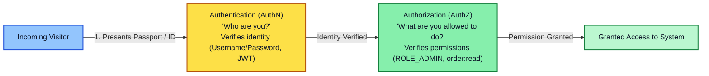
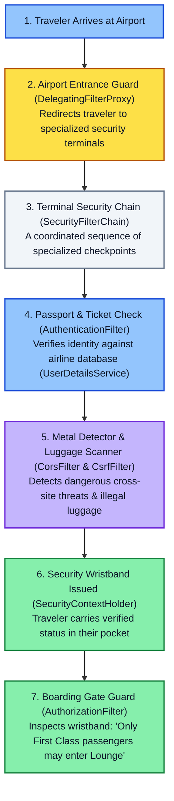
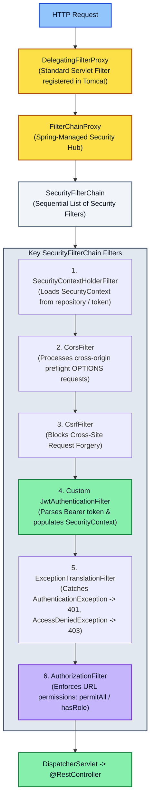
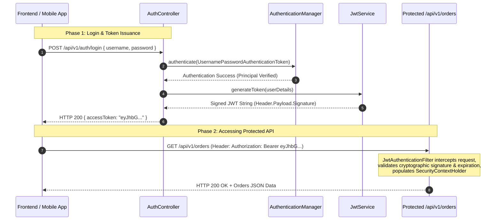

# Spring Security 6: Architecture, JWT Authentication & OAuth2

> **Cluster 05 — Module 05**  
> **Level**: Beginner-Friendly to Production & FAANG-Level Deep Dive  
> **Key References**: Spring Security 6 Official Documentation, OAuth 2.0 & OIDC RFC 6749, Rob Winch & Laurentiu Spilca (Spring Security in Action), Baeldung

---

## 🌱 0. The Beginner's Mental Model: Securing Applications

### The Confusion: Authentication vs. Authorization

Before writing any security code, every engineer must master the difference between **Authentication (AuthN)** and **Authorization (AuthZ)**:



- **Authentication (AuthN)**: *"Who are you?"* Verifying that a user or machine is who they claim to be (e.g., logging in with email and password, biometrics, or an API key).
- **Authorization (AuthZ)**: *"What are you allowed to do?"* Determining whether the authenticated identity has permission to perform a specific action (e.g., can a standard user delete another customer's bank account?).

---

### The Real-World Analogy: Airport Security Checkpoints

Think of **Spring Security** as the comprehensive security system of an international airport:



1. **`DelegatingFilterProxy`**: The doorman at the airport entrance. It intercepts incoming HTTP traffic at the standard servlet layer and hands it over to the Spring-managed security system.
2. **`SecurityFilterChain`**: The series of physical metal detectors, passport checkpoints, and baggage scanners. Every request must pass through these filters in strict sequential order.
3. **`SecurityContextHolder`**: The temporary security wristband given to the passenger. It stays attached to the executing thread, proving identity throughout the flight.
4. **`AuthorizationFilter`**: The gatekeeper at the VIP Lounge checking whether the passenger holds a First Class boarding pass before allowing entry.

---

## 📝 1. Comprehensive Study Notes: Understanding Spring Security 6

### What is Spring Security?

Spring Security is a powerful, highly customizable authentication and access-control framework that serves as the de facto standard for securing Spring-based enterprise applications and REST APIs.

Spring Security protects applications at two distinct boundaries: the **Web Request Layer** (intercepting HTTP requests using a chain of servlet filters) and the **Method Execution Layer** (intercepting Java method invocations using Aspect-Oriented Programming and annotations like `@PreAuthorize`). It handles user authentication, password hashing, session management, CSRF prevention, CORS policy enforcement, and role-based access control out of the box.

### What Does Spring Security Actually Do?

Spring Security executes four core defensive missions:

1. **Request Interception & Filter Delegation:** It intercepts every incoming HTTP packet before it ever reaches your controllers, evaluating authentication tokens, credentials, and firewall rules.
2. **Credential Authentication:** It validates incoming credentials (usernames/passwords, Bearer JWT tokens, API keys) against user databases, LDAP directories, or identity providers (like Keycloak, Okta, or Auth0) using secure password hashing algorithms (BCrypt, Argon2).
3. **Principal & Context Storage:** Upon successful authentication, it stores the authenticated user's identity, roles, and privileges inside a thread-local container called the `SecurityContext`.
4. **Fine-Grained Access Control:** It evaluates whether the authenticated principal has the necessary authorities (`ROLE_ADMIN`, `order:write`) to access specific HTTP endpoints or execute specific service methods.

### Why Do We Need Spring Security & What Help Does It Provide?

Understanding the critical value of Spring Security in enterprise environments:

* **Elimination of Hand-Rolled Security Bugs:** Security is deceptively hard to implement correctly. Hand-rolling token parsing, salt generation, password hashing, and session management almost always leads to catastrophic vulnerabilities (like timing attacks, credential leaks, and SQL injection). Spring Security provides audited, battle-tested implementations.
* **Modern Stateless REST Support:** It supports building 100% stateless microservices using JSON Web Tokens (JWT) where server memory is never wasted storing HTTP sessions.
* **Declarative Role-Based Access Control (RBAC):** Developers can guard sensitive business methods with expressive annotations (`@PreAuthorize("hasRole('ADMIN')")`), completely decoupling business rules from authentication logic.
* **Enterprise Identity Integration (OAuth2 / OIDC):** It provides seamless integration with single sign-on (SSO) protocols like OpenID Connect and OAuth 2.0, allowing users to log in with corporate Google, GitHub, or Active Directory accounts.

---

## ⚡ 2. Before vs. After: Modern Spring Security 6 vs. Legacy Spring Security

### The Before vs. After Transformation Table

| Feature / Pattern | Legacy Spring Security (Pre-Boot 3 / Pre-Spring 6) | Modern Spring Security 6 (Spring Boot 3.x) | Why This Helps (Engineering Value) |
| :--- | :--- | :--- | :--- |
| **Configuration Style** | Extend deprecated `WebSecurityConfigurerAdapter` and override `configure()`. | Declare a standalone `@Bean public SecurityFilterChain`. | Eliminates rigid class inheritance; enables clean functional composition. |
| **HTTP Configuration DSL** | Method chaining with `.and()`: `http.csrf().disable().and().authorizeRequests()...` | Functional Lambda DSL: `http.csrf(AbstractHttpConfigurer::disable)...` | Clean indentation; no ambiguous `.and()` operators; easier to read and maintain. |
| **Endpoint Matching** | `antMatchers("/api/**")` and `authorizeRequests()`. | `requestMatchers("/api/**")` and `authorizeHttpRequests()`. | Safer path matching; automatically integrates with Spring MVC route mappings. |
| **Filter Internals** | Deprecated `FilterSecurityInterceptor`. | Modern, streamlined `AuthorizationFilter`. | Higher performance; unified authorization logic. |
| **Session Architecture** | Stateful HTTP Sessions (`JSESSIONID`) stored in memory. | Stateless Session Policy (`SessionCreationPolicy.STATELESS`) with JWT. | Infinite horizontal scalability across Kubernetes pods without sticky sessions. |

---

## 🏛️ 3. Spring Security Architecture: Under the Hood

To master Spring Security, you must understand how a request travels through its filter architecture:



### The Core Architectural Components

1. **`DelegatingFilterProxy`**: A standard J2EE servlet filter registered in the web server that acts as a bridge, delegating all filtering work to a Spring bean called `FilterChainProxy`.
2. **`FilterChainProxy`**: The master security router that holds one or more `SecurityFilterChain` instances and decides which chain applies to an incoming request.
3. **`SecurityContextHolder`**: The central repository where Spring Security stores details of the currently authenticated principal. By default, it stores this information in a `ThreadLocal`, meaning it is accessible to any method executed on that same thread.
4. **`Authentication`**: The token interface representing an authenticated user:
   - `getPrincipal()`: The identity of the user (e.g., `UserDetails` object or username).
   - `getCredentials()`: The password or token (usually wiped after authentication for security).
   - `getAuthorities()`: The granted permissions (e.g., `ROLE_USER`, `ROLE_ADMIN`).
5. **`AuthenticationManager`**: The top-level interface for performing authentication (`authenticate(Authentication)`). The standard implementation is `ProviderManager`, which delegates to a list of configured `AuthenticationProvider` beans.
6. **`PasswordEncoder`**: A cryptographic service used to securely hash and verify passwords using slow, salted one-way hashing algorithms (e.g., `BCryptPasswordEncoder`).

---

## 🔒 4. Production Spring Security 6 Configuration

Here is the modern, production-grade security configuration for a stateless REST API in Spring Boot 3 / Spring Security 6:

```java
@Configuration
@EnableWebSecurity
@EnableMethodSecurity(prePostEnabled = true) // Activates @PreAuthorize
public class SecurityConfig {

    private final JwtAuthenticationFilter jwtAuthFilter;
    private final UserDetailsService userDetailsService;

    public SecurityConfig(JwtAuthenticationFilter jwtAuthFilter, UserDetailsService userDetailsService) {
        this.jwtAuthFilter = jwtAuthFilter;
        this.userDetailsService = userDetailsService;
    }

    @Bean
    public SecurityFilterChain securityFilterChain(HttpSecurity http) throws Exception {
        return http
                // 1. Disable CSRF (Not needed for stateless JWT APIs without browser cookies)
                .csrf(AbstractHttpConfigurer::disable)

                // 2. Enable CORS with custom policy
                .cors(cors -> cors.configurationSource(corsConfigurationSource()))

                // 3. Stateless Session Management (Zero HTTP sessions in memory!)
                .sessionManagement(session -> session.sessionCreationPolicy(SessionCreationPolicy.STATELESS))

                // 4. URL Authorization Rules
                .authorizeHttpRequests(auth -> auth
                        .requestMatchers("/api/v1/auth/**").permitAll() // Public login/register
                        .requestMatchers("/actuator/health/**").permitAll() // K8s health checks
                        .requestMatchers("/api/v1/admin/**").hasRole("ADMIN") // Admin only
                        .anyRequest().authenticated() // Everything else requires a valid token
                )

                // 5. Register Authentication Provider
                .authenticationProvider(authenticationProvider())

                // 6. Insert custom JWT filter BEFORE the standard UsernamePasswordAuthenticationFilter
                .addFilterBefore(jwtAuthFilter, UsernamePasswordAuthenticationFilter.class)

                .build();
    }

    @Bean
    public AuthenticationProvider authenticationProvider() {
        DaoAuthenticationProvider authProvider = new DaoAuthenticationProvider();
        authProvider.setUserDetailsService(userDetailsService);
        authProvider.setPasswordEncoder(passwordEncoder());
        return authProvider;
    }

    @Bean
    public AuthenticationManager authenticationManager(AuthenticationConfiguration config) throws Exception {
        return config.getAuthenticationManager();
    }

    @Bean
    public PasswordEncoder passwordEncoder() {
        return new BCryptPasswordEncoder(12); // Work factor 12 (Salted & secure)
    }

    @Bean
    public CorsConfigurationSource corsConfigurationSource() {
        CorsConfiguration config = new CorsConfiguration();
        config.setAllowedOrigins(List.of("https://app.company.com"));
        config.setAllowedMethods(List.of("GET", "POST", "PUT", "DELETE", "PATCH", "OPTIONS"));
        config.setAllowedHeaders(List.of("Authorization", "Content-Type", "X-Requested-With"));
        config.setAllowCredentials(true);
        config.setMaxAge(3600L);

        UrlBasedCorsConfigurationSource source = new UrlBasedCorsConfigurationSource();
        source.registerCorsConfiguration("/**", config);
        return source;
    }
}
```

---

## 🎟️ 5. End-to-End Stateless JWT Authentication Flow

A **JSON Web Token (JWT)** is an open, industry-standard (RFC 7519) compact and self-contained URL-safe string used to transmit claims securely between parties as a digital token.



### 1. The Anatomy of a JWT:
A JWT consists of three parts separated by dots (`.`):
1. **Header**: Specifies the cryptographic algorithm (e.g., `{"alg": "HS256", "typ": "JWT"}`).
2. **Payload (Claims)**: Contains statements about the user (e.g., `sub`: "john_doe", `roles`: ["ROLE_USER"], `exp`: 1731672000).
3. **Signature**: A hash generated by taking the encoded Header, the encoded Payload, and a secret server key:
   $$\text{Signature} = \text{HMACSHA256}(\text{base64UrlEncode}(\text{Header}) + "." + \text{base64UrlEncode}(\text{Payload}), \text{secret})$$

### 2. Custom `JwtAuthenticationFilter` Implementation:
```java
@Component
public class JwtAuthenticationFilter extends OncePerRequestFilter {

    private final JwtService jwtService;
    private final UserDetailsService userDetailsService;

    public JwtAuthenticationFilter(JwtService jwtService, UserDetailsService userDetailsService) {
        this.jwtService = jwtService;
        this.userDetailsService = userDetailsService;
    }

    @Override
    protected void doFilterInternal(
            @NonNull HttpServletRequest request,
            @NonNull HttpServletResponse response,
            @NonNull FilterChain filterChain
    ) throws ServletException, IOException {

        final String authHeader = request.getHeader(HttpHeaders.AUTHORIZATION);

        // 1. Check for Bearer token
        if (authHeader == null || !authHeader.startsWith("Bearer ")) {
            filterChain.doFilter(request, response);
            return;
        }

        final String jwt = authHeader.substring(7);
        final String username = jwtService.extractUsername(jwt);

        // 2. Validate token and authenticate if no context is already set
        if (username != null && SecurityContextHolder.getContext().getAuthentication() == null) {
            UserDetails userDetails = this.userDetailsService.loadUserByUsername(username);

            if (jwtService.isTokenValid(jwt, userDetails)) {
                UsernamePasswordAuthenticationToken authToken = new UsernamePasswordAuthenticationToken(
                        userDetails,
                        null,
                        userDetails.getAuthorities()
                );
                authToken.setDetails(new WebAuthenticationDetailsSource().buildDetails(request));

                // 3. Populate SecurityContext!
                SecurityContextHolder.getContext().setAuthentication(authToken);
            }
        }

        // 4. Proceed to next filter
        filterChain.doFilter(request, response);
    }
}
```

---

## 🛡️ 6. Method-Level Security & Role-Based Access Control (RBAC)

While URL-based authorization filters traffic at the HTTP boundary, **Method-Level Security** guards Java method executions directly inside your service classes.

Activate it on your configuration using `@EnableMethodSecurity`.

### Expressive Method Security Annotations

```java
@Service
public class OrderService {

    // 1. Role Check
    @PreAuthorize("hasRole('ADMIN')")
    public void deleteOrder(UUID orderId) {
        orderRepository.deleteById(orderId);
    }

    // 2. Multiple Roles
    @PreAuthorize("hasAnyRole('MANAGER', 'ADMIN')")
    public void approveRefund(UUID orderId) { ... }

    // 3. Fine-Grained Authority (Permission) Check
    @PreAuthorize("hasAuthority('order:write')")
    public OrderResponse createOrder(OrderCreateRequest request) { ... }

    // 4. Object-Level Access Control (SpEL Expression)
    // Only allows user to read order IF the order belongs to them OR they are an admin!
    @PreAuthorize("hasRole('ADMIN') or #customerId == authentication.principal.username")
    public List<OrderResponse> getCustomerOrders(String customerId) {
        return orderRepository.findByCustomerId(customerId);
    }

    // 5. Inspecting the Returned Value (@PostAuthorize)
    // Runs AFTER method executes; checks if return object belongs to authenticated user
    @PostAuthorize("returnObject.customerId == authentication.principal.username")
    public OrderResponse getOrderById(UUID orderId) {
        return orderRepository.findById(orderId)
                .map(OrderResponse::from)
                .orElseThrow(() -> new ResourceNotFoundException("Order not found"));
    }
}
```

---

## 🌐 7. OAuth2 & OpenID Connect (OIDC) Resource Server

In modern microservice architectures, authentication is often centralized into a dedicated Identity Provider (IdP) like **Keycloak, Auth0, or Okta**.

Your Spring Boot microservice acts as an **OAuth2 Resource Server** that validates incoming JWT tokens issued by the Identity Provider:

```mermaid
flowchart LR
    User["User / Client App"] -->|1. Authenticates| IdP["Identity Provider\n(Keycloak / Okta / Auth0)"]
    IdP -->|2. Issues Signed JWT| User
    User -->|3. GET /api/orders (Bearer JWT)| Resource["Spring Boot Microservice\n(OAuth2 Resource Server)"]
    Resource -->|4. Validates JWT Signature via JWKS URL| IdP

    style User fill:#93c5fd,stroke:#1d4ed8,stroke-width:2px,color:#0f172a
    style IdP fill:#fde047,stroke:#b45309,stroke-width:2px,color:#0f172a
    style Resource fill:#86efac,stroke:#15803d,stroke-width:2px,color:#0f172a
```

### Spring Boot 3 Resource Server Setup (3 Lines of Config!)

Add dependency: `spring-boot-starter-oauth2-resource-server`

```yaml
# application.yml
spring:
  security:
    oauth2:
      resourceserver:
        jwt:
          issuer-uri: https://idp.company.com/realms/enterprise
          jwk-set-uri: https://idp.company.com/realms/enterprise/protocol/openid-connect/certs
```

```java
@Configuration
public class OAuth2ResourceServerConfig {

    @Bean
    public SecurityFilterChain securityFilterChain(HttpSecurity http) throws Exception {
        return http
                .csrf(AbstractHttpConfigurer::disable)
                .authorizeHttpRequests(auth -> auth
                        .requestMatchers("/api/public/**").permitAll()
                        .anyRequest().authenticated()
                )
                .oauth2ResourceServer(oauth2 -> oauth2.jwt(Customizer.withDefaults()))
                .build();
    }
}
```
Spring Boot automatically downloads the public cryptographic keys from the IdP's JWKS endpoint and verifies incoming JWT signatures with zero custom verification code!
