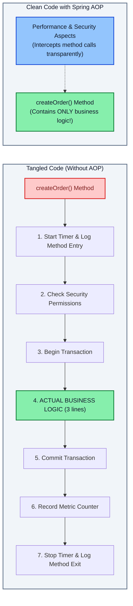
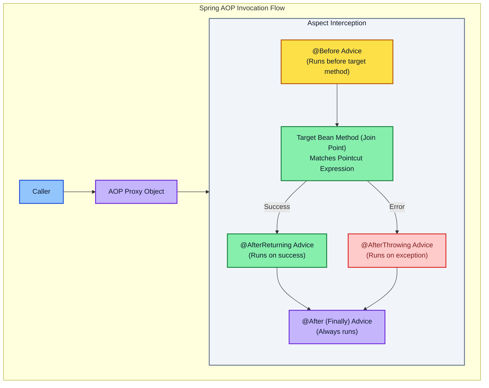
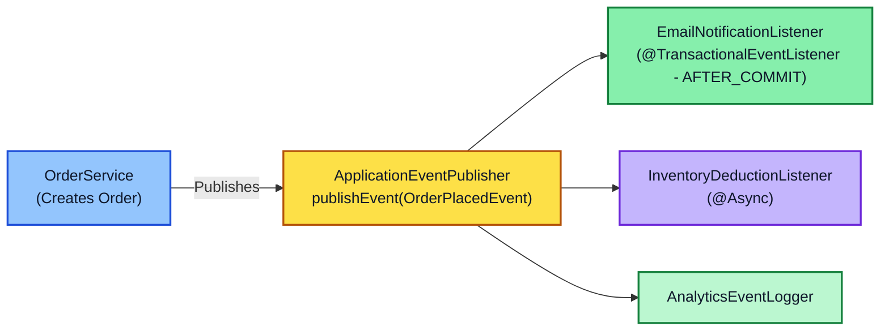
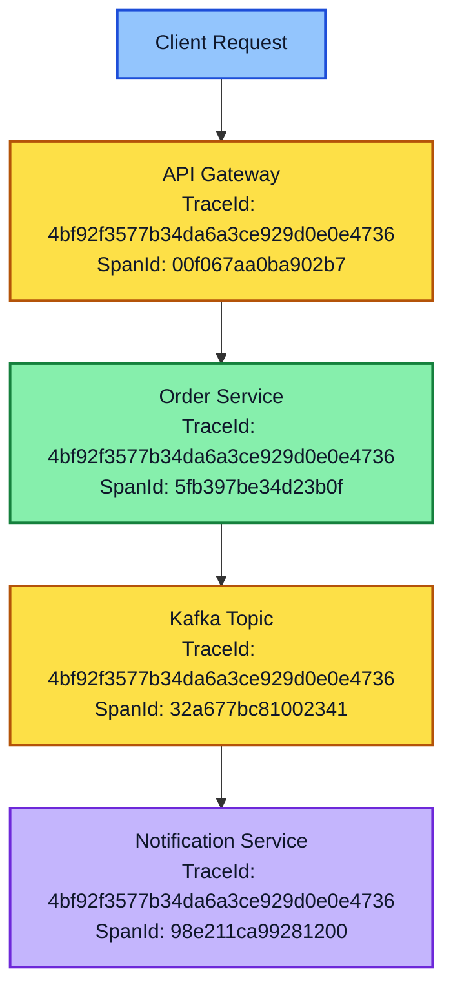

# Spring AOP, Application Events, Actuator & Observability

> **Cluster 05 — Module 06**  
> **Level**: Beginner-Friendly to Production & FAANG-Level Deep Dive  
> **Key References**: Spring Framework AOP Documentation, Spring Boot Actuator Reference, Micrometer & OpenTelemetry Documentation, Jon Schneider (Observability in Spring Boot 3), Baeldung

---

## 🌱 0. The Beginner's Mental Model: Cross-Cutting Concerns & Production Telemetry

### The Problem: Tangled Cross-Cutting Concerns

In any enterprise application, your business logic is only part of what runs. Every time a customer places an order, you also need to:
1. Log the execution time for performance monitoring.
2. Authenticate the security token.
3. Open and commit a database transaction.
4. Record Prometheus metrics for alerts.
5. Capture an immutable audit trail for compliance.



If you copy and paste 20 lines of infrastructure logging, metrics, and security checks into every single business method, your codebase becomes an unmaintainable nightmare. **Aspect-Oriented Programming (AOP)** extracts these cross-cutting concerns into modular, reusable aspects.

---

### The Real-World Analogies: The Security Guard & The Airplane Flight Recorder

#### Analogy 1: The Corporate Security Guard & Auditor (Spring AOP)
Imagine a bank vault. When a bank teller walks into the vault to count money, the teller does not write down the time in a logbook, check their own badge, and turn on the security cameras.
Instead, a **Security Guard (The Aspect)** stands outside the vault door. Whenever anyone enters or exits (a **Join Point**), the guard intercepts them, validates their badge, logs the exact entry time, and records the event. The teller focuses 100% on counting cash!

#### Analogy 2: The Airplane Flight Data Recorder (Spring Boot Actuator)
Modern jet airliners are equipped with a Flight Data Recorder ("Black Box") and an array of cockpit diagnostic instruments that constantly monitor engine temperature, cabin pressure, hydraulic fluid levels, and GPS coordinates.
**Spring Boot Actuator** is the digital black box and diagnostic cockpit of your microservice. It provides live telemetry on heap memory consumption, active thread counts, database connection pool health, and dynamic logging without requiring you to stop the plane mid-flight!

---

## 📝 1. Comprehensive Study Notes: AOP & Observability

### What is Aspect-Oriented Programming (AOP)?

Aspect-Oriented Programming (AOP) is a programming paradigm that complements Object-Oriented Programming (OOP) by providing a way to modularize cross-cutting concerns—such as logging, transaction management, caching, and security—across multiple non-related application layers without modifying the core business code.

In OOP, the key unit of modularity is the Class. In AOP, the key unit of modularity is the **Aspect**. An aspect encapsulates behaviors that affect multiple classes into a single reusable component. Spring AOP achieves this at runtime by wrapping target beans inside dynamic proxies that intercept method invocations.

### What is Spring Boot Actuator & Observability?

Spring Boot Actuator is a production-ready feature set that brings comprehensive monitoring, health checking, and management capabilities to your microservices via standard HTTP REST endpoints and JMX beans.

Observability is the ability to infer the internal state of a complex distributed system based on external outputs. Modern cloud-native observability is built upon the **Three Pillars of Observability**:
1. **Metrics:** Numeric aggregated telemetry measuring system behavior over time (e.g., request rates, error percentages, memory utilization) scraped by **Prometheus**.
2. **Traces:** Distributed tracking of a single user request as it traverses across multiple microservices and message queues using **Micrometer Tracing** and **OpenTelemetry**.
3. **Logs:** Timestamped records of discrete events emitted during execution and aggregated into platforms like Elasticsearch, Loki, or Splunk.

### Why Do We Need AOP & Actuator & What Help Do They Provide?

Understanding why modern engineering teams rely on these tools:

* **Separation of Concerns:** Business classes remain 100% pure domain code, completely free of repetitive timing logic, transaction wrappers, or audit code.
* **Kubernetes Orchestration Integration:** Actuator provides dedicated `/actuator/health/liveness` and `/actuator/health/readiness` endpoints that Kubernetes kubelets probe to determine when to restart dead pods or route traffic to ready pods.
* **Dynamic Log Level Switching Without Restart:** If an incident occurs in production, you can change the log level of a specific service from `INFO` to `DEBUG` on the fly via a simple POST request to `/actuator/loggers`, diagnosing bugs in real-time without restarting the server!
* **Distributed Request Tracking:** When an API call fails across a cluster of 50 microservices, distributed tracing propagates a single `traceId` across HTTP headers, allowing engineers to pinpoint the exact failing service within seconds in Grafana Tempo or Zipkin.

---

## ⚡ 2. Before vs. After: Manual Plumbing vs. Declarative Telemetry

### The Before vs. After Transformation Table

| Capability / Metric | Manual Plumbing (Before AOP & Actuator) | Modern Spring AOP & Actuator | Concrete Engineering Value |
| :--- | :--- | :--- | :--- |
| **Execution Profiling** | `long start = System.currentTimeMillis();` copied and pasted into 200 methods. | 1 clean `@Around` aspect on a custom `@LogExecutionTime` annotation. | Zero code duplication; can enable or disable globally in 1 line. |
| **Production Health Checks** | Write custom servlets executing `SELECT 1` queries; manual JSON formatting. | Out-of-the-box `/actuator/health` automatically checking DB, Redis, and Disk. | Standardized Kubernetes health probes; zero maintenance. |
| **Emergency Log Level Changes** | Change log level in config file, rebuild container, and redeploy to production. | HTTP `POST /actuator/loggers/com.company.order` with `{"configuredLevel": "DEBUG"}`. | Instant live debugging during production outages with zero downtime. |
| **Distributed Request Tracing** | Manually generate UUIDs and pass them through every method argument and HTTP call. | Micrometer Tracing automatically injects W3C `traceparent` headers. | End-to-end visualization of distributed microservice latency. |
| **System Event Decoupling** | Directly call email, payment, and inventory services synchronously from OrderService. | Publish `OrderPlacedEvent`; listeners handle notification and analytics asynchronously. | Complete architectural decoupling and resilience against downstream failures. |

---

## 🎯 3. Spring AOP Core Concepts & Terminology

Understanding AOP requires learning six foundational terms:



1. **Aspect**: A modular unit of cross-cutting functionality (a Java class annotated with `@Aspect` and `@Component`).
2. **Join Point**: A candidate execution point in the application where an aspect can be plugged in. In Spring AOP, a join point is **always a method execution**.
3. **Pointcut**: A predicate or regex expression that matches one or more join points (e.g., `execution(* com.company.service.*.*(..))`).
4. **Advice**: The actual action taken by an aspect at a join point:
   - `@Before`: Runs *before* the target method executes.
   - `@AfterReturning`: Runs *after* the target method completes normally without throwing errors.
   - `@AfterThrowing`: Runs *only if* the target method throws an exception.
   - `@After`: Runs *after* method execution regardless of outcome (like a `finally` block).
   - `@Around`: The most powerful advice. It wraps the target method entirely, controlling whether, when, and with what arguments the method executes!
5. **Target Object**: The real business bean being advised.
6. **Weaving**: The process of linking aspects with target beans to create advised proxy objects. Spring AOP performs weaving dynamically at runtime.

---

### Production Implementation: Custom Method Execution Timer Aspect

Here is how FAANG and top enterprise teams implement performance tracking cleanly:

#### 1. Define the Custom Annotation:
```java
@Target(ElementType.METHOD)
@Retention(RetentionPolicy.RUNTIME)
public @interface TrackExecutionTime {
    String metricName() default "custom_operation";
}
```

#### 2. Implement the `@Around` Aspect:
```java
@Aspect
@Component
public class PerformanceMonitoringAspect {

    private static final Logger log = LoggerFactory.getLogger(PerformanceMonitoringAspect.class);

    @Around("@annotation(trackTime)")
    public Object profileMethod(ProceedingJoinPoint joinPoint, TrackExecutionTime trackTime) throws Throwable {
        String methodName = joinPoint.getSignature().toShortString();
        long startTime = System.currentTimeMillis();

        try {
            // Proceed with actual method execution
            return joinPoint.proceed();
        } finally {
            long duration = System.currentTimeMillis() - startTime;
            log.info("Execution metric [{}] - Method {} finished in {} ms",
                    trackTime.metricName(), methodName, duration);

            if (duration > 1000) {
                log.warn("SLOW OPERATION DETECTED: Method {} exceeded 1000ms threshold (took {} ms)",
                        methodName, duration);
            }
        }
    }
}
```

#### 3. Use in Any Service Class:
```java
@Service
public class ReportService {

    @TrackExecutionTime(metricName = "generate_quarterly_pdf")
    public byte[] generateQuarterlyPdf(String reportId) {
        // Business logic here... zero timing boilerplate!
        return new byte[0];
    }
}
```

---

## 📢 4. Decoupling Microservices with Application Events

Spring's event mechanism allows beans to communicate asynchronously within a single application context without knowing about each other:



### The Transactional Event Listener Pattern (Production Standard!)

A common bug in event-driven systems occurs when an event is published *inside* an active transaction. If the notification listener immediately sends an email to the customer, but the database transaction subsequently rolls back due to a constraint violation, the customer receives an email for an order that never existed!

Spring provides `@TransactionalEventListener` to solve this:

```java
// 1. Immutable Domain Event Record
public record OrderPlacedEvent(UUID orderId, String customerEmail, BigDecimal totalAmount) {}

// 2. Event Publisher
@Service
public class OrderService {
    private final ApplicationEventPublisher eventPublisher;
    private final OrderRepository orderRepository;

    public OrderService(ApplicationEventPublisher eventPublisher, OrderRepository orderRepository) {
        this.eventPublisher = eventPublisher;
        this.orderRepository = orderRepository;
    }

    @Transactional
    public Order createOrder(OrderCreateRequest request) {
        Order saved = orderRepository.save(new Order(request));
        // Publish event inside transaction
        eventPublisher.publishEvent(new OrderPlacedEvent(saved.getId(), saved.getEmail(), saved.getTotal()));
        return saved;
    }
}

// 3. Transaction-Safe Listener
@Component
public class NotificationEventListener {

    // Runs ONLY AFTER the database transaction has successfully COMMITTED!
    @TransactionalEventListener(phase = TransactionPhase.AFTER_COMMIT)
    @Async // Runs in background thread pool without blocking the caller!
    public void onOrderPlaced(OrderPlacedEvent event) {
        emailClient.sendConfirmation(event.customerEmail(), event.orderId());
    }
}
```

---

## 🩺 5. Spring Boot Actuator: Production Health & Metrics

Actuator exposes crucial operational endpoints over HTTP under the `/actuator` path:

```yaml
# application.yml
management:
  endpoints:
    web:
      exposure:
        include: health, info, metrics, prometheus, loggers
  endpoint:
    health:
      show-details: when-authorized
      probes:
        enabled: true # Enables Kubernetes Liveness & Readiness probes!
```

### Essential Production Endpoints

| Endpoint | HTTP Method | Description & Operational Utility |
| :--- | :--- | :--- |
| **`/actuator/health`** | `GET` | Aggregated application health status (`UP`, `DOWN`, `OUT_OF_SERVICE`). |
| **`/actuator/health/liveness`** | `GET` | Used by Kubernetes: checks if the JVM is alive or stuck in a deadlock. |
| **`/actuator/health/readiness`**| `GET` | Used by Kubernetes: checks if the app is ready to accept HTTP traffic. |
| **`/actuator/metrics`** | `GET` | Query JVM memory, garbage collection pauses, HTTP request latencies. |
| **`/actuator/prometheus`** | `GET` | Formatted metrics in OpenMetrics text format for Prometheus scraping. |
| **`/actuator/loggers`** | `GET / POST` | Inspect and dynamically update logger levels at runtime without restarting! |
| **`/actuator/env`** | `GET` | Inspect active Spring environment properties and system variables. |

### Writing a Custom Health Indicator
```java
@Component
public class PaymentGatewayHealthIndicator implements HealthIndicator {

    private final PaymentClient paymentClient;

    public PaymentGatewayHealthIndicator(PaymentClient paymentClient) {
        this.paymentClient = paymentClient;
    }

    @Override
    public Health health() {
        try {
            long pingMs = paymentClient.pingGateway();
            if (pingMs < 1000) {
                return Health.up()
                        .withDetail("gateway", "Stripe")
                        .withDetail("latencyMs", pingMs)
                        .build();
            } else {
                return Health.status("DEGRADED")
                        .withDetail("latencyMs", pingMs)
                        .build();
            }
        } catch (Exception ex) {
            return Health.down(ex)
                    .withDetail("gateway", "Stripe")
                    .build();
        }
    }
}
```

---

## 🔭 6. Distributed Tracing: Micrometer & OpenTelemetry in Spring Boot 3

In a microservice cluster, a single user click triggers a cascade of calls: API Gateway $\rightarrow$ Order Service $\rightarrow$ Payment Service $\rightarrow$ Kafka Broker $\rightarrow$ Notification Service.

If a request times out, how do you know which service caused the delay?



### The Two Core Concepts:
- **`TraceId`**: A globally unique 128-bit hex string that represents the entire end-to-end journey of a single user request across all services. The `TraceId` remains **identical** across all microservices!
- **`SpanId`**: Represents a single unit of work within a specific service (e.g., executing a SQL query or calling an HTTP endpoint). Each service generates its own `SpanId`.

### Spring Boot 3 Configuration:
Add dependencies: `micrometer-tracing-bridge-brave` (or `otel`) and `zipkin-reporter-brave`.

```yaml
# application.yml
management:
  tracing:
    sampling:
      probability: 1.0 # 100% sample rate for dev; 0.1 (10%) for high-volume production
  zipkin:
    tracing:
      endpoint: http://tempo.monitoring.svc:9411/api/v2/spans
logging:
  pattern:
    level: "%5p [${spring.application.name:},%X{traceId:-},%X{spanId:-}]"
```
Log output now automatically includes trace tags:
```text
INFO [order-service,4bf92f3577b34da6a3ce929d0e0e4736,5fb397be34d23b0f] Order 9812 created successfully
```
Engineers can copy that `traceId` and immediately visualize the complete multi-service latency waterfall in Grafana Tempo or Zipkin!
