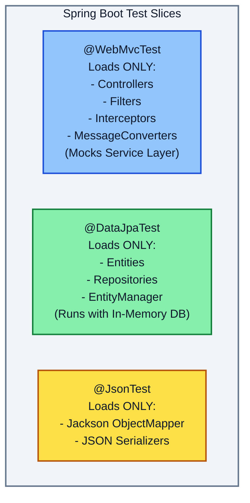

# Testing in Spring Boot: Unit, Slice & Testcontainers Integration

> **Cluster 05 — Module 07**  
> **Level**: Beginner-Friendly to Production & FAANG-Level Deep Dive  
> **Key References**: Spring Boot Testing Reference Documentation, Martin Fowler (The Practical Test Pyramid), Testcontainers Official Documentation, Baeldung

---

## 🌱 0. The Beginner's Mental Model: The Testing Pyramid

### The Mistake: The "Ice Cream Cone" Testing Anti-Pattern

Many engineering teams build testing suites backwards. They write very few fast unit tests, a handful of slice tests, and hundreds of massive, slow end-to-end integration tests that boot the entire Spring context, connect to shared staging databases, and take 45 minutes to execute in CI/CD.

This is called the **Ice Cream Cone Anti-Pattern**: tests are brittle, flaky, slow to run, and difficult to debug when they fail.

```mermaid
flowchart TD
    subgraph AntiPattern["The Flaky Anti-Pattern (Ice Cream Cone) ❌"]
        E2E_Bad["Hundreds of Slow End-to-End Tests (45 Mins, Flaky)"]
        Slice_Bad["Few Slice Tests"]
        Unit_Bad["Very Few Unit Tests"]
        E2E_Bad --> Slice_Bad --> Unit_Bad
    end

    subgraph BestPractice["The Production Best Practice (Testing Pyramid) ✅"]
        E2E_Good["Few Full Context Integration Tests (@SpringBootTest + Testcontainers)"]
        Slice_Good["Targeted Slice Tests (@WebMvcTest, @DataJpaTest)"]
        Unit_Good["Thousands of Fast Plain Unit Tests (JUnit 5 + Mockito - 5ms each)"]
        E2E_Good --> Slice_Good --> Unit_Good
    end

    style AntiPattern fill:#f1f5f9,stroke:#64748b,stroke-width:2px,color:#0f172a
    style BestPractice fill:#f1f5f9,stroke:#64748b,stroke-width:2px,color:#0f172a
    style E2E_Bad fill:#fecaca,stroke:#dc2626,stroke-width:2px,color:#7f1d1d
    style Slice_Bad fill:#fde047,stroke:#b45309,stroke-width:2px,color:#0f172a
    style Unit_Bad fill:#e2e8f0,stroke:#334155,stroke-width:2px,color:#0f172a
    style E2E_Good fill:#c4b5fd,stroke:#6d28d9,stroke-width:2px,color:#0f172a
    style Slice_Good fill:#fde047,stroke:#b45309,stroke-width:2px,color:#0f172a
    style Unit_Good fill:#86efac,stroke:#15803d,stroke-width:2px,color:#0f172a
```



---

### The Real-World Analogy: The Automotive Quality Control System

Think of testing a new hybrid car:
1. **Unit Test (The Component Inspection Microscope)**: You inspect a single spark plug or fuel injector in a laboratory vice. You do not install it in the car chassis or turn on the headlights. If the spark plug fails, you know immediately within 1 millisecond.
2. **Slice Test (The Engine Test Bench)**: You mount the assembled engine onto an isolated test bench with a fuel line and exhaust pipe. You test the transmission and engine without assembling the car seats, windshield, or radio.
3. **Integration Test with Testcontainers (The Proving Ground Crash Test)**: You assemble the entire car, put it on an authentic asphalt racetrack with real weather conditions, and test the brakes, steering, and anti-lock systems working together.

---

## 📝 1. Comprehensive Study Notes: The Spring Boot Testing Strategy

### What is Testing in Spring Boot?

Testing in Spring Boot is a multi-layered verification strategy supported by first-class testing annotations and libraries (`spring-boot-starter-test`, JUnit 5, Mockito, AssertJ, and Testcontainers) that allows engineers to verify application correctness at different levels of isolation, speed, and environmental fidelity.

Spring Boot categorizes tests into three distinct scopes:
1. **Plain Unit Tests:** Tests focused on pure Java business logic without loading any Spring container beans. Driven by JUnit 5 and Mockito.
2. **Spring Slice Tests:** Targeted tests that load only a specific subset of beans relevant to a particular architectural layer (e.g., `@WebMvcTest` loads only controllers and filters; `@DataJpaTest` loads only entities and repositories).
3. **Full Integration Tests:** Comprehensive tests annotated with `@SpringBootTest` that spin up the complete `ApplicationContext`, wire all real beans, and verify end-to-end component interaction against real databases via **Testcontainers**.

### What Does the Spring Test Framework Actually Do?

The Spring Test framework performs four crucial duties:

1. **Context Caching:** When executing hundreds of tests, booting a new Spring container for every test class would take hours. Spring intelligently caches the `ApplicationContext` in memory across test classes sharing the same configuration.
2. **Dependency Mocking (`@MockBean` / `@MockitoBean`):** It automatically creates Mockito mock instances and injects them directly into the Spring `ApplicationContext`, replacing the real beans during execution.
3. **Transactional Test Rollback:** By default, database tests annotated with `@DataJpaTest` or `@Transactional` execute their queries inside a transaction that is **automatically rolled back** when the test method finishes, leaving the database completely pristine for subsequent tests.
4. **Mock HTTP Invocation (`MockMvc`):** It simulates incoming HTTP requests to controllers without binding to real network sockets, providing lightning-fast HTTP testing in RAM.

---

## ⚡ 2. Before vs. After: The Evolution of Spring Testing

### The Before vs. After Transformation Table

| Dimension / Metric | Legacy Spring Testing (Pre-Boot) | In-Memory H2 Testing | Modern Testcontainers Testing |
| :--- | :--- | :--- | :--- |
| **Database Parity** | Connect to shared staging DB (breaks when other devs write data). | In-memory H2 database (different SQL syntax and functions). | Real PostgreSQL / MySQL container running via Docker. |
| **False Positives** | Tests pass on H2; production fails on PostgreSQL JSONB or sequence errors. | Frequent dialect mismatches; hides migration script bugs. | **100% environmental parity with production.** |
| **Test Isolation** | Shared database mutations pollute other tests. | In-memory DB recreated per run. | Fresh, ephemeral Docker container per test run. |
| **Startup Speed** | Slow manual server startup. | Instant in RAM (100ms). | Fast startup via Ryuk Docker container cleanup (2-3s). |
| **Execution Environment**| Requires developers to manually install DBs on laptops. | Built into JVM memory. | Runs anywhere Docker runs (local laptop, GitHub Actions, GitLab CI). |

---

## 🔬 3. Plain Unit Testing: JUnit 5 + Mockito (Zero Spring Context)

Unit tests must be blazing fast (less than 20 milliseconds). They do **NOT** load the Spring context (`@SpringBootTest` is forbidden here!).

```java
@ExtendWith(MockitoExtension.class) // Initializes Mockito annotations
class OrderServiceUnitTest {

    @Mock
    private OrderRepository orderRepository;

    @Mock
    private PaymentClient paymentClient;

    @InjectMocks
    private OrderService orderService; // Injects mock repo & paymentClient into constructor!

    @Test
    @DisplayName("Should create order successfully when payment succeeds")
    void shouldCreateOrderSuccessfully() {
        // Given (Arrange)
        OrderCreateRequest request = new OrderCreateRequest("cust-123", BigDecimal.valueOf(99.99));
        Order mockOrder = new Order(UUID.randomUUID(), "cust-123", OrderStatus.CONFIRMED, BigDecimal.valueOf(99.99));

        when(paymentClient.processPayment(any(), any())).thenReturn(new PaymentResult(true, "tx-999"));
        when(orderRepository.save(any(Order.class))).thenReturn(mockOrder);

        // When (Act)
        OrderResponse response = orderService.createOrder(request);

        // Then (Assert)
        assertThat(response).isNotNull();
        assertThat(response.status()).isEqualTo(OrderStatus.CONFIRMED);
        assertThat(response.totalAmount()).isEqualByComparingTo("99.99");

        // Verify interactions
        verify(paymentClient, times(1)).processPayment(eq("cust-123"), eq(BigDecimal.valueOf(99.99)));
        verify(orderRepository, times(1)).save(any(Order.class));
    }
}
```

---

## 🍕 4. Spring Slice Testing: Testing One Layer in Isolation

Slice tests load only a tiny fraction of the Spring `ApplicationContext`, providing speed while retaining Spring's wiring power.



### 1. Web Layer Slice: `@WebMvcTest` with `MockMvc`
```java
@WebMvcTest(OrderController.class) // Boots ONLY OrderController, skips DB and Services!
class OrderControllerSliceTest {

    @Autowired
    private MockMvc mockMvc;

    @Autowired
    private ObjectMapper objectMapper;

    @MockBean // Replaces real OrderService in ApplicationContext with a Mockito mock
    private OrderService orderService;

    @Test
    @DisplayName("POST /api/v1/orders should return 201 Created on valid payload")
    void shouldCreateOrderAndReturn201() throws Exception {
        UUID orderId = UUID.randomUUID();
        OrderCreateRequest request = new OrderCreateRequest("cust-123", BigDecimal.valueOf(150.00));
        OrderResponse mockResponse = new OrderResponse(orderId, "cust-123", OrderStatus.CREATED, BigDecimal.valueOf(150.00));

        when(orderService.createOrder(any())).thenReturn(mockResponse);

        mockMvc.perform(post("/api/v1/orders")
                        .contentType(MediaType.APPLICATION_JSON)
                        .content(objectMapper.writeValueAsString(request)))
                .andExpect(status().isCreated())
                .andExpect(header().exists("Location"))
                .andExpect(jsonPath("$.id").value(orderId.toString()))
                .andExpect(jsonPath("$.customerId").value("cust-123"))
                .andExpect(jsonPath("$.totalAmount").value(150.00));
    }

    @Test
    @DisplayName("POST /api/v1/orders should return 400 Bad Request on blank customerId")
    void shouldReturn400WhenCustomerIdIsBlank() throws Exception {
        OrderCreateRequest invalidRequest = new OrderCreateRequest("", BigDecimal.valueOf(150.00));

        mockMvc.perform(post("/api/v1/orders")
                        .contentType(MediaType.APPLICATION_JSON)
                        .content(objectMapper.writeValueAsString(invalidRequest)))
                .andExpect(status().isBadRequest())
                .andExpect(jsonPath("$.title").value("Invalid Request Payload"));
    }
}
```

### 2. Data Layer Slice: `@DataJpaTest`
```java
@DataJpaTest
@AutoConfigureTestDatabase(replace = AutoConfigureTestDatabase.Replace.NONE) // Uses real test DB
class OrderRepositorySliceTest {

    @Autowired
    private OrderRepository orderRepository;

    @Autowired
    private TestEntityManager entityManager; // Helper to persist test entities

    @Test
    @DisplayName("Should find active orders by customer ID")
    void shouldFindOrdersByCustomerId() {
        Order order = new Order("cust-999", OrderStatus.CONFIRMED, BigDecimal.valueOf(45.00));
        entityManager.persistAndFlush(order);

        List<Order> found = orderRepository.findByCustomerId("cust-999");

        assertThat(found).hasSize(1);
        assertThat(found.get(0).getCustomerId()).isEqualTo("cust-999");
    }
}
```

---

## 🐳 5. Modern Integration Testing with Testcontainers

A **Testcontainer** is a lightweight, disposable Docker container instance managed directly by Java code during test execution to provide authentic databases, message brokers, and cloud services.

### Why In-Memory H2 Databases Cause Disasters in Production:
For years, tutorials taught developers to use in-memory H2 databases for testing. In the real world, this causes severe bugs:
1. H2 does not support native PostgreSQL features (such as `JSONB`, `UUID` generation, array types, full-text search).
2. H2 handles concurrency and transactions differently than PostgreSQL or MySQL, masking locking bugs and deadlocks.
3. Liquibase and Flyway migration scripts fail because SQL syntax is different.

### Production Integration Test with PostgreSQL Testcontainer:

```java
@SpringBootTest(webEnvironment = SpringBootTest.WebEnvironment.RANDOM_PORT)
@Testcontainers // Manages lifecycle of Docker containers
class OrderServiceIntegrationTest {

    // 1. Declare real PostgreSQL container
    @Container
    static PostgreSQLContainer<?> postgres = new PostgreSQLContainer<>("postgres:16-alpine")
            .withDatabaseName("testdb")
            .withUsername("testuser")
            .withPassword("testpass");

    // 2. Dynamically inject container port and credentials into Spring Environment
    @DynamicPropertySource
    static void configureProperties(DynamicPropertyRegistry registry) {
        registry.add("spring.datasource.url", postgres::getJdbcUrl);
        registry.add("spring.datasource.username", postgres::getUsername);
        registry.add("spring.datasource.password", postgres::getPassword);
    }

    @Autowired
    private TestRestTemplate restTemplate;

    @Autowired
    private OrderRepository orderRepository;

    @BeforeEach
    void setUp() {
        orderRepository.deleteAll();
    }

    @Test
    @DisplayName("End-to-End: Should place order and persist in real PostgreSQL database")
    void shouldPlaceOrderEndToEnd() {
        OrderCreateRequest request = new OrderCreateRequest("cust-real-1", BigDecimal.valueOf(250.00));

        ResponseEntity<OrderResponse> response = restTemplate.postForEntity(
                "/api/v1/orders",
                request,
                OrderResponse.class
        );

        assertThat(response.getStatusCode()).isEqualTo(HttpStatus.CREATED);
        assertThat(response.getBody()).isNotNull();

        // Verify record was actually saved to real PostgreSQL!
        assertThat(orderRepository.count()).isEqualTo(1);
        Order savedOrder = orderRepository.findAll().get(0);
        assertThat(savedOrder.getCustomerId()).isEqualTo("cust-real-1");
    }
}
```
When this test runs, Testcontainers automatically talks to Docker, pulls `postgres:16-alpine`, spins up an isolated database container, runs your Flyway migrations, executes the tests, and tears down the container when finished!
