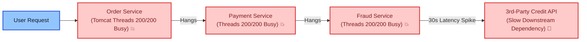
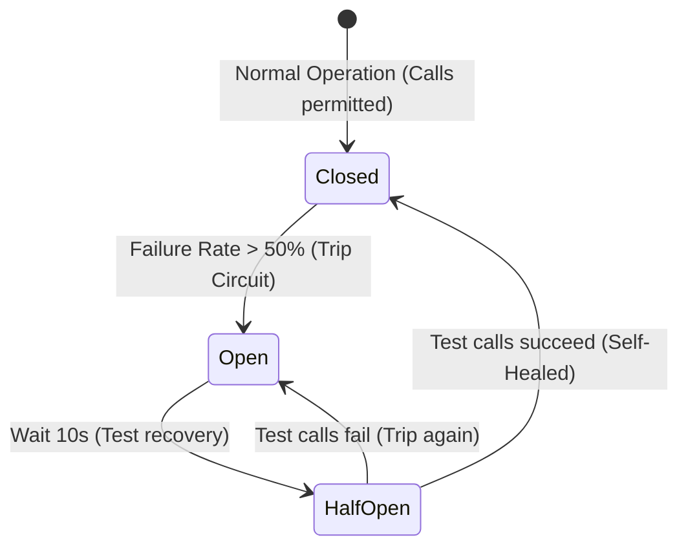
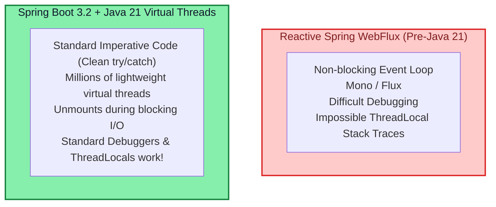
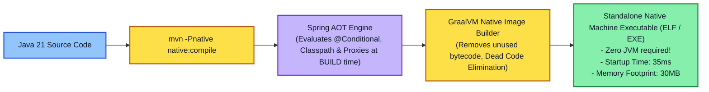

# Microservices, Resilience & High-Performance Spring Boot

> **Cluster 05 — Module 08**  
> **Level**: Beginner-Friendly to Production & FAANG-Level Deep Dive  
> **Key References**: Spring Cloud Reference Documentation, Resilience4j Documentation, GraalVM Native Image Documentation, Brett Wooldridge (HikariCP Down the Rabbit Hole), Baeldung

---

## 🌱 0. The Beginner's Mental Model: Cascading Failures & Circuit Breakers

### The Problem: The Domino Effect (Cascading Microservice Outage)

In a distributed microservice architecture, services do not operate in isolation. An Order Service depends on a Payment Gateway; the Payment Gateway depends on a Fraud Detection Service; the Fraud Detection Service depends on a 3rd-party Credit Bureau API.

If the 3rd-party Credit Bureau API becomes slow (taking 30 seconds to reply instead of 100 milliseconds):
1. Fraud Detection threads block waiting for responses.
2. The Fraud Detection thread pool becomes 100% exhausted.
3. Payment Gateway calls to Fraud Detection hang and exhaust its thread pool.
4. Order Service calls to Payment Gateway hang, exhausting all Tomcat worker threads.
5. **The entire e-commerce platform crashes for all users!**



---

### The Real-World Analogy: The Electrical Circuit Breaker

In your home, all appliances (refrigerator, oven, television) are connected to the municipal electrical power grid.
If your toaster malfunctions and draws an electric surge of 10,000 amps, the house does not catch fire, and the entire city's power grid does not go dark.
Instead, an **Electrical Circuit Breaker** in your basement panel instantly trips open. It physically severs the connection to the toaster, sacrificing that single outlet to protect the rest of the house and the neighborhood.



In software, a **Resilience4j Circuit Breaker** sits between microservices. If calls to Payment Gateway start failing, the circuit breaker **trips open**. Instead of waiting 30 seconds, it immediately returns a graceful fallback (e.g., "Payment queued for processing") in 1 millisecond, shielding the upstream services from crashing!

---

## 📝 1. Comprehensive Study Notes: Distributed Resilience & Performance

### What is Microservice Resilience?

Microservice Resilience is the capability of a distributed software system to anticipate, withstand, recover from, and gracefully degrade in the presence of network partitions, hardware failures, slow downstream dependencies, and unexpected traffic spikes.

Building resilient microservices requires moving away from the assumption that the network is reliable. In cloud environments, network packets are dropped, database connections timeout, and third-party APIs experience outages. Resilient architectures use patterns like **Circuit Breakers**, **Rate Limiters**, **Bulkheads**, and **Exponential Backoff Retries** to ensure that a failure in one subsystem never cascades into a total system failure.

### What Does Modern High-Performance Spring Boot Actually Do?

Modern Spring Boot 3 delivers extreme enterprise throughput and responsiveness using three architectural innovations:

1. **Fluent HTTP Communication (`RestClient`):** Replaces legacy blocking `RestTemplate` with a fluent, synchronous HTTP client that provides intuitive request building and response mapping.
2. **Virtual Threads (Project Loom):** Enables lightweight, user-mode threads managed by the Java runtime that allow applications to handle tens of thousands of concurrent I/O operations without depleting OS platform threads.
3. **Ahead-of-Time (AOT) & GraalVM Native Image:** Compiles Spring Boot applications directly into standalone machine binary executables, reducing startup time from 4 seconds down to **30 milliseconds** and cutting memory consumption by 80%.

### Why Do We Need Resilience & Performance Tuning & What Help Do They Provide?

Understanding why high-throughput engineering teams prioritize these techniques:

* **Zero Cascading Outages:** Isolating failing downstream dependencies prevents thread starvation and keeps critical business operations available.
* **Radical Cost Reduction in Cloud Infrastructure:** By using GraalVM Native Images and Java 21 Virtual Threads, companies can run 10 times more microservice instances on the same Kubernetes cluster nodes, saving millions in AWS or GCP compute bills.
* **Instant Auto-Scaling on Kubernetes:** When traffic spikes 500% in seconds, traditional JVM applications take 10 to 30 seconds to boot up and warm their JIT compilers. GraalVM native binaries start in under 50 milliseconds, serving traffic instantly.
* **Elimination of Database Connection Starvation:** Proper HikariCP pool tuning ensures high concurrency without overwhelming database servers with thousands of competing connections.

---

## ⚡ 2. Before vs. After: The Microservice Resilience Matrix

### The Before vs. After Transformation Table

| Capability / Scenario | Naive Microservices (Before Resilience) | Resilient Spring Boot (With Resilience4j) | Concrete Engineering Value |
| :--- | :--- | :--- | :--- |
| **Downstream Outage** | Threads block for 60 seconds; server runs out of memory and crashes. | Circuit breaker trips; fails fast in 1ms with fallback response. | 99.99% system availability; graceful degradation. |
| **Transient Network Glitch**| A dropped packet causes immediate transaction failure to the customer. | Exponential backoff retry with jitter retries 3 times automatically. | Self-heals transient network hiccups invisibly. |
| **Traffic Spike / DDoS** | Uncontrolled traffic floods backend database, locking all CPU cores. | Rate Limiter and Bulkhead restrict request velocity to safe limits. | Protects database from sudden overload and denial-of-service. |
| **HTTP Client API** | Verbose `RestTemplate.exchange()` with awkward type parameters. | Clean, fluent `RestClient.builder()` with built-in status handling. | Readable, maintainable HTTP client code. |
| **JVM Cold Start** | 8 to 25 seconds JVM boot time; slow Kubernetes pod scaling. | GraalVM Native Image boots in **35 milliseconds**. | True serverless / instant auto-scaling readiness. |

---

## 🌐 3. Inter-Service Communication: The New `RestClient` in Spring Boot 3.2+

For years, Spring developers used `RestTemplate` (introduced in Spring 3.0). In Spring Boot 3.2 / Spring Framework 6.1, the Spring team introduced **`RestClient`**—a modern, fluent, synchronous HTTP client that offers the clean API of `WebClient` without requiring the reactive WebFlux stack.

```mermaid
flowchart LR
    OrderSvc["Order Service"] -->|Fluent API: restClient.get()| RestClient["Spring RestClient\n(Synchronous + Fluent)"]
    RestClient -->|HTTP / JSON| PaymentSvc["Payment Service\nhttps://api.payment.com"]

    style OrderSvc fill:#93c5fd,stroke:#1d4ed8,stroke-width:2px,color:#0f172a
    style RestClient fill:#86efac,stroke:#15803d,stroke-width:2px,color:#0f172a
    style PaymentSvc fill:#fde047,stroke:#b45309,stroke-width:2px,color:#0f172a
```

### Production Implementation:

```java
@Configuration
public class ClientConfig {

    @Bean
    public RestClient paymentRestClient(RestClient.Builder builder) {
        return builder
                .baseUrl("https://api.payment.internal:8443")
                .defaultHeader(HttpHeaders.CONTENT_TYPE, MediaType.APPLICATION_JSON_VALUE)
                .requestFactory(new JdkClientHttpRequestFactory(
                        HttpClient.newBuilder()
                                .connectTimeout(Duration.ofSeconds(3))
                                .build()
                ))
                .build();
    }
}
```

```java
@Service
public class PaymentClient {

    private final RestClient restClient;

    public PaymentClient(RestClient restClient) {
        this.restClient = restClient;
    }

    public PaymentResponse chargeCreditCard(PaymentRequest request) {
        return restClient.post()
                .uri("/v1/charges")
                .body(request)
                .retrieve()
                // Handle specific 4xx error codes cleanly
                .onStatus(HttpStatusCode::is4xxClientError, (req, resp) -> {
                    throw new PaymentDeclinedException("Card declined by gateway: " + resp.getStatusCode());
                })
                // Handle 5xx server errors
                .onStatus(HttpStatusCode::is5xxServerError, (req, resp) -> {
                    throw new ServiceUnavailableException("Payment gateway is temporarily unavailable");
                })
                .body(PaymentResponse.class);
    }
}
```

---

## 🛡️ 4. Resilience Patterns with Resilience4j

**Resilience4j** is a lightweight, fault-tolerance library designed specifically for Java and Spring Boot.

### 1. Circuit Breaker (`@CircuitBreaker`)
Tracks execution health. If the failure rate exceeds a threshold, the breaker opens and routes calls to a fallback method:

```java
@Service
public class InventoryClient {

    private final RestClient restClient;

    public InventoryClient(RestClient restClient) {
        this.restClient = restClient;
    }

    @CircuitBreaker(name = "inventoryService", fallbackMethod = "fallbackCheckStock")
    public InventoryStockResponse checkStock(String sku) {
        return restClient.get()
                .uri("/api/inventory/{sku}", sku)
                .retrieve()
                .body(InventoryStockResponse.class);
    }

    // Fallback method MUST have identical signature + Exception parameter!
    public InventoryStockResponse fallbackCheckStock(String sku, Throwable throwable) {
        // Return safe degraded response (e.g. assume in stock with backorder warning)
        return new InventoryStockResponse(sku, 0, true, "Stock verification offline; queued for verification");
    }
}
```

### 2. Resilience4j Configuration in `application.yml`:
```yaml
resilience4j:
  circuitbreaker:
    instances:
      inventoryService:
        sliding-window-type: COUNT_BASED
        sliding-window-size: 10 # Inspect last 10 calls
        failure-rate-threshold: 50 # Trip if 5 out of 10 fail
        slow-call-rate-threshold: 50 # Trip if 50% take > 2s
        slow-call-duration-threshold: 2s
        wait-duration-in-open-state: 10s # Stay OPEN for 10s before testing recovery
        permitted-number-of-calls-in-half-open-state: 3
  retry:
    instances:
      inventoryService:
        max-attempts: 3
        wait-duration: 500ms
        enable-exponential-backoff: true
        exponential-backoff-multiplier: 2
```

### 3. Bulkhead Pattern (`@Bulkhead`)
Isolates critical resources. If the recommendation service runs out of threads, the checkout flow is unaffected because each service has its own dedicated thread pool.

---

## 🚀 5. Performance Tuning: Virtual Threads vs. Reactive WebFlux

With **Java 21 Virtual Threads** enabled (`spring.threads.virtual.enabled=true`), the classic debate between imperative Spring MVC and reactive Spring WebFlux is largely resolved:



- **Why Virtual Threads Win for 95% of Applications**:
  You write clean, readable, imperative code with normal `for` loops and `try-catch` blocks. The JVM handles the non-blocking suspension under the hood without the mental overhead of reactive functional reactive programming (`Mono`/`Flux`).

---

## ⚡ 6. GraalVM Native Image: Sub-50ms Cold Starts

Spring Boot 3 includes first-class support for **GraalVM Native Image Ahead-of-Time (AOT)** compilation:



### The Native Advantage:
- Traditional JVM Startup: 4.5 seconds, 350 MB RAM.
- GraalVM Native Binary Startup: **0.038 seconds (38 ms)**, **32 MB RAM**.
- Perfect for serverless functions (AWS Lambda) and scale-to-zero Kubernetes architectures (Knative).

---

## 💾 7. HikariCP Connection Pool Tuning

**HikariCP** is the default high-performance JDBC connection pool in Spring Boot.

### The Pool Sizing Formula
Beginners often assume: *"More connections = faster database"*. In reality, allocating 500 connections to a database server with 8 CPU cores creates massive OS thread context switching and disk I/O thrashing, slowing down the entire system!

The formula published by the HikariCP engineering team:

$$\text{Maximum Pool Size} = (\text{Core Count} \times 2) + \text{Effective Spindle Count}$$

For a database server with 8 CPU cores and SSD storage:
$$\text{Pool Size} = (8 \times 2) + 1 = 17 \text{ connections}$$

### Production `application.yml` HikariCP Configuration:
```yaml
spring:
  datasource:
    hikari:
      maximum-pool-size: 20
      minimum-idle: 10
      idle-timeout: 300000 # 5 minutes
      max-lifetime: 1800000 # 30 minutes (must be shorter than DB timeout!)
      connection-timeout: 5000 # 5 seconds (fails fast if pool exhausted)
      leak-detection-threshold: 2000 # Warns if a thread holds connection > 2s
      pool-name: EnterpriseOrderHikariPool
```
