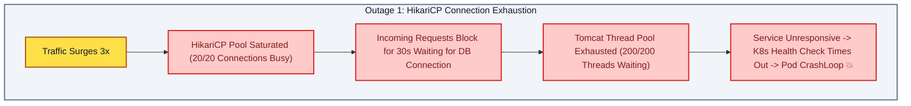

# Spring & Spring Boot: 35+ Senior Interview Questions & Production Outage Scenarios

> **Cluster 05 — Module 09**  
> **Level**: Production & FAANG-Level Senior/Lead Engineer Interview Preparation  
> **Key References**: Real-World Production Post-Mortems, FAANG System Design & Java Interviews, Spring Framework Core Team Discussions

---

## 🏛️ Part 1: Core Spring & IoC Container Interview Questions

### Q1: Are Spring Singleton beans thread-safe?
**Answer**:
No, Spring singleton beans are **not inherently thread-safe**.
A Spring singleton bean means there is only one instance of the object in the `ApplicationContext`. In a typical web application, Tomcat or Undertow uses a thread pool where multiple concurrent HTTP request threads execute methods on that exact same singleton bean instance at the same time.
- If the singleton bean is **stateless** (i.e., it only holds read-only injected dependencies or immutable `final` references), it is thread-safe.
- If the singleton bean maintains **mutable shared state** (e.g., an `int counter = 0;` or a `List<Order> cache = new ArrayList<>();`), concurrent threads will interleave execution, causing race conditions, dirty reads, and heap memory corruption.
- *Mitigation*: Keep singleton beans stateless. Store request-scoped data in method parameters, local variables (allocated on the thread's private stack), `ThreadLocal` variables, or use thread-safe data structures like `ConcurrentHashMap` and `AtomicInteger`.

---

### Q2: What happens if you inject a Prototype bean into a Singleton bean, and how do you fix it?
**Answer**:
A prototype bean is supposed to have a new instance created every time it is requested. However, because a singleton bean is instantiated only once during container startup, its constructor executes only once. Consequently, the prototype bean is injected **only once**, effectively freezing it and behaving like a singleton for the lifetime of the application.
- *Solutions*:
  1. **`ObjectProvider<T>` (Recommended)**: Inject `ObjectProvider<MyPrototypeBean>` into the singleton, and call `provider.getObject()` whenever a fresh instance is needed.
  2. **`@Lookup` Method Injection**: Declare an abstract getter method annotated with `@Lookup` inside the singleton. Spring uses CGLIB at runtime to override the method and query the `ApplicationContext` for a new prototype instance.

---

### Q3: What is the difference between `BeanFactoryPostProcessor` and `BeanPostProcessor`?
**Answer**:
- **`BeanFactoryPostProcessor`**: Operates on **Bean Definitions (Metadata)** *before* any bean instances are actually created. It can inspect and modify bean configurations, such as resolving `${...}` property placeholders via `PropertySourcesPlaceholderConfigurer`.
- **`BeanPostProcessor`**: Operates on **Actual Bean Instances** *after* they have been instantiated and their properties populated. It contains two callback methods:
  - `postProcessBeforeInitialization()`: Runs before `@PostConstruct` or `afterPropertiesSet()`.
  - `postProcessAfterInitialization()`: Runs after initialization. **This is where Spring AOP wraps target beans in dynamic proxies** (creating transactional, secured, or cached proxies).

```mermaid
flowchart LR
    BFPP["BeanFactoryPostProcessor\n(Modifies Bean Metadata / XML / @Bean definitions)"] --> Instantiation["Bean Instantiation (new Object)"]
    Instantiation --> BPP1["BeanPostProcessor.beforeInitialization()"]
    BPP1 --> Init["@PostConstruct / afterPropertiesSet()"]
    Init --> BPP2["BeanPostProcessor.afterInitialization()\n(Creates Dynamic AOP Proxies!)"]

    style BFPP fill:#fde047,stroke:#b45309,stroke-width:2px,color:#0f172a
    style Instantiation fill:#93c5fd,stroke:#1d4ed8,stroke-width:2px,color:#0f172a
    style BPP1 fill:#c4b5fd,stroke:#6d28d9,stroke-width:2px,color:#0f172a
    style Init fill:#86efac,stroke:#15803d,stroke-width:2px,color:#0f172a
    style BPP2 fill:#c4b5fd,stroke:#6d28d9,stroke-width:2px,color:#0f172a
```



---

### Q4: Why does Spring Boot 2.6+ disable Circular Dependencies by default?
**Answer**:
Circular dependencies occur when Bean A depends on Bean B, and Bean B depends on Bean A.
Historically, Spring resolved circular references between singleton beans using a three-level cache in `DefaultSingletonBeanRegistry`. However, circular references are fundamentally an **architectural code smell** indicating violations of the Single Responsibility Principle and tight coupling.
Furthermore, circular references create severe problems with constructor injection (which cannot be resolved via proxies without `@Lazy`) and break Ahead-of-Time (AOT) compilation in GraalVM native images. Therefore, Spring Boot explicitly disabled circular references by default (`spring.main.allow-circular-references=false`) to force developers to refactor shared logic into a clean mediator service.

---

## ⚙️ Part 2: Spring Boot Internals & Auto-Configuration

### Q5: How does Spring Boot 3 auto-configuration discover and load classes?
**Answer**:
In Spring Boot 3.0+, auto-configuration discovery shifted away from `META-INF/spring.factories` to:
`META-INF/spring/org.springframework.boot.autoconfigure.AutoConfiguration.imports`
1. During startup, `AutoConfigurationImportSelector` reads this file from all JARs on the classpath to collect candidate auto-configuration classes.
2. The `ConditionEvaluator` scans each class for conditional annotations (`@ConditionalOnClass`, `@ConditionalOnMissingBean`, `@ConditionalOnProperty`).
3. If all conditions evaluate to `true`, the auto-configuration class is loaded and its `@Bean` definitions are registered in the `ApplicationContext`. If any condition fails, the class is silently skipped.

---

### Q6: What is the difference between `@Configuration(proxyBeanMethods = true)` and `proxyBeanMethods = false`?
**Answer**:
- **`proxyBeanMethods = true` (Full Mode - Default)**: Spring uses CGLIB to subclass the configuration class. When one `@Bean` method calls another `@Bean` method inside the class:
  ```java
  @Bean public DataSource dataSource() { return new HikariDataSource(); }
  @Bean public EntityManagerFactory em() { return new LocalEMF(dataSource()); } // Calls method!
  ```
  The CGLIB proxy intercepts the `dataSource()` call and returns the existing singleton bean from the container cache rather than instantiating a second `HikariDataSource`.
- **`proxyBeanMethods = false` (Lite Mode)**: CGLIB proxy generation is skipped. Direct method calls invoke plain Java methods, creating duplicate instances. Lite mode reduces startup time and memory footprint and is mandatory for GraalVM Native Image compilation.

---

## 🌐 Part 3: Spring MVC & Web Layer

### Q7: Explain the exact request execution flow of `DispatcherServlet`.
**Answer**:
1. Incoming HTTP request hits `DispatcherServlet`.
2. `DispatcherServlet` queries `HandlerMapping` (e.g., `RequestMappingHandlerMapping`) to find the matching controller method.
3. It obtains a `HandlerExecutionChain` containing the target handler and any configured `HandlerInterceptor`s.
4. Pre-handle interceptors (`interceptor.preHandle()`) execute in sequence.
5. `DispatcherServlet` calls `HandlerAdapter` (`RequestMappingHandlerAdapter`), which uses `HttpMessageConverter` (Jackson) to deserialize the JSON request body.
6. The controller method executes and returns a domain object or DTO.
7. `HttpMessageConverter` serializes the returned Java object into JSON and writes it to the response stream.
8. Post-handle interceptors (`postHandle()`) and completion interceptors (`afterCompletion()`) execute in reverse order.
9. Response is returned to the client.

---

### Q8: What is RFC 7807 (`ProblemDetail`), and why is it preferred over custom error DTOs?
**Answer**:
RFC 7807 is an IETF standard defining a standardized JSON format for reporting errors from HTTP APIs.
Before RFC 7807, every development team invented custom error schemas (`{"errCode": 400, "msg": "failed"}` vs `{"error": {"status": 400, "description": "failed"}}`), making client integration inconsistent.
Spring 6 and Spring Boot 3 natively support RFC 7807 via `ProblemDetail`, which provides standard fields:
- `type`: URI identifying the error category.
- `title`: Short human-readable summary.
- `status`: HTTP status code (404, 400, 500).
- `detail`: Human-readable explanation specific to this occurrence.
- `instance`: URI of the resource that caused the error.
- Custom extensions via `.setProperty("invalidFields", map)`.

---

## 💾 Part 4: Spring Data JPA & Transactions

### Q9: Why does `@Transactional` fail when a method is called from within the same class?
**Answer**:
Spring's declarative transaction management is powered by **Spring AOP Dynamic Proxies**.
When Bean A injects Bean B, it holds a reference to B's *proxy*, not the raw object. When an external caller invokes a `@Transactional` method, it invokes the proxy, which opens a transaction, delegates to the real object, and commits the transaction.
However, when a method calls another method inside the **same class** (`this.innerMethod()`), the call executes on the raw `this` pointer directly, **bypassing the AOP proxy completely**. As a result, no transaction interceptor is ever executed, and transactional settings (like `REQUIRES_NEW`) are silently ignored.
- *Fix*: Move the method to a separate collaborator service, or use programmatic transaction management with `TransactionTemplate`.

---

### Q10: What is the N+1 Query Problem, and how do you detect it in CI/CD?
**Answer**:
The N+1 problem occurs when fetching an entity with a one-to-many relationship causes Hibernate to issue 1 initial query to fetch the parent entities, followed by N additional queries to fetch child entities for each parent row.
- *Detection*:
  1. Enable query logging: `logging.level.org.hibernate.SQL=DEBUG`.
  2. Use tools like `datasource-proxy` or QuickPerf in unit tests to assert maximum allowed SQL query counts:
     ```java
     @Test
     @ExpectSelect(1) // Fails test if more than 1 SELECT query is issued!
     void shouldFetchOrdersWithSingleQuery() { ... }
     ```
- *Resolution*: Use JPQL `JOIN FETCH`, `@EntityGraph`, or DTO Projections.

---

## 🔒 Part 5: Spring Security 6

### Q11: Why is CSRF protection disabled in stateless REST APIs using JWT?
**Answer**:
**Cross-Site Request Forgery (CSRF)** exploits the fact that web browsers automatically attach stored session cookies (`JSESSIONID`) to all outgoing requests to a target domain, even when triggered by a malicious third-party site (e.g., via an embedded `<form action="bank.com/transfer">`).
In a stateless REST API secured with Bearer JWT tokens:
1. The client stores the JWT in JavaScript memory or local storage, **not** in an automatic browser cookie.
2. The browser does **NOT** automatically attach `Authorization: Bearer <token>` headers to cross-site requests.
3. A malicious site cannot forge requests because it cannot access the token in the user's browser memory due to the Same-Origin Policy.
Therefore, CSRF protection is completely redundant for pure stateless token APIs and can be safely disabled (`http.csrf(AbstractHttpConfigurer::disable)`).

---

## 💥 Part 6: Real-World Production Outage Scenarios & Post-Mortems



### Scenario 1: HikariCP Connection Pool Exhaustion Causing Total Service Lockup
- **Symptoms**: During a marketing flash sale, HTTP response latencies spiked from 45ms to 30,000ms. Kubernetes liveness probes failed, causing continuous pod restarts.
- **Root Cause Analysis (RCA)**:
  1. A slow reporting query (`SELECT ... GROUP BY`) was taking 8 seconds to run.
  2. Developers had left `spring.datasource.hikari.maximum-pool-size=10` with default `connection-timeout=30000` (30 seconds).
  3. All 10 connections were monopolized by the slow reporting query.
  4. Incoming fast checkout requests blocked for 30 seconds waiting for a connection from the pool.
  5. Tomcat's 200 worker threads all became blocked waiting for database connections, leading to total thread starvation.
- **Immediate Fix & Long-Term Prevention**:
  1. Separated read-only analytical queries to a dedicated read-replica database pool.
  2. Reduced `connection-timeout` to 3 seconds (`spring.datasource.hikari.connection-timeout=3000`) so requests fail fast rather than holding Tomcat threads.
  3. Configured `leak-detection-threshold=2000` to log stack traces of threads holding connections longer than 2 seconds.

---

### Scenario 2: OutOfMemoryError (`Java heap space`) from Unpaged JPA Queries
- **Symptoms**: Pod crashed with `java.lang.OutOfMemoryError: Java heap space`. Garbage collection pause times spiked to 12 seconds.
- **Root Cause Analysis (RCA)**:
  1. A developer wrote `orderRepository.findAll()` to display orders in an administrative dashboard.
  2. Over 3 years, the `orders` table grew to 2,500,000 rows.
  3. Hibernate attempted to instantiate 2.5 million managed `Order` entities, complete with all their `OrderItem` child objects, inside the Persistence Context first-level cache.
  4. The JVM allocated 4 GB of heap in 3 seconds, triggering immediate OutOfMemoryError.
- **Immediate Fix & Long-Term Prevention**:
  1. Enforced mandatory pagination by returning `Page<Order>` with a strict maximum page size (`@Max(100)`).
  2. Converted heavy search queries to DTO Projections (`OrderSummaryDto`), bypassing Hibernate entity hydration and first-level caching completely.

---

### Scenario 3: Database Deadlock Caused by Out-of-Order Concurrent Updates
- **Symptoms**: High volume of `org.springframework.dao.DeadlockLoserDataAccessException` errors in payment processing.
- **Root Cause Analysis (RCA)**:
  1. Transaction 1 (User A transferring funds to User B): Locked User A's row, then attempted to lock User B's row.
  2. Transaction 2 (User B transferring funds to User A simultaneously): Locked User B's row, then attempted to lock User A's row.
  3. PostgreSQL detected circular wait lock dependency and terminated one transaction with a deadlock error.
- **Immediate Fix & Long-Term Prevention**:
  1. **Strict Lock Ordering**: Always acquire locks on database rows in a consistent deterministic order (e.g., sort user IDs numerically before updating):
     ```java
     Long firstLockId = Math.min(accountFromId, accountToId);
     Long secondLockId = Math.max(accountFromId, accountToId);
     accountRepository.lockById(firstLockId);
     accountRepository.lockById(secondLockId);
     ```
  2. Configured Resilience4j `@Retry(name = "deadlockRetry")` with exponential backoff and jitter to automatically retry deadlocked transactions.

---

### Scenario 4: Thread Pinning Under Java 21 Virtual Threads
- **Symptoms**: After upgrading to Java 21 and enabling `spring.threads.virtual.enabled=true`, throughput was lower than expected, and CPU utilization reached 100%.
- **Root Cause Analysis (RCA)**:
  1. Virtual threads are meant to unmount from their carrier OS thread during blocking I/O.
  2. However, if a virtual thread performs blocking I/O inside a `synchronized` block or method, the virtual thread is **pinned** to its carrier OS thread!
  3. A legacy third-party library was using `synchronized` around network socket reads, locking all carrier threads and completely neutralizing the benefits of Virtual Threads.
- **Immediate Fix & Long-Term Prevention**:
  1. Enabled JVM flag `-Djdk.tracePinnedThreads=full` to identify pinned thread stack traces.
  2. Replaced `synchronized` blocks with `java.util.concurrent.locks.ReentrantLock`, which allows virtual threads to unmount freely during blocking calls.
