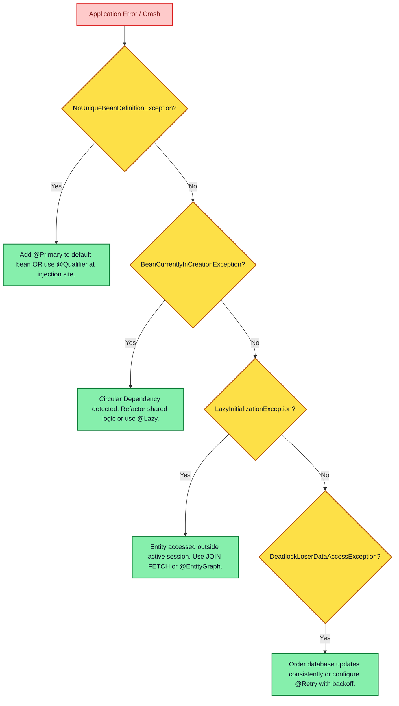

# Spring & Spring Boot: Hands-On Labs, Production Templates & Master Cheat Sheet

> **Cluster 05 — Module 10**  
> **Level**: Production-Ready Reference & Quick-Revision Cheat Sheet  
> **Key References**: Spring Framework Reference, Spring Boot 3.x Production Guides, Jakarta EE Specifications

---

## 🛠️ Lab 1: Building an Enterprise RESTful Microservice (Java 21 + Spring Boot 3)

Follow this complete reference implementation to construct an enterprise-grade Order Service featuring Spring Data JPA, JSR-380 validation, and RFC 7807 error handling.

### 1. Domain Entity (`Order.java`)
```java
package com.company.orderservice.entity;

import jakarta.persistence.*;
import org.hibernate.annotations.CreationTimestamp;
import org.hibernate.annotations.UpdateTimestamp;
import java.math.BigDecimal;
import java.time.Instant;
import java.util.UUID;

@Entity
@Table(name = "orders", indexes = {
    @Index(name = "idx_orders_customer_id", columnList = "customer_id"),
    @Index(name = "idx_orders_status", columnList = "status")
})
public class Order {

    @Id
    @GeneratedValue(strategy = GenerationType.UUID)
    @Column(name = "id", updatable = false, nullable = false)
    private UUID id;

    @Column(name = "customer_id", nullable = false, length = 64)
    private String customerId;

    @Enumerated(EnumType.STRING)
    @Column(name = "status", nullable = false, length = 32)
    private OrderStatus status;

    @Column(name = "total_amount", nullable = false, precision = 12, scale = 2)
    private BigDecimal totalAmount;

    @CreationTimestamp
    @Column(name = "created_at", updatable = false, nullable = false)
    private Instant createdAt;

    @UpdateTimestamp
    @Column(name = "updated_at", nullable = false)
    private Instant updatedAt;

    @Version
    private Long version;

    public Order() {}

    public Order(String customerId, OrderStatus status, BigDecimal totalAmount) {
        this.customerId = customerId;
        this.status = status;
        this.totalAmount = totalAmount;
    }

    // Getters and Setters...
    public UUID getId() { return id; }
    public String getCustomerId() { return customerId; }
    public OrderStatus getStatus() { return status; }
    public void setStatus(OrderStatus status) { this.status = status; }
    public BigDecimal getTotalAmount() { return totalAmount; }
    public Instant getCreatedAt() { return createdAt; }
}
```

---

### 2. Spring Data JPA Repository (`OrderRepository.java`)
```java
package com.company.orderservice.repository;

import com.company.orderservice.entity.Order;
import com.company.orderservice.entity.OrderStatus;
import org.springframework.data.domain.Page;
import org.springframework.data.domain.Pageable;
import org.springframework.data.jpa.repository.JpaRepository;
import org.springframework.data.jpa.repository.Modifying;
import org.springframework.data.jpa.repository.Query;
import org.springframework.data.repository.query.Param;
import org.springframework.stereotype.Repository;

import java.util.UUID;

@Repository
public interface OrderRepository extends JpaRepository<Order, UUID> {

    // Derived Query Method with Pagination
    Page<Order> findByCustomerIdAndStatus(String customerId, OrderStatus status, Pageable pageable);

    // Optimized Modifying Query
    @Modifying
    @Query("UPDATE Order o SET o.status = :status WHERE o.id = :id")
    int updateOrderStatus(@Param("id") UUID id, @Param("status") OrderStatus status);
}
```

---

### 3. Service Layer (`OrderService.java`)
```java
package com.company.orderservice.service;

import com.company.orderservice.dto.OrderCreateRequest;
import com.company.orderservice.dto.OrderResponse;
import com.company.orderservice.entity.Order;
import com.company.orderservice.entity.OrderStatus;
import com.company.orderservice.exception.ResourceNotFoundException;
import com.company.orderservice.repository.OrderRepository;
import org.springframework.stereotype.Service;
import org.springframework.transaction.annotation.Transactional;

import java.util.UUID;

@Service
public class OrderService {

    private final OrderRepository orderRepository;

    public OrderService(OrderRepository orderRepository) {
        this.orderRepository = orderRepository;
    }

    @Transactional(rollbackFor = Exception.class)
    public OrderResponse createOrder(OrderCreateRequest request) {
        Order order = new Order(
                request.customerId(),
                OrderStatus.CREATED,
                request.totalAmount()
        );
        Order saved = orderRepository.save(order);
        return OrderResponse.from(saved);
    }

    @Transactional(readOnly = true)
    public OrderResponse getOrderById(UUID id) {
        return orderRepository.findById(id)
                .map(OrderResponse::from)
                .orElseThrow(() -> new ResourceNotFoundException("Order not found with ID: " + id));
    }
}
```

---

### 4. REST Controller (`OrderController.java`)
```java
package com.company.orderservice.controller;

import com.company.orderservice.dto.OrderCreateRequest;
import com.company.orderservice.dto.OrderResponse;
import com.company.orderservice.service.OrderService;
import jakarta.validation.Valid;
import org.springframework.http.ResponseEntity;
import org.springframework.web.bind.annotation.*;
import org.springframework.web.servlet.support.ServletUriComponentsBuilder;

import java.net.URI;
import java.util.UUID;

@RestController
@RequestMapping("/api/v1/orders")
public class OrderController {

    private final OrderService orderService;

    public OrderController(OrderService orderService) {
        this.orderService = orderService;
    }

    @PostMapping
    public ResponseEntity<OrderResponse> createOrder(@Valid @RequestBody OrderCreateRequest request) {
        OrderResponse created = orderService.createOrder(request);
        URI location = ServletUriComponentsBuilder.fromCurrentRequest()
                .path("/{id}")
                .buildAndExpand(created.id())
                .toUri();
        return ResponseEntity.created(location).body(created);
    }

    @GetMapping("/{id}")
    public ResponseEntity<OrderResponse> getOrderById(@PathVariable UUID id) {
        return ResponseEntity.ok(orderService.getOrderById(id));
    }
}
```

---

## 🛠️ Lab 2: Enterprise Global Exception Handler (RFC 7807)

```java
package com.company.orderservice.exception;

import jakarta.servlet.http.HttpServletRequest;
import org.springframework.http.HttpStatus;
import org.springframework.http.ProblemDetail;
import org.springframework.validation.FieldError;
import org.springframework.web.bind.MethodArgumentNotValidException;
import org.springframework.web.bind.annotation.ExceptionHandler;
import org.springframework.web.bind.annotation.RestControllerAdvice;

import java.net.URI;
import java.time.Instant;
import java.util.HashMap;
import java.util.Map;

@RestControllerAdvice
public class GlobalExceptionHandler {

    @ExceptionHandler(ResourceNotFoundException.class)
    public ProblemDetail handleNotFound(ResourceNotFoundException ex, HttpServletRequest request) {
        ProblemDetail problem = ProblemDetail.forStatusAndDetail(HttpStatus.NOT_FOUND, ex.getMessage());
        problem.setTitle("Resource Not Found");
        problem.setType(URI.create("https://api.company.com/errors/not-found"));
        problem.setInstance(URI.create(request.getRequestURI()));
        problem.setProperty("timestamp", Instant.now());
        return problem;
    }

    @ExceptionHandler(MethodArgumentNotValidException.class)
    public ProblemDetail handleValidation(MethodArgumentNotValidException ex, HttpServletRequest request) {
        ProblemDetail problem = ProblemDetail.forStatusAndDetail(HttpStatus.BAD_REQUEST, "Validation failed");
        problem.setTitle("Invalid Request Content");
        problem.setType(URI.create("https://api.company.com/errors/validation-error"));
        problem.setInstance(URI.create(request.getRequestURI()));

        Map<String, String> errors = new HashMap<>();
        for (FieldError fieldError : ex.getBindingResult().getFieldErrors()) {
            errors.put(fieldError.getField(), fieldError.getDefaultMessage());
        }
        problem.setProperty("fieldErrors", errors);
        problem.setProperty("timestamp", Instant.now());
        return problem;
    }
}
```

---

## ⚙️ Lab 3: Production-Grade `application.yml` Reference

```yaml
server:
  port: 8080
  shutdown: graceful # Waits for active requests to finish before stopping

spring:
  application:
    name: order-service

  # Java 21 Virtual Threads (Project Loom)
  threads:
    virtual:
      enabled: true

  # Database & Connection Pooling
  datasource:
    url: ${DB_URL:jdbc:postgresql://localhost:5432/orderdb}
    username: ${DB_USER:postgres}
    password: ${DB_PASSWORD:postgres}
    driver-class-name: org.postgresql.Driver
    hikari:
      maximum-pool-size: 20
      minimum-idle: 10
      idle-timeout: 300000 # 5 minutes
      max-lifetime: 1800000 # 30 minutes
      connection-timeout: 3000 # 3 seconds (fail fast)
      leak-detection-threshold: 2000 # 2 seconds
      pool-name: OrderHikariPool

  # Hibernate JPA
  jpa:
    open-in-view: false # CRITICAL: Disables OSIV anti-pattern!
    hibernate:
      ddl-auto: validate # NEVER use update or create in production!
    properties:
      hibernate:
        dialect: org.hibernate.dialect.PostgreSQLDialect
        format_sql: false
        jdbc:
          batch_size: 50 # Enables batch inserts/updates
          order_inserts: true
          order_updates: true

# Production Observability & Actuator
management:
  endpoints:
    web:
      exposure:
        include: health, info, metrics, prometheus, loggers
  endpoint:
    health:
      show-details: when-authorized
      probes:
        enabled: true # Kubernetes Liveness & Readiness Probes
  metrics:
    tags:
      application: ${spring.application.name}
  tracing:
    sampling:
      probability: 0.1 # Sample 10% of requests in production

# Logging Format with Distributed Tracing Tags
logging:
  pattern:
    level: "%5p [${spring.application.name:},%X{traceId:-},%X{spanId:-}]"
  level:
    root: INFO
    com.company.orderservice: INFO
```

---

## 📚 Master Spring & Spring Boot Cheat Sheet

### 1. Core Annotations

| Annotation | Target | Purpose & Quick Reference |
| :--- | :--- | :--- |
| **`@SpringBootApplication`** | Class | Combines `@SpringBootConfiguration`, `@EnableAutoConfiguration`, `@ComponentScan`. |
| **`@Component`** | Class | Generic Spring-managed bean candidate. |
| **`@Service`** | Class | Semantic stereotype for business domain service logic. |
| **`@Repository`** | Class | Data access bean; translates low-level DB exceptions into Spring exceptions. |
| **`@Configuration`** | Class | Declares Spring beans via `@Bean` methods; CGLIB proxied by default. |
| **`@Bean`** | Method | Produces a bean instance managed by the Spring container (ideal for 3rd-party classes). |
| **`@Primary`** | Class/Method | Designates default bean when multiple beans of the same type exist. |
| **`@Qualifier("name")`** | Parameter | Selects specific bean by name at injection site. |
| **`@Lazy`** | Parameter/Class | Defers initialization until first access; breaks circular dependencies via proxies. |
| **`@Scope("prototype")`** | Class | Creates a new bean instance on every request. |
| **`@PostConstruct`** | Method | Executes immediately after bean creation and dependency injection. |
| **`@PreDestroy`** | Method | Executes before the bean is destroyed during container shutdown. |

---

### 2. Web & REST Annotations

| Annotation | Target | Purpose & Quick Reference |
| :--- | :--- | :--- |
| **`@RestController`** | Class | Marks class as a REST controller where all methods return JSON/XML. |
| **`@RequestMapping`** | Class/Method | Maps HTTP requests to handler methods. |
| **`@GetMapping`** | Method | Shortcut for `@RequestMapping(method = RequestMethod.GET)`. |
| **`@PostMapping`** | Method | Shortcut for `@RequestMapping(method = RequestMethod.POST)`. |
| **`@PutMapping`** | Method | Shortcut for `@RequestMapping(method = RequestMethod.PUT)`. |
| **`@PatchMapping`** | Method | Shortcut for `@RequestMapping(method = RequestMethod.PATCH)`. |
| **`@DeleteMapping`** | Method | Shortcut for `@RequestMapping(method = RequestMethod.DELETE)`. |
| **`@PathVariable`** | Parameter | Extracts values from URI template: `/orders/{id}` $\rightarrow$ `@PathVariable UUID id`. |
| **`@RequestParam`** | Parameter | Extracts query parameters: `?page=0&size=20` $\rightarrow$ `@RequestParam int page`. |
| **`@RequestBody`** | Parameter | Deserializes HTTP request body into a Java Record or Class. |
| **`@RequestHeader`** | Parameter | Reads HTTP headers: `@RequestHeader("X-Tenant-Id") String tenant`. |
| **`@RestControllerAdvice`** | Class | Global exception interceptor returning JSON response payloads. |
| **`@ExceptionHandler`** | Method | Catches specific exception types within controller advice. |

---

### 3. Data & Persistence Annotations

| Annotation | Target | Purpose & Quick Reference |
| :--- | :--- | :--- |
| **`@Entity`** | Class | Specifies that the class is an entity mapped to a relational database table. |
| **`@Table`** | Class | Specifies the database table name, schema, and indexes. |
| **`@Id`** | Field | Marks the primary key field. |
| **`@GeneratedValue`** | Field | Configures primary key generation strategy (`IDENTITY`, `SEQUENCE`, `UUID`). |
| **`@Enumerated(STRING)`** | Field | Maps Java Enum to DB string representation (NEVER use ORDINAL!). |
| **`@OneToMany`** | Field | One parent to many children; use `mappedBy` on non-owning side. |
| **`@ManyToOne`** | Field | Many children to one parent; always configure `fetch = FetchType.LAZY`! |
| **`@JoinColumn`** | Field | Specifies the foreign key column name in the database table. |
| **`@Transactional`** | Method/Class | Manages database transaction boundaries; use `rollbackFor = Exception.class`. |
| **`@EntityGraph`** | Method | Overrides lazy fetching with an eager join to prevent the N+1 query problem. |
| **`@Modifying`** | Method | Required on `@Query` methods executing `INSERT`, `UPDATE`, or `DELETE` statements. |

---

### 4. Common Troubleshooting Matrix



| Exception / Error | Root Cause | Proven Production Solution |
| :--- | :--- | :--- |
| **`NoUniqueBeanDefinitionException`** | Two or more beans implement the same interface. | Add `@Primary` to one implementation or specify `@Qualifier("beanName")` at the injection point. |
| **`NoSuchBeanDefinitionException`** | Spring cannot find bean candidate during component scan. | Ensure class is in a sub-package of `@SpringBootApplication` or annotate with `@Component`. |
| **`BeanCurrentlyInCreationException`** | Circular dependency between two or more singleton beans. | Refactor shared responsibility to a 3rd mediator service, or apply `@Lazy` to one constructor. |
| **`LazyInitializationException`** | Lazy relationship accessed after Hibernate Session closed. | Fetch relationship eagerly using `JOIN FETCH` in JPQL or use `@EntityGraph`. Set `spring.jpa.open-in-view=false`. |
| **`MethodArgumentNotValidException`**| Payload failed JSR-380 validation (`@NotBlank`, `@Min`). | Implement `@ExceptionHandler(MethodArgumentNotValidException.class)` returning RFC 7807 `ProblemDetail`. |
| **`DataIntegrityViolationException`**| Database constraint violated (duplicate unique key, null constraint). | Catch and translate into clean 409 Conflict or 400 Bad Request error. |
| **`ConnectionTimeoutException`** | HikariCP connection pool exhausted by slow queries. | Optimize queries, add DB indexes, reduce `connection-timeout` to 3s, and separate read queries to replica. |
