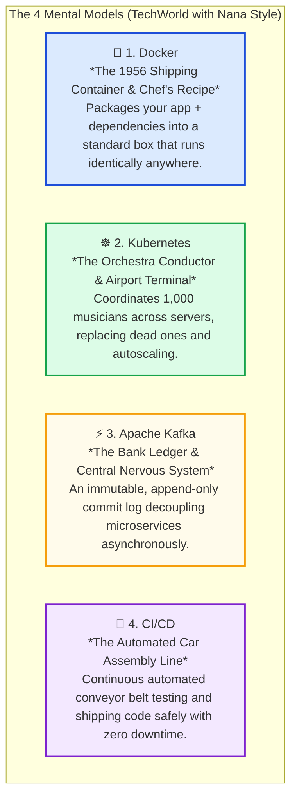
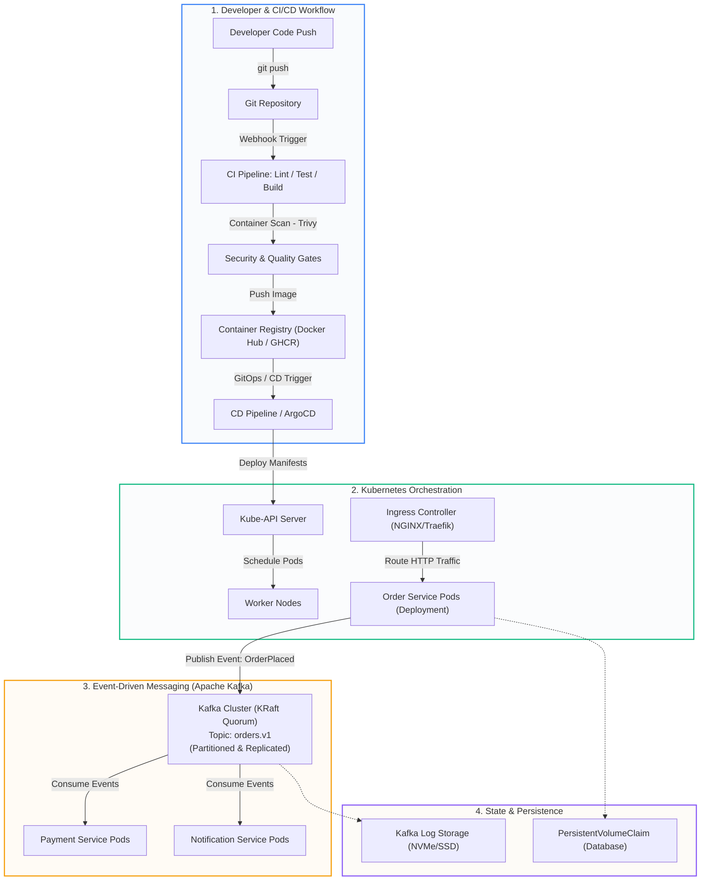
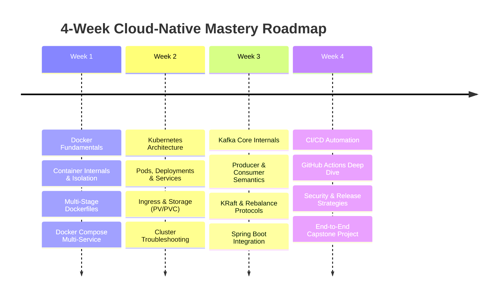

# Cloud-Native Mastery: Docker, Kubernetes, Apache Kafka & CI/CD Pipelines

> **A Beginner-Friendly, Production-Grade Engineering Curriculum & Interview Preparation Guide**  
> *Inspired by the teaching methodologies of TechWorld with Nana, ByteByteGo, and industry distributed system architectures.*

Welcome to your comprehensive roadmap for mastering modern distributed systems, cloud-native infrastructure, and DevOps engineering. Whether you are completely new to containers or preparing for senior-level engineering interviews, this curriculum bridges the gap between **intuitive conceptual understanding** and **hardcore production mechanics**.

---

## 🌱 Pedagogical Design: The Four Real-World Mental Models

To make these complex distributed technologies simple and intuitive, this curriculum uses real-world analogies:

---

## ⚡ The Master "Before vs. After" Transformation Matrix

Why do companies adopt these technologies? Here is what engineering looks like **Before vs. After**:

| Pillar | Before (The Manual Nightmare) | After (The Cloud-Native Standard) | Concrete Benefit & Value |
| :--- | :--- | :--- | :--- |
| **🐳 Docker** | *"It works on my machine!"* Manual dependency setup taking 3 days; conflicting Python/Java versions. | Standardized OCI containers; 1-click startup via `docker compose up`. | 100% environmental parity across Dev, QA, and Production. |
| **☸️ Kubernetes** | Server crashes at 2 AM; engineer wakes up to manually SSH and restart containers. Downtime on releases. | Automated self-healing (reschedules in seconds); zero-downtime rolling updates. | 99.99% high availability; engineers sleep peacefully. |
| **⚡ Kafka** | Synchronous REST spaghetti. If Payment or Email service is down, checkout crashes! | Asynchronous event bus. Order service completes in 3ms; services consume at their own pace. | Complete microservice decoupling; zero dropped transactions. |
| **🚀 CI/CD** | "Deployment Friday Panic". Manual FTP uploads at midnight; 12-hour outages when things break. | Automated pipeline testing, security scanning (Trivy), and GitOps (ArgoCD) deployment. | Ship features 10x faster with automated 1-click rollbacks. |

---

## 🗺️ System Architecture Overview

Here is how all four pillars connect in a modern, production enterprise:

---

## 📂 Repository Structure & Study Clusters

The curriculum is divided into five dedicated clusters. Each cluster contains beginner intuitions, deep internals, interview question banks, cheat sheets, and hands-on exercises:

| Cluster | Topic | Beginner Intuition & Analogy | Deep Dive Focus | Hands-On & Interview Output |
| :--- | :--- | :--- | :--- | :--- |
| **[`01-Docker`](./01-Docker/)** | Containerization | 1956 Shipping Containers, Chef Recipe vs Cake | Linux Namespaces, cgroups v2, Overlay2 UnionFS, Multi-stage builds | [Cheat Sheet](./01-Docker/05-Hands-On-Labs-and-Cheat-Sheet.md) & [Interview Bank](./01-Docker/04-Interview-Questions-and-Troubleshooting.md) |
| **[`02-Kubernetes`](./02-Kubernetes/)** | Orchestration | The Orchestra Conductor, Hotel Concierge | Control Plane internals, Pods, Deployments, Services, Ingress, PV/PVC, RBAC | [Cheat Sheet](./02-Kubernetes/06-Hands-On-Labs-and-Cheat-Sheet.md) & [Interview Bank](./02-Kubernetes/05-Interview-Questions-and-Production-Scenarios.md) |
| **[`03-Apache-Kafka`](./03-Apache-Kafka/)** | Distributed Streaming | The Sacred Bank Ledger, Pizza Slices, Postal Mail | Zero-Copy `sendfile()`, Partitions, ISR, KRaft, Idempotent Producer, Rebalance | [Cheat Sheet](./03-Apache-Kafka/06-Hands-On-Labs-and-Cheat-Sheet.md) & [Interview Bank](./03-Apache-Kafka/05-Interview-Questions-and-Failure-Scenarios.md) |
| **[`04-CICD-Pipelines`](./04-CICD-Pipelines/)** | Continuous Delivery | Automated Car Factory, Bakery, Airport TSA Scanner | GitOps (ArgoCD), GitHub Actions DAGs, Shift-Left Security (Trivy), Blue-Green/Canary | [Pipeline Templates](./04-CICD-Pipelines/06-Hands-On-Pipeline-Templates.md) & [Interview Bank](./04-CICD-Pipelines/05-Interview-Questions-and-Troubleshooting.md) |
| **[`05-Hands-On-Capstone-Project`](./05-Hands-On-Capstone-Project/)** | End-to-End System | Amazon "Buy Now" Checkout & Notification | Complete runnable microservice application tying all 4 pillars together | [Full Capstone Project Guide & Runbook](./05-Hands-On-Capstone-Project/README.md) |

---

## 🎯 Recommended 4-Week Study Schedule

### Week 1: Docker (Containerization)
- **Day 1-2**: [Core Concepts & Architecture](./01-Docker/01-Core-Concepts-and-Architecture.md) — The Shipping Container revolution, VM vs Container, Namespaces & cgroups.
- **Day 3-4**: [Dockerfile Deep Dive & Best Practices](./01-Docker/02-Dockerfile-Deep-Dive-and-Best-Practices.md) — Layer caching order, multi-stage builds, `CMD` vs `ENTRYPOINT`.
- **Day 5**: [Networking, Volumes & Compose](./01-Docker/03-Networking-Volumes-and-Compose.md) — Bridge networks, volume persistence, `docker-compose.yml`.
- **Weekend**: Review [Docker Interview Questions](./01-Docker/04-Interview-Questions-and-Troubleshooting.md) and practice the [Hands-On Labs](./01-Docker/05-Hands-On-Labs-and-Cheat-Sheet.md).

### Week 2: Kubernetes (Orchestration)
- **Day 1-2**: [Architecture & Control Plane](./02-Kubernetes/01-Architecture-and-Control-Plane.md) — The Orchestra Conductor, API Server, etcd Raft, Kubelet, Kube-proxy.
- **Day 3**: [Workloads & Scheduling](./02-Kubernetes/02-Workloads-and-Scheduling.md) — Pods, Deployments (cattle) vs StatefulSets (pets), DaemonSets, QoS classes.
- **Day 4**: [Networking, Services & Ingress](./02-Kubernetes/03-Networking-Services-and-Ingress.md) — ClusterIP, NodePort, LoadBalancer, Ingress, NetworkPolicies.
- **Day 5**: [Storage, Configs & Security](./02-Kubernetes/04-Storage-Config-and-Security.md) — PV vs PVC vs StorageClass, ConfigMaps, Secrets, RBAC.
- **Weekend**: Master [Kubernetes Interview Scenarios](./02-Kubernetes/05-Interview-Questions-and-Production-Scenarios.md) (`CrashLoopBackOff`, `ImagePullBackOff`, `OOMKilled`).

### Week 3: Apache Kafka (Distributed Messaging)
- **Day 1-2**: [Architecture & Log Internals](./03-Apache-Kafka/01-Architecture-and-Log-Internals.md) — The Sacred Bank Ledger, Sequential I/O, Zero-Copy `sendfile()`, Partitions.
- **Day 3**: [Producer Internals & Semantics](./03-Apache-Kafka/02-Producer-Internals-and-Delivery-Semantics.md) — School bus batching, `acks=0/1/all`, Idempotent Producer, Zero Data Loss.
- **Day 4**: [Consumer Groups & Rebalances](./03-Apache-Kafka/03-Consumer-Groups-Rebalance-and-Offsets.md) — Pizza slices analogy, Consumer Lag, Cooperative Sticky rebalancing.
- **Day 5**: [Modern Kafka (KRaft & Schema Registry)](./03-Apache-Kafka/04-KRaft-Schema-Registry-and-Streams.md) & [Spring Boot Kafka Integration](./03-Apache-Kafka/07-Spring-Boot-Kafka-Integration-and-Patterns.md).
- **Weekend**: Drill through [Kafka Interview Questions](./03-Apache-Kafka/05-Interview-Questions-and-Failure-Scenarios.md).

### Week 4: CI/CD & The Capstone Project
- **Day 1-2**: [CI/CD Fundamentals & GitOps](./04-CICD-Pipelines/01-Fundamentals-GitOps-and-Pipeline-Design.md) & [GitHub Actions Deep Dive](./04-CICD-Pipelines/02-GitHub-Actions-Deep-Dive.md).
- **Day 3**: [DevSecOps & Supply Chain Security](./04-CICD-Pipelines/03-Security-and-Best-Practices.md) — Shift-Left security, Trivy, Gitleaks, Cosign.
- **Day 4**: [Deployment Strategies](./04-CICD-Pipelines/04-Deployment-Strategies.md) — Rolling Update, Blue-Green, Canary, Expand-and-Contract DB migrations.
- **Day 5-Weekend**: Launch and test the [Hands-On Capstone Project](./05-Hands-On-Capstone-Project/README.md) and practice the interview elevator pitch!

---

## 📌 Master Interview Preparation Checklist

Before heading into cloud engineering, DevOps, or distributed backend system interviews, ensure you can answer:
- [ ] *Can you explain the exact difference between a process, a container, and a virtual machine?* $\to$ [Answer](./01-Docker/04-Interview-Questions-and-Troubleshooting.md#q1-what-is-docker-and-why-is-it-used-over-traditional-virtual-machines)
- [ ] *What happens under the hood when a pod gets scheduled from `kubectl apply -f` to running on a node?* $\to$ [Answer](./02-Kubernetes/01-Architecture-and-Control-Plane.md#-7-what-happens-when-you-run-kubectl-apply--f-deployyaml)
- [ ] *Why does Kafka achieve orders of magnitude higher throughput than traditional message brokers like RabbitMQ?* $\to$ [Answer](./03-Apache-Kafka/01-Architecture-and-Log-Internals.md#-4-why-is-kafka-insanely-fast-the-3-engineering-secrets)
- [ ] *How do you achieve Zero Data Loss in an Apache Kafka pipeline?* $\to$ [Answer](./03-Apache-Kafka/02-Producer-Internals-and-Delivery-Semantics.md#-4-the-golden-triangle-of-zero-data-loss)
- [ ] *How do you design a zero-downtime deployment pipeline with automated canary rollbacks?* $\to$ [Answer](./04-CICD-Pipelines/04-Deployment-Strategies.md#-5-interview-preparation-high-yield-questions--answers)
- [ ] *How do you isolate poison pill messages in Spring Boot Kafka without freezing partition consumption?* $\to$ [Answer](./03-Apache-Kafka/07-Spring-Boot-Kafka-Integration-and-Patterns.md#2-the-poison-pill-trap--errorhandlingdeserializer)
